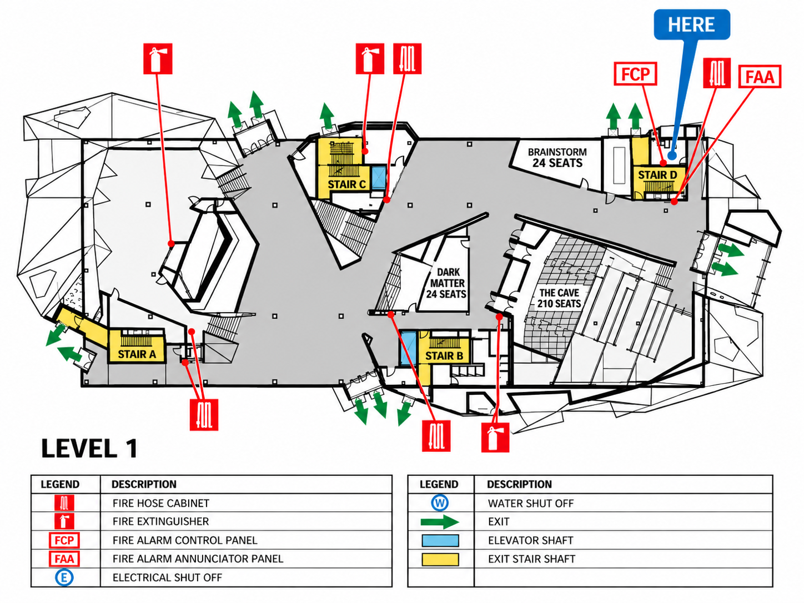
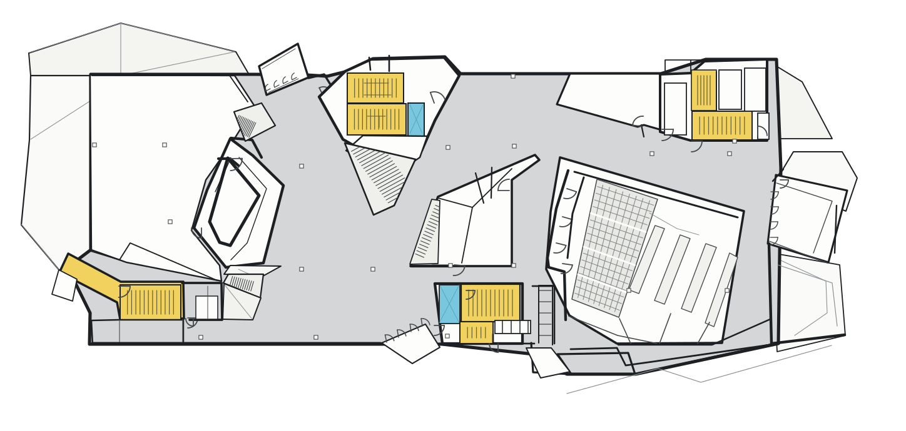
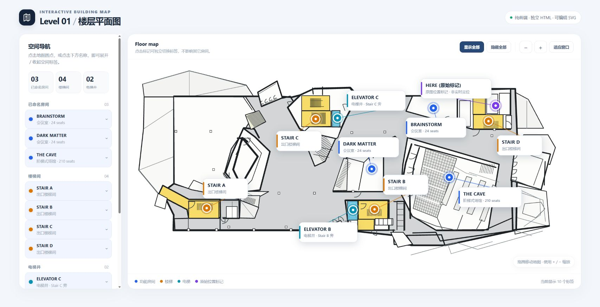
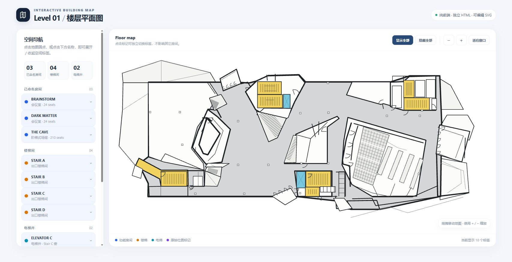
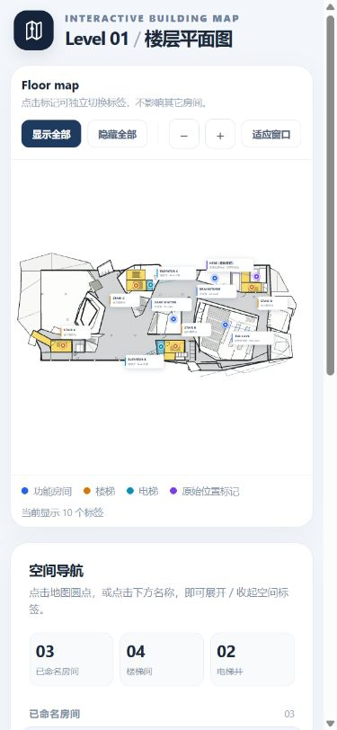

# ChatGPT web floor-plan artifact review

**Reviewed:** October 17, 2026. **Verdict:** useful feasibility evidence for a staged, human-corrected authoring workflow; the supplied second interactive version fails functional acceptance. This review does not replace the [current API pipeline audit](2026-10-17-map-authoring-pipeline.md).

The [shared conversation](https://chatgpt.com/share/6ad33093-9ac8-83ea-8ef7-542e6bf83306) was read from the initial two-image request through image generation, first SVG, interactive HTML, correction request and final workflow report. Its attachments could not be retrieved from the share page. The user subsequently supplied seven files in ignored `local/gpt-web-test/`; those exact files were inspected and the HTML executed locally. The generated bitmap was downloaded separately through the visible conversation image.

The resulting [redesign proposal](../pipeline/redesign-proposal.md) distinguishes measured behavior from the assistant's claims. This was an offline review: no fresh image generation, provider inference, backend storage writes or application code changes.

## 1. What the conversation actually demonstrated

| Step | Supplied context and output | What can be concluded |
| --- | --- | --- |
| Generate raster | Two reference images; the first supplies floor geometry, the second helps labels. Produces a cleaner, rectified-looking raster with names, safety symbols and a legend | A useful visual intermediate can be produced with additional context; geometric fidelity needs independent checking |
| First vector | User explicitly asks for label removal, stair interpretation and simplified exterior decoration; standalone SVG and preview | Real vector primitives and named layers exist; this is an approximate reconstruction |
| First interactive page | User asks for independently toggleable room labels; HTML embeds SVG and a ten-entry `places` array | A working small interaction demo exists; three named rooms are covered, not every enclosed space |
| Correction | User identifies misaligned stairs, skewed seating, detached door arcs and excessive exterior geometry | Human review was part of the successful chain, not an optional final polish |
| Second vector/page/report | Revised SVG and HTML plus workflow Markdown; assistant describes parameterized stairs, doors, seating and schema-driven editing | SVG visuals changed, but the HTML regressed; the generator source and a canonical geometry schema were not delivered |

The web test therefore supports trying an image → semantic components → deterministic display workflow. It does not establish unattended conversion into a reviewed, routable map, nor reproduction through our selected APIs.

The visible duration badges are approximately 1m35s, 5m52s, 6m03s and 3m33s. These mix thinking/working durations across separate turns and are **not an end-to-end benchmark**. API model identifiers, prompts hidden by the product, tool call counts and billable usage are not exposed. Do not compare these numbers directly with the single-image, nine-attempt Vertex run or claim a cost saving.

## 2. Visual acceptance

### Generated raster

The upper floor is substantially more legible than the phone photo. Brainstorm, Dark Matter and The Cave remain in their broad expected locations. The cropped lower drawing is omitted and legend content appears below the plan. This is helpful presentation, but also demonstrates that the image stage can change page composition; downstream coordinates cannot simply inherit the original photo dimensions.

The original photo visibly has both `STAIR J` and `STAIR C` in the central upper block. The web demo exposes one `stair-c` hotspot for that block. Their identity, level relationship or alias status must remain unresolved until checked; a cleaner two-flight drawing is not evidence that one name can safely disappear. HERE is a location printed on the source sign, not GPS.

### Second standalone SVG

The standalone SVGs parse as XML, have `viewBox="0 125 1448 690"`, and contain no SVG `image`, `text`, `foreignObject` or script elements. The first is 59,287 bytes; the second is 55,554 bytes, about 6.3% smaller. This verifies pure vector export and a smaller artifact, not lower inference cost.

Inspection confirms named groups for walls/partitions, stairs/elevators, auditorium geometry, seating and columns. The revised treads are more regularly spaced; the sloped central flight uses clipping. Seating is more regular and exterior lines are reduced. Residual issues remain visible: the central stair fan and diagonal regions require source alignment review, multiple door symbols still need hinge-to-wall checks, and thin exterior lines remain. The photo contains oblique geometry, so forcing every feature to a rectangular grid would also introduce errors.

We have no surveyed CAD ground truth or registered landmark set. No quantitative positional-accuracy claim is made. Clipping treads prevents overflow but cannot establish stair travel direction, landing walkability or inter-floor connectivity. Regular seat marks do not establish the original seat count, aisle clearances or accessible routes.

## 3. Browser acceptance: a concrete regression

Both HTML files were served only from the supplied artifact directory on loopback port 5177, with external connections blocked by a response CSP. Static inspection found one inline script per page and no external script/image imports, fetch/XHR/WebSocket, cookie access or browser storage calls. The supplied originals were not edited.

| Check | First HTML | Second HTML |
| --- | --- | --- |
| Ten map markers and ten label groups belong to `#floorSvg` | Pass | **Fail: all twenty groups belong to the 24×24 Logo SVG** |
| Map marker click toggles corresponding label | Pass for Brainstorm | Fail: no map markers exist |
| Independent state | Brainstorm + Dark Matter gives 2; Enter on Brainstorm gives 1 with Dark Matter retained | List/counter changes do not produce map labels |
| Show/hide all | 10 / 0; visible label cards verified | Counter becomes 10, but map remains without markers or labels |
| Zoom/reset | Shared implementation present | Verified viewBox changes to approximately `144.8 194 1158.4 552`; reset restores `0 125 1448 690` |
| Drag | Verified viewBox changes to approximately `-67.72 91.14 1448 690`; reset works | Same handler present; independent drag test not repeated |
| Narrow layout | Responsive breakpoint checked; no horizontal document overflow | Not separately accepted |
| Route graph, persisted edits, identity, publication | Absent | Absent |

In the second HTML, `#interactive-labels` and marker groups were inserted immediately after the brand icon's circle, inside `.brand-mark svg` (`viewBox="0 0 24 24"`, ancestor `aria-hidden="true"`). `#floorSvg` contains zero `.poi` and zero `.place-label` elements. There are no duplicate IDs; an ID uniqueness test alone would miss this failure. A likely export/template replacement mistake explains the observed DOM, but the missing generation code prevents attributing its exact cause.

Both versions also keep label cards `aria-hidden="true"` even while visually open. In v1 the accessible marker names and sidebar retain useful name/state information, but this does not constitute a full screen-reader audit. The second version's marker subtree inherits the hidden Logo ancestor. Browser console silence is not evidence of correct functionality.

A 390×844 viewport override produced a 375 CSS-pixel document client width and equal scroll width in this browser. The map precedes the sidebar and the page scrolls vertically. The whole-floor fit makes labels and touch targets very small; zoom buttons help, but two-finger pinch and a minimum on-screen touch target are not implemented or accepted by this test. A responsive layout alone is insufficient mobile navigation acceptance. The temporary viewport override was reset.

## 4. Assessment of the workflow report

| Report recommendation | Assessment and required change |
| --- | --- |
| Normalize crop, perspective and floor selection first | Adopt. Preserve the original and every transform; confirm the target floor before inference. Do not attach lower-sheet rooms to this floor |
| Repair broken labels/structure with an image model | Restrict. Read labels from the original before removal; generated labels, doors and wall repairs remain unverified candidates |
| Semantic components rather than arbitrary traced paths | Adopt for stairs, seats and door presentation. Require evidence for underlying openings and walkability; a neat symbol is not a new doorway |
| Canonical structured schema | Adopt using the existing `BuildingSchema` v2 and revision rules. Original images remain immutable evidence; reviewed map data becomes the rendering authority |
| Generate HTML for every map | Replace with the existing Angular viewer consuming validated data. Avoid the observed Logo insertion failure and arbitrary generated executable code |
| Confidence thresholds auto-apply high-confidence results | Reject as a publication policy. Self-reported model confidence is uncalibrated; deterministic checks and authorized human review still gate navigation |
| Local patch and parameterized renderer | Adopt with stable IDs, base revision, permissions, preview, atomic validation and undo. The supplied SVG does not itself prove these facilities exist |
| Coarse pass, targeted crops, stage caches | Adopt as experiments. No blind exhaustive crop fan-out; cache scope must include ownership, model, schema, prompts, coordinates and renderer versions |
| Snap edges and repeated elements | Bound tolerances and protect intentionally diagonal features. Keep display snapping separate from structural route geometry |
| Five backend services | Treat as logical stages inside the existing application/worker boundary. Five new deployed services are not justified by this prototype |
| MCP tools for image, render and edits | Useful proposed tools, not an implemented MCP integration. UI and tools must invoke the same authorized domain commands |
| Lower latency and token usage | Plausible hypotheses. Measure failed attempts, thinking, images, retries and human repair time per accepted map |

The Markdown report gives good engineering directions but contains no measured evaluation, reusable generator source, production schema, durable job integration or API adapter for the image stage. Its sample JSON includes ellipses and an unrestricted geometry patch; these are illustrations, not validated contracts. See the proposal's bounded schemas and execution gates for a testable replacement.

## 5. Provenance and reproducibility

The [artifact manifest](assets/2026-10-17-chatgpt-web/artifact-manifest.json) records names, byte sizes and SHA-256 hashes for all seven supplied files, standalone SVG element counts, selected browser observations and the committed screenshots/raster. Original executable HTML/SVG files remain ignored under `local/`; documentation contains evidence images, not executable generated pages.

To reproduce the key failure without any API key: open `Level_1_Interactive_Floorplan_v2.html`, click **显示全部**, observe the ten-label counter and empty map overlay, then inspect which SVG contains `#marker-brainstorm` and `#label-brainstorm`. Compare the same action in the first HTML. Test marker ownership, visible output and interaction state together in the future renderer acceptance suite.
