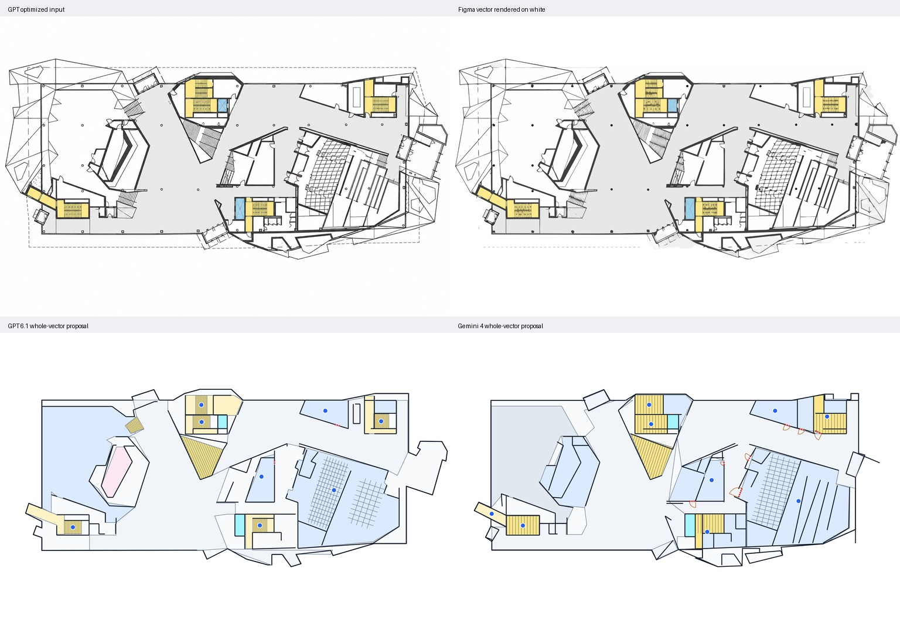
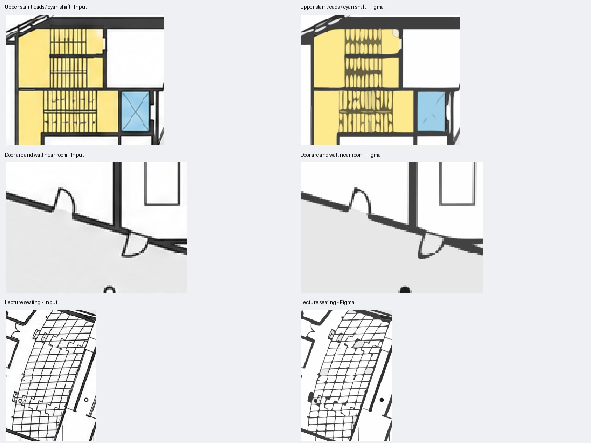

# IA 一楼：Figma 原生矢量化的视觉与导航验收

日期：2026-10-17；代码基线：`3975922`；分支：`acceptance/map-authoring-pipeline`。
本次只分析成员提供的产物并核查公开 API；没有额外模型调用、生产数据写入、依赖安装或应用 API 改动。
遵循[现有架构](../initial/Indoor_Navigation_Architecture_and_Dependencies_EN.md)。下述流程调整为待验证建议，尚未实施。

## 结论

**这份 Figma SVG 比上一轮 GPT/Gemini 整图重建更忠实于输入图片，适合优先作为展示底图候选；尚不能作为可导航地图直接导入。**
它证明“生成/清理图片之后，用专门的描摹工具保留线条”值得提升实验优先级。
房间、门洞、通行区域与路线图仍需另外提取、验证和审核；不必再让通用语言模型重画每条墙线或每排座椅。
本次没有测量 Figma 的处理时间或 credit 消耗，不能给出相对 GPT/Gemini 的实测加速比或价格优势。

## 输入、结构与可复查证据

实际文件位于 `local/test-results/figma-initial-test/`，并非根目录的 `test-results/`。
保留原始导出副本：[figma-vector.svg](assets/2026-10-17-figma-vectorization/figma-vector.svg)。
输入为上一轮实际 GPT Image 2.5 产物 [optimized-floor.png](assets/2026-10-17-gpt-fullchain/optimized-floor.png)，不是更早的网页端生成图。

| 检查 | 实际结果 | 含义 |
| --- | --- | --- |
| 输入 / SVG 尺寸 | 1536 × 1024；`viewBox="0 0 1536 1024"` | 本次比较无需缩放或配准 |
| SVG 大小 | 440,127 bytes，约 430 KiB | 文件体量可接受；实际移动端渲染性能未测 |
| 内容 | 1,321 个 `path`，44 种路径填色 | 真矢量，并非图片套 SVG |
| 路径命令 | 6,546 个 C、4,227 个 L、1,349 个 M/Z，另有 H/V | 曲线与轮廓细节比上一轮有意限量的 LLM 输出丰富 |
| 闭合与复合 | 所有路径包含闭合子路径；14 个路径含多个子路径 | 闭合的是绘画轮廓，不代表每个路径就是一个房间；复合填充还需处理环与层叠 |
| 其他元素 | 没有 `image`、`text`、`g`、`script`、`foreignObject`、`use` | 当前导出是扁平的纯路径资产 |
| 导出的语义 | 没有 `id`、`data-*`、房间名、门关联、图节点或边 | 无法从导出直接获得 Room / Door / Graph；不推断原 Figma 文件是否另存了插件元数据 |
| 绘画方式 | 填充路径，无 `stroke`；196 个路径带填充透明度 | 墙线是可见墨迹的轮廓，不能直接当墙中心线 |

SVG SHA256：`c7ec1165be27096017ab4f2a5b9aac9aaf5f0f1407845bd28c0aeeed0fc6f53e`。
输入 SHA256：`7b8edc60e54b1b0840cd16231666afa27f557b7166eb17c66f4f5040d76b7c45`。



### 视觉量化

[重放脚本](assets/2026-10-17-figma-vectorization/analyze.py)在原始像素坐标比较，透明区域统一合成白底，
只检查楼层包围区域 `(15,140)–(1530,835)`；深色像素定义为 `max(R,G,B)<96`。
Precision 表示候选深色像素中，距输入深色像素不超过 2 px 的比例；Recall 反向衡量输入深色像素的保留率。
距离用欧氏距离，F1 为两者调和均值。

| 已有产物 | 深色像素 IoU | Precision，2 px | Recall，2 px | F1，2 px |
| --- | ---: | ---: | ---: | ---: |
| Figma 本次导出 | 76.27% | 99.85% | 92.59% | 96.09% |
| GPT 6.1 sol 上轮整图 | 20.87% | 89.10% | 44.36% | 59.23% |
| Gemini 4 上轮整图 | 25.00% | 93.24% | 52.74% | 67.38% |

这支持“本次 Figma 描摹更贴近输入”的观察，**96.09% 不是导航准确率，也不是房间识别率**。
换用阈值 80 / 128 的完整数值见 [metrics.json](assets/2026-10-17-figma-vectorization/metrics.json)。
LLM 候选含语义着色、标记和规则生成的简化线条，目标及绘画预算与 Figma 不同；这个表只比较最终显示中的深色墨迹，
不能用来证明 Figma 的空间理解优于 LLM。大范围背景的正确颜色也不应淹没少量关键门洞错误。

[精确像素叠加图](assets/2026-10-17-figma-vectorization/dark-paint-overlay.png)：黑色为重合，绿色为仅输入存在，紫色为仅 SVG 存在；未应用 2 px 容差。
Figma 对输入的深色像素覆盖距离 P95 仍为 7 px，不能视为完全无损。



人工观察：主体墙线、房间外形、座椅区方向和楼梯位置明显比上轮重建完整；同时踏步间隙变成弯曲水滴状，
蓝色竖井中的细对角线大部分消失，部分空心柱符号变为实心点，虚线外框多处被过滤，座椅细线发生局部合并。
门弧在示例中保留了外观，但并没有因此产生明确的通行开口或两侧空间关联。
输入中的无意义外围三角立面线仍大量保留；描摹不会自行判断建筑语义。

## 导航可用性判定

| 用途 | 当前判定 | 还需要什么 |
| --- | --- | --- |
| 缩放展示、在上方叠加定位点 / 路线 | 可以作为实验底图 | 明确坐标系、缩放与裁剪；在 Web/Android 测一次实际渲染 |
| 房间点选、名称与容量显示 | 底图可复用，交互数据不足 | 独立语义区域 / hit area、稳定 ID、房间信息与区域关联 |
| 自动区分墙、门弧、家具、立面、楼梯 | 不通过 | 语义分类，保留来源与不确定项；不能按黑色统一当墙 |
| 房间 / 走廊连通、路线计算 | 不通过 | 门洞线段、两侧空间、可通行面、障碍与净空、节点 / 边，及人工路线真值 |
| 无障碍与跨楼层导航 | 不通过 | 楼梯梯段 / 平台 / 中空区区分，电梯证据、跨层对应、宽度与限制 |
| 与真实建筑一致 | 未验证 | 原始照片 / 原图与人工核验，实际尺度；不能只对生成图验收 |

直接把 1,321 个路径转换成 `spaces` 会把墙墨迹、反走样色块、座椅和填白形状误建成房间。
先按阈值二值化再寻路也不能自动解决问题：门弧和门扇可能被当作障碍，外部白色/透明区域可能被当作可行走地面，
近邻墨迹合并会封住窄通道。必须显式确定室内 footprint 和门户，之后验证路线不穿墙、不到楼外，且可正确进入目标房间。

原图被抹去的名称和容量不能从这份 SVG 恢复；继续使用[上一轮原图 inventory](assets/2026-10-17-gpt-fullchain/inventory.json)
中的 BRAINSTORM / DARK MATTER / THE CAVE 与容量 24 / 24 / 210 等来源记录。
原图裁剪坐标与生成图之间仍需地标配准和语义复核；即使生成图到 SVG 尺寸一致，也不能假定原图到生成图完全保持几何位置。

## 为什么看起来更快、更好

Figma 官方将 Vectorize 描述为 Figma AI 的图片转可编辑矢量工具，支持颜色数量、灰度数量或黑白阈值，
并提示复杂程度影响耗时。这符合专门描摹任务的输入输出形式；官方没有在本次核查的文档中披露其完整引擎、模型或部署实现。
因此不能断言它使用 Potrace、VTracer、某个 LLM，或者完全不用 AI。
[官方功能说明](https://help.figma.com/hc/en-us/articles/38031452710807-Convert-static-images-to-vector-layers)

合理的技术解释是：针对像素的颜色分区、轮廓提取和曲线拟合可以直接保留大量局部几何；
通用 LLM 上轮则在有限输出 token 中重建房间、墙线和展示参数，并逐步输出坐标。
本次 Figma 导出含超过一万个线/曲线命令，而上轮整图契约限制 24 个区域及最多 160 条展示墙线，细节损失有任务设计与输出预算因素。
颜色少、对比清晰的优化图也适合图像描摹。这些是机制层面的解释，**并非对 Figma 内部实现的确认**。
例如开源 VTracer 明确公开了颜色聚类、轮廓拟合的专门处理路线，说明无需语言模型逐点写坐标也能完成这种任务。
[VTracer 官方仓库](https://github.com/visioncortex/vtracer)

上一轮两次矢量请求合计：GPT 222.783 s / USD 0.158947，Gemini 112.083 s / USD 0.226316（折扣前估算）；
包含语义提取与展示结构两步，不是相同任务下的纯描摹基准。
Figma 这次没有时间日志、credit 变化或重试次数；不得将本地 SVG 渲染耗时当作它的转换耗时。
官方说明 AI 工具使用 credits，也不能把本次用户操作按 USD 0 记账。
历史调用详见[完整链路报告](2026-10-17-gpt-fullchain-pilot.md)。

## 可直接调用的 API 与替代方案

| 方案 | 自动化能力 | 本项目判断 |
| --- | --- | --- |
| Figma 原生 Vectorize | 本次核查未找到公开 REST / Plugin API 入口 | 目前保留人工向量化与导出作为对照；不作为无人值守生产依赖 |
| Figma REST 导出 | `GET /v1/images/{file_key}?ids={node_id}&format=svg`，需要相应访问权限 | 可导出已经矢量化的节点；对图片节点导出 SVG 不等于运行 Vectorize，仍可能包含位图 |
| Figma Plugin API | `createNodeFromSvg`、`createVector`、`vectorPaths` | 可以导入 / 编辑已有矢量；这些 API 不提供从 PNG 自动描摹的能力 |
| Vectorizer.AI | `POST https://api.vectorizer.ai/api/v1/vectorize`；上传图片，返回 SVG | 有正式服务端 HTTP API，可做商业对照；不能保证与 Figma 同引擎或同等质量 |
| VTracer | MIT 开源，提供本地工具 / 代码接口 | 优先评估的可重复描摹基线；本地调用没有逐图供应商 API 费用，但仍有计算与维护成本；不是现成托管 HTTP 服务 |

核查依据为 [Figma REST 文档](https://developers.figma.com/docs/rest-api/)、
[文件导出端点](https://developers.figma.com/docs/rest-api/file-endpoints/)、
[公开 REST OpenAPI](https://github.com/figma/rest-api-spec)、
[Plugin API 类型](https://github.com/figma/plugin-typings)和 [VectorPath 文档](https://developers.figma.com/docs/plugins/api/VectorPath/)。
额外保存了[公开接口快照索引](assets/2026-10-17-figma-vectorization/api-public-surface.json)：
REST 规范提交 `7ec6254f6b8b49eb13136349ff4d83bf69bd7e72` 与插件类型提交
`d0af2ef5fbb1f9ee9c7fe20641e06f14a34e5105` 均未出现 `vectoriz`，结合接口列表未找到原生入口。
这限定为当前公开支持范围的调查结论，不声称 Figma 没有内部接口；MCP 连接也不自动等于具备该能力。

Vectorizer.AI 的 API 使用 HTTPS Basic Auth（API ID / API Secret），支持 `mode=test` 免费但有明显水印，
生产向量化为 1 credit / 图；`policy.retention_days=0` 为默认，不启用额外结果留存。
若后续接入，密钥应放在现有服务端私有环境文件，记录 HTTP 耗时、credits、输出与请求参数，不能放在前端。
[官方 API 文档](https://vectorizer.ai/api/documentation)

**该商业 API 当前是按月订阅 credit 方案，并非无订阅承诺的纯按次服务**；入门为 USD 9.99 / 月、50 credits，
不应只按 USD 0.20 / 图估计少量测试的实际支出。没有购买或调用该服务。
[官方价格](https://vectorizer.ai/pricing)
VTracer 的授权见其 [MIT LICENSE](https://github.com/visioncortex/vtracer/blob/master/LICENSE)；尚未安装或实测。

## 建议的下一轮实验与现有契约的衔接

保留“原图信息提取 → 图片清理”的已验证部分，将其后工作拆成两条输出：

1. **展示资产：** 使用专门工具描摹，保存原始输出、输入 hash、工具版本 / 设置和坐标系；不要求 LLM 重画座椅与墙线。
2. **导航数据：** 让 GPT / Gemini / 后续 Opus 候选只识别房间、真实门户、楼梯 / 电梯和不确定区域，输出有来源的结构化结果；
   结合可视化矢量 / 原始像素及局部 ROI，确定几何关联并人工审核。是否比直接重建更省时省钱，需要实测。

这是同一个 authoring 流程中的职责调整建议，不要求增加服务或改动应用 API。
现有 [BuildingSchema v2](../../apps/pipeline/shared/building/schema.js)已分开 assets / sources、geometry、access、nodes / edges 与审核状态，
[MapSchema](../../apps/pipeline/shared/map.js)也已有 spaces / walls / doors；可先用隔离实验验证展示资产与语义图叠加。
任意 SVG 作为可编辑 presentation 的端到端支持尚未验收，不能宣称现有前后端已直接支持；
schema 不支持的环、复杂路径不强塞为单一简单 polygon。若确需扩展 schema、依赖或运行架构，先提交具体变更供成员确认。

建议首轮冻结相同优化 PNG，比较本次 Figma 人工对照、本地 VTracer、商业 API 可选对照；
用人工标定的房间边界、真实门洞与几条起终点路线验收，记录纯描摹、语义提取、修订分别的时间与成本。
另用原始裁剪图直接描摹作为对照，判断 GPT 清理是否值得其开销与几何变化风险。
多个真实楼层、窄门与拥挤家具区域都通过后，再比较每张**可验收**地图的总成本；先不指定新的胜出模型或工具。

## 本次复查范围与重放

共享证据包括 SVG、透明渲染、白底渲染、四图对照、局部放大、像素叠加、结构 / 视觉指标和 API 调查索引。
哈希清单见 [manifest.json](assets/2026-10-17-figma-vectorization/manifest.json)。没有付费 API 密钥或原始模型响应。

已有 `apps/pipeline/node_modules` 与本机 `.venv`（Pillow、NumPy、OpenCV）可重放；这些是本机验收工具，不新增团队依赖。
在 `apps/pipeline/` 执行下式可重建透明渲染，然后回到仓库根运行 Python 分析：

```powershell
node --input-type=module -e "import sharp from 'sharp'; const p='../../docs/audits/assets/2026-10-17-figma-vectorization/'; await sharp(p+'figma-vector.svg').png().toFile(p+'rendered.png');"
```

```powershell
.venv/Scripts/python.exe docs/audits/assets/2026-10-17-figma-vectorization/analyze.py
```

已检查原 SVG 结构、输入 hash、三个条件的原始尺寸与阈值敏感性，人工查看四图对照和三个放大区域。
没有执行新路线构建、门洞标注、Figma 自动化、移动端性能测试或新模型推理；导航判定为数据不足，非运行路由后的测量结论。

## 追加调查：Vector Magic 的可行性与授权条件

核查日期：2026-10-17；成员要求调查，没有上传 IA 图片、注册、购买、安装或调用其转换服务。
**结论：具备图片描摹能力，但当前 API 接入与我们需要的 AI 后处理 / 效果比较授权均未成立，不宜直接选为自动化 pipeline 依赖。**

| 维度 | 已核实内容 | 对本项目的影响 |
| --- | --- | --- |
| 转换能力 | 网页和桌面版支持 PNG 等位图转 SVG / EPS / PDF；桌面版有批处理、分区编辑与颜色分组 | 适合候选展示资产；不能据此推断输出包含房间 / 门洞 / 导航图，也没有本项目质量或速度实测 |
| 在线版 | 人工上传 / 预览；下载需要订阅，订阅持续自动续费至取消 | 不满足项目结束后自然归零的纯按次付费偏好；网页订阅不证明包含 API |
| 桌面版 | Windows / Mac；当前官网显示 USD 295 一次性购买，1 人可在 2 台电脑使用；试用不能保存 | 买断可避免网页月费，但不是团队共享服务端许可证，也未找到公开的 headless / CLI 接入文档；批处理不等于 HTTP API |
| 当前 API | 官网首页 / FAQ / 价格页未找到现行 developer 注册、密钥签发、端点契约、限流与 API 价目；`/developer` 本次未能成功打开 | 状态为待供应商确认，不能断言历史 API 已停止，也不能拿检索中的旧文档直接开工 |
| 与 Vectorizer.AI 的关系 | 官方 About 将两者列为 Cedar Lake Ventures 的产品，后者另有公开开发者入口 | 同一家公司，但不能推定引擎、订阅、密钥、API 或授权可以互换 |

能力、订阅机制和产品差异依据：[Vector Magic 价格与功能](https://vectormagic.com/pricing)、
[官方 About](https://vectormagic.com/about)、[桌面试用](https://vectormagic.com/desktop/download)、
[桌面购买](https://vectormagic.com/desktop/purchase)、[FAQ](https://vectormagic.com/support/faq)。
各语言 / 币种页面显示的在线月价不一致，本次不据此固定 API 或团队预算；例如
[中文价格页](https://zh.vectormagic.com/pricing)显示 USD 6.49 / 月，而其他语言检索页显示不同月价。
应以实际结算与供应商报价为准，不能把桌面 USD 295 当作云 API 的买断价格。

### 直接影响当前 workflow 的公开限制

[Vector Magic 在线服务条款](https://vectormagic.com/policies/terms)（标注生效日期 2025-10-23）
要求针对 AI/ML 用途取得事先书面同意，并明确涵盖评估、benchmark 及向第三方提供相关产物；也限制非公开接口的自动访问。
本项目希望将 SVG / 渲染结果交给 GPT/Gemini 继续识别，并比较模型效果，因此不能默认普通订阅覆盖这些用途。
这是按公开文本识别的采购与集成条件，尚无供应商对 SnapWay 场景的解释或单独协议。

[桌面 EULA](https://vectormagic.com/policies/eula)的 1、2(iii)、2(iv) 条也分别限定单人许可、
限制 service-bureau 用途以及软件比较 / benchmarking。不能用桌面买断版默认替代面向其他用户的服务器服务，
也不应直接开展或发布所计划的性能比较，除非取得适用的额外许可。

**同时补充修正上一轮 Vectorizer.AI 候选的适用条件：**
其[公开条款](https://vectorizer.ai/policies/terms)也包含 AI/ML 用途、评估和第三方使用限制。
有[正式 API](https://vectorizer.ai/api)只是技术接入证据，不能据此认定已获准本项目的下游模型处理与比较。
上一轮的商业对照建议应读作“取得相应用途授权之后的候选”，不是已可直接运行的实验。

### 若继续采用，向供应商一次确认这些具体事项

通过[官方支持入口](https://vectormagic.com/support)询问即可；本次没有代用户发送消息：

1. 是否仍接受新的 Vector Magic API 客户？提供当前官方文档、测试凭证申请、并发 / 超时 / 输入上限与计费方式；如推荐 Vectorizer.AI，请明确替代关系。
2. 是否书面允许将我们的自有 / 已获权楼层图的矢量结果交给 OpenAI / Google API 做推理标注，而不训练模型？是否允许本地效果比较及团队审计报告？
3. 是否允许在 SnapWay 的多人地图上传流程中服务端调用、保存与分发 SVG / 渲染图，并将派生语义几何存入数据库？提供相应商业 / 团队授权范围。
4. API 是否有月最低消费、自动续费、失败调用或留存收费？图片 / 结果留存和删除机制是什么？桌面批处理是否另有受支持的无界面接口与服务器许可？

确认后再用同一优化 PNG 进行受控试验，沿用前文视觉与导航分开的验收；授权前保留为待确认候选。
若希望立即推进不依赖该供应商合同的本地描摹基线，可以优先评估已列出的 MIT VTracer，仍需按 AGENTS 在安装新依赖前取得成员确认。
本次仅更新调查结论，没有改动架构、依赖、应用 API 或运行数据。
