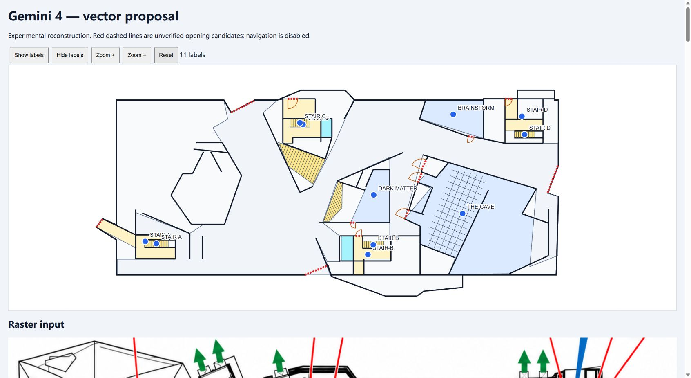
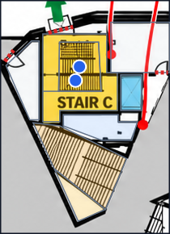
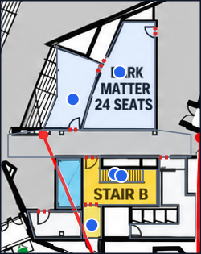

# Gemini 4 vectorization pilot on the downloaded web raster

**Date:** October 17, 2026 (America/Toronto). **Verdict:** useful partial vector reconstruction; **not a complete or navigation-ready map**. The three named rooms are now visibly in their expected broad locations, but overlaps, incomplete coverage and detached opening candidates remain. One local retry improves boundary consistency; another produces invalid geometry and is rejected.

**Phase closure:** the requesting member reviewed the evidence and confirmed the
[stage conclusion and next comparison priorities](#member-reviewed-stage-conclusion)
below. Acceptance remains failed/incomplete; closing this investigation does not
approve the map or select a winning model. Recorded experiment checkpoint: `71a5a17`.

The member's latest instruction limits this experiment to **Gemini 4**, using the already downloaded GPT web image as the simulated image-generation output. No OpenAI image API, Opus, alternate model, backend job/apply, database/R2 mutation or publication was performed. This executes the vector portion of [E1 in the proposal](../pipeline/redesign-proposal.md), not the full selected-model chain.

Runtime baseline: acceptance branch `8d159aa`; production modules remain unchanged.
The experiment's scripts and regression fixtures are reviewed separately from
the earlier full-pipeline trial. Six focused offline tests and the documented
fresh-directory replay passed; no full application suite was needed for isolated
scripts that do not modify production entry points.

## Input, protocol and reproducibility

- Original generated raster: [previous review asset](assets/2026-10-17-chatgpt-web/generated-raster.png), 1448×1086. Its floor crop is x=20, y=160, width=1405, height=625, excluding the legend. The [exact PNG sent to Gemini](assets/2026-10-17-gemini-vector-pilot/frozen-floor.png) is retained; the encoded SHA-256 begins `8aaf2ca074bce958`.
- Real provider: existing Vertex transport, `gemini-4-argon`, explicitly constructed with **MEDIUM** effort, max output 16,384 tokens per request. This avoids the previously observed global/default effort ambiguity without changing the production adapter.
- The model saw the generated floor raster, or a crop of it, **not the original photograph or supplied SVG/HTML**. Seven label IDs/text strings were supplied from human reading of the raster. Label association is tested; independent OCR is not. No supplied vector geometry was used as a tracing template.
- First request returns the proposal's bounded trace schema; second returns footprint/major walls and parameters for stair lines, seating and door symbols. Code converts normalized xy coordinates explicitly, validates locally, adapts a non-routable draft to existing `MapSchema`, and draws SVG deterministically. The structure response is experimental presentation data, not an application API extension.
- Two further requests test unresolved local details. All four responses, including the rejected one, remain recorded. No automatic model fallback or paid retry loop was used.

Source photograph context was cropped locally for visual comparison. An optional SIFT/RANSAC diagnostic between that crop and the generated raster found 109 inliers among 297 tentative matches, with 3.59 px p95 **inlier reprojection** error. Selected matches exclude outliers and are not ground truth; this does not certify original-to-generated fidelity. Original-photo geometry and `STAIR J` identity cannot be recovered solely from a generated raster that has already lost or changed information.

## Actual result

The [standalone SVG](assets/2026-10-17-gemini-vector-pilot/vector.svg) and [PNG](assets/2026-10-17-gemini-vector-pilot/vector.png) are generated from the returned data. They contain a structural silhouette, 96 major wall segments, 16 semantic regions, six stair presentation blocks, one seating block, eight door symbols and 12 **unverified** opening candidates. They intentionally omit much of the decorative facade; some actual secondary geometry is also missing and must not be dismissed as decoration.

| Check | Observed result |
| --- | --- |
| Structured response, frame echo, finite/bounded coordinates | Both global responses pass; original local schemas and raw responses retained |
| Basic global polygon validation | Pass; does not imply that different polygons fit together |
| Existing map schema | Draft passes; all accepted doors and route edges remain zero |
| Named-room association | Three manually chosen raster text-centre anchors fall inside the corresponding Brainstorm, Dark Matter and The Cave polygons |
| Independent OCR / original-photo accuracy | Not established; registry text was supplied and input is the generated raster |
| Global overlaps | Two: The Cave versus main circulation; Stair C landing versus its flight |
| Opening endpoints on every declared adjacent boundary | Only **5/12** within the pilot's 2 px diagnostic tolerance; largest deviation **56.2 px** |
| Coverage | Trace hits 16-region cap and explicitly omits secondary rooms, western hall, voids and other stairs |
| Walls | Exactly 96, the response cap; completeness is not established and no useful wall-capacity warning was returned |
| Stair/seat fidelity | Neater parameterized rendering, but upper Stair C run omitted; seating estimate is 6×14, not verified 210-seat capacity |
| Navigation/publication | Not attempted or accepted |

The 16 disconnected-region messages from existing validation are expected for this deliberately doorless, graphless draft. They are not evidence that a complete navigation pipeline was run and failed. The two overlaps and measured opening-boundary inconsistencies are actual geometry defects in these proposals.

The browser test verified marker click, independent label state (2 → 1 after Enter), show/hide all (11 → 0), zoom/reset and drag. All 11 markers/labels belong to the map SVG, addressing the earlier web v2 ownership failure. Four stairs have both landing and flight labels, so 11 markers represent seven names; these duplicate stair labels visibly collide and need display grouping. Browser functionality does not imply polished labels, mobile acceptance or correct map topology. No mobile or Android/GPS acceptance was claimed.

## Local crop experiments

### Stair C: valid JSON, invalid polygon

The 210×290 crop begins at (500,45) in the frozen floor frame. Gemini returned eight regions and three openings, but the landing polygon self-intersects at three edge pairs. Local geometry validation rejects it, despite valid schema output. Its ambiguous floor relationship and clipped space remain explicit. **It was not applied to the baseline.**

The landing wraps around a flight. A single simple polygon is an awkward model target for a region with a hole; asking for more detailed coordinates did not solve that representation problem. The next experiment should request an enclosure plus exclusion references, then use deterministic subtraction/partitioning into the existing model's simple polygons, followed by review. This would be a new transient extraction contract and must be reviewed before implementation; it cannot silently add a hole-bearing production schema.

### Dark Matter / Stair B doors: useful local improvement, partial boundary

The 250×315 crop begins at (630,240). The prompt requests small simple non-overlapping polygons and shared opening boundaries. It returns nine regions and seven opening candidates, without local self-intersections or overlaps. Dark Matter's south opening and Stair B's north opening now have **0 px** endpoint-to-boundary distance on both returned adjacent polygons; their global counterparts were approximately 52.9 and 56.2 px from circulation.

However, one additional internal-opening candidate is still 11.45 px from its associated boundary. Circulation is clipped and the small polygons do not automatically share stable IDs or seams with the global map. Numerical endpoint agreement is not proof of an actual doorway in the original photo. **The local proposal was retained separately, not merged or accepted for routing.**

Each crop has its own hashed frame. Parent conversion is `parent_x = left + local_x/1000 × cropWidth`, likewise y. The test does not overlay crop-normalized points on the full floor without this conversion. Local repairs need object association, cross-crop boundary reconciliation and explicit review before apply.

## Real usage and latency

| Call | Input tokens | Output tokens | HTTP latency | Undiscounted estimate, USD |
| --- | ---: | ---: | ---: | ---: |
| Global semantic regions/openings | 2,985 | 3,578 | 47.517 s | 0.083500 |
| Global footprint/walls/components | 6,462 | 4,006 | 51.408 s | 0.105968 |
| Stair C local proposal, rejected geometry | 3,015 | 1,271 | 18.597 s | 0.037480 |
| Door local proposal, retained for review | 3,032 | 2,017 | 29.034 s | 0.052468 |
| **Total** | **15,494** | **10,872** | **146.556 s** | **0.279416** |

The provider reports **26,366 total tokens**. It does not separately report thinking tokens in these responses; the recorded totals equal reported input plus candidate output. The timing sum is API HTTP latency, excluding preprocessing, coding, review and gaps between requests; it is not end-to-end production throughput.

Estimates use USD 4/M input and USD 20/M output, conservatively excluding promotional credits/caching. The official [Google Cloud pricing page](https://cloud.google.com/gemini-enterprise-agent-platform/generative-ai/pricing?hl=en) lists introductory effective Global prices and notes that promotion is provided through credits; invoice settlement is not verified here. Thus **about USD 0.28 is an undiscounted estimate, not a confirmed card charge**. The two-call global baseline alone is 17,031 tokens / 98.925 s / USD 0.189468 by this basis.

The earlier full photo trial used nine attempts, HIGH effort and broader access/semantic workflow, totaling 98,224 reported tokens and 469.836 s. This pilot changes input quality, normalization, effort, task scope and output contracts; it does **not** establish a controlled cost or speed improvement. It excludes image generation, original-label extraction, full coverage, verified navigation, storage and publication. There is no accepted-map cost yet.

## Outcome and next experiment

Gemini 4 can produce useful bounded semantic/vector parameters from this raster without writing full SVG. The normalized frame is coherent and the gross room placement is substantially more usable than the previous failed photo overlay. Nevertheless, clean input plus JSON Schema does not ensure non-overlap, correct openings, full coverage or source fidelity.

Before spending on the image API, prioritize: splitting global extraction by evidence-backed coverage; enforcing shared opening anchors; testing enclosure/exclusion decomposition for stairs; and reconciling reviewed local patches into global IDs/revisions. Keep the original as separate evidence. A later GPT Image 2.5 API experiment must be measured independently, after keys are supplied, rather than counted as completed by this frozen-input test.

## Member-reviewed stage conclusion

Following review on October 17, the member concluded:

1. **Gemini 4 whole-image vectorization is unsatisfactory in the tested workflow.** Receiving the complete GPT Image 2.5 web-generated floor image still produces missing regions, overlapping geometry and detached openings. A cleaner raster and strict JSON response alone do not meet the application's fidelity or navigation requirements. This conclusion concerns the recorded fixture/configuration, not an exhaustive evaluation of every Gemini setting.
2. **Segmenting the generated image shows a useful but unproven improvement.** The door crop improves the two targeted boundary relationships, while the Stair C crop fails polygon validation. More fixtures, crop boundaries and repeated trials are needed before treating segmentation as a reliable general solution; seam reconciliation and global coverage remain unresolved.
3. **Promote GPT 6.1 sol and Opus 5.5 to priority vectorization candidates.** They should be evaluated as alternatives for the vectorization workflow, rather than reserved solely for rare fallback repairs after a Gemini-first chain. Gemini 4 remains a comparison baseline, including the segmented variant. Neither alternative has been called in this investigation, and no performance winner is established.
4. **Select for accepted quality, time and total cost together.** The next evaluation must retain unsuccessful calls and human repair effort as well as successful outputs. The cheapest request or shortest response is not sufficient evidence of the best value per accepted map.

The image-generation preference remains GPT Image 2.5; this review changes the
priority of future vectorization comparisons. It does not switch production
providers, change application APIs/dependencies, or establish image API access.

### Required comparison record for the next phase

| Dimension | Matched evaluation requirement |
| --- | --- |
| Candidate models | GPT 6.1 sol (`gpt-6.1-sol`), Opus 5.5 (`claude-opus-5-5`), Gemini 4 (`gemini-4-argon`); verify actual account access and returned versions before inference |
| Input conditions | Same frozen full image and same predeclared crop set for every candidate; identical label inventory, coordinate contract, local renderer and quality gates. Keep the full-image and segmented conditions separate |
| Representation | Compare the same task/response contract first. If enclosure/exclusion or another representation is introduced, version it and rerun the baseline; do not attribute schema improvements to a model change |
| Quality | Coverage, source-registered geometry, overlaps/self-intersections, opening-to-boundary consistency, stair/landing roles, cross-crop seams, manual corrections and accepted/rejected verdict. Schema compliance is only one check |
| Time | Per-call latency, total workflow elapsed time including sequential crop/repair work, retries/timeouts and human repair time. Record concurrency and warm/cold cache conditions |
| Cost | Actual reported input/output/thinking/cached/image usage where available, all attempts, applicable provider price/date/currency and later invoice reconciliation. Missing usage stays unknown; do not compare models by raw token counts alone |
| Reliability | Begin with a bounded matched pilot, then repeat promising conditions across multiple fixtures and held-out examples. Report sample counts and failures; do not present a single successful crop as a stable success rate or latency percentile |
| Value decision | First require the same acceptance threshold; among passing conditions compare total cost and time per accepted map, including repairs. If quality, latency and cost trade off, report the alternatives instead of declaring an unsupported universal winner |

Keep image-generation cost outside the isolated vectorization comparison because
all candidates reuse the same raster; include it again in any later complete-chain
cost. Freeze per-condition call/spending limits before execution; do not spend on
all candidates automatically or assume that one provider's effort label equals
another's compute budget. New calls await the next update and required keys.

The four-call evidence and its USD 0.279416 undiscounted estimate remain the
historical baseline. **No GPT/Opus comparison, new paid request or further model
selection was performed during this phase closure.**

The [experiment README](../../apps/pipeline/experiments/README.md) documents offline replay and explicit live commands. [Portable evidence and hashes](assets/2026-10-17-gemini-vector-pilot/manifest.json), [summary](assets/2026-10-17-gemini-vector-pilot/pilot-summary.json), [trace](assets/2026-10-17-gemini-vector-pilot/trace.json) and [presentation response](assets/2026-10-17-gemini-vector-pilot/structure.json) support review without credentials. Full provider responses remain ignored in `local/test-results/pipeline-v2-pilot/`.
