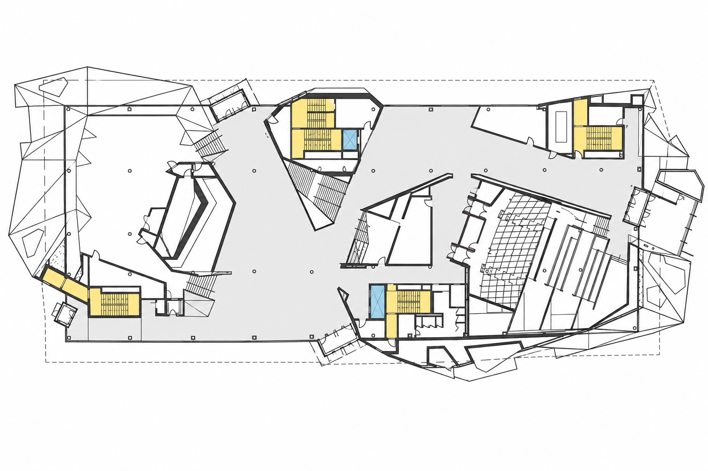
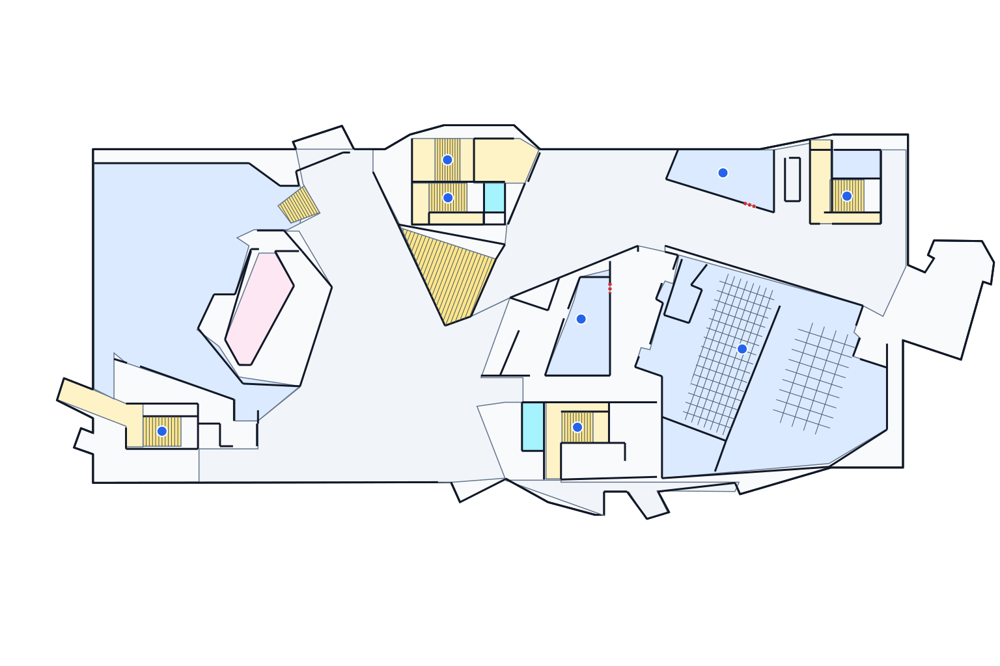
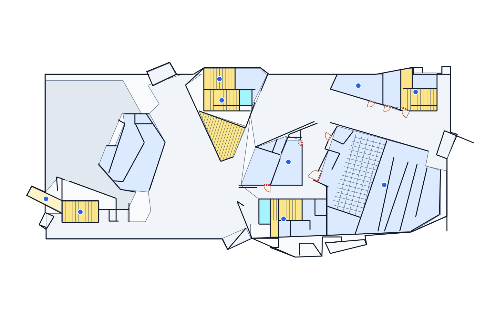
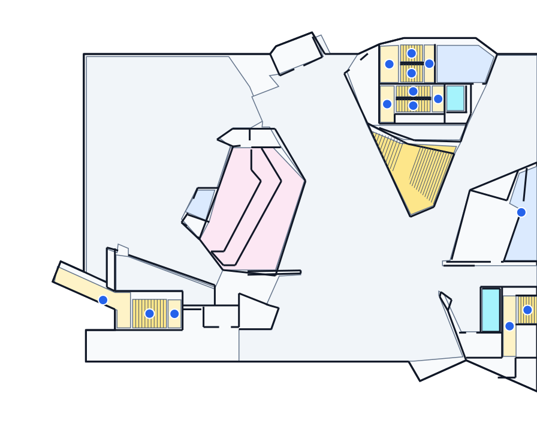
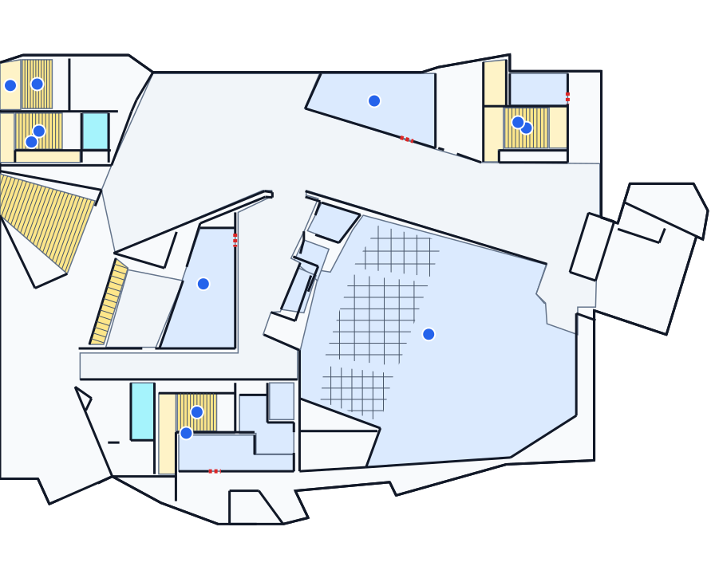

# Original IA-1 photo: GPT image API, vectorization and Gemini comparison

**Date:** October 17, 2026 (America/Toronto). **Runtime baseline:** acceptance branch `ee09dfe`. This is a real model-API experiment with local staging, not production authoring integration. The requested image and vector models were called through the official APIs; no model output was accepted for navigation or publication.

This follows the member-reviewed [previous phase](2026-10-17-gemini-vector-pilot.md#member-reviewed-stage-conclusion), which promoted GPT 6.1 sol and Opus 5.5 for comparison. Opus is not part of this run. The original photo replaces the earlier frozen ChatGPT web raster, so results must not be treated as a controlled comparison with that previous pilot.

## Execution and preserved information

1. Read the original `IA-1-floor-original.jpg`, SHA-256 `d3f1726c7abdd467482ac36c70a8b305fd764e5214bd17416550d1c0da2b6b2b`. Crop the upper target floor at (20,250), size 1930×900, excluding the lower-floor inset.
2. GPT 6.1 sol reads labels and room information **before** label removal. Preserve exact readable text, text-centre coordinates in the original crop frame, capacities, observation state and unresolved details.
3. Store all observations and proposed Room field mappings in local SQLite. The image stage never replaces or deletes original semantics.
4. Use the unmodified imagegen skill CLI for one actual `gpt-image-2.5-sunburst` image edit: high quality, opaque PNG, 1536×1024. A single-request loopback relay records upstream latency/usage while the child CLI receives only an ephemeral local token.
5. GPT 6.1 sol and Gemini 4 each receive the exact same generated image, original photo reference, inventory, trace prompt and local schema. Both use a two-stage trace → deterministic presentation workflow.
6. Because the whole-floor result is insufficient, GPT also processes two overlapping crops independently. No automatic stitching, access approval or graph construction follows.

Both explicit model catalogue checks returned HTTP 200; subsequent real inference also succeeded. `OPENAI_API_KEY` was filled in ignored `local/env/api.env`; Vertex credentials remain in ignored `apps/pipeline/.env.prod`. Keys were never added to frontend code, command arguments, shared documentation or the child image CLI's environment.

The response/presentation schemas allow up to 24 regions, 32 opening candidates and 160 wall segments in this run. These are experimental response contracts, not production API changes. This differs from the previous pilot's 16/16/96 limits. Explicit normalized xy frames and parent crop offsets are retained; the original photo reference has a different frame and cannot supply geometry coordinates directly.

## Room information and database mapping

The source inventory contains **11 observations**, including three named rooms and five distinct stair labels A/B/C/D/J. No readable elevator identifier or floor title is asserted; blurred/cropped annotations remain unresolved.

| Room read from original | Capacity read from original | Persistence state |
| --- | ---: | --- |
| BRAINSTORM | 24 | Unreviewed room candidate |
| DARK MATTER | 24 | Unreviewed room candidate |
| THE CAVE | 210 | Unreviewed room candidate |

The [existing backend schema](../../apps/api/maps/models.py) already has Room `name`, `number`, `purpose`, `attributes` and `provenance`, MapObject stable identities and Revision geometry/frame fields. **The schema is not missing Room metadata.** However, the configured shared database failed read-only connectivity checks with `OperationalError`, and an authorized target/contribution/revision import path was not established for this experiment.

The authorized local fallback is `local/test-results/gpt-fullchain-2026-10-17/experiment.sqlite3`. It stores experiments, observations, room candidates, vector regions, observation-to-region associations and model-call metadata. Capacity maps to `Room.attributes.capacity`; raw text, source hash and original label position map to provenance. Unknown room numbers/purposes remain empty rather than being invented. Non-room stair/safety observations stay separate from Room records. Test UUIDs are staging identities, not published object identities.

The [staging summary](assets/2026-10-17-gpt-fullchain/staging-summary.json) documents field mappings. Final counts are 11 observations, three room candidates, 96 unreviewed region proposals across four independent conditions, 42 observation-region associations and ten model-call records. These are not 96 distinct accepted rooms. Shared target/revision ownership and reviewed geometry must be resolved through the domain layer before import. No shared database schema, fake user, accepted route, R2 object or publication was created. `basic_polygon_valid` means only the explicitly performed local checks; it is not a source-fidelity or navigation verdict.

## Actual GPT Image 2.5 output

The [reusable raster prompt](assets/2026-10-17-gpt-fullchain/raster-prompt.txt) requests removal of all names/numbers/capacity/floor text, HERE and safety callouts/leader lines/arrows, while retaining true walls, vestibules, door openings, diagonal geometry, stairs, shafts and auditorium structure. Only nonstructural facade mesh should be simplified.

Manual inspection finds label and safety-annotation removal successful. **Exterior simplification is incomplete:** substantial thin triangular facade lines and the dashed perimeter survive. This does not satisfy the full image-cleanup objective. Room metadata survives independently in staging, including Stair J/C identities; no labels are recovered from newly generated text.

The image response reports high/1536×1024 and usage, but no returned model identifier. The explicitly requested Image API model and successful access check are recorded; no unsupported claim about a returned dated image-model snapshot is made. The generated drawing is a candidate with possible geometric drift, not surveyed evidence. Vector renderers discard additional decoration but also omit real details; this is not proof that the raster itself was fully repaired.

## Whole-floor vector results

| Observed check | GPT 6.1 sol | Gemini 4 |
| --- | ---: | ---: |
| Regions | 24, at cap | 24, at cap |
| Wall segments | 160, at cap | 132 |
| Local basic polygon/frame checks | Pass | Pass |
| Existing validator's overlapping region pairs | 5 | 4 |
| Proposed openings | 2 | 7 |
| Openings within 2 px of every **declared** adjacent boundary | 2/2 | 4/7 |
| Openings declaring both adjacent regions | 1 | 7 |
| Accepted doors / route edges | 0 / 0 | 0 / 0 |

GPT places the three named rooms in their broad expected areas and separately associates Stair J and C. It is conservative about openings, leaving most of the map without a usable access proposal. Five overlaps remain, mainly involving the west room/circulation/stair regions. It hits both region and wall caps, omits secondary details and renders a second approximate seating grid where fidelity still needs review. Exact symbolic seating counts must not overwrite the source's 210-seat metadata.

Gemini finishes faster in this single test and proposes more two-sided openings, but four overlaps remain and three openings fail the 2 px boundary diagnostic (largest deviation approximately 10.34 px). Its broad layout is also incomplete. Neither result passes map acceptance.

The opening diagnostic measures only proximity to the boundaries the model actually declared. A single-sided interior opening or a mathematically aligned invented opening cannot establish a traversable doorway. Both drafts deliberately keep accepted doors/graphs empty; resulting disconnected-region warnings are expected, rather than evidence of a completed navigation test.

## Segmented GPT test

The generated 1536×1024 image is split into (0,140,896,720) and (640,140,896,720). The 256 px overlap is retained for later reconciliation. The original labelled reference and inventory remain identical; only the coordinate-bearing generated image is cropped. Each crop returns normalized local xy points, converted using its recorded parent offset and dimensions.

The [comparison record](assets/2026-10-17-gpt-fullchain/comparison.json) contains both detail results. They remain separate proposals: overlap counts within a crop do not account for cross-crop duplicates, mismatched seams or omitted continuations. The crop outputs were not merged into the full map or accepted for routing.

The left crop returns 24 regions and 133 wall segments, reducing local overlap to one pair but proposing no openings. This is a limited geometric improvement with incomplete coverage, not a usable local navigation map. Clipped Dark Matter/Stair B boundaries and ambiguous nested central geometry remain explicit.

The right crop returns 24 regions and 129 wall segments, but **six overlaps**
remain. Its four opening candidates meet their declared boundary diagnostic but
all are single-sided. Its auditorium seating is visibly simplified and misaligned
relative to the input. These results do not establish a reliable segmentation
improvement, and independent crop overlap counts cannot be added into a global
acceptance score.

| GPT crop condition | Regions / walls | Within-crop overlapping pairs | Openings / two-sided openings | HTTP time | Estimated USD |
| --- | ---: | ---: | ---: | ---: | ---: |
| Left | 24 / 133 | 1 | 0 / 0 | 219.343 s | $0.137812 |
| Right | 24 / 129 | 6 | 4 / 0 | 246.212 s | $0.153922 |
| Both sequentially, not stitched | 48 proposals / 262 wall proposals | Not a global metric | No accepted connectivity | 465.555 s | $0.291734 |

The two-crop workflow costs about 1.84× and takes about 2.09× the whole GPT
vector workflow here, before any seam reconciliation or human correction. It
does not achieve a correspondingly accepted map, so the added cost is not yet
justified by measured accepted quality. Gemini crop runs were not repeated in
this phase; the matched cross-model comparison is whole-image only.

## Timing, cost and comparison limits

All observed requests and token usage are in the [comparison record](assets/2026-10-17-gpt-fullchain/comparison.json), including the image stage, metadata extraction and both crop stages. Costs below are estimates in USD, not verified card charges.

| Shared preparation / whole-floor condition | Summed upstream HTTP time | Token-based estimate |
| --- | ---: | ---: |
| Original-photo inventory, GPT 6.1 sol | 26.002 s | $0.019979 |
| GPT Image 2.5 actual image edit | 31.325 s | $0.054638 |
| GPT 6.1 sol whole vector workflow, two calls | 222.783 s | $0.158947 |
| Gemini 4 whole vector workflow, two calls | 112.083 s | $0.226316 before promotional credits; $0.113158 conditional introductory net estimate |

The whole-image trace prompts/schemas and image byte hashes match across models; the presentation template/schema match, with each model receiving its own prior trace. Both request MEDIUM effort and 16,384 maximum output tokens. Matching effort names does not establish equal compute. This is one run per condition, not a latency percentile or stable success-rate evaluation. No warm-cache benefit is assumed.

The complete experiment used **ten paid inference requests** (one image edit and
nine text/vision requests) and an estimated **USD 0.751614** before any Vertex
promotional credits. Two catalogue reads and read-only database probes are not
included as model inference. The requested original → image → whole GPT chain
alone is approximately USD 0.233564 and 280.110 s of summed upstream HTTP time;
the additional model comparison and crop calls are research overhead. No repeated
image generation or paid retry was performed.

OpenAI estimates use the [official Standard short-context pricing](https://developers.openai.com/api/docs/pricing), including cache writes at $2.50/M rather than counting all input at $2/M; cached reads are $0.10/M and output including reasoning is $10/M. Reasoning tokens are already included in OpenAI output and are not added a second time. Image usage separates text input, image input and image output. Responses report `service_tier=default`.

Gemini estimates use [official Google Cloud Global pricing](https://cloud.google.com/gemini-enterprise-agent-platform/generative-ai/pricing?hl=en): $4/M input and $20/M output/thinking before promotion, with the conditional 50% promotional-credit estimate shown separately. Gemini separately reported thinking is included. Eligibility, settlement, exchange conversion, tax and final invoices were not verified. Consequently a price winner cannot be selected by comparing GPT's Standard estimate only with Vertex's pre-credit estimate.

GPT's whole vector workflow took approximately **1.99×** Gemini's summed HTTP time here. Shared inventory/image preparation is excluded from that vector-only comparison; add it once for a full-chain estimate, not once per crop or model. HTTP sums exclude CLI startup, deterministic processing, coding/review gaps and human correction. They are not end-to-end production throughput. No accepted map exists, so cost per accepted map is undefined.

## Verification and remaining work

One crop response initially failed local validation because a Windows text-mode pipe decoded UTF-8 using the system codepage. The stored successful API response was replayed with explicit binary UTF-8 input; there was **no additional paid retry**. The original model text, including an odd Unicode character in one unresolved explanation, was preserved. A regression checks exact character limits and Chinese text; data was not shortened to make validation pass.

Eleven focused tests pass, covering coordinate frames, dynamic original-label IDs, geometry rejection, SVG marker ownership, cache-write/thinking cost accounting and UTF-8 validation. The prior default renderer behavior remains compatible. Browser checks cover independent labels, keyboard toggle, all/none, zoom/reset and switching the model/crop preview. No normal application route/provider/default, dependency lockfile or shared schema was changed. The reproducible commands and staging boundaries are in the [experiment README](../../apps/pipeline/experiments/README.md). The [evidence manifest](assets/2026-10-17-gpt-fullchain/manifest.json) records exact portable artifact hashes; secrets, raw provider responses and the SQLite binary remain ignored under `local/`.

The API sequence is feasible and source information is retained, but full fidelity is not established. Next work should address the raster's exterior cleanup, explicit exclusions/partitioning for complex landings, shared opening anchors and coverage/seam reconciliation before another model can be declared suitable. Broader fixtures and repeated matched trials remain necessary. Opus access, shared database import and production navigation remain untested.
