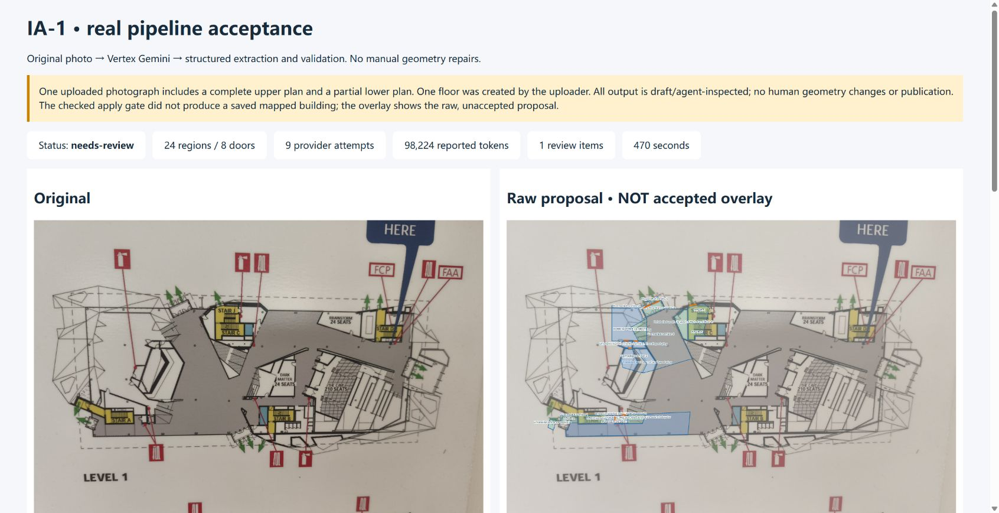
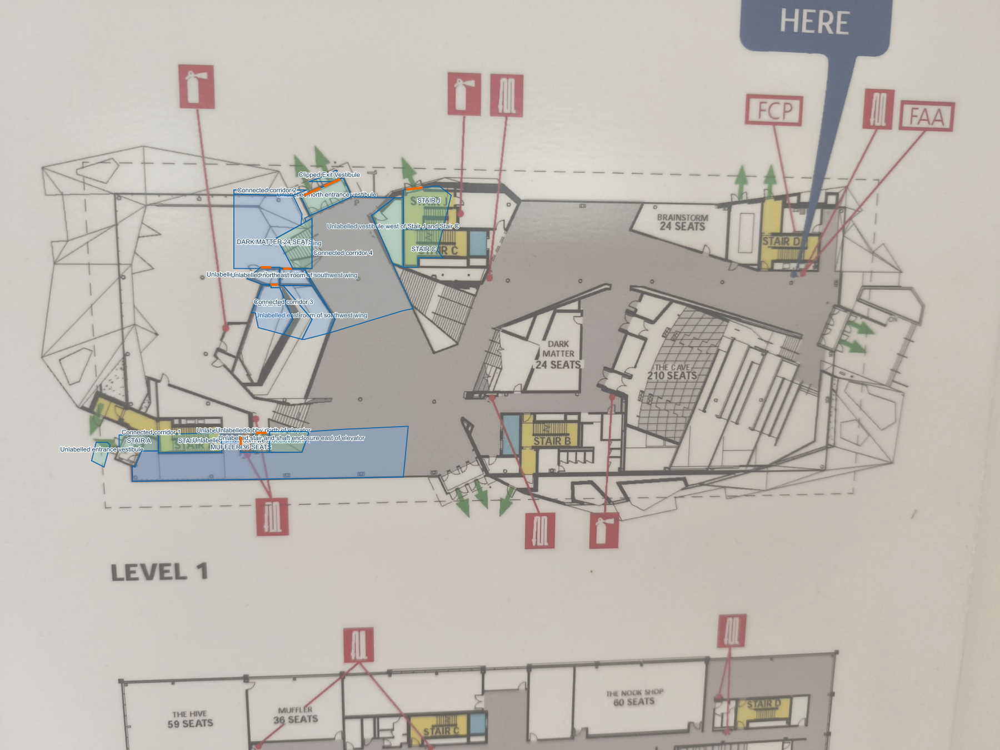

# Map-authoring phase audit and implementation gaps

**Date:** October 17, 2026, America/Toronto.

**Decision:** The existing local pipeline is an implemented prototype, but its
IA-1 output **fails this real-fixture acceptance**. The promised bitmap-to-vector
authoring workflow is incomplete. No project-wide stage gate is approved here.

## Scope and baseline

This records the requesting member's review and authorized live trial, followed
by the request to publish the phase audit and screenshots. It changes
documentation only; it neither waives requirements nor approves new architecture,
dependencies, models or deployment. No additional paid run was made for this audit.

| Checkpoint | Source |
| --- | --- |
| Teammate AI branch | `feature/map-authoring-pipeline` at `b2939be`; implementation in `9ce073e` |
| Updated main | `71f24ab`, including schema and Google OAuth foundations |
| Combined local acceptance branch | `acceptance/map-authoring-pipeline`; main merged **into it** in `b83e87c`, without modifying main |
| Live-tested code | [`3edd14e`](https://github.com/mhamza1906/SnapWay/commit/3edd14e6681f56807d42df7da95939474c8cf2b7) |
| Original acceptance record | [`7f40b9c`](https://github.com/mhamza1906/SnapWay/commit/7f40b9c8c837e788887b03ee3e7ae289a71b45e0) |

Requirements: [architecture/model roles](../initial/Indoor_Navigation_Architecture_and_Dependencies_EN.md#6-ai-workflows-and-model-roles),
[required raster adapter and explicit Opus backup](../initial/Indoor_Navigation_AI_and_Maps_Integration_EN.md#5-required-gpt-image-raster-adapter-and-conditional-opus-backup),
[test catalogue](../initial/Indoor_Navigation_Test_Catalog_EN.md), and
[Stage 1 responsibilities](../initial/Indoor_Navigation_Stage_1_Assignment_Plan_EN.md).
Model IDs below are the recorded requirements or checked-in configuration; this
report does not re-audit provider catalogues or assert untested account access.

## What this phase delivered

- Angular `/authoring` and a loopback Node service: source upload, map-job
  initiation/polling, room/doorway controls, local rendering, route APIs and a
  saved-copy catalog. These are implementation capabilities, not all passing IA-1 results.
- Deterministic image preparation, original-asset preservation, PDF line/text
  hints, structured vision adapters, coverage reconciliation, semantic/opening
  checks, local geometry/graph rules, bounded requests and response caches.
- Django relational models/migrations and a Google OAuth/session slice on main;
  the Node authoring service does not use those accounts, jobs or storage.
- Local preparation and offline verification on Node 24: pipeline **142 passed,
  18 skipped** because the Waterloo fixture is absent; Angular **59 passed in
  11 files**. These checks preceded the live run and were not rerun for this
  documentation publication. The original feature author's separate build/UI
  claims remain in the [original handoff](https://github.com/mhamza1906/SnapWay/blob/b2939bea1e80b235fbb9cc0d4f2f62e99c791482/docs/map-authoring-pipeline.md).
- One authorized, cold real-photo trial, visual inspection, failed-apply check,
  and persisted evidence. No manual geometry repairs, fake users or published
  map were introduced to make this trial appear successful.

## Required versus implemented call chain

The recorded authoring requirement is:

```text
Preserved original -> optional deterministic correction
-> GPT Image 2.5 raster generation/editing -> compare and review new bitmap
-> Gemini vector/structured proposal -> geometry/topology validation
-> manual or authorized MCP correction -> reviewed contribution/publication
```

The current production profile implements:

```text
Original PDF/image -> local normalization (+ PDF vectors when available)
-> Vertex Gemini inventory -> detail extraction -> coverage reconciliation/repairs
-> region semantics -> opening verification -> local geometry/graph checks
-> checked proposal apply -> assumed-door postprocessing in Angular -> local copy
```

IA-1 stopped during region semantics. Opening verification and the remaining
apply/route stages did not complete. Local SVG/PNG rendering is an output of
geometry code; it does not implement the required GPT Image raster stage.

| Required capability | Current implementation/evidence | Gap or limit |
| --- | --- | --- |
| GPT Image 2.5 `gpt-image-2.5-sunburst` raster generation/editing | No runtime image-generation adapter/call in this path; EXIF rotation/resizing is local | **Missing required stage**, including reviewed standardized bitmap, edit provenance and repeated quality trials |
| Gemini primary vector/semantic modeling | Team prod uses Vertex `gemini-4-argon`, high; real access succeeded | **Implemented but failed IA-1 quality/completion**; current results cannot be accepted as a usable vector map |
| Routine Flash versus quality-model routing | Other provider classes exist; prod selects one Vertex provider for this workflow | No demonstrated stage-specific Argon/Flash selection or comparative evaluation; not a reason to switch models silently |
| Sole designated vector backup: Opus 5.5 | Development has Anthropic/Sonnet and other adapters; no explicit Opus modeling retry integration | Implement a controlled, attributed backup when required. **Automatic fallback is not required** and silent provider changes are prohibited |
| Editable output with faithful labels/geometry | Local schemas, SVG rendering and editing controls exist | Retained IA-1 polygons are visibly misplaced/incomplete; no accepted edit/save/reload journey for this target |
| Manual/MCP correction with shared authority | Local doorway tools and model function calls exist; Python MCP exposes a status resource only | Local function calling does not establish editor-wide MCP parity, signed delegation, DB permissions or revision-safe mutations |
| Durable application jobs and contribution lifecycle | Node writes job JSON/caches; Django `Job`/`JobAttempt` models exist separately | No integrated worker/job/actor/revision/publication flow; local file persistence is not shared product persistence |
| Asset storage and consistent recovery | Original hash, local copy and task files preserved | No configured R2 runtime adapter, cloud round-trip or joint metadata/assets backup-restore trial |
| Scene interpretation, embeddings and visitor localization | Outside this authoring trial; planned embedding/reference flow not integrated here | **Not run / later-stage work**, not an inferred failed localization test or a claim that Stage 1 owns all later requirements |

Implementation evidence: [provider factory](../../apps/pipeline/server/provider.js),
[Vertex transport](../../apps/pipeline/server/vertex.js),
[orchestrator](../../apps/pipeline/server/pipelines/smart-map.js),
[semantic batch handling](../../apps/pipeline/server/pipelines/region-semantics.js),
[local design rendering](../../apps/pipeline/server/pipelines/design.js),
[model doorway tools](../../apps/pipeline/server/pipelines/doorways.js),
[MCP scaffold](../../apps/mcp/server.py), [Django routes](../../apps/api/config/urls.py),
[job models](../../apps/api/jobs/models.py), [Node jobs](../../apps/pipeline/server/map-jobs.js)
and [saved copies](../../apps/pipeline/server/building-library.js).

## IA-1 real-fixture evidence

Input: `IA-1-floor-original.jpg`, 2048 × 1536, 223,829 bytes. Original SHA-256:
`d3f1726c7abdd467482ac36c70a8b305fd764e5214bd17416550d1c0da2b6b2b`.
The preserved original asset matched this hash. The image contains a complete
upper plan and part of a second plan; no cropping or manual geometry correction
was performed. Executor: Codex acting for the requesting member; independent
geometry/field reviewer has not signed off.

| Measurement | Observed value |
| --- | --- |
| Job | `34dc6f6c-2021-454c-af02-dee9fad417d2` |
| Provider/model/effort | Vertex AI / `gemini-4-argon` / high |
| Limits | 40 requests; 500,000 reported tokens (soft); 20 minutes |
| Duration / requests / usage | 469.836 seconds / 9 attempts / 98,224 reported tokens; 0 cache hits |
| Pipeline status | `needs-review`, with `MAX_TOKENS` failure during semantic processing |
| Raw proposal | 24 regions, 8 door candidates; **unaccepted** |
| Completed semantics / opening-verification records | 8 / 0 |
| Applied map / usable destinations | None / 0; route quality could not be validated |
| Apply endpoint | HTTP 400: `No checked proposal is ready. Resolve the review queue first.` |
| Coverage diagnostics | 17 unmapped of 28 entries, 6 overlaps, 4 door-boundary diagnostics |

Coverage includes generated aliases, so 17/28 is **not** a ground-truth room
recall statistic. Token totals are observed usage, not a measured monetary cost.
One source and one run do not establish repeatability, a benchmark or a universal
model-quality conclusion. The failure does not establish that adding GPT Image
alone would fix extraction.

The [selected run summary](assets/2026-10-17-ia-1/run-summary.json) contains the
settings, metrics, label spot checks, apply rejection and screenshot hashes.
Credentials, absolute machine paths, raw response caches and browser history
are excluded. The full source/results remain under ignored
`local/test-results/IA-1-2026-10-17T07-33-21-079Z/` and `apps/pipeline/.local/`.
The following images are committed and can be reviewed from a fresh checkout.

### Comparison screenshot

Left: untouched source. Right: an inspection overlay of the **rejected raw
proposal**, not a published/accepted map. Click for full resolution.

[](assets/2026-10-17-ia-1/comparison.jpg)

### Full proposal overlay

Polygons cluster on the left while large right-hand areas remain uncovered.
Brainstorm and The Cave have no matching retained region; Dark Matter and
Muffler are visibly misplaced. The lower drawing was not separated into its own floor.

[](assets/2026-10-17-ia-1/proposal-overlay.png)

## Confirmed gaps and diagnostic hypotheses

These are proposed coordination/repair priorities, not assigned work or approved
design changes. Arjun coordinates Stage 1 AI; Erfang frontend; Hamza API; Eric
schema/deployment. The existing team reassignment rules still apply.

| ID | Priority / coordination | Evidence and impact | Next evidence required |
| --- | --- | --- | --- |
| GAP-01 | Required capability / AI | GPT Image raster stage, review and re-edit pipeline absent | Real adapter output, original/new artifact provenance, reviewed bitmap handoff and AI-01 trials; verify selected account/model access before integration |
| GAP-02 | Blocks this target / AI | Severe region displacement and absent target labels in screenshots | Isolated coordinate/frame and label-to-region checks on the unmodified source and known landmarks, then a faithful full proposal. **Mixed normalized/pixel coordinates is a hypothesis**, not a confirmed root cause |
| GAP-03 | Blocks this target / AI + frontend | Inventory detects two footprints, upload creates one floor | Explicit floor/region selection or separation and evidence that separate drawings cannot become adjacent walkable rooms |
| GAP-04 | Blocks completion / AI | Semantic requests have a 6,000-output-token ceiling; an incomplete response aborted the run before opening checks. Detail-tile splitting does not recover this semantic batch | Bounded incomplete-response handling and resume with preserved successful work; real semantic and doorway checks finish without silent truncation or provider changes |
| GAP-05 | Misleading progress / AI + frontend | Only one top-level failure item although retained coverage/geometry diagnostics show additional work | Stage-aware status and surfaced unresolved diagnostics on partial completion; accurate distinctions among proposal, applied map and human review |
| GAP-06 | Required integration / AI + API + schema | Node jobs/files bypass Django actors/revisions/contributions and shared assets | Agreed integration boundary, actor/revision checks, actual persistence/reload and reviewed submission/publication. Blank Node user fields do not satisfy Django job constraints |
| GAP-07 | Required MCP / AI + frontend + API | Python MCP has no map mutation tools or authorization context | MCP/UI operation parity, controlled identity, stale-revision/permission rejection, attributable changes and declared undo behavior |
| GAP-08 | Conditional capability / AI | Designated explicit Opus modeling backup is not integrated | Bounded, opt-in backup retaining reason/model/input revision and validators; preserve explicit failure if unavailable |
| GAP-09 | Acceptance evidence / module owners + reviewer | Missing Waterloo fixture skips 18 offline cases; IA-1 has one cold run and no reviewed ground truth | Restore required fixture coverage or record exclusions; repeated clean/oblique/difficult real trials, independent review, actual repair effort and route checks |

The recorded Node/Vertex arrangement was described by the teammate as an
approved interim implementation in the original feature handoff. Its existence
is not evidence that the Django/Celery/MCP integration requirement is complete.
The pipeline's local function tools, geometry validators, response caches and
failed-apply protection are useful implemented work and should be retained.

## Acceptance status and next checkpoint

| Catalogue area | Current evidence classification |
| --- | --- |
| AI-01 bitmap standardization | **Not run; required runtime stage missing** |
| AI-02 editable vector generation | Required reviewed-bitmap input unavailable; current direct-input IA-1 vector quality **Fail** |
| AI-03 structured extraction | **Fail for IA-1 fidelity/completeness**; no general accuracy percentage claimed |
| AI-04 natural-language re-edit | Local presentation/door tools exist; required raster/structural re-edit round-trip **Not run** |
| AI-05 failure/retry | Input preservation and real failed-apply rejection verified; full retry/stale-result/concurrent-edit case **Not run in full** |
| AI-06 useful automation/publication | **Blocked** by missing raster stage and failed usable vector result |
| MCP-01–07 | Authorized application MCP workflows **Not run / implementation incomplete**; local mocked function tests do not pass these cases |
| Cross-role DB/publication/visitor loop | **Blocked** by missing product integration; no new claim about deployed shared DB or phone behavior |
| Later scene/localization/device/field cases | **Not run in this authoring scope** |

Before another acceptance claim, resolve coordinate/floor selection and bounded
semantic completion, implement the required raster stage or explicitly agree a
revised requirement, and demonstrate an editable reviewed result through the
agreed persistence/MCP boundary. Then rerun the relevant catalogue cases with
named build, original/new artifacts, observed usage/latency, correction effort
and independent review. Additional paid trials require a new deliberate run;
this audit publication performs none.

The [feature record](../map-authoring-pipeline.md) remains the concise operating
entry point; this report owns the detailed phase assessment and shared evidence.
Personal execution history remains in ignored `local/ACTIONS.md`. Publish only
the acceptance branch for team review; no PR, merge, deployment or release is
part of this request.

## Documentation publication checks

Relative links, image decoding, screenshot hashes and the selected run metrics
were checked against the private originals. The comparison screenshot was
already JPEG bytes despite its private `.png` filename; the committed copy uses
the correct `.jpg` extension without re-encoding. No model or application tests
were repeated for this documentation-only publication.

**DOC-01 — existing initial-document inventory mismatch:**
`python scripts/check_docs.py` fails because
`docs/initial/archive/Indoor_Visual_Navigation_Detailed_Plan_EN.md` is listed in
the manifest but absent from the existing Git baseline. This is separate from
the IA-1/model findings. The initial files, manifest and checker were not changed
by this audit. Reconcile the migration inventory and historical archive in a
separate documentation task; do not report this check as passing.
