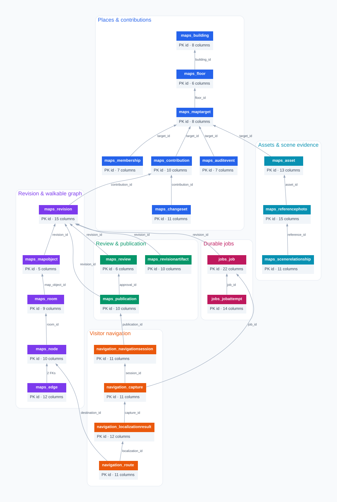
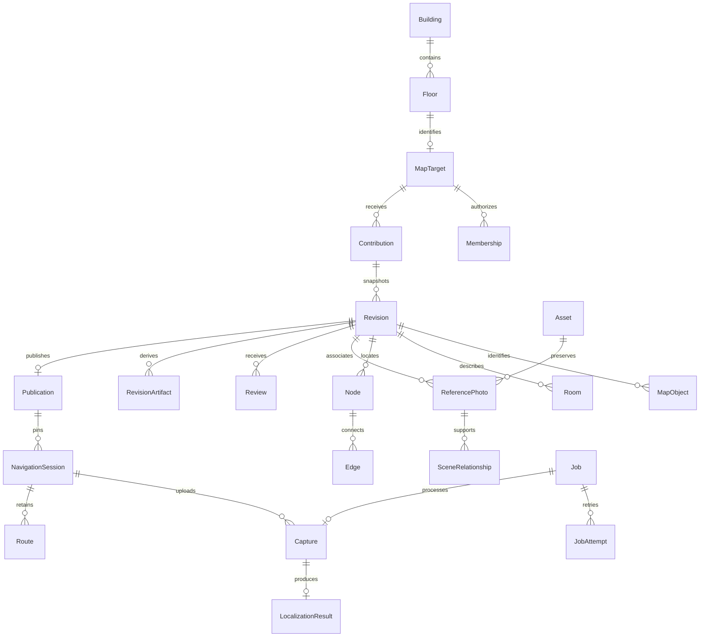

# PostgreSQL database schema

Owner: Eric. Handoff: Hamza (authorized services/APIs), Arjun (job/provenance
payloads), Erfang (editor/read models). Updated October 17, 2026.

**Initial deployment record:** migrated to the Tiger Cloud DEV database `db-snap-way`
on October 17, 2026: **26 migrations applied, zero pending**, with **24 domain
tables** in the `snapway` schema. See the [cloud migration record](#tiger-cloud-migration--completed-october-17-2026)
for PostgreSQL version, role permissions, verification and the scoped TLS exception.

This implements the relational schema described by the [initial index](initial/README.md),
[architecture §§4–9](initial/Indoor_Navigation_Architecture_and_Dependencies_EN.md),
and AUTH/GOV/MAP/REF/JOB acceptance cases in the [test catalogue](initial/Indoor_Navigation_Test_Catalog_EN.md).
It adds 24 domain tables through Django migrations (plus four photo-capture tables, below). The existing `accounts_user`
and Django authentication/session/admin tables remain in use. PostgreSQL is the
product database; SQLite retains its limited onboarding role. No new dependencies,
extensions or architecture choices are introduced.

Read the generated [PostgreSQL DDL](../contracts/postgresql-schema.sql) alongside
the models. Django migrations are the application schema authority; the export
is a schema-only reference with no data or migration-history records. It was
generated from local PostgreSQL 17.11 in `public`; the deployed PostgreSQL 18.6
database uses the dedicated `snapway` schema. It is not a cloud database dump.

## Relationships

### Live Tiger Data map — October 17, 2026

Read-only inspection at **18:26 UTC (14:26 Toronto)** confirmed service
`db-snap-way` (`DEV`/`READY`), database `tsdb`, schema `snapway`, PostgreSQL
**18.6**, using `snapway_runtime`. The live namespace has **39 tables**, **329
columns**, **124 foreign keys** (including **36 composite scope keys**), **196
indexes**, **62 CHECK constraints**, and **20 custom triggers**. These are catalog
object counts, not application row counts. No application records, migration
history rows, or data-derived statistics were read.

The original 34-table migration record below is historical. The live inventory
also contains `account_emailaddress`, `account_emailconfirmation`,
`socialaccount_socialaccount`, `socialaccount_socialapp`, and
`socialaccount_socialtoken`: **24 domain tables and 15 identity/framework tables**
in total. This inspection does not establish when those five tables were added
or whether further Django migrations are pending.

Open the [interactive schema map](assets/database-schema/snapway-schema-map.html)
in a browser. Search by table or column, select a table for every physical column
and incoming/outgoing foreign key, and switch from the domain overview to all
39 tables. Primary-key, foreign-key and nullable-column tags are explicit;
constraint, index and trigger definitions are available in the inspector.
The map is self-contained and works offline; it is a dated snapshot, not a live
database connection. Arrows point **from child to referenced parent**. Lines
between the same pair of tables are combined; the inspector lists each physical
constraint, including composite keys. No relationship cardinality is inferred
from table names.



The overview shows all 24 domain tables with selected backbone foreign keys;
the [complete SVG](assets/database-schema/snapway-full.svg) includes every table
and foreign-key relationship. Identity and framework tables are in the full view.

Source and reproduction:

- [Unmodified catalog snapshot](assets/database-schema/2026-10-17-snapway-catalog.json)
  preserves returned column, constraint, index and trigger definitions without
  application data or credentials.
- [Read-only catalog query](assets/database-schema/catalog-query.sql) was executed
  through Tiger MCP with `snapway_runtime`. It uses `BEGIN READ ONLY` and scopes
  detailed metadata to `snapway`; provider-internal schemas are excluded.
- [Renderer](assets/database-schema/render.py) and [source template](assets/database-schema/viewer.html.template)
  regenerate the [interactive HTML](assets/database-schema/snapway-schema-map.html),
  [overview SVG](assets/database-schema/snapway-overview.svg), and
  [full SVG](assets/database-schema/snapway-full.svg) offline with Python's standard
  library and an existing Graphviz `dot` installation. Run
  `python docs/assets/database-schema/render.py` from the repository root.
  [Overview DOT](assets/database-schema/snapway-overview.dot) and
  [full DOT](assets/database-schema/snapway-full.dot) retain editable graph sources.
  The legacy [viewer entry](assets/database-schema/viewer.html) redirects to the
  generated map. The `.template` file is renderer input and is not a viewable map.

This documentation task changes no application schema, architecture, dependencies,
or environment settings. The local environment check could not run because
`local/.env` is absent. Application work requires the team's private configuration
for root template contract **2026-10-17.4**, obtained through the external private
channel, retaining documented host exceptions and passing
`python scripts/env_contract.py check`. The connected Tiger MCP session was used
for this inspection independently of the application environment.

### Conceptual relationship summary

This earlier summary describes the core workflow; the live map above provides
physical table and foreign-key definitions.



## Tables and ownership

All new tables use UUID primary keys and timezone-aware `created_at`. Foreign
keys retain provenance/history (`PROTECT` in Django, database references without
cascading deletes). All foreign keys have indexes; explicit composite indexes
support review inboxes, room lookup, job recovery/queues and audit/route history.
`JSONField` becomes PostgreSQL JSONB. No images or model binaries are stored in rows.

Each relation uses `Relation(attribute1, attribute2, ...)` notation. Primary keys
are underlined; `_id` attributes are the physical foreign-key columns. Every
attribute is listed, including inherited `id` and `created_at`.
The unqualified relation names below belong to `snapway` in the cloud database;
for example, `maps_building` is deployed as `snapway.maps_building`.

| Relation (all attributes) | Purpose |
| --- | --- |
| maps_building(<u>id</u>, created_at, name, slug, address, latitude, longitude, created_by_id) | Name, unique slug, address, optional paired WGS84 latitude/longitude, creator |
| maps_floor(<u>id</u>, created_at, code, name, sort_order, building_id) | Building, floor code unique within building, display name/order; basement codes need not be integers |
| maps_maptarget(<u>id</u>, created_at, title, instructions, status, archived_at, created_by_id, floor_id) | One collaborative mapping target per floor, instructions, creator, open/archive state and timestamp |
| maps_membership(<u>id</u>, created_at, role, revoked_at, granted_by_id, target_id, user_id) | One application-owned admin/volunteer role per target/user, granting actor and optional revocation |
| maps_contribution(<u>id</u>, created_at, title, status, lock_version, submitted_at, author_id, target_id, base_revision_id, head_revision_id) | Author, target, title, base publication revision, head snapshot, status, optimistic lock version, submission time |
| maps_revision(<u>id</u>, created_at, schema_version, geometry, coordinate_frame, north_degrees, metres_per_unit, content_hash, frozen_at, contribution_id, created_by_id, parent_id, source_asset_id, standardized_asset_id, target_id) | Contribution/target/parent, actor, schema version, authoritative geometry JSONB, explicit coordinate frame, optional north/scale, source/standardized assets, content digest and freeze time |
| maps_mapobject(<u>id</u>, created_at, stable_id, kind, revision_id) | Revision-local relational handle for a stable geometry object UUID; no duplicate wall geometry |
| maps_room(<u>id</u>, created_at, number, name, purpose, attributes, provenance, map_object_id, revision_id) | Room's object handle, number/name/purpose, attributes and factual provenance |
| maps_node(<u>id</u>, created_at, stable_id, kind, x, y, label, map_object_id, revision_id, room_id) | Stable node UUID, local graph position, kind, optional room/object link; one room destination node per revision/room |
| maps_edge(<u>id</u>, created_at, stable_id, cost, distance_metres, is_open, is_verified, restrictions, provenance, from_node_id, to_node_id, revision_id) | Stable edge UUID, directed endpoints, nonnegative cost/optional metric distance, open/verified flags, restrictions and evidence |
| maps_asset(<u>id</u>, created_at, kind, storage_key, content_type, sha256, byte_size, width, height, provenance, source_asset_id, uploaded_by_id, target_id) | Target-scoped private storage key, type, SHA-256, size/dimensions, uploader, source asset and transformation/provider provenance |
| maps_referencephoto(<u>id</u>, created_at, stable_id, captured_at, collection_session, heading_degrees, status, reviewed_at, capture_context, scene_description, analysis_provenance, asset_id, node_id, reviewed_by_id, revision_id) | Stable association UUID, original photo, optional camera node/heading, capture/collection context, scene text, analysis provenance and human review |
| maps_scenerelationship(<u>id</u>, created_at, kind, evidence, status, reviewed_at, node_id, reference_id, reviewed_by_id, revision_id, room_id) | Photo-supported observed relation and optional room/node, evidence, independent review state/actor/time |
| maps_review(<u>id</u>, created_at, decision, feedback, reviewer_id, revision_id) | Append-only decision/feedback tied to one frozen snapshot and reviewer |
| maps_revisionartifact(<u>id</u>, created_at, kind, state, required, input_content_hash, profile, error_code, asset_id, revision_id) | Unique SVG/semantic/index slot per revision, required flag, pending/ready/failed state, exact input digest, asset, profile and error |
| maps_publication(<u>id</u>, created_at, sequence, is_current, invalidated_at, invalidation_reason, published_by_id, target_id, approval_id, revision_id) | Immutable revision and approval identities, publisher, ordered sequence, current flag, explicit permanent invalidation |
| maps_changeset(<u>id</u>, created_at, idempotency_key, operations, inverse_operations, source, provenance, actor_id, contribution_id, base_revision_id, result_revision_id) | Actor, contribution, before/after snapshots, idempotency key, manual/agent source, operations/inverse operations and provenance |
| maps_auditevent(<u>id</u>, created_at, action, details, actor_id, target_id, revision_id) | Append-only target/revision event, actor and sanitized details |
| jobs_job(<u>id</u>, created_at, operation, queue, idempotency_scope, idempotency_key, state, input_content_hash, input_payload, result_payload, error_code, deadline_at, next_attempt_at, dispatched_at, lease_token, lease_expires_at, max_attempts, finished_at, requested_by_id, revision_id, session_id, target_id) | Durable operation, authoring/localization queue, actor or guest session, scoped idempotency key, input revision/digest, payloads, deadline, dispatch/retry/lease/terminal state |
| jobs_jobattempt(<u>id</u>, created_at, number, lease_token, started_at, finished_at, provider, model, prompt_version, provider_request_id, outcome, usage, error_code, job_id) | Numbered attempt, unique lease token, timings, provider/model/prompt/request identity, usage and outcome/error |
| navigation_navigationsession(<u>id</u>, created_at, token_hash, expires_at, invalidated_at, context_version, latest_capture_sequence, confirmed_result_id, destination_id, publication_id, revision_id) | Pinned publication/revision, hashed random capability secret, expiry/invalidation, destination, context/capture counters and last confirmed result |
| navigation_capture(<u>id</u>, created_at, sequence, context_version, captured_at, idempotency_key, capture_context, asset_id, job_id, revision_id, session_id) | Session/revision, private image asset, job, capture time/context/version/sequence and per-session idempotency key |
| navigation_localizationresult(<u>id</u>, created_at, outcome, heading_degrees, heading_confirmed, reason_code, evidence, retrieval_profile, capture_id, node_id, revision_id, session_id) | One immutable result per capture: accepted/ambiguous/rejected/error, accepted node, independently known/confirmed heading, reason/evidence/retrieval profile |
| navigation_route(<u>id</u>, created_at, context_version, steps, restrictions, invalidated_at, arrived_at, destination_id, localization_id, revision_id, session_id) | Session/revision, localization and destination, context version, derived ordered steps/restrictions, arrival/invalidation times |

## Photo capture tables

Added October 17, 2026 for [photo capture](photo-capture.md) (Django app
`capture`; migrations [`0001_initial`](../apps/api/capture/migrations/0001_initial.py)
and PostgreSQL-only [`0002_postgresql_integrity`](../apps/api/capture/migrations/0002_postgresql_integrity.py)).
Session, point and photo primary keys are client-generated UUIDs; all three
have `updated_at` as well as `created_at`. No existing table is altered.

| Relation (all attributes) | Purpose |
| --- | --- |
| capture_capturemaplink(<u>id</u>, created_at, map_building_id, map_floor_id, target_id) | One pipeline building/floor per MapTarget (unique both ways) |
| capture_capturesession(<u>id</u>, created_at, updated_at, map_building_id, map_floor_id, map_revision, corridor_id, direction, spacing_m, contributor_id, target_id) | A contributor's walk along one corridor in one direction |
| capture_capturepoint(<u>id</u>, created_at, updated_at, order, plan_id, map_revision, edge_id, node_id, reference_edge_id, fraction, corridor_distance_px, distance_m, forward_angle_deg, planned_x, planned_y, confirmed_x, confirmed_y, position_source, reason, status, review_reason, session_id) | Capture position referencing pipeline edge/node IDs (not a routing vertex) |
| capture_capturephoto(<u>id</u>, created_at, updated_at, slot, viewing_angle_deg, direction_source, position_source, position_x, position_y, map_revision, captured_at, sha256, client_sha256, content_type, byte_size, width, height, upload_status, review_status, review_reason, display_asset_id, original_asset_id, point_id, replaced_by_id, session_id, target_id, thumbnail_asset_id, uploaded_by_id) | One reference photo with map-relative viewing angle; original/display/thumbnail are `maps_asset` rows of kind `photo` |

PostgreSQL adds composite keys tying a photo's session, point and three assets
to the same target, and a trigger requiring `photo` assets. A partial unique
index keeps one current (non-`replaced`) photo per point and fixed slot.

## Integrity and revision rules

Django migrations define database CHECK/UNIQUE constraints, including valid state
values, paired geographic coordinates/image dimensions, positive versions/sizes,
nonnegative edge weights, no self edges, heading ranges, required review metadata,
job lease/terminal-time consistency and scoped idempotency. A partial unique index
permits at most one current publication per target.

The PostgreSQL integrity migration adds composite foreign keys that enforce target,
revision, contribution and session boundaries. An edge's two endpoints, a room's
object, photo/scene associations, approval, capture job, result and route cannot
silently refer to another scope. Composite references are initially immediate
but deferrable for deliberate transactional imports. Asset triggers check the
photo/capture/artifact kind and revision target.

Snapshot lifecycle:

1. Build a new revision and its room/graph/reference records. Copy stable object,
   node, edge and photo-association UUIDs from the preceding snapshot when they
   identify the same logical entity. Draft edits create new snapshots; do not
   thaw an old revision.
2. Validate and compute a canonical SHA-256 content digest covering geometry,
   relational records, graph, references, coordinate/source/profile identities.
   Set `frozen_at`. PostgreSQL then blocks revision updates/deletes and all writes
   to its object/room/node/edge/reference/relationship rows, including bulk writes.
3. Record an append-only review against that frozen revision. Any correction
   produces another revision and needs its own review.
4. Prepare required artifacts outside the publication transaction. Each ready
   artifact has a private asset and the frozen input digest. SVG is always
   required. Semantic/index requirements depend on the enabled feature profile.
5. Publish in one short transaction, locking target, revision, then contribution.
   Recheck the actor, contribution head, base and latest approval. Demote the old
   current row and insert the next publication. PostgreSQL checks open target,
   submitted/merged contribution, exact head/approval, latest review, sequential
   history, nonstale base and complete matching required artifacts. Failure rolls
   back the demotion along with the insertion.

The publication trigger serializes candidates on the target row. Artifact writes
lock the revision, so promotion waits for them; after publication they are immutable.
Assets, reviews, change sets, audit entries, captures and localization results are
append-only. Publication identity cannot change; current status and permanent
invalidation are explicit metadata transitions. Retention must be a deliberate
later maintenance operation, not cascaded removal of shared history.

## Service boundaries and remaining work

The schema supplies persistence and structural invariants. It does not implement
the editor, REST/MCP commands, OAuth, publication service, workers, routing or
localization. No map or live provider operation is created by these migrations.

Backend services must still enforce current membership/role and CSRF/session
authority, archive restrictions on **every** authoring command and late result,
valid state transitions, approved content provenance, lease ownership, bounded
attempts/deadlines and durable dispatch reconciliation. A UUID or client-provided
idempotency namespace is not authorization. Generate namespaces server-side and
store only a digest of a random guest capability, never the capability itself.

Services also validate geometry schema/object UUID correspondence, transforms,
physical doors/walkability/reachability, safe SVG, source attribution, image type,
artifact file availability/digests, canonical content hashing and profile
compatibility. SQL cannot establish that a corridor is passable or that an LLM
observation is true. Required artifact slots must be established by the enabled
feature profile; a database cannot infer an undeclared required index.

N0 persistence is included for later integration. Session refresh starts a new
session pinned to the new publication; old sessions retain their original bundle.
Destination changes/movement increment context; accepting a result must atomically
check session ownership/expiry, context version, newest capture sequence and
publication invalidation. Keeping a last confirmed result does not make it fresh.
Only accepted, compatible results may generate guidance. Route `steps` are derived
output, not graph authority. Cross-floor route composition and N1–N4 extensions
remain later work; stairs/lifts identify transition points without inventing links
between separately reviewed floors.

The base profile uses versioned file/index artifacts and adds no PostGIS,
TimescaleDB or pgvector extension. Embedding dimensions are recorded in the index
profile, not frozen as database vector columns. Initial migrations and role
permissions are verified on Tiger Cloud PostgreSQL 18.6 below. Trusted production
TLS, backup/restore exercises and activation of optional extensions remain open.

## Apply and verify

Install the existing lockfile with the [development guide](development.md).
Django development settings load ignored `local/.env`; process environment
variables take precedence. The root `.env` is not loaded automatically.

Use the `snapway_runtime` connection URL for normal API/worker operation. To run
migrations, temporarily supply a `DATABASE_URL` using `snapway_migrator` instead;
the runtime role cannot create or alter schema objects. Both role logins default
to the `snapway,public` search path in this database.

### Teammate migration handoff

Teammates need the current repository, installed backend dependencies and the
full migration-role connection URL. Tiger MCP and Tiger CLI are not required
to run Django migrations. The maintainer can retrieve the locally saved URL with:

```powershell
& "$env:LOCALAPPDATA\Programs\TigerCLI\tiger.exe" db uri db-snap-way --role snapway_migrator --with-password
```

Share the full output through a secure credential-sharing channel. The generated
URL is the value of `DATABASE_URL`; the command text is not the value. Installing
Tiger MCP on another machine does not transfer the maintainer's saved credentials.
Keep URLs/passwords out of this document, Git and `.env.example`.

With the migration URL supplied through the process environment or temporarily
in `local/.env`, inspect and apply pending migrations:

```sh
uv run --locked --extra ai --extra geometry --extra mcp python apps/api/manage.py migrate --plan
uv run --locked --extra ai --extra geometry --extra mcp python apps/api/manage.py migrate
```

For the migrated schema commit, Django should report no migrations to apply.
Later checked-in migrations are applied normally. Restore the runtime URL before
starting the API if the private environment file was changed. Password changes
to `tsdbadmin` do not automatically change these separate role passwords.

The current CLI URL includes `sslmode=require`. The exception recorded below
covered this DEV migration only; teammate/application connections still need
the required trusted TLS configuration or an explicitly approved exception.

### Development and integration checks

```sh
uv run --locked --extra ai --extra geometry --extra mcp python apps/api/manage.py makemigrations --check --dry-run
uv run --locked --extra ai --extra geometry --extra mcp pytest
```

For PostgreSQL integration, explicitly set `TEST_DATABASE_URL` to a disposable
local PostgreSQL database using a role allowed to create the separate test
database. Never point this at production. The integration settings deliberately
do not fall back to `DATABASE_URL` or load private environment files.

```sh
uv run --locked --extra ai --extra geometry --extra mcp pytest --ds=config.settings.postgresql_test
```

The default suite uses SQLite and marks PostgreSQL-only cases skipped. Passing it
does not verify the scope keys/triggers. CI adds a separate Ubuntu job using the
runner's native PostgreSQL service, with no container. See the official
[runner database profile](https://github.com/actions/runner-images/blob/main/images/ubuntu/Ubuntu2404-Readme.md#postgresql).

Local verification (October 16, 2026):

- Fresh migrations applied successfully on isolated native PostgreSQL 17.11.
- Full PostgreSQL backend suite: **38 passed**, including 28 schema cases.
- Default SQLite suite: **22 passed, 16 PostgreSQL cases skipped**.
- PostgreSQL integrity migration reversed and reapplied successfully.
- Generated SQL restored into a second empty PostgreSQL database with all 24
  domain tables present.
- Django checks, migration drift check, Ruff lint/format and diff whitespace check passed.
- Initial document inventory check is blocked by the **pre-existing staged rename**
  of `Indoor_Visual_Navigation_Detailed_Plan_EN.md` to `Outdated_Plan.md`.
  This schema task does not alter those documents or their inventory.

The new GitHub job has not been verified remotely in this session. Cloud database
initialization is recorded below; full product acceptance remains open.

### Tiger Cloud migration — completed October 17, 2026

Target: `db-snap-way`, service `mj6s3bdz74`, `DEV`/`READY`, database `tsdb`,
PostgreSQL **18.6**. The preflight found only provider-internal tables and no
application schema, migration history or SnapWay roles. The contributor reset
the database password using Tiger CLI after earlier `28P01` failures; a fresh
CLI connection then authenticated successfully. No password values were logged.

Applied the actual Django migration graph from
[schema commit `186448e`](https://github.com/mhamza1906/SnapWay/commit/186448e):

- **26 migrations applied; zero pending.**
- Dedicated `snapway` schema with **34 tables**, including **24 domain tables**
  and Django's supporting tables, plus **36 composite scope foreign keys**
  and **20 custom triggers**.
- `snapway_migrator` owns all application tables and runs migrations.
  `snapway_runtime` has application DML and sequence access, with default grants
  for future migration-created tables/sequences. The migration-history table
  is read-only to runtime. Neither role has superuser, database-creation or
  role-creation attributes; runtime cannot assume the migration role.
- No existing provider extensions or internal tables were changed. No source
  migration was changed, no SQL reference dump was imported, and no application
  user/demo data was seeded.

Verification used real logins for both roles. Runtime SELECT and INSERT/sequence
access succeeded; CREATE SCHEMA, application CREATE TABLE, role membership grant
and SET ROLE to the migrator were denied. Future default table/sequence grants
were checked in a rolled-back owner transaction. Runtime rollback-only smoke
checks rejected a cross-revision graph edge, a frozen snapshot edit and a
publication missing required artifacts. No smoke-test rows remain. A separate
Tiger MCP read using `snapway_runtime` confirmed the schema, counts and encrypted
connection.

The [infrastructure TLS policy](initial/Indoor_Navigation_Infrastructure_Integration_EN.md#32-tls-and-certificate-verification)
requires `verify-full`. The service currently presents an untrusted internal
Timescale CA; the contributor approved encrypted **`sslmode=require` for this
DEV migration only**. This exception was confined to migration/verification
connections. Production settings and the default TLS policy were not changed;
future verified application/deployment connections still need a trusted service
CA/certificate profile.

Role credentials are saved in the local Tiger credential store; private recovery
state and sanitized preflight/result evidence remain under ignored `local/env/`
and `local/artifacts/`. The one-off migration runner is under ignored `local/`.
Use the runtime role for the API/worker and the migrator for migrations, as
specified by the infrastructure plan. The root `.env` and application connection
settings have not been switched automatically to the cloud database.

## Change record

Live schema-map follow-up (October 17, 2026): inspected the cloud catalog in a
read-only transaction, retained the source snapshot and query, generated the
offline interactive map and SVG/DOT views linked above, and distinguished the
39-table live inventory from the original 34-table migration record. Verified
all 39 inspectors against saved column and incoming/outgoing FK counts in real
Chromium, plus overview/full views, search, empty results/reset, zoom, keyboard
selection, responsive mobile layout, and absence of page errors/network requests.
Both SVGs parse and the snapshot records a read-only transaction with all 124
FKs validated. Commit pending. Suggested commit:
`docs(db): add verified Tiger Data schema maps`.
Personal verification/history: ignored `local/ACTIONS.md`.

Viewer-entry correction: renamed the unfilled source to `viewer.html.template`
and made `viewer.html` redirect to the generated map, preventing a blank diagram
when opening the former template path. Regeneration rejects unresolved template
tokens. Verified the redirect and all 39 table inspectors in Chromium. Suggested
commit: `fix(docs): open generated schema map from viewer entry`.

Personal development history is maintained in ignored `local/ACTIONS.md`.
This is the single shared feature record. Base scaffold commit: `e79a65b`.
Schema implementation: [commit `186448e`](https://github.com/mhamza1906/SnapWay/commit/186448e).
The cloud migration record is pending a documentation commit.

Documentation follow-up: expanded all 24 relation signatures to list every
physical column, with primary keys underlined; checked against the SQL export.
After deployment, refreshed the status/date, clarified the deployed namespace
and SQL reference version, and added teammate credential/migration instructions.

Changed files:

- Maps: [models](../apps/api/maps/models.py), [app config](../apps/api/maps/apps.py),
  [package](../apps/api/maps/__init__.py), [migration package](../apps/api/maps/migrations/__init__.py),
  [initial schema](../apps/api/maps/migrations/0001_initial.py),
  [PostgreSQL integrity](../apps/api/maps/migrations/0002_postgresql_integrity.py),
  [scalar checks](../apps/api/maps/migrations/0003_schema_checks.py).
- Jobs: [models](../apps/api/jobs/models.py), [app config](../apps/api/jobs/apps.py),
  [package](../apps/api/jobs/__init__.py), [migration package](../apps/api/jobs/migrations/__init__.py),
  [initial entities](../apps/api/jobs/migrations/0001_initial.py),
  [relations](../apps/api/jobs/migrations/0002_initial.py),
  [principal check](../apps/api/jobs/migrations/0003_schema_checks.py).
- Navigation: [models](../apps/api/navigation/models.py),
  [app config](../apps/api/navigation/apps.py), [package](../apps/api/navigation/__init__.py),
  [migration package](../apps/api/navigation/migrations/__init__.py),
  [initial schema](../apps/api/navigation/migrations/0001_initial.py).
- Integration: [app registration](../apps/api/config/settings/base.py),
  [identity model note](../apps/api/accounts/models.py),
  [PostgreSQL test profile](../apps/api/config/settings/postgresql_test.py),
  [constraint tests](../apps/api/tests/test_database_schema.py),
  [native PostgreSQL CI](../.github/workflows/ci.yml),
  [generated DDL](../contracts/postgresql-schema.sql),
  [contract guide](../contracts/README.md),
  [API guide](../apps/api/README.md), [root guide](../README.md),
  [this feature record](database-schema.md).

Implementation references: [Django constraints](https://docs.djangoproject.com/en/5.2/ref/models/constraints/),
[PostgreSQL foreign keys and CHECK limitations](https://www.postgresql.org/docs/current/ddl-constraints.html),
[PostgreSQL triggers](https://www.postgresql.org/docs/current/sql-createtrigger.html).
