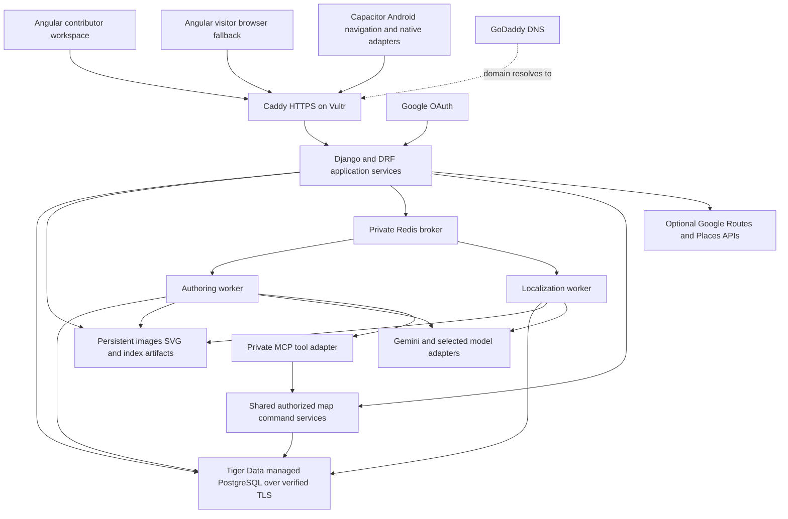

# Indoor Navigation Architecture and Dependency Plan

**Status:** Architecture baseline and integration plan, not a deployed implementation  
**Updated:** October 16, 2026  
**Platforms:** Web contributor workspace and Android visitor application  
**Scope:** MVC responsibility mapping, component boundaries, data flow, external services, dependency profiles, and fast deployment

Use Angular for the interface, Django and Django REST Framework for application services, Capacitor for the Android navigation build, Tiger Data for managed PostgreSQL, Vultr for application hosting, and GoDaddy for domain management. Google OAuth identifies map developers; Google Maps supplies outdoor navigation capabilities. Gemini is the first provider to evaluate for scene understanding, structured extraction, and difficult map modeling.

This baseline replaces the original plan's DigitalOcean/Railway deployment assumptions and earlier default model choices. It preserves the three stakeholder workflows, reviewed publications, AI/MCP editing, and acceptance requirements already defined. Exact application API fields remain a separate design task. The service names and library profiles below are concrete preparation choices, not evidence of a successful clean install or account-specific model access.

## 1 Document map and decisions

Start with the root [README](README.md) for the current folder summary and reading order. Historical proposal/research files are retained under `archive/`.

| Document | Purpose |
|---|---|
| [Stakeholders and workflows](Indoor_Navigation_Stakeholders_and_Workflows_Review_EN.md) | Administrator, volunteer, and visitor behavior |
| [Acceptance plan](Indoor_Navigation_Acceptance_and_Test_Plan_EN.md) and [test catalogue](Indoor_Navigation_Test_Catalog_EN.md) | Stage gates and behavioral evidence |
| [Stage 1 assignment plan](Indoor_Navigation_Stage_1_Assignment_Plan_EN.md) | Current Map Platform leads, XP cross-review/reassignment, and later-stage placeholders |
| [Infrastructure integration](Indoor_Navigation_Infrastructure_Integration_EN.md) | Local setup, Tiger Data, Vultr, GoDaddy, Google OAuth, and device connectivity |
| [AI and Google Maps integration](Indoor_Navigation_AI_and_Maps_Integration_EN.md) | Model verification, SDK/API examples, structured output, embeddings, and outdoor services |
| [Android architecture](Indoor_Navigation_Android_Architecture_EN.md) | Canonical Android structure, native bridges, lifecycle, permissions, and APK release boundary |
| [Open-source reuse plan](Indoor_Navigation_Open_Source_Reuse_Plan_EN.md) | Repository code inspection, extraction boundaries, dependencies, and acceptance checks |
| [.env.example](.env.example) | Public/private configuration inventory with placeholders |

The selected operating profile is native Ubuntu services on Vultr: Caddy, Gunicorn, Celery, a private Redis broker, and a separate MCP adapter managed by systemd. CI builds affected artifacts with caches and transfers a versioned release over SSH; no Docker images, Compose stack, or container rebuild is part of this design. Native iOS development is outside the present scope. This planning change creates no application scaffold, dependency installation, or deployment workflow implementation.

## 2 Runtime architecture



The first production deployment has one Vultr Linux VM for the reverse proxy, API, workers, broker, and private MCP adapter. Tiger Data is the PostgreSQL server; it is not an additional database layered on another production PostgreSQL instance. A native local PostgreSQL service is a development/test substitute with a compatible major version and selected extensions. Use WSL2/Linux for a local Celery/Redis integration profile on Windows; ordinary Django/Angular development can remain on Windows.

**Approved demo exception, October 17, 2026:** the requesting contributor approved
`PGSSLMODE=require` for the Tiger Data Free-plan demo after certificate verification
blocked the first deployment. This encrypts database traffic without verifying
the server's identity. Verified TLS remains the default and the production target
shown above; see the [deployment configuration](../deployment.md#free-plan-demo-tls)
for the scoped exception and return to `verify-full`.

The API and workers share the same backend codebase and domain rules. Separate processes isolate slow image/model work from request handling. Two bounded queues prevent a long authoring job from occupying the only localization execution slot. If the VM cannot support both workloads, suspend authoring during a walk and record that operating limit.

Keep media and index bundles in persistent directories outside releases initially. Object storage is an interchangeable storage adapter when required. Database rows store identity, ownership, revisions, associations, review state, and artifact locations; photographs and model binaries do not need to be database blobs. Back up metadata and assets as one recoverable publication set.

## 3 MVC responsibility mapping and component organization

Use standard separation of Model, View, and Controller responsibilities while preserving each framework's conventions. Modern Angular is component-based; this project maps MVC responsibilities to Angular components, templates, services, and typed state rather than introducing AngularJS-style controllers. Django uses its own model/view/template terminology. Its DRF views handle the HTTP/controller boundary here, while Angular supplies the main user-facing views. Django templates remain appropriate for internal Admin or selected authentication pages. [Angular components](https://angular.dev/essentials/components), [Django terminology](https://docs.djangoproject.com/en/5.2/faq/general/)

| Responsibility | Angular implementation | Django implementation |
|---|---|---|
| Model | Typed domain/read models; feature state services using signals and derived state; API adapters convert transport data | ORM entities, migrations, constraints; domain rules and application command/query services |
| View | Standalone presentational components, HTML templates, styles, SVG map renderer; state supplied through inputs | DRF representations/serializers; internal templates only where required; public views remain in Angular |
| Controller | Route/page component responds to user events and invokes a feature service; Router handles page navigation | URL routing and thin DRF views/viewsets validate requests and call authorized services |
| External boundary | Injected API/device adapters, HttpClient, camera/geolocation bridge | Provider SDK, database, storage, broker and MCP adapters behind application interfaces |

This is a responsibility mapping, not a claim that a DRF serializer is a graphical view or that Angular exposes a native `Controller` class. Shared business invariants belong in backend domain services; client models provide rendering and interaction state, not a second authority for permissions or publication.

### Angular structure

Use one Angular workspace with shared domain models, API services, controls, and design tokens. Keep contributor and visitor features separate. The baseline Android build uses a visitor entry target that excludes contributor routes and editor screens; the browser build includes the contributor workspace. Authorization remains enforced by the backend regardless of what the bundle contains.

The contributor workspace covers targets, contributions, source/standardized/vector map comparisons, map editing, reference annotation, AI commands, review, and publication. The visitor feature covers building/floor context, destination selection, capture, result states, static/reference guidance, arrival, and recovery.

Organize by feature first, then responsibility. Suggested features are `identity`, `targets`, `editor`, `references`, `review`, and `navigation`. Each feature contains route/page components, smaller UI components, its models/state, and a facade/service when orchestration is shared. A shared UI area owns buttons, forms, dialogs, loading/error states, and design tokens; platform adapters own HTTP and device integration. Avoid one global service or controller containing every workflow.

Use signals/computed values for synchronous view state, RxJS for asynchronous streams and cancellation, Reactive Forms for editable forms, and injected services for shared logic. Keep state writes behind explicit commands and expose readonly state to components. No extra state framework is required initially. Angular's services and signals support these mechanisms; the boundaries are project design choices. [Dependency injection](https://angular.dev/essentials/dependency-injection), [Signals](https://angular.dev/guide/signals)

For example, `MapEditorPage` coordinates a draft; `MapCanvas`, `RoomInspector`, `GraphOverlay`, and `RevisionDiff` render state and emit user actions. An editing service creates a command, an API adapter submits it, and accepted server state refreshes the model. A navigation page composes `CapturePanel`, `LocationStatus`, `DestinationPicker`, `RouteSteps`, and `RecoveryPrompt`. A camera callback cannot independently overwrite confirmed location or bypass capture freshness checks.

### Django structure

Retain a modular monolith, consistent with the original plan. Domain apps include accounts, maps/contributions, assets/references, publication, localization/navigation, and jobs. Within each app, keep `models`, `serializers`, HTTP views, permissions, and service/query functions distinct where their size warrants it. Do not create empty abstraction layers just to satisfy folder names.

The request flow is URL -> view/controller -> input and permission validation -> application service -> domain/ORM/storage -> response serializer. REST views, Celery tasks, internal repair commands, and MCP tools call the same services. Services define transaction boundaries and recheck actor authority, base revision, and archival state. Provider requests and image work run outside long database transactions; tasks delegate to pure geometry/retrieval functions where possible. Django Admin is an internal inspection tool, not a replacement for the volunteer/admin review product.

### Android boundary

All device calls go through a small adapter: camera lifecycle and capture, location, app/network events, and optional sensors. Provide a browser adapter and an Android implementation. The first Android candidate is the compatible camera-preview plugin; verify image rotation, preview readiness, lifecycle, overlays, and screen sharing on the actual phone. Its upstream API supplies embedded preview/capture behavior, but those device checks remain application acceptance work. [Camera-preview repository](https://github.com/capacitor-community/camera-preview)

Use Kotlin or Java inside a custom Capacitor plugin only for native capabilities that the chosen plugin set does not expose adequately, such as a pressure sensor or later AR integration. Do not expose provider keys through this bridge. Package built frontend assets in the APK; a development live-reload URL is not the production distribution strategy. Maintain detailed Android decisions in the root [Android architecture document](Indoor_Navigation_Android_Architecture_EN.md); this section states the shared-system boundary.

## 4 Module responsibilities and independent development

The names below are module boundaries, not frozen endpoint contracts. Each can be developed against fixtures while its dependencies are implemented. Stage 1 Map Platform leads are Erfang for frontend, Hamza for basic APIs, Eric for schema design and deployment/CI/CD, and Arjun for basic AI authoring/MCP/tool calling. These are revisable coordination assignments under the team's XP approach; the [assignment plan](Indoor_Navigation_Stage_1_Assignment_Plan_EN.md) defines their scope. Navigation pipelines and later-stage ownership remain placeholders.

| Module | Owns | Consumes and produces | Independent test boundary |
|---|---|---|---|
| Identity and permissions | Google login, session identity, map role assignments, guest capabilities | Authenticated actor and authorized scope; never trusts a client-supplied role | AUTH fixtures and role matrix |
| Targets and contributions | Building/floor targets, drafts, starting revision, submission feedback | Contributor change sets and reviewable history | GOV transitions without AI |
| Geometry and map commands | Stable geometry objects, labels, nodes, edges, validation, undoable draft changes | Validated operations and map documents | MAP fixtures; same commands used by UI and MCP |
| Assets and references | Upload validation, original/corrected/generated artifacts, node/view associations | Owned artifact identities and reviewed reference manifests | REF/MAP checks with small local files |
| AI authoring | Bitmap styling, vector proposal, structured extraction, bounded repair | Typed proposals, evidence, and job outcomes | AI fixtures plus separate real-provider probes |
| Agent and MCP tools | Intent decomposition, tool calls, parameter editing, batch limits | Authorized commands and auditable change sets | MCP examples against an isolated draft |
| Scene understanding | Real photo analysis, observed labels/landmarks, proposed spatial relationships | Reviewed scene records with source evidence | REF cases with known photo/node labels |
| Semantic retrieval | Canonical scene text, embedding generation, candidate lookup | Ranked reference/node candidates with index identity | Fixed text/query fixtures and compatibility checks |
| Localization decisions | Candidate verification, ambiguity/rejection, direction availability | Capture-time observation; no unverified metric pose | LOC positive/negative sets independent of UI |
| Routing | Directed weighted graph, closures and mode constraints | Allowed route and semantic steps | NAV graph fixtures; no model/API dependencies |
| Guidance and session state | Confirmed versus previewed position, capture freshness, destination, renderer selection | Human instructions and navigation state | APP/JOB race cases with synthetic observations |
| Publication | Validation, required derived artifacts, approval, atomic current revision | A coherent immutable publication | GOV fault injection and revision tests |
| Jobs and operations | Dispatch, deadlines, retry/deduplication, recovery, tracing, deployment | Durable job state and observable release health | JOB/OPS checks independent of model quality |

Permission checks occur inside the shared command services as well as at transport entry points. This avoids a permissive MCP path bypassing stricter REST behavior. A routing function accepts a validated graph, not a Django request or a model-provider response. A model adapter returns validated application data, not provider objects scattered throughout the application.

## 5 Data authority and publication

### Structured geometry and vector artifacts

Recommended resolution of the earlier open choice: use a validated structured map document as the editable geometry authority, with stable object identifiers and schema versioning. Persist an SVG vector file for each reviewed revision and export. The vector file remains a real deliverable; it is rendered from, and checked against, the same map document.

An AI-produced SVG is an import proposal. Parse its allowed elements, associate them with structured geometry, reject unsupported active content, and show a comparison before adopting it. Manual or MCP edits operate on the authoritative objects, then regenerate the vector artifact. This avoids two independently edited copies of the geometry.

Use relational records for users, targets, memberships, submissions, revisions, room identities, graph connections, reference associations, and jobs. JSONB can retain versioned geometry, AI proposals, flexible semantic attributes, and source evidence. Exact table boundaries are deferred; foreign-key/revision integrity and repeatable export are required.

Keep the navigation graph distinct from wall geometry. A wall segment is not a walking edge; a room centroid is not proof of a doorway connection. Global geographic coordinates identify buildings/entrances. Local plan coordinates and reference-image/3D frames require explicit transforms and independent validation.

### Publication transaction

1. Freeze the proposed contribution content and its starting revision for review.
2. Validate geometry, labels, reference associations, and walkable connectivity; identify conflicts with the current publication.
3. Build required vector, semantic, and embedding/index artifacts under a candidate revision.
4. Recheck authorization, map status, approved content identity, and current revision after long jobs finish.
5. Promote the candidate in a short database transaction only when every required artifact is ready.
6. Keep the previous publication available on any preparation failure. Clean abandoned artifacts through a later controlled retention process.

Administrator corrections use this same revision flow. Archive blocks new writes and late agent results under the current testing baseline. Navigation sessions use one publication until refresh or explicit invalidation. Database transactions cannot atomically roll back a remote model call or an object-storage upload; the candidate/activation sequence handles that boundary.

## 6 AI workflows and model roles

### Provider routing

Use the selected model roles below: Gemini remains primary for recognition, structured processing and vector modeling; GPT Image 2.5 handles raster generation/editing, and Opus 5.5 is the designated vector-modeling backup. The [AI integration guide](Indoor_Navigation_AI_and_Maps_Integration_EN.md) contains the dated official-source audit, availability distinctions, API modes, and required account probes. This records the user's model-selection decision, not a completed project benchmark.

| Role | Recommended model | Selection rule |
|---|---|---|
| Vision quality baseline and difficult vector/semantic modeling | `gemini-4-argon` | Evaluate accuracy and rejection behavior first; slower authoring and visitor localization have different time budgets |
| Routine structured extraction, edit planning, and faster vision comparison | `gemini-3.8-flash` | Test on the same held-out cases; promote to the visitor fast path only after it meets the same quality gate |
| Bitmap generation and natural-language raster edits | GPT Image 2.5: `gpt-image-2.5-sunburst` | Selected raster model; generated walls/doors remain proposals requiring comparison and review |
| NLP destination/reference matching | `gemini-embedding-2`, initially 768 dimensions | Explicit replacement recommendation for the unverified “Gemini Embedding 4”; use model-specific prefixes and rebuild indexes on representation changes |
| Vector-modeling backup | Claude Opus 5.5: `claude-opus-5-5` | Designated alternative to Argon for difficult vector proposals; retain the same geometry/topology validators and review gates |

The official Embedding 2 model card and release notes resolve the older model-index preview wording; the selected recommendation is stable `gemini-embedding-2`. Keep activation off until an account probe and retrieval evaluation pass. Image understanding and text/code output do not imply bitmap image generation: Flash/Argon plan or interpret changes, and GPT Image 2.5 renders the bitmap. Raster and geometry quality must be evaluated separately. An Opus retry records why it was selected and preserves the input revision, provenance, validation and review requirements. Do not silently switch provider, model, or vector space after a failed request.

### Map authoring flow

Preserved source bitmap → optional deterministic correction → raster standardization → vector/structured proposal → validation and comparison → manual or MCP correction → reviewable contribution.

Prompts describe the desired operation and output structure. Pydantic or equivalent validation checks types and allowed values; domain checks then verify referenced object identity, geometry, permissions, and revision consistency. Valid JSON does not prove a valid door or route. Failed outputs remain proposals and do not overwrite reviewed content.

Each member prepares their own task prompts; no centralized Prompt handbook or separate preparation deliverable is planned. Product workflow prompts remain the relevant implementer's responsibility, including their versioning and existing acceptance/regression evidence.

### Reference and NLP matching flow

Real scene photo plus known collection context → Gemini scene interpretation → structured observations and relationships → reviewed canonical scene text → selected NLP embedding → candidate reference/node lookup → optional Gemini verification → accepted, ambiguous, rejected, or error outcome.

Canonical text should include verified building/floor/room context and discriminative observed features, while retaining raw observations and their source. Do not let inferred prose replace the original photograph. Filter by confirmed context; aggregate reference matches by distinct node; compare alternative nodes; allow no match. Route history may check consistency but must not force every query onto the expected next checkpoint.

This is initially semantic-text matching, not raw image-descriptor matching. An optional DINOv2/OpenCLIP/OCR comparison remains a separate adapter and experiment. Two vector spaces cannot be mixed even if their dimensions happen to match.

For the small pilot gallery, a versioned NumPy matrix and exact similarity search avoid an additional vector service. Tiger Data `pgvector` is an optional storage/search profile after confirming the service extension and selected dimensionality. An embedding model, dimension, task mode, text normalization, or prefix change invalidates the old index and requires controlled rebuilding and evaluation.

## 7 MCP and agent execution

Use the official Python `mcp` SDK for an adapter around the existing map command services. The currently published SDK documents stable v2, requires Python 3.11+, and uses `MCPServer`; do not mix old v1 FastMCP examples with v2 APIs or install an unrelated package merely because its name contains FastMCP. Pin the chosen SDK and transitive dependencies after a client/server trial. [Official MCP Python SDK](https://py.sdk.modelcontextprotocol.io/)

The first application-controlled agent calls a private MCP service over Streamable HTTP on loopback or an authenticated private network. The agent's backend job receives an authenticated user context; a short-lived signed delegation token lets the adapter verify that context. The LLM cannot select its own user ID or acquire administrator authority by changing tool arguments. The adapter rechecks current database permissions and revision status for each mutation.

Expose tool families for reading/selecting map objects, generation and tracing, structured edits, photo association, validation/diff/undo, submission, and authorized review. Keep long generation work in jobs and return trackable outcomes. Bound agent steps and retries. User-supplied website content can populate factual proposals, but cannot alter the tool's instructions or permissions; its fetcher also needs public-network and redirect validation.

Do not publish the private MCP endpoint simply by adding a Caddy route. Third-party remote MCP clients require the appropriate authorization discovery, token audience checks, and authorization-server integration. A Google sign-in token is not automatically a valid access token for this MCP resource. The public integration is a separate profile governed by the [MCP authorization specification](https://modelcontextprotocol.io/specification/2026-07-28/basic/authorization). Local development can also use stdio with a controlled test identity.

## 8 Identity and outdoor navigation boundaries

Map developers use Google OAuth/OpenID Connect through Django/allauth in a normal browser. Django maps identity to its own administrator/volunteer roles; Google does not decide map ownership. Serve the web interface and auth/API routes under one origin. Align Angular's CSRF cookie/header handling with Django and use a real CSRF-protected login initiation flow.

Public visitors use published maps without developer login. The API issues a scoped navigation capability for private job lookup and confirmation, including Android requests from the actual WebView origin. Do not assume the contributor browser's session cookie is available to the APK. Native developer login, if later required, gets a supported Android/external-browser flow and separate client configuration.

For outdoor navigation, the initial profile opens Google Maps to the chosen entrance using Maps URLs. An embedded web map adds Maps JavaScript API; in-app walking-route data adds Routes API through the backend; place search adds Places API (New) only when needed. Native Maps/Navigation SDKs are separate choices with Android key restrictions and Gradle integration. See the detailed [service selection and setup guide](Indoor_Navigation_AI_and_Maps_Integration_EN.md).

Google services guide users outdoors. Indoor routing continues to use the reviewed application graph. A GPS suggestion does not prove entrance crossing or floor identity. Preserve a deliberate indoor state until exit or explicit correction.

## 9 Jobs and operational data flow

Use application-owned job identifiers and persistent job rows. Commit the pending job before broker dispatch, then record dispatch success/failure. Celery's commit-aware dispatch helper can prevent early execution, but it does not by itself provide durable recovery for a failed broker send, and it does not return an application job identity. Keep reconciliation, leases/deadlines, idempotent result writes, and bounded retries in application logic. [Celery Django integration](https://docs.celeryq.dev/en/stable/django/first-steps-with-django.html)

Poll job state initially. A newer capture invalidates incompatible prior results without pretending that it cancels a provider operation already running. Separate capture/session freshness from backend concurrency limits. API liveness, full readiness, queue delay, model/provider state, and current index identity are separate operational signals.

Deploy versioned source/static artifacts to Vultr, with native processes managed by systemd. Persist media, indexes, broker state as needed, and Caddy TLS data outside replaceable releases. Keep database, provider, and signing credentials server-side or in CI; deploy public frontend configuration through an explicit allowlist. Restore exercises must cover the Tiger Data records and matching image/vector/index assets.

### Selected fast CI/CD strategy

Choose GitHub Actions with Linux runners for server/web checks and artifacts, plus an Android-capable runner for signed APK artifacts. This is a planned CI host choice; no repository connection or workflow has been created. Use native runtime tools, dependency/build caches, SSH transfer, and systemd services. A normal code release must not reinstall an unchanged dependency environment or rebuild an unaffected target.

| Change | Build and deploy behavior |
|---|---|
| Documents or private `local/` work | Documents need no application deployment; `local/` never enters source control or CI |
| Backend source only | Run affected checks, package source, reuse compatible venv identified by OS/architecture/Python/lock hash, deploy API/worker/MCP processes that consume changed modules |
| Backend dependency lock | Build a new immutable venv at its final versioned path using cached wheels; retain the prior venv for rollback; never mutate the environment of running processes |
| Web feature or public web config | Build affected Angular target using npm/Angular caches, transfer hashed static output, atomically change the active frontend root; preserve assets needed by open tabs |
| Android visitor web assets/config | Build the visitor target, Capacitor sync, then incremental Gradle APK build; web asset changes in a bundled APK still require a new APK |
| Native/plugin/Gradle changes | Re-sync and rebuild Android; rerun permission/lifecycle/device checks; reuse compatible Gradle caches |
| Shared contracts, geometry, or navigation | Recheck every consuming target, including Android when its bundled client behavior changes; path-only filtering cannot ignore dependency relationships |
| Model/prompt/index change | Run the matching AI/retrieval regression and prepare a coherent index version; code deployment alone does not activate an incompatible index |

Upload a candidate release to `/srv/indoor-nav/releases/<release-id>/` without overwriting the active release. Secrets and writable data live outside it; dependency environments are identified separately. Check the candidate on a private API slot, then switch Caddy to the healthy slot and the corresponding static release. Drain the old API and restart/drain affected workers with the correct release environment. A symlink switch or Gunicorn HUP alone is not proof that every process has loaded new code and dependencies.

Use additive, backward-compatible migrations before switching mixed old/new processes; postpone destructive changes until the previous version is retired. Workers must finish or safely release active jobs before replacement. Rollback selects the prior tested code/static/venv combination only while database and job payloads remain compatible. Record build, transfer, readiness and switch times during the independent deployment rehearsal; no unmeasured deployment-time promise is part of this plan. The [infrastructure guide](Indoor_Navigation_Infrastructure_Integration_EN.md) defines the concrete procedure and recovery checks.

## 10 Dependency and toolchain inventory

### Candidate compatibility baseline

| Layer | Initial candidate | Validation before locking |
|---|---|---|
| Angular | 21.2.x; TypeScript 5.9.x; RxJS 7.x | Align core/CLI/compiler and optional UI packages; production build and browser test |
| Node | Current patched 24.x, at least 24.15 | Meets the selected Angular/Capacitor requirements; use the same line in CI |
| Python/backend | Python 3.12; Django 5.2 LTS; compatible DRF/allauth releases | Resolve the whole SDK/MCP/worker set and database driver wheels in a clean environment |
| Capacitor | Matching 8.x core/CLI/Android; compatible preview plugin | Use the actual generated Android project; install and exercise the APK |
| Android | Android Studio 2025.2.1 or newer; SDK 36 candidate; bundled or explicitly selected compatible JDK | Record Java, Gradle, Android Gradle Plugin, and plugin versions; use generated wrapper |
| PostgreSQL | Tiger Data service's available version; local major matched where possible | Verify connection/TLS, extensions, migrations, and backup/restore against the selected cloud service |
| MCP | Official `mcp` v2 release line | Client/server transport and identity propagation test; no mixing v1-only snippets |

These are compatible candidate families, not exact tested lockfiles. The Angular matrix lists 21.x with TypeScript 5.9 and Node 24 support; moving to Angular 22 requires its own TypeScript/Node constraints. [Angular compatibility](https://angular.dev/reference/versions) Django 5.2 supports Python 3.12. [Django release notes](https://docs.djangoproject.com/en/5.2/releases/5.2/) Capacitor's 8.0 migration baseline includes SDK 36, AGP 8.13.0 and Gradle 8.14.3; later minor templates may differ, so preserve generated compatible files. [Capacitor migration guide](https://capacitorjs.com/docs/updating/8-0)

### Core packages

| Area | Package or component | Role and installation boundary |
|---|---|---|
| Angular runtime | `@angular/core`, `@angular/common`, `@angular/compiler`, `@angular/platform-browser`, `@angular/router`, `@angular/forms`, `rxjs` | Client-rendered SPA, HttpClient, forms, state, routing |
| Angular build | `@angular/cli`, `@angular/build`, `@angular/compiler-cli`, `typescript` | Build-only; use the builder generated for the selected Angular version |
| Native container | `@capacitor/core`, `@capacitor/android`; `@capacitor/cli` as a development tool | Android wrapper and build synchronization |
| Capture and lifecycle | `@capacitor-community/camera-preview`, `@capacitor/app`, `@capacitor/network`, `@capacitor/geolocation` | Selected capture/device adapter; browser uses Web APIs |
| Backend | `Django`, `djangorestframework`, `django-allauth[socialaccount]` | Application services, API, developer identity |
| Configuration and cross-origin | `django-environ`, `django-cors-headers` | Explicit environment parsing and actual APK-origin policy |
| API documentation | `drf-spectacular` | Publish OpenAPI after application contracts are agreed |
| PostgreSQL | `psycopg[binary]` | PostgreSQL client; verify actual libpq version and TLS support in the selected runtime |
| Jobs | `celery[redis]` | Worker and Redis transport; Redis is a separate private service |
| API process | `gunicorn` | Linux Django API process; Windows uses the development server or WSL2 for runtime parity |
| MCP and ASGI process | `mcp`, `uvicorn`; `mcp[cli]` for development | Separate adapter process; retain the SDK's resolved HTTP/ASGI dependencies |
| Provider SDKs | `google-genai`, `openai` | Gemini text/vision/vector modeling and embeddings; GPT Image 2.5 raster generation/editing through its dedicated adapter |
| Validation and HTTP | `pydantic`, `httpx` | Application schemas, direct external HTTP, and bounded website ingestion; SDK-specific HTTP dependencies remain pinned transitively |
| Image and array processing | `Pillow`, `numpy`, `opencv-python-headless` | Decode/orient/compress, perspective correction, image quality hints, small embedding matrix |
| Geometry and routing | `shapely`, `networkx` | Geometry checks and directed weighted routing; application defines walkability |
| SVG and website parsing | `defusedxml`, `beautifulsoup4` | Parse restricted vector markup and extract external room information; explicit allowed-element/URL rules are application work |
| Runtime infrastructure | Ubuntu/systemd, Caddy, Redis, Python venv, SSH/rsync | Native services and versioned artifact releases; dependency environments reused by compatible lock hash |
| Operating tools | `ca-certificates`, PostgreSQL client tools, Git, Android SDK/platform-tools | TLS trust, database probes/backups, source provenance, device installation |

Package existence does not prove integration. Use the upstream documentation for [DRF](https://www.django-rest-framework.org/), [environment parsing](https://django-environ.readthedocs.io/en/latest/), [API schema generation](https://drf-spectacular.readthedocs.io/en/latest/), and [Psycopg installation profiles](https://www.psycopg.org/psycopg3/docs/basic/install.html). In particular, plain `psycopg` and `psycopg[binary]` have different system-library requirements.

### Selected extras and research profiles

| Profile | Additional packages | Enable only when |
|---|---|---|
| UI component kit | Matching `@angular/material` and `@angular/cdk` | The team chooses this UI system; native SVG editor is the initial geometry renderer |
| Canvas editor | `konva` or `fabric` | A targeted editor trial justifies replacing/extending the SVG layer; do not install both by default |
| Alternative indoor renderer | `maplibre-gl` | A specific OpenIndoorMaps-style renderer experiment justifies it; native SVG remains the initial indoor view |
| Google embedded web map | `@angular/google-maps`, compatible `@types/google.maps`; `@googlemaps/js-api-loader` if using the chosen direct loader approach | Maps JavaScript API is selected; avoid competing loader paths |
| Google native Android map | `@capacitor/google-maps` and its compatible native Maps SDK dependencies | Native map display is selected; Navigation SDK turn guidance is a separate optional native integration |
| Native system capture fallback | `@capacitor/camera` | A separate still-camera flow is needed and tested |
| Browser/native support | `@capacitor/browser`, `@capacitor/filesystem`, `@capacitor/preferences` as needed | A tested handoff, asset caching, or non-secret preferences requirement needs them |
| Sensors and feedback | `@capacitor/motion`, `@capacitor/haptics`; custom Android sensor plugin where needed | Sensor/feedback extension is selected; web motion does not expose every native sensor |
| Panorama | `@photo-sphere-viewer/core`, `@photo-sphere-viewer/virtual-tour-plugin`, optional markers plugin, compatible `three` | Reference-tour renderer is accepted |
| Vector-modeling backup | `anthropic` | The selected Opus 5.5 backup is activated after account access and shared geometry-validation checks |
| PostgreSQL vector storage | Python `pgvector` plus service-side `vector` extension | Extension, dimension, index type, and query operator are validated; Python package alone does not install the database extension |
| Object storage | `django-storages[s3]`, `boto3` | S3-compatible media storage is selected and API/worker access is tested |
| Local image retrieval | Matching `torch`/`torchvision`, chosen DINOv2 implementation or `open_clip_torch`; `transformers` only if the selected implementation requires it | An isolated comparison justifies local model operation; weights and preprocessing are separate artifacts |
| OCR | One verified RapidOCR/ONNX Runtime profile, or `paddleocr` plus matching `paddlepaddle`, or `pytesseract` plus Tesseract executable/language data | Actual door-label tests justify an OCR path; use one profile initially |
| Geometry/retrieval extensions | `svgpathtools`, `scikit-image`, `scipy`, AnyLoc/LightGlue dependencies | Specific extracted modules need them; see pinned upstream manifest |
| Floor-plan constraint experiment | `PuLP` with a compatible solver and the selected FloorplanTransformation scientific dependencies | Isolated extraction trial only; do not import the upstream legacy dependency pins into the main backend |
| Native 3D/SLAM | Selected ARCore/Android dependencies or isolated hloc/PALMS/ORB-SLAM research environment | Separate GX experiment; not part of the core server/APK dependency set |

These extras are alternatives and future profiles, not an instruction to deploy every research stack. For PostgreSQL vector storage, the official [Python integration](https://github.com/pgvector/pgvector-python) documents Django integration; extension support and vector index limits must also be checked in the chosen Tiger Data service.

### Development and testing tools

Use `ruff`, `pytest`, `pytest-django`, and targeted API/service tests for Python; the Angular CLI's selected test runner and TypeScript checks for the frontend; and `@playwright/test` for browser workflows. Add ESLint/angular-eslint and Prettier if selected by the team. Use MCP's CLI/Inspector for tool inspection. Android device acceptance still requires the physical phone and screen-sharing path.

Commit the selected JavaScript lockfile, Python lockfile, generated Gradle wrapper, OS/runtime compatibility record, model/weight manifests where applicable, and source commit/license records. Preserve optional packages in separate dependency groups. At the implementation stage, perform one clean install and its acceptance checks before freezing exact versions; this planning task does not download dependencies or create lockfiles.

## 11 Environment mapping and setup order

`.env.example` is a configuration inventory, not an application that automatically configures installed libraries. The later implementation must map each project variable to Django settings, provider clients, worker startup, public Angular configuration, Capacitor config, or deployment automation. A blank required value fails the enabled profile; an unused optional provider does not block startup.

| Consumer | Allowed configuration |
|---|---|
| API | Django/auth, scoped session limits, database connection, storage, broker, selected server Maps key |
| Authoring worker | Database/storage/broker, selected model SDK keys, long-job limits, private MCP delegation |
| Localization worker | Database/storage/broker, selected vision/embedding provider configuration, capture deadlines |
| MCP adapter | Backend permission context, database access if importing domain services, internal delegation verifier; no unnecessary provider keys |
| Browser/APK assets | Explicit `PUBLIC_*` allowlist and deliberately public restricted native Maps identifiers only |
| Build/CI | Toolchain, signing inputs, SSH/deployment identity and release ID; signing secrets excluded from the artifact |
| Reverse proxy | Domain, certificate contact, routing, and mounted assets; no AI keys |

Start with the selected domain/subdomain, service accounts, and intended phone. Then verify local locked toolchains; Tiger Data TLS and migrations; the independent Vultr deployment and DNS; OAuth on the exact domain; the real Capacitor capture/Web API path; bounded model/schema probes; and the selected semantic embedding profile. Integrate a real map publication and navigation loop only after those dependencies are observable. The two integration guides provide the detailed steps and smoke checks.

`AI_MAX_CALLS_PER_RUN=0` in the example prevents accidental live experiments until a finite run limit is intentionally chosen. `EMBEDDING_ENABLED=false` keeps the explicitly recommended Embedding 2 profile inactive until account/quality probes pass; it is not a claim that semantic retrieval is complete. Set model-specific task types or prefixes only for the chosen embedding adapter.

## 12 Repository layout and handoffs

Suggested implementation layout:

```text
apps/web/                 Angular workspace, contributor and visitor features
apps/web/android/         Generated Capacitor Android project and native plugins
apps/api/                 Django apps, domain commands, permissions, job entrypoints
apps/mcp/                 Thin official-SDK adapter over authorized commands
packages/vision/          Provider adapters, semantic extraction, retrieval, decisions
packages/geometry/        Map normalization, validation, vector import/export, routing
contracts/                Agreed schemas and fixtures when ready
infra/                    systemd, Caddy, CI artifact deployment and restore procedures
evals/                    Manifests, test records and evaluation scripts
docs/                     Requirements, decisions, workflow records and reuse provenance
local/                    Ignored personal tests, logs, skills, secrets and research
```

Current planning documents remain at the repository root and are indexed by `README.md`. The original detailed plan and `Previous Research` are retained in `archive/`. The application layout above is a proposal for later implementation; those application directories have not been created by this planning task.

`local/` is a required local directory and `.gitignore` contains `/local/`. Personal exploratory tests, logs, downloaded research snapshots, local SKILL documents, screenshots, private environments/configuration, and generated trial results go here, for example `local/tests/`, `local/logs/`, `local/research/`, `local/skills/`, and `local/env/`. Reviewed reusable team tests and sanitized acceptance fixtures may be deliberately promoted into tracked `tests/` or `evals/`; shared CI must never depend on a developer's `local/`. Framework-mandated generated outputs remain ignored in their normal locations when the application is later scaffolded. Production logs/secrets belong on the server or CI secret store, not in Git.

Git cannot preserve an ignored directory in a clone. The later onboarding/bootstrap instructions must recreate `local/`; this workspace already has the directory and a private README. No Git repository has been initialized by this documentation task.

Each handoff identifies the module's observable behavior, input/output meaning, permitted side effects, fixtures, failure states, and acceptance cases. Shared migrations, lockfiles, publication rules, and release configuration have one designated integrator. Separate modules can proceed against fixtures, but a fixture is replaced by a real implementation at an explicit gate.

Immediate architecture decisions still requiring evidence are the exact Tiger Data service/TLS/extension profile, embedding model and dimension, raster-editing quality, camera plugin compatibility, and selected outdoor integration level. The initial work should resolve those through small tests instead of expanding the framework list.
