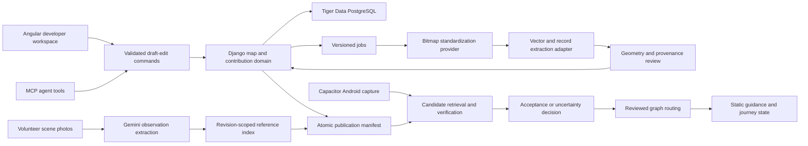

# Indoor Navigation — Open-Source Reuse and Extraction Plan

**Status:** Architecture research and proposed extraction plan; no implementation or deployment approval is implied by a candidate's ranking.  
**Reviewed:** 2026-10-16, America/Toronto.  
**Owners:** `{{ARCHITECTURE_OWNER}}`, `{{AI_OWNER}}`, `{{MAP_OWNER}}`, `{{APP_OWNER}}`, `{{QA_LEAD}}`.  
**Target:** Angular + Django + Capacitor/Android + Tiger Data PostgreSQL; Gemini primary AI, GPT Image 2.5 raster editing, Opus 5.5 vector-modeling backup; deployment on Vultr.  
**Related:** [Stakeholders and workflows](Indoor_Navigation_Stakeholders_and_Workflows_Review_EN.md), [acceptance plan](Indoor_Navigation_Acceptance_and_Test_Plan_EN.md), [test catalogue](Indoor_Navigation_Test_Catalog_EN.md), [Android architecture](Indoor_Navigation_Android_Architecture_EN.md), and the archived [Previous Research](<archive/Previous Research>) file.

## 1. Decision and evidence boundary

Build one product with one authoritative map/revision model. Extract small algorithms, provider interfaces, and interaction patterns from the reviewed projects; do not merge their complete applications or introduce all their databases and model stacks.

The strongest initial candidates are **NaviGraph's independent Python map extractor and graph-edit command pattern**, and **InVision's candidate scoring, reference-review, and journey-progress separation**. Their production behavior still needs substantial changes. **NAVI** is particularly useful as a navigation-state reference. **Anyplace** contributes building/floor/POI/connectivity concepts and a real object-fingerprint localization alternative. **OpenIndoorMaps** provides rendering ideas. **Snap&Nav** provides corridor-skeleton and intersection-navigation research, with an iOS dependency that does not fit the Android baseline.

This review independently resolved repository identities, retrieved Git trees and pinned source files, and inspected implementation paths and license files. It did **not** execute repository programs, install packages, download model weights, build native applications, run upstream tests, or benchmark localization. Earlier test counts and accuracy measurements in `Previous Research` are historical claims, not results reproduced here. A test file's existence is evidence of a test design only.

The six primary repository HEADs retrieved for this review match the short revisions cited in `Previous Research`. Their underlying code was re-read rather than assuming the previous conclusions remained correct. Exact pins below make the review reproducible; future default-branch changes require a targeted re-review.

## 2. Repository identity, revision, and license register

License observations describe inspected files, not a legal conclusion about a combined distribution. Code, third-party components, model weights, and datasets require separate records. Preserve applicable license and attribution files when copying code. For projects without a license file, this plan permits study of publicly visible behavior but schedules no direct code incorporation until reuse permission is resolved.

| Project / actual repository | Reviewed commit | License file observed | Disposition |
|---|---|---|---|
| [NaviGraph — lancelot2/NaviGraph](https://github.com/lancelot2/NaviGraph) | `1390c59edbc45fb025a47d760d85c16230f4ddf6` | [Apache-2.0](https://github.com/lancelot2/NaviGraph/blob/1390c59edbc45fb025a47d760d85c16230f4ddf6/LICENSE) | Accept selected extraction experiments; reject whole-stack adoption |
| [InVision — LikithSh3tty/Indoor-Mall-Navigation](https://github.com/LikithSh3tty/Indoor-Mall-Navigation) | `39ef7f09ae42c5ac78957bd708fb117b9f74c43b` | [MIT](https://github.com/LikithSh3tty/Indoor-Mall-Navigation/blob/39ef7f09ae42c5ac78957bd708fb117b9f74c43b/LICENSE) | Accept selected Python extraction experiments |
| [NAVI — NgWY02/Indoor-Navigation-for-visually-impaired](https://github.com/NgWY02/Indoor-Navigation-for-visually-impaired) | `5b734064622c9a9f2537af451aabfe9d3b469a41` | No `LICENSE` file found in pinned tree; README license wording is insufficient for this plan | Reference only pending permission and runnable prerequisites |
| [Anyplace — dmsl/anyplace](https://github.com/dmsl/anyplace) | `7229551823757cc39174cc693947d9077e770bfb` | [MIT](https://github.com/dmsl/anyplace/blob/7229551823757cc39174cc693947d9077e770bfb/LICENSE.txt) | Reference models/workflows; optional algorithm extraction |
| [Anyplace Android library](https://github.com/dmsl/anyplace-lib-android) | `653becd0961171ad33fa25fac2260927ce5f5175` | [MIT](https://github.com/dmsl/anyplace-lib-android/blob/653becd0961171ad33fa25fac2260927ce5f5175/LICENSE) | Parent-pinned submodule; CV experiment only |
| [Anyplace Core library](https://github.com/dmsl/anyplace-lib-core) | `4b94f38b2df7f16fdb86f891a04fa4b87610fc5f` | [MIT](https://github.com/dmsl/anyplace-lib-core/blob/4b94f38b2df7f16fdb86f891a04fa4b87610fc5f/LICENSE) | Parent-pinned submodule; data-contract reference |
| [Snap&Nav — chestnutforestlabo/Snap-and-Nav](https://github.com/chestnutforestlabo/Snap-and-Nav) | `314e85f75959dd22c075a9f233167bdfc80d997f` | No license file found in pinned tree | Reference only; reject iOS runtime for Android baseline |
| [OpenIndoorMaps — openindoormaps/openindoormaps](https://github.com/openindoormaps/openindoormaps) | `1fafb3ff5895bb7ebe7dca52e02fa3766d224b70` | [Apache-2.0](https://github.com/openindoormaps/openindoormaps/blob/1fafb3ff5895bb7ebe7dca52e02fa3766d224b70/LICENSE) | Rendering/reference interaction only initially |
| [CubiCasa5k](https://github.com/CubiCasa/CubiCasa5k) | `c34440266665a11f4484eb06cd2e4b7d72ad76c1` | [CC BY-NC 4.0](https://github.com/CubiCasa/CubiCasa5k/blob/c34440266665a11f4484eb06cd2e4b7d72ad76c1/LICENSE) | Deferred floor-parser benchmark; not baseline dependency |
| [FloorplanTransformation](https://github.com/art-programmer/FloorplanTransformation) | `929e7a309e300fbf1d8c77fb2277e5744cdca43e` | [MIT](https://github.com/art-programmer/FloorplanTransformation/blob/929e7a309e300fbf1d8c77fb2277e5744cdca43e/LICENSE) | Geometry-constraint reference; isolate any experiment |
| [Raster-to-Graph](https://github.com/SizheHu/Raster-to-Graph) | `04f14b36a26ccc0986d300243f64db8f388dd6ef` | [GPL-3.0](https://github.com/SizheHu/Raster-to-Graph/blob/04f14b36a26ccc0986d300243f64db8f388dd6ef/LICENSE) | Deferred wall-topology experiment |
| [DINOv2](https://github.com/facebookresearch/dinov2) | `7764ea0f912e53c92e82eb78a2a1631e92725fc8` | [Apache-2.0 root](https://github.com/facebookresearch/dinov2/blob/7764ea0f912e53c92e82eb78a2a1631e92725fc8/LICENSE); additional specialist-model licenses exist | Optional visual retrieval baseline; choose weights explicitly |
| [AnyLoc](https://github.com/AnyLoc/AnyLoc) | `a9fda68c55083f765b019df148a1b67614f90ee2` | [BSD 3-Clause](https://github.com/AnyLoc/AnyLoc/blob/a9fda68c55083f765b019df148a1b67614f90ee2/LICENSE); bundled projects have separate terms | Optional retrieval comparison after baseline |
| [LightGlue](https://github.com/cvg/LightGlue) | `eb42fee2d71449efb0aa5c10549752b5d75384d8` | [Apache-2.0](https://github.com/cvg/LightGlue/blob/eb42fee2d71449efb0aa5c10549752b5d75384d8/LICENSE) | Optional geometric candidate verification |
| [hloc / Hierarchical-Localization](https://github.com/cvg/Hierarchical-Localization) | `c13273bd0ecc2917a35910fd843712a1c6243193` | [Apache-2.0](https://github.com/cvg/Hierarchical-Localization/blob/c13273bd0ecc2917a35910fd843712a1c6243193/LICENSE) | Deferred 3D localization track |
| [ORB-SLAM3](https://github.com/UZ-SLAMLab/ORB_SLAM3) | `4452a3c4ab75b1cde34e5505a36ec3f9edcdc4c4` | [GPLv3](https://github.com/UZ-SLAMLab/ORB_SLAM3/blob/4452a3c4ab75b1cde34e5505a36ec3f9edcdc4c4/LICENSE) | Deferred native continuous-tracking track |
| [PaddleOCR](https://github.com/PaddlePaddle/PaddleOCR) | `dab3fe35379033fdcb2d0e9572fac0b36c9a9ebf` | [Apache-2.0](https://github.com/PaddlePaddle/PaddleOCR/blob/dab3fe35379033fdcb2d0e9572fac0b36c9a9ebf/LICENSE) | Optional OCR alternative; do not require two OCR engines initially |
| [PALMS / PALMS+](https://github.com/Head-inthe-Cloud/PALMS-Plane-based-Accessible-Indoor-Localization-Using-Mobile-Smartphones) | `baf5aa5ca6e7532f6d8cae331fb84cc95a99182c` | [MIT](https://github.com/Head-inthe-Cloud/PALMS-Plane-based-Accessible-Indoor-Localization-Using-Mobile-Smartphones/blob/baf5aa5ca6e7532f6d8cae331fb84cc95a99182c/LICENSE) | Deferred structural localization track |

**Name resolution matters:** NaviGraph here is `lancelot2/NaviGraph`, not flight-simulation Navigraph or the similarly named spatial-analysis project. InVision here is the repository whose files and commit match `Previous Research`, not another project with the same product name. Anyplace's [`.gitmodules`](https://github.com/dmsl/anyplace/blob/7229551823757cc39174cc693947d9077e770bfb/.gitmodules) was inspected and both referenced submodule commits were inspected separately.

**Navi Grid remains unverified for source reuse.** Its [author submission](https://devpost.com/software/navi-grid) describes room-number OCR and manual annotations; its linked `https://github.com/Adityaagulatii/NaviGrid` returned 404 during this review. No source commit, license, or executable workflow was established. Do not substitute another similarly named repository or treat the promotional demo as a verified implementation.

## 3. NaviGraph: strongest map-processing and semantic-pipeline candidate

### 3.1 Actual implementation and reusable boundaries

| Source inspected | Actual input → output | Extraction opportunity |
|---|---|---|
| [`extractor/navigraph_extractor/pipeline.py`](https://github.com/lancelot2/NaviGraph/blob/1390c59edbc45fb025a47d760d85c16230f4ddf6/extractor/navigraph_extractor/pipeline.py): `extract_graph`, `graph_to_dict` | Image bytes + extraction parameters + labeler → normalized geometry, nodes, edges, confidence/certainty | Call from a Django worker through an adapter; keep the pure stages independent of HTTP |
| [`regions.py`](https://github.com/lancelot2/NaviGraph/blob/1390c59edbc45fb025a47d760d85c16230f4ddf6/extractor/navigraph_extractor/regions.py), [`passages.py`](https://github.com/lancelot2/NaviGraph/blob/1390c59edbc45fb025a47d760d85c16230f4ddf6/extractor/navigraph_extractor/passages.py), [`graph.py`](https://github.com/lancelot2/NaviGraph/blob/1390c59edbc45fb025a47d760d85c16230f4ddf6/extractor/navigraph_extractor/graph.py) | Free-space/region evidence and proposed passages → room-region connectivity | Optional deterministic check or alternative to Gemini vector tracing; never assume inferred passage means verified doorway |
| [`src/app/projects/graph-actions.ts`](https://github.com/lancelot2/NaviGraph/blob/1390c59edbc45fb025a47d760d85c16230f4ddf6/src/app/projects/graph-actions.ts), [`src/lib/graph/repository.ts`](https://github.com/lancelot2/NaviGraph/blob/1390c59edbc45fb025a47d760d85c16230f4ddf6/src/lib/graph/repository.ts) | Named move/rename/type/edge/description/certainty operations → persisted graph edits | Shared validated edit-command service called by Angular and MCP; implement in Django rather than copying Next server actions |
| [`src/app/projects/actions.ts`](https://github.com/lancelot2/NaviGraph/blob/1390c59edbc45fb025a47d760d85c16230f4ddf6/src/app/projects/actions.ts): `addNodePhoto` | Photo bound to a known node → stored asset, extracted semantics, embedding | Reference ingestion pattern; add immutable provenance and explicit association review |
| [`src/lib/engine/context.ts`](https://github.com/lancelot2/NaviGraph/blob/1390c59edbc45fb025a47d760d85c16230f4ddf6/src/lib/engine/context.ts): `localizeFromImage` | Query photo → extracted objects/landmarks/signs/synonyms → text embedding → matched node | Closest match to Gemini-first semantic observation + NLP retrieval |
| [`src/lib/engine/core.ts`](https://github.com/lancelot2/NaviGraph/blob/1390c59edbc45fb025a47d760d85c16230f4ddf6/src/lib/engine/core.ts), [`sdk/python/navigraph/core.py`](https://github.com/lancelot2/NaviGraph/blob/1390c59edbc45fb025a47d760d85c16230f4ddf6/sdk/python/navigraph/core.py) | Graph + known current node + instruction → destination, path, textual navigation context | Deterministic-core separation and parity-test pattern, not a complete human-navigation session |

The separate Python extractor is a more practical reuse candidate for Django than the complete React/Next/Supabase application. Its pipeline combines deterministic image processing with replaceable semantic labeling. The default labeler is a mock: an extractor call that returns JSON is not evidence that real AI labeling ran. Its LLM-connections mode proposes connectivity separately from the passage detector; both outputs require map review. These are proposed building blocks for the user's standardization → vectorization → structured-record workflow, not a substitute for that workflow.

### 3.2 Required adaptations

- Replace the provider layer with configured Gemini adapters for observations and labels; store provider/model, prompt version, preprocessing, embedding dimensionality, and map revision with derived results. A text embedding of a scene description is not a visual descriptor and cannot be compared against CLIP/DINOv2 vectors.
- Replace Supabase-specific auth/storage/RPC access with Django permissions, storage access, and PostgreSQL queries. Its [`photos` migration](https://github.com/lancelot2/NaviGraph/blob/1390c59edbc45fb025a47d760d85c16230f4ddf6/supabase/migrations/20260101000001_schema.sql) fixes embedding width at 512; select the actual Gemini embedding configuration before creating the project's index. Do not copy that dimension unexamined.
- Replace nearest-reference acceptance: the inspected [`datasources.ts`](https://github.com/lancelot2/NaviGraph/blob/1390c59edbc45fb025a47d760d85c16230f4ddf6/src/lib/engine/datasources.ts) and [matching SQL](https://github.com/lancelot2/NaviGraph/blob/1390c59edbc45fb025a47d760d85c16230f4ddf6/supabase/migrations/20260101000002_functions.sql) take the first result. Add distinct-location candidate aggregation, absolute evidence checks, margin checks, unknown handling, and reviewable evidence. Do not infer physical position from an instruction without recording it as a user declaration.
- Replace [`findPath`](https://github.com/lancelot2/NaviGraph/blob/1390c59edbc45fb025a47d760d85c16230f4ddf6/src/lib/graph/algo.ts): it performs undirected BFS by hop count. The product needs allowed, directed, weighted edges and explicit no-route outcomes, plus physical path geometry through verified doors/corridors.
- Rebuild the editor interaction in Angular, retaining a shared command boundary. Add target ownership, volunteer drafts, review, rejection, merge conflicts, archive, and immutable publication manifests. Graph replacement in the inspected project is not the requested Git-like contribution workflow.

**Dependencies worth extracting:** the [extractor manifest](https://github.com/lancelot2/NaviGraph/blob/1390c59edbc45fb025a47d760d85c16230f4ddf6/extractor/pyproject.toml) separates a small `numpy`, `opencv-python-headless`, `Pillow`, `pydantic` core from optional service/evaluation packages. Do not add FastAPI merely because the upstream extractor exposes it; Django can invoke the pure package in a worker.

**Observed verification assets:** extractor tests for regions, passages, graph, preprocessing, pipeline and service; TypeScript bundle/context tests; Python offline/parity tests. None ran here. The next experiment must pass MAP-01/02/04/05, AI-02/03/05, MCP-01/05/06, REF-04, LOC-03/04, and NAV-01 against our fixtures.

## 4. InVision: useful Python localization and journey concepts

### 4.1 Actual implementation

[`src/encoders.py`](https://github.com/LikithSh3tty/Indoor-Mall-Navigation/blob/39ef7f09ae42c5ac78957bd708fb117b9f74c43b/src/encoders.py) loads CLIP and RapidOCR lazily. `embed_images` produces normalized image vectors; `ocr_image` produces text tokens, confidence and text-height evidence. [`src/localizer.py`](https://github.com/LikithSh3tty/Indoor-Mall-Navigation/blob/39ef7f09ae42c5ac78957bd708fb117b9f74c43b/src/localizer.py) groups gallery rows by directory unit, takes the best image match per unit, combines visual and text evidence, and permits a signage-based override. The output is a ranked **unit/location**, not continuous camera pose.

[`src/frame_align.py`](https://github.com/LikithSh3tty/Indoor-Mall-Navigation/blob/39ef7f09ae42c5ac78957bd708fb117b9f74c43b/src/frame_align.py) and [`src/pipeline.py`](https://github.com/LikithSh3tty/Indoor-Mall-Navigation/blob/39ef7f09ae42c5ac78957bd708fb117b9f74c43b/src/pipeline.py) provide a reference-building example: sequence/group evidence is aligned to known directory order, with ambiguous assignments exposed for review. This is useful for volunteer collection assistance, provided every proposed association remains provisional until accepted.

[`MallGraph.route`, `nearby`, `tour`, `progress`](https://github.com/LikithSh3tty/Indoor-Mall-Navigation/blob/39ef7f09ae42c5ac78957bd708fb117b9f74c43b/src/mall_graph.py) operate on a NetworkX graph. `progress` distinguishes arrival, staying on a route, and deviation; a fresh route can be generated after deviation. [`api.py`](https://github.com/LikithSh3tty/Indoor-Mall-Navigation/blob/39ef7f09ae42c5ac78957bd708fb117b9f74c43b/api.py) and the [web client](https://github.com/LikithSh3tty/Indoor-Mall-Navigation/blob/39ef7f09ae42c5ac78957bd708fb117b9f74c43b/web/index.html) connect photo capture, localization, routing, and progress checks. This is a real user-facing flow, primarily based on explicit photographs rather than continuous tracking.

### 4.2 What must change before extraction

1. **Replace the map generator.** `_build_graph` assumes rows of shops, fixed cross-connections/escalators, and estimated dimensions. These are not a parser for arbitrary floor plans. Feed a reviewed graph from our map domain instead.
2. **Separate observation from accepted position.** In the inspected `/api/progress`, the first prediction becomes `here` and is sent to `graph.progress` before the response returns `confident`. Do not advance, reroute, or declare arrival from an unaccepted observation.
3. **Remove implicit arrival.** The browser's `assumeWalked()` is not localization evidence. Preview and route browsing must leave physical position unchanged. Explicit manual confirmation must be labelled and excluded from visual-success metrics.
4. **Replace shop-name heuristics.** Classroom identifiers are short, numerical, sometimes repeated across buildings/floors, and can appear on signs pointing elsewhere. Preserve exact identifiers and context; do not treat brand-oriented fuzzy matching or large text height as sufficient acceptance evidence.
5. **Adapt transport and persistence.** Retain isolated scoring or graph helpers, replace FastAPI endpoints with Django application services, replace `.npy`/JSON runtime assumptions with revision-scoped PostgreSQL/index access, and rebuild the UI in Angular. Reference files can remain an offline evaluation fixture.
6. **Keep independent evidence channels.** Gemini semantic extraction plus Gemini text embeddings can form one retrieval channel. A separately evaluated CLIP/DINOv2 image channel and OCR channel are optional. Recalibrate fusion after changing any channel; the upstream 0.7/0.3 weights are not validated for this building or model family.

**Dependencies:** NumPy/Pillow and NetworkX are useful small candidates. The upstream local-vision path adds Torch, Transformers, CLIP weights, RapidOCR and ONNX Runtime; these are optional experiments, not required for a Gemini-first deployment. [Manifest](https://github.com/LikithSh3tty/Indoor-Mall-Navigation/blob/39ef7f09ae42c5ac78957bd708fb117b9f74c43b/requirements.txt).

**Evaluation boundary:** [`evaluate.py`](https://github.com/LikithSh3tty/Indoor-Mall-Navigation/blob/39ef7f09ae42c5ac78957bd708fb117b9f74c43b/evaluate.py) evaluates cached gallery/query evidence. It does not establish fresh-query performance in our building. No source-photo re-encoding or evaluation was executed here. Use separate capture sessions, independently checked labels and frozen final queries; do not copy previously reported accuracy into the acceptance results.

**Next gates:** REF-02/03/04/05; LOC-01/03/04/06/08; NAV-01/03/04/05; JOB-02. Multi-stop optimization is useful only if later added to scope; it is not needed for the minimum demo.

## 5. NAVI: reference collection and navigation-state design

[`AuthWrapper`](https://github.com/NgWY02/Indoor-Navigation-for-visually-impaired/blob/5b734064622c9a9f2537af451aabfe9d3b469a41/lib/auth/auth_wrapper.dart) selects different administrator and user interfaces. The [video processor](https://github.com/NgWY02/Indoor-Navigation-for-visually-impaired/blob/5b734064622c9a9f2537af451aabfe9d3b469a41/lib/services/video_processor_service.dart) and [continuous recorder](https://github.com/NgWY02/Indoor-Navigation-for-visually-impaired/blob/5b734064622c9a9f2537af451aabfe9d3b469a41/lib/services/continuous_path_recorder.dart) associate captured references/waypoints with administrator-defined nodes and recorded routes. This is not automatic recovery of camera-to-floorplan coordinates.

The [DINOv2 gateway](https://github.com/NgWY02/Indoor-Navigation-for-visually-impaired/blob/5b734064622c9a9f2537af451aabfe9d3b469a41/scripts/dinov2_http_gateway.py) loads `facebook/dinov2-base` and normalizes image features. [`position_localization_service.dart`](https://github.com/NgWY02/Indoor-Navigation-for-visually-impaired/blob/5b734064622c9a9f2537af451aabfe9d3b469a41/lib/services/position_localization_service.dart) performs matching with optional further verification. The supplied architecture is Flutter/Supabase plus HTTP model services, not an Angular/Capacitor application or proof of fully offline mobile inference.

The strongest design reference is [`real_time_navigation_service.dart`](https://github.com/NgWY02/Indoor-Navigation-for-visually-impaired/blob/5b734064622c9a9f2537af451aabfe9d3b469a41/lib/services/real_time_navigation_service.dart): orientation alignment, waypoint progression, recovery states, three captured recovery views, and vote-based waypoint recovery. The actual [user screen](https://github.com/NgWY02/Indoor-Navigation-for-visually-impaired/blob/5b734064622c9a9f2537af451aabfe9d3b469a41/lib/screens/user/user_navigation_main_screen.dart) uses a one-second frame-processing timer and skips while processing is already active. README frame-rate statements are therefore not a measured end-to-end throughput guarantee. The recovery code also contains comments/log text inconsistent with a configured failure threshold; use executable conditions rather than prose as evidence.

**Decision:** reference-only for now. Design our own navigation state machine around accepted observations, a reviewed arbitrary-route graph, explicit pause/retry, bounded sampling, and capture/revision IDs. Porting Flutter widgets into Angular is unlikely to save time. Use the state transition ideas for N0 first, then automatic sampling under EXT-04. Do not adopt recovery instructions that ask a lost user to walk in an unverified direction; stop and request a useful new observation or explicit confirmation.

**Integration blockers:** no license file found; [`database_scheme.sql`](https://github.com/NgWY02/Indoor-Navigation-for-visually-impaired/blob/5b734064622c9a9f2537af451aabfe9d3b469a41/database_scheme.sql) defines only part of the data used by the application and references other tables; [`pubspec.yaml`](https://github.com/NgWY02/Indoor-Navigation-for-visually-impaired/blob/5b734064622c9a9f2537af451aabfe9d3b469a41/pubspec.yaml) and Python dependencies need a fresh compatibility trial. The app bundles `.env` as an asset; this project's provider credentials must remain on the backend. The gateway's optional person-removal/inpainting machinery adds models and processing without demonstrating a localization improvement for our route.

No native build or test run was performed. Required product checks: APP-03/04, NAV-02/04, LOC-03/07, JOB-02/05, and EXT-03/04 if enabled. Introduce administrator/volunteer separation independently: the upstream two-role UI does not implement our three-role contribution workflow.

## 6. Anyplace: broad platform reference plus a real CV alternative

### 6.1 Main platform

The Architect [floor controller](https://github.com/dmsl/anyplace/blob/7229551823757cc39174cc693947d9077e770bfb/clients/web/anyplace_architect/controllers/FloorController.js), [POI controller](https://github.com/dmsl/anyplace/blob/7229551823757cc39174cc693947d9077e770bfb/clients/web/anyplace_architect/controllers/PoiController.js), and [building controller](https://github.com/dmsl/anyplace/blob/7229551823757cc39174cc693947d9077e770bfb/clients/web/anyplace_architect/controllers/BuildingController.js) implement mapping operations, not just screenshots. Its floor plan serves as a registered map background, with explicit POIs and connections. [`NavigationController.scala`](https://github.com/dmsl/anyplace/blob/7229551823757cc39174cc693947d9077e770bfb/server/app/controllers/NavigationController.scala) routes across a floor or building using [`Dijkstra.scala`](https://github.com/dmsl/anyplace/blob/7229551823757cc39174cc693947d9077e770bfb/server/app/utils/Dijkstra.scala), which reads edge weights.

Reuse the concepts of building, floor, point, connector, and published visibility. Reimplement the domain in Django/PostgreSQL and modern Angular. Older AngularJS, Scala/Play and MongoDB/Couchbase-related components do not become dependencies of this architecture. Published visibility is also not the same as immutable review/merge history.

### 6.2 Android and Core submodules

The pinned Android library contains [`CvViewModel.kt`](https://github.com/dmsl/anyplace-lib-android/blob/653becd0961171ad33fa25fac2260927ce5f5175/src/main/java/cy/ac/ucy/cs/anyplace/lib/android/viewmodels/anyplace/CvViewModel.kt): detections are accumulated over a scanning window and sent to local or remote localization. [`CvLoggerViewModel.kt`](https://github.com/dmsl/anyplace-lib-android/blob/653becd0961171ad33fa25fac2260927ce5f5175/src/main/java/cy/ac/ucy/cs/anyplace/lib/android/viewmodels/anyplace/CvLoggerViewModel.kt) supplies the corresponding collection workflow. The [TFLite detector](https://github.com/dmsl/anyplace-lib-android/blob/653becd0961171ad33fa25fac2260927ce5f5175/src/main/java/cy/ac/ucy/cs/anyplace/lib/android/ui/cv/yolo/tflite/DetectorActivityBase.kt) establishes that the modern branch is not solely a Wi-Fi platform.

[`smasQueries.kt`](https://github.com/dmsl/anyplace-lib-android/blob/653becd0961171ad33fa25fac2260927ce5f5175/src/main/java/cy/ac/ucy/cs/anyplace/lib/android/data/smas/db/smasQueries.kt) implements object-fingerprint matching using SQLite. `global_algo3` ranks stored fingerprints by dissimilarity and object-frequency weights; `local_algo4` also considers previous coordinates/floor and spatial limits. Its overlap condition can yield no result. The Core [`CvLocalization.kt`](https://github.com/dmsl/anyplace-lib-core/blob/4b94f38b2df7f16fdb86f891a04fa4b87610fc5f/src/main/java/cy/ac/ucy/cs/anyplace/lib/smas/models/CvLocalization.kt) confirms inputs such as building/model identity, detections and optional previous position, and a result containing location rows. These are object fingerprints, not CLIP vectors.

**Candidate experiment:** convert reviewed Gemini object observations into a consistent vocabulary and compare fingerprint matching against semantic-text retrieval on the same held-out set. This is a new adaptation, not a proven combination of Gemini and Anyplace. Reimplement the comparison as a pure Python function or carefully adapted PostgreSQL query; SQLite syntax and object multiplicity handling should not be copied blindly. Preserve an unrestricted relocalization path so a wrong prior position does not trap all future candidates.

**Limits:** the CV navigator and the old visitor routing client belong to different code paths. This source review does not establish a fully connected modern CV → destination → route → arrival product. Model download/SMAS dependencies need independent validation. Do not adopt the entire native library simply to obtain a matching formula. Existing Scala/integration and migration checks were observed, not run.

**Next gates:** MAP-04/05, NAV-01/06, REF-01/02, LOC-02/03/04, and EXT-03 only for an explicitly selected sensor experiment.

## 7. Snap&Nav: useful topology research, Android runtime mismatch

[`MapAnalysis/main.py`](https://github.com/chestnutforestlabo/Snap-and-Nav/blob/314e85f75959dd22c075a9f233167bdfc80d997f/MapAnalysis/main.py) implements corridor/path extraction, skeletonization, corner/intersection filtering, connection extraction and JSON writing. Outputs include intersection, POI and initial-position data. [`ocr.py`](https://github.com/chestnutforestlabo/Snap-and-Nav/blob/314e85f75959dd22c075a9f233167bdfc80d997f/MapAnalysis/ocr.py) uses EasyOCR. This genuinely targets a navigation/intersection graph, unlike a model whose edges denote walls.

Its [`CWalkerController.swift`](https://github.com/chestnutforestlabo/Snap-and-Nav/blob/314e85f75959dd22c075a9f233167bdfc80d997f/Navigation/intersection_detector/intersection_detector/CWalkerController.swift) and [`gMapping/gridMap.swift`](https://github.com/chestnutforestlabo/Snap-and-Nav/blob/314e85f75959dd22c075a9f233167bdfc80d997f/Navigation/intersection_detector/intersection_detector/gMapping/gridMap.swift) depend on an ARKit/depth observation path. [`routeTrackingManager.swift`](https://github.com/chestnutforestlabo/Snap-and-Nav/blob/314e85f75959dd22c075a9f233167bdfc80d997f/Navigation/intersection_detector/intersection_detector/routeTrackingManager.swift) tracks intersections and route progress. This differs from ordinary RGB photo-to-gallery matching.

**Decision:** reference-only until licensing is resolved; do not depend on its iOS application. A separately implemented corridor-mask → skeleton → candidate-junction → reviewed-edge workflow could be compared with NaviGraph/Gemini outputs. It must preserve the original plan and all coordinate transforms, allow manual correction, and handle map-style failure explicitly.

**Blockers:** no license file found; [`yolov8Manager.swift`](https://github.com/chestnutforestlabo/Snap-and-Nav/blob/314e85f75959dd22c075a9f233167bdfc80d997f/Navigation/intersection_detector/intersection_detector/coreML/yolov8Manager.swift) refers to a `yolov8_2` model not found as a model artifact in the inspected tree; the [app upload code](https://github.com/chestnutforestlabo/Snap-and-Nav/blob/314e85f75959dd22c075a9f233167bdfc80d997f/Navigation/intersection_detector/intersection_detector/ViewController.swift) expects a server interface that still needs independent completeness verification. Android depth/AR support would be a new implementation and device trial.

**Possible experiment libraries:** OpenCV, NumPy, scikit-image skeletonization and one selected OCR engine, not the entire Swift/CoreML application. No app/server/model execution occurred. Test MAP-01/04/05/07, AI-02/03, NAV-01/02; use EXT-05 only if a separate calibrated 3D/depth track is later selected.

## 8. OpenIndoorMaps: render layers, not a complete navigation platform

The inspected [`map-component.tsx`](https://github.com/openindoormaps/openindoormaps/blob/1fafb3ff5895bb7ebe7dca52e02fa3766d224b70/app/components/map-component.tsx) and [indoor layer](https://github.com/openindoormaps/openindoormaps/blob/1fafb3ff5895bb7ebe7dca52e02fa3766d224b70/app/layers/indoor-map-layer.ts) use MapLibre/GeoJSON. [`directions/main.ts`](https://github.com/openindoormaps/openindoormaps/blob/1fafb3ff5895bb7ebe7dca52e02fa3766d224b70/app/indoor-directions/directions/main.ts) builds navigation from supplied line geometry. The [page](https://github.com/openindoormaps/openindoormaps/blob/1fafb3ff5895bb7ebe7dca52e02fa3766d224b70/app/routes/_index.tsx) is wired to repository mock-building data. This does not establish map upload/vectorization, contributor CRUD, or visual positioning.

A concrete defect exists in [`Pathfinder.dijkstra`](https://github.com/openindoormaps/openindoormaps/blob/1fafb3ff5895bb7ebe7dca52e02fa3766d224b70/app/indoor-directions/pathfinding/pathfinder.ts): it reconstructs from the destination even when distance is infinite and no predecessor was found, yielding a destination-only path for an unreachable node. [`Graph.addEdge`](https://github.com/openindoormaps/openindoormaps/blob/1fafb3ff5895bb7ebe7dca52e02fa3766d224b70/app/indoor-directions/pathfinding/graph.ts) always adds the reverse connection. These behaviors conflict with NAV-01. UI controls alone are not evidence that accessibility, multi-floor routing, sharing, or QR actions are implemented.

**Decision:** use rendering and POI interaction patterns as references. If MapLibre is selected for our indoor renderer, create an Angular component around the library and feed our published geometry; do not port Remix/React state wholesale. A local indoor SVG coordinate frame may be simpler for the minimum floor-plan editor. If GeoJSON is used, explicitly transform local plan coordinates to a declared map coordinate system instead of pretending pixels are longitude/latitude. Google Maps remains the outdoor integration, independent of this choice.

**Dependencies:** optional `maplibre-gl` and only the geometry helpers actually required. A correct shared routing service belongs in Django. No build or algorithm execution ran here; the disconnected-path conclusion follows direct control-flow inspection. Required checks: MAP-02/04, NAV-01/02/03/06, APP-07, and EXT-06 for outdoor handoff boundaries.

## 9. Additional floor-plan parsing candidates

These projects recover architectural geometry. A wall graph, semantic region, or detected opening does not automatically become a walkable navigation graph.

| Candidate and inspected source | Verified behavior / prerequisites | Decision and integration work |
|---|---|---|
| CubiCasa5k [`floortrans/post_prosessing.py`](https://github.com/CubiCasa/CubiCasa5k/blob/c34440266665a11f4484eb06cd2e4b7d72ad76c1/floortrans/post_prosessing.py), `get_polygons`, `merge_rectangles` | Postprocessing returns polygons/types and room polygons/types. Same-class regions are unioned; output is not guaranteed to be separated room instances. Requires trained model weights and compatible Torch/image stack. | Deferred benchmark under its observed noncommercial license. Compare room-instance separation and door associations; do not label every returned room polygon as a verified room ID. Store only proposed geometry until review. |
| FloorplanTransformation [`pytorch/IP.py`](https://github.com/art-programmer/FloorplanTransformation/blob/929e7a309e300fbf1d8c77fb2277e5744cdca43e/pytorch/IP.py), `reconstructFloorplan`; [`floorplan_dataset.py`](https://github.com/art-programmer/FloorplanTransformation/blob/929e7a309e300fbf1d8c77fb2277e5744cdca43e/pytorch/datasets/floorplan_dataset.py) | Integer-programming geometry reconstruction is real; the inspected Python path imports **PuLP**. Training loader groups door and window annotations in the opening path. Manifest uses an old Torch/OpenCV/scientific stack. | Reference geometry constraints; optional isolated solver experiment. Do not infer a doorway from an undifferentiated opening. A Gurobi requirement should not be invented for this inspected Python path. |
| Raster-to-Graph [`demo.py`](https://github.com/SizheHu/Raster-to-Graph/blob/04f14b36a26ccc0986d300243f64db8f388dd6ef/demo.py), [`dataset_demo.py`](https://github.com/SizheHu/Raster-to-Graph/blob/04f14b36a26ccc0986d300243f64db8f388dd6ef/datasets/dataset_demo.py), [`graph_utils.py`](https://github.com/SizheHu/Raster-to-Graph/blob/04f14b36a26ccc0986d300243f64db8f388dd6ef/util/graph_utils.py) | Autoregressive structural graph; the demo scales/pads the image to 512 square. Graph geometry is walls/junctions rather than traversable paths. Training/weights and compiled attention dependencies need a separate environment. | Deferred GPL-licensed wall-extraction experiment, not the navigation router. Add perspective correction, room/door semantics and free-space topology independently. |

All three require AI-02/03 and MAP-01/04/05/07 on our actual scanned/photographed plan styles before promotion. Original scans remain the audit evidence even when an image-generation stage produces a cleaner-looking bitmap. A generative model can improve style while changing a critical wall or door; visual attractiveness is not an acceptance metric for traversability.

For LIFULL-derived research data, acquire dataset access under its own conditions; a repository's code license does not grant redistribution of third-party floor-plan images. No such dataset or checkpoint was downloaded in this review.

## 10. Additional localization libraries and research tracks

| Candidate / source inspected | Actual boundary | Planned use / gate |
|---|---|---|
| DINOv2 [`vision_transformer.py`](https://github.com/facebookresearch/dinov2/blob/7764ea0f912e53c92e82eb78a2a1631e92725fc8/dinov2/models/vision_transformer.py), `forward_features` | Returns global/class and patch features; no map identity, room number, or pose by itself | Optional appearance-retrieval baseline. Bind each reference to reviewed location/view. LOC-01/03/04/06/08, REF-04 |
| AnyLoc [`demo/utilities.py`](https://github.com/AnyLoc/AnyLoc/blob/a9fda68c55083f765b019df148a1b67614f90ee2/demo/utilities.py), `VLAD.fit`, `generate` | Dense descriptors → pooled place descriptor. Vocabulary can be loaded or fitted by K-means; training-free backbone does not eliminate vocabulary/data preparation | Compare against simple global DINOv2 and Gemini semantics only after baseline failure analysis. Fit vocabulary using permitted reference/training data, never final queries. Same LOC/REF gates |
| LightGlue [`utils.match_pair`](https://github.com/cvg/LightGlue/blob/eb42fee2d71449efb0aa5c10549752b5d75384d8/lightglue/utils.py) and [matcher](https://github.com/cvg/LightGlue/blob/eb42fee2d71449efb0aa5c10549752b5d75384d8/lightglue/lightglue.py) | Two images/features → keypoint correspondences and match information | Optional reranking/geometric verification of a few retrieved images. Needs chosen feature extractor/weights and geometric validation. Match count alone is not room truth or metric pose. LOC-03/04/06/07 |
| hloc [`localize_sfm.py`](https://github.com/cvg/Hierarchical-Localization/blob/c13273bd0ecc2917a35910fd843712a1c6243193/hloc/localize_sfm.py) | Retrieved images + local matches + reference SfM reconstruction + query camera → geometric camera pose | Deferred 3D path. Needs COLMAP/pycolmap reconstruction and floor-map alignment. Inspect pose-estimation success/inliers: a non-clustered failure branch falls back to a reference-camera pose. A returned pose is not automatically a successful query localization. EXT-05, LOC-07 |
| ORB-SLAM3 [`include/System.h`](https://github.com/UZ-SLAMLab/ORB_SLAM3/blob/4452a3c4ab75b1cde34e5505a36ec3f9edcdc4c4/include/System.h) | Timestamped monocular/stereo/RGB-D frames, optionally IMU → tracked camera transform | Deferred native research. C++ dependencies, calibration, synchronization, Android bridge and world-to-floor alignment are separate work. Not a Capacitor JavaScript plugin or immediate photo-matching replacement. EXT-03/04/05 |
| PaddleOCR [`paddleocr/_pipelines/ocr.py`](https://github.com/PaddlePaddle/PaddleOCR/blob/dab3fe35379033fdcb2d0e9572fac0b36c9a9ebf/paddleocr/_pipelines/ocr.py) | OCR pipeline wrapper with predict/predict_iter, backed by its model/runtime dependencies | Alternative to RapidOCR or Gemini-extracted signage if room-number evaluation justifies it. Retain boxes/recognition evidence; resolve text to map entities separately. AI-03, REF-02, LOC-03/04/05 |
| PALMS+ [`test_pp.py`](https://github.com/Head-inthe-Cloud/PALMS-Plane-based-Accessible-Indoor-Localization-Using-Mobile-Smartphones/blob/baf5aa5ca6e7532f6d8cae331fb84cc95a99182c/test_pp.py), [`observation_module.py`](https://github.com/Head-inthe-Cloud/PALMS-Plane-based-Accessible-Indoor-Localization-Using-Mobile-Smartphones/blob/baf5aa5ca6e7532f6d8cae331fb84cc95a99182c/observation_module/observation_module.py) | Images, depths, camera intrinsics/poses and map resolution → reconstructed structural observation, location/orientation heatmap and pose estimate | Deferred floor-plan matching research. Requires a depth model and calibrated input preparation; not equivalent to uploading an uncalibrated single image. Invalid/no-geometry sentinel outputs must not become accepted map coordinates. EXT-05, LOC-03/07 |

No model in this table was run. Each optional experiment must report acquisition/setup effort, cold/warm latency, accuracy and rejection behavior, plus memory/runtime requirements, before joining the deployment set.

## 11. Proposed extraction architecture

These are internal responsibilities and information flows, not frozen API fields.



### 11.1 Boundaries that every reused component must obey

| Product boundary | Reuse adaptation |
|---|---|
| Administrator authority | Create targets, inspect/correct submissions, merge/reject/archive through Django permissions; no model or MCP tool bypasses that authority |
| Volunteer work | Every mutation applies to a draft based on a known revision. Preserve original plan, AI outputs, human changes, references and provenance |
| Public navigation | Read a consistent publication and maintain a private journey/capture context; do not require contributor login or permit map mutations |
| Vector map versus navigation graph | Maintain linked geometry, room entities, door/connector relationships and permitted route edges. A room-centre vertex alone does not prove traversable connectivity |
| Publication | Map geometry, semantic records, photo associations and indexes become current together. Previous publication remains usable/identifiable under the chosen policy |
| MCP and UI parity | Both invoke the same domain commands and validators; MCP does not get raw unrestricted SQL or arbitrary asset mutation |
| AI generation | Return candidate outputs with provenance and validation results. No executable SVG/script content, silent geometry replacement or automatic publication |
| Website enrichment | Retrieved pages supply facts with citations, not instructions or permissions. Distinguish unmatched rooms and conflicting uses |
| Observation versus position | VLM claims, text matches and nearest-neighbor scores produce evidence/candidates. A separate policy accepts, requests confirmation, or returns unknown |
| Heading versus place | Recognizing a checkpoint does not establish orientation or six-degree-of-freedom pose. Relative arrows need verified direction; metric placement needs a calibrated geometry pipeline |
| Async completion | Capture/job/model/map identity travels with results. A late completion cannot overwrite a new destination, manual edit, publication or archive |

The requirements to label north-side rooms, enrich room purposes from URLs, and create one vertex per room remain our product capabilities. None of the reviewed repositories establishes the complete three-role, MCP-controlled, revision-consistent flow. Reuse should accelerate these capabilities without weakening their acceptance requirements.

### 11.2 Gemini-first localization experiment

1. Build a small reviewed reference set with checkpoint/view labels and independent query sessions.
2. Ask the configured Gemini vision provider for observable signs, room identifiers, objects and spatial relationships; preserve uncertainty and supporting image regions where available. Do not ask it to invent exact floor-map coordinates.
3. Store exact identifiers and normalized searchable descriptions separately. Use exact building/floor/room context where trustworthy; use Gemini embeddings for semantic retrieval of descriptions and destination language.
4. Retrieve distinct location candidates from the same published map and representation version. Keep raw scores and provenance; deduplicate many photos of the same node before assessing runner-up ambiguity.
5. Optionally verify top candidates using query/reference images through the selected vision provider. This is another measured evidence stage, not calibrated certainty merely because the model emits a confidence number.
6. Accept, reject or ask for a discriminating photo/confirmation. On acceptance, route using reviewed topology; on uncertainty preserve the last confirmed state and its age.
7. Compare appearance/OCR alternatives only when held-out failures indicate semantic information loss, repeated descriptions, small-label errors or excessive latency. Model/provider changes trigger re-indexing or a compatible versioned index; never mix embedding spaces.

This design is an engineering inference from the inspected components, not an upstream implementation already proven with the requested models. The [AI and Maps integration guide](Indoor_Navigation_AI_and_Maps_Integration_EN.md) owns the Gemini vision/text-embedding profiles, GPT Image 2.5 raster workflow, Argon vector modeling with Opus 5.5 as backup, and their model/API verification and activation gates; the [configuration template](.env.example) records their settings. Upstream model names and dimensions described here are source evidence, not project defaults.

## 12. Ranked extraction backlog and stop conditions

| Rank / package | Work and candidate source | Deliverable | Acceptance / stop condition | Owner |
|---|---|---|---|---|
| R0 — domain and fixtures | Product-owned roles, revisions, graph/geometry distinctions; reference Anyplace/NaviGraph concepts | Small reviewed map fixture, draft commands, publication contract, candidate result semantics | AUTH-02/03, GOV-01/03/05/07, MAP-02/05; stop a reuse path that requires bypassing these | `{{ARCHITECTURE_OWNER}}` |
| R1 — map extraction adapter | NaviGraph Python extractor beside Gemini vectorization workflow | Independent image-in/candidate-geometry-out job with editable output and provenance | MAP-01/04/05, AI-02/03/05; reject outputs with unreviewable topology or unstable associations | `{{MAP_OWNER}}` / `{{AI_OWNER}}` |
| R2 — semantic localization | NaviGraph observation/retrieval separation + InVision candidate evidence structure | Gemini observation and embedding adapters; accepted/ambiguous/unknown decisions | REF-02/04, LOC-01/03/04/06; stop threshold tuning on final-test images | `{{AI_OWNER}}` |
| R3 — reference review | InVision alignment/review concepts | Suggested node/view association, human correction, rebuild/invalidation rules | REF-01/02/03/05; no auto-published associations; measure correction effort | `{{MAP_OWNER}}` |
| R4 — route and journey | InVision progress separation; NAVI state/recovery concepts | Django weighted router + Angular/Capacitor N0 journey state | NAV-01/02/03/04/05, APP-03/04, JOB-02; stop any implicit movement/arrival | `{{APP_OWNER}}` |
| R5 — map rendering | OpenIndoorMaps interaction/layer concepts or simpler SVG renderer | Angular map viewer/editor using published geometry | MAP-02/04, APP-07; reject coordinate shortcuts and UI-only promises | `{{APP_OWNER}}` / `{{MAP_OWNER}}` |
| R6 — selective retrieval comparison | DINOv2/CLIP, one OCR engine, then AnyLoc/LightGlue if justified | Isolated comparison report and optional adapter | LOC-08 and LOC-06 on same fixed cohorts; exclude if gain does not justify deployment burden | `{{AI_OWNER}}` / `{{QA_LEAD}}` |
| R7 — advanced navigation | Anyplace fingerprint/sensor ideas, PALMS+, hloc, ORB-SLAM3 | Separately enabled experiment with calibration and failure behavior | Applicable EXT-03/04/05/07 plus core regression; defer if data/model/device prerequisites cannot be met | `{{RESEARCH_OWNER}}` |

Ranks indicate investigation order, not a promise to integrate every library. R1–R5 can proceed in parallel once R0 fixtures and ownership boundaries are clear. A failed extraction experiment leaves a product-owned implementation or explicit reduced scope, rather than forcing the entire upstream stack into deployment.

## 13. Dependency deployment policy

Pin the selected production set together after G1 experiments. Maintain separate optional research environments so older Torch/CUDA/native requirements do not constrain Django, Angular or Android builds.

Personal research snapshots, scratch probes, logs, environment files and skills belong under gitignored `local/`; this audit's source snapshots and helper scripts are retained under `local/research/reuse-audit-20261016/`. Shared acceptance suites remain tracked product assets. Future integration and CI/CD use native host/runner toolchains; **Docker is excluded**, even where an upstream repository offers a Docker quickstart. This review installed no dependencies.

| Set | Libraries / capabilities to include in the preparation inventory | Selection rule |
|---|---|---|
| Small geometry and scoring core | NumPy, Pillow, OpenCV headless, Shapely, NetworkX; Pydantic if used for AI/output validation | Candidate core for extraction, geometry checks and routing. Install only where actually used |
| Gemini-first provider integration | Official Google Gen AI SDK; NumPy exact retrieval for the initial small gallery, PostgreSQL manifests and optional later `pgvector`; selected model/dimension profiles follow the integration guide | Main provider path; credentials only in backend/worker environment |
| Raster and vector backup providers | Python `openai` for the selected GPT Image 2.5 raster workflow; `anthropic` when activating the selected Opus 5.5 vector-modeling backup | Share source/revision provenance and the same review/validation gates; provider credentials stay server-side |
| Angular renderer | Native SVG/canvas first or `maplibre-gl` if chosen; optional relevant geometry helpers | Pick one initial indoor renderer. Keep outdoor Google Maps integration distinct |
| Local visual baseline | Torch, torchvision, Transformers, selected CLIP or DINOv2 weights | Optional isolated worker; not needed merely to call Gemini |
| Local OCR | RapidOCR with ONNX Runtime **or** PaddleOCR with its supported runtime/models | Select from room-number tests. Do not add both as mandatory deployment prerequisites |
| Place-retrieval enhancement | Selected AnyLoc descriptor/VLAD code, needed clustering/runtime packages; LightGlue plus chosen local-feature extractor/weights | Add only after controlled comparison; do not copy an entire research environment export |
| Skeleton/constraint experiments | scikit-image, PuLP and a compatible solver, other necessary scientific libraries | Separate experimental environment until correctness and maintenance burden are known |
| 3D/continuous research | COLMAP/pycolmap and hloc; or Open3D/depth model/PALMS+; or ORB-SLAM3 native dependencies | Independent tracks, not cumulative prerequisites for minimum demo |

One concrete portability warning: the inspected [AnyLoc `requirements.txt`](https://github.com/AnyLoc/AnyLoc/blob/a9fda68c55083f765b019df148a1b67614f90ee2/requirements.txt) contains machine-local wheel paths. The [FloorplanTransformation requirements](https://github.com/art-programmer/FloorplanTransformation/blob/929e7a309e300fbf1d8c77fb2277e5744cdca43e/pytorch/requirements.txt) pin substantially older dependencies. Neither should be concatenated into the project's backend requirements. Write a minimal compatible environment for the chosen extraction and verify it from a clean checkout.

Upstream Supabase, FastAPI, Flutter, Remix/React, Scala, MongoDB, Couchbase, ROS 2 and iOS frameworks are **not** selected deployment dependencies. Their presence in a reference repository does not override the user's chosen stack.

## 14. Verification workflow and evidence packet

1. **Before copying code:** identify source commit, files, license/notice, selected models/data and exact boundary. Record whether this is a copy, adaptation, or independently implemented reference pattern.
2. **Before integration:** create a minimal adapter around product fixtures. Run only the relevant upstream tests after reviewing the code and environment, then run our behavior tests. Upstream passes never waive our requirements.
3. **Before AI evaluation:** freeze reference/tuning/final split by capture session. Preserve original imagery, independent location/view labels, source-to-map alignment and correction history. Record failed decodes/timeouts and rejected predictions.
4. **Before publication:** test directed weighted routing, invalid geometry and permissions; build reference/index outputs for the same immutable revision; exercise merge/reject/archive and late-job paths.
5. **Before demo inclusion:** run LOC-08, NAV critical-turn checks, actual Capacitor device checks and E2E-01/03/04 for the selected candidate. Advanced features also pass their EXT gates and disabling them preserves N0.
6. **After upstream, model, prompt, geometry or collection changes:** run the affected regression suites; invalidate stale performance evidence. A changed embedding model or dimension normally requires a new index, not a silent query-time switch.

Each extraction record should contain:

```text
Experiment: {{REUSE_EXPERIMENT_ID}}
Owner/reviewer: {{OWNER}} / {{REVIEWER}}
Source repository + commit + files:
License/notice + model/data provenance:
Decision: reference / adapt / copy / defer / reject
Product boundary and excluded upstream dependencies:
Input/output fixture identities + coordinate convention:
Provider/model/prompt/preprocessing/index versions:
Tests observed upstream:
Tests actually executed, commands, environment and results:
Independent accuracy/rejection/latency results, including failures:
Required changes and unresolved blockers:
Regression cases + rollback/disable procedure:
Promotion decision and evidence links:
```

**Current execution status:** source and license review completed for the identified candidates; no product integration, upstream test execution, live model benchmark, Android build or deployment has occurred. All proposed extraction and performance gates remain **not run**.
