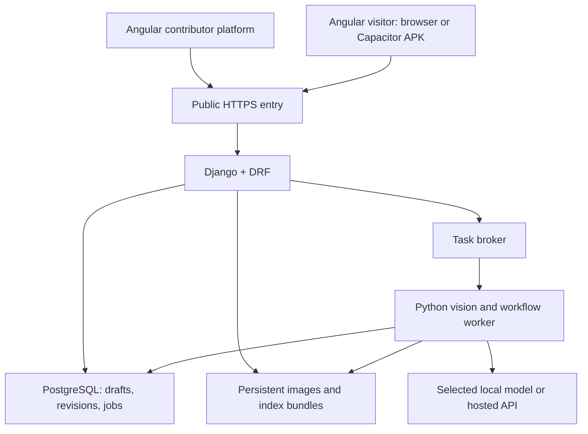

# Indoor Visual Navigation and Collaborative Mapping — Detailed Hackathon Plan

**Archived reference:** Retained for historical context. Start with the [current README](../README.md) for active decisions and document navigation. Older staffing, schedules, deployment choices and centralized preparation suggestions below are superseded where current documents differ.

**Team:** 2–4 people · **Duration:** 36 hours · **Demonstration:** an approximately 200-metre campus walk · **Updated:** October 8, 2026

This plan expands the previously proposed contributor platform, mobile camera workflow, and three navigation options. It is a development specification, not a claim that the system has already been implemented or benchmarked. Numerical budgets and acceptance gates below are proposed starting targets; record actual results and revise the supported scope accordingly. The Chinese and English editions contain the same decisions.

**Revision 2:** Django/Angular architecture, pre-event reusable modules, public deployment, account and dependency inventory, cost scenarios, and a rest-aware 36-hour schedule. **Reading guide:** §§1–17 specify the product and validation; §§18–25 are the execution handbook.

**Architecture update — October 16, 2026:** The [current architecture and dependency plan](../Indoor_Navigation_Architecture_and_Dependencies_EN.md), [infrastructure integration guide](../Indoor_Navigation_Infrastructure_Integration_EN.md), [AI/Maps integration guide](../Indoor_Navigation_AI_and_Maps_Integration_EN.md), and root [Android architecture](../Indoor_Navigation_Android_Architecture_EN.md) supersede this edition's technology, model, environment-variable and deployment choices where they differ. The active choices are Angular componentized MVC responsibilities, Django, Capacitor Android, Tiger Data PostgreSQL, Vultr/GoDaddy, Gemini-first adapters, and native cached artifact deployment without Docker. Keep personal tests/logs/SKILL files in ignored `local/`. Earlier cost and deployment comparisons below remain historical context, not the current deployment decision.

## 1. Product goal and inherited decisions

**Current assignment record:** The [Stage 1 — Map Platform assignment plan](../Indoor_Navigation_Stage_1_Assignment_Plan_EN.md) supersedes this edition's suggested A/B/C/D staffing for current work. Erfang leads frontend, Hamza basic backend APIs, Eric schema design and deployment/CI/CD, and Arjun basic map-authoring AI/MCP/tool calling. Review and reassignment remain flexible under the team's XP approach. Later stages are unassigned; historical staffing examples below do not allocate them to these named people.

Build a platform where a contributor turns a photographed floor plan into a reviewed, editable navigation graph, attaches real reference imagery, and publishes it for visitors. A visitor selects a destination, deliberately takes a photograph when localization is needed, and follows directions using the verified graph and reference views. The competition outcome is a person reaching the presentation room through a working contributor-to-visitor workflow.

| Original proposal | Implementation decision |
|---|---|
| Capacitor mobile runtime | Package the shared mobile interface as an **Android APK**, with a device-access adapter. The SDK is development tooling; the APK is the installable deliverable. |
| Deployed Web application and API | One shared service supplies map publication, reference indexing, localization, routing, and session state. |
| GPS and Google Maps outdoors | Navigate to a chosen entrance; GPS can suggest proximity. User confirmation or visual localization establishes entry into the indoor map. |
| Correct indoor map and annotations for the demo | Accept these as the demonstration prerequisites. Keep upload, AI suggestions, manual correction, and publication visible in the contributor product. |
| Manual photography | The camera can remain open; the user controls when an absolute localization request is submitted. Periodic automatic uploads are unnecessary. |
| Asynchronous results | Keep the preview responsive. Associate every result with its captured image and time; show the last confirmed location while processing. |
| Three navigation options | Preserve all three: continuous sensor/visual tracking, reference-panorama navigation, and simple photograph-based guidance. Implement the simplest option first. |
| Mobile-browser fallback | Use the same interface and API over HTTPS if native integration is not stable. |
| Open platform and measured limitations | Publish documented graph/reference interfaces and evaluation results. Treat advanced quality checks and obstruction classification as extensions. |

**Default demonstration scope:** one building and one verified floor, with a prepared route of approximately 200 metres. Support additional floors in the data model; include a real floor transition only if the chosen route requires it and its entry/exit points have been validated. A selected building or initial floor is user-provided context, not a successful visual recognition result.

## 2. Delivery priorities and navigation levels

| Priority | Deliverable | Completion evidence |
|---|---|---|
| P0 — required | Floor-plan upload, manual graph/reference editing, publication, manual photo localization, reject/retry, deterministic routing, basic directional guidance | A newly captured image selects a valid location or is rejected; the published route guides a real walk. |
| P1 — after P0 works | AI map/label suggestions, connected panoramas, polished Android packaging, alternative routes, explicit floor transitions | Each addition operates on the same published graph and survives a complete rehearsal. |
| P2 — isolated experiments | Continuous visual–inertial tracking, world-registered AR arrows, pressure-assisted floor-change detection, semantic obstruction checks | Separate demonstrations establish their accuracy and failure behavior before enabling them in the main route. |

Android packaging starts early even though final polish is P1: installation and camera compatibility are risks to discover immediately. The AI-assisted contributor workflow should be shown when it works; if automatic parsing fails, reviewed manual graph construction still preserves the contributor platform.

The user's original navigation numbering is retained:

| Option | Experience | Required information | Recommendation |
|---|---|---|---|
| **1. Continuous navigation** | Arrows/progress update as the person walks | A known start, heading, ongoing motion estimate, tracking quality, and alignment with the building map | Stretch goal. Sensor access alone is insufficient. |
| **2. Panorama/reference-view navigation** | Browse prepared views and follow annotated outgoing links; confirm progress manually or with another photograph | Correct node association, directed-edge annotations, and a known reference-view orientation | Preferred presentation enhancement after basic guidance works. |
| **3. Simple photo guidance** | A captured-photo card, a schematic arrow or short SVG animation, a 2D route, and the next landmark | Accepted node; a confirmed direction for directional instructions | Required fallback. The graphic remains a direction aid unless image geometry has been established. |

**Build order: Option 3 → Option 2 → Option 1.** Preserve the last working level whenever an experiment fails.

## 3. Architecture and responsibilities

The selected stack is **Angular + Django REST Framework (DRF) + PostgreSQL + a separate Python worker**, with **Capacitor for the Android APK**. Use Angular standalone components, services/signals, Reactive Forms and a client-rendered SPA. Django is a modular monolith: account/ownership, assets, maps, references, jobs, localization and navigation are bounded applications or services in one backend. [Django](https://docs.djangoproject.com/en/5.2/), [DRF](https://www.django-rest-framework.org/), [Angular](https://angular.dev/overview).

Primary deployment is a rehearsed public VM with Docker Compose and Caddy; paid Railway is the alternative if the team is more effective with managed deployment (§21). Serve the Web UI and developer API/auth paths under one HTTPS origin. PostgreSQL and the task broker stay private. Uploads use persistent storage; a small embedding gallery can remain an in-memory NumPy matrix loaded from a versioned index. Choose one encoder profile after the preparation comparison (§20).



The API owns authorization, validation, job identity, publication and route endpoints. The worker owns costly image normalization, indexing, embedding and optional verification; pure routing/vision functions remain separately testable. The client owns preview rendering, user confirmation and navigation state. **An asynchronous Angular request, a Django async view and a background task are different mechanisms.** Ordinary DRF endpoints plus a real task worker are sufficient. If choosing Django 6 later, its Tasks API still needs an execution backend. [Django asynchronous support](https://docs.djangoproject.com/en/5.2/topics/async/), [Django Tasks](https://docs.djangoproject.com/en/6.0/topics/tasks/), [Celery integration](https://docs.celeryq.dev/en/stable/django/first-steps-with-django.html).

Prepare two client access paths explicitly. The developer browser uses Django/allauth sessions and CSRF protection. The APK's Angular HTTP requests can have a different origin, so allow the actual tested app origin and required preflight headers using `django-cors-headers` or equivalent ingress behavior. CORS and CSRF are separate configuration concerns. P0 visitors use public maps and a scoped guest navigation session rather than native Google login. [CORS configuration](https://github.com/adamchainz/django-cors-headers).

Django Admin is an internal inspection/repair tool; the Angular editor remains the contributor interface. Under `DEBUG=false`, run `collectstatic` and serve Admin/allauth assets through a dedicated path such as `/django-static/`, distinct from Angular assets and API routing. [Django static deployment](https://docs.djangoproject.com/en/5.2/howto/static-files/deployment/).

Preload the selected map, route and required reference views on the phone. Cached guidance remains available during network loss; new server-side localization still requires a connection. Keep provider credentials server-side, bound uploads/jobs and record actual performance. The module/contract catalogue is in §18, dependencies in §19, pre-event work in §22, and environment/CI/recovery in §23.

## 4. Data model and coordinate contracts

| Entity | Minimum useful fields |
|---|---|
| Building | ID, name, optional entrance coordinates, available floor IDs |
| Floor | ID, label, original/corrected images, plan-frame ID, image dimensions, source-to-plan transform, optional scale/calibration |
| Map revision | Building/floor IDs, revision ID, schema version, draft/published status, author, publication time |
| Node | Stable ID, floor ID, normalized image coordinates, label, type, checkpoint/capture-zone description |
| Directed edge | ID, source/target IDs, walkable polyline, enabled/reviewed flags, nonnegative cost and unit, optional measured length, step-free status |
| Floor connector | Paired endpoint nodes, transition type, verified floor labels and accessibility attributes |
| Reference image | ID, node ID, view/direction ID, image path, capture session, orientation metadata, reviewer status |
| Guidance annotation | Reference ID, outgoing edge ID, image-space arrow or panorama yaw/pitch, instruction text |
| Reference index | Map revision, encoder/checkpoint ID, modality, preprocessing version, vector dimension, reference IDs |
| Localization job | Capture ID/time, session revision, map revision, status, candidates, evidence, rejection reason, timing |
| Navigation session | Destination, route revision, last confirmed node/time, previewed node, confirmation source, active capture ID |

Keep these coordinate spaces distinct:

- **Map-image coordinates:** normalized `x/y` with an explicitly defined origin and axis direction. The recommended convention is top-left origin, x rightward, y downward.
- **Abstract graph-layout coordinates:** optional positions used to arrange a relationship diagram; never substitute these for floor-plan locations.
- **Metric building coordinates:** optional. Establish scale and alignment from measured or trusted floor-plan dimensions. Normalized image distances are not automatically metres; account for image aspect ratio before any conversion.
- **Reference-image coordinates:** pixels or normalized arrow positions for a specific photograph, or yaw/pitch for a panorama.
- **Live camera/AR coordinates:** an independent camera/world frame requiring registration before projecting map geometry.

Use separate `schema_version` and `map_revision` fields. Schema compatibility does not establish that a route and reference index describe the same map. Publish a bundle atomically: graph, labels, reference associations, and index metadata must agree. Pin an active navigation session to its revision; a newer map prompts an explicit refresh and route recalculation.

Use Dijkstra routing with nonnegative costs in one consistent unit initially; manually assigned relative costs are acceptable. Keep semantic relationships such as “contains” or “adjacent to” separate from reviewed walkable edges. If an edge is blocked or a route mode is disallowed, exclude it instead of assigning an arbitrary “very large” cost. A step-free mode includes only passages verified as step-free; it does not by itself establish universal accessibility. Use distance-based A* only after coordinate units and an admissible heuristic are established. A drawn straight line must not cut through walls; encode the actual walkable path through doors and corridor bends. Without trustworthy scale and aspect ratio, omit precise distance and ETA claims.

## 5. Contributor workflow: photographed plan to published map

1. **Create a building and floor.** Upload the original floor-plan photograph and preserve it unchanged.
2. **Correct the photograph.** Let the contributor identify four corners, crop, rotate, and correct perspective. OpenCV provides `getPerspectiveTransform` and `warpPerspective`; these operations transform image geometry rather than interpreting walkability. [OpenCV geometric transformations](https://docs.opencv.org/4.x/da/d54/group__imgproc__transform.html)
3. **Generate suggestions.** OCR, a floor-plan parser, or a vision-language API may suggest room labels, wall/door candidates, and graph nodes. Store suggestions separately with provenance and review status.
4. **Review geometry and topology.** Overlay candidate annotations on the corrected image. Let contributors move/add/delete nodes, edit walkable polylines, reverse/add edges, change weights, mark closures, and assign stair/elevator endpoints.
5. **Attach reference imagery.** Capture or upload images while explicitly selecting a node and view direction. AI can suggest labels or likely associations; the contributor confirms them.
6. **Validate the draft.** Check dangling edges, missing endpoints, duplicate IDs, unreachable destinations, negative costs, missing references at visual checkpoints, and inconsistent floors. Ordinary routing-only nodes need not each have photographs. Manually verify doors and the demonstration route; automated graph checks do not prove physical passability.
7. **Build the index and publish.** Precompute reference embeddings, show build status, then expose a consistent read-only visitor bundle. Preserve the previous publication if indexing fails.

A generative image model may provide a cleaned visual preview, but it can change doors, signs, or boundaries. Do not make generated pixels the source of truth for connectivity. Preserve original/corrected/generated versions separately and obtain contributor approval of the final geometry. Real localization references should retain the scene's actual appearance.

The complete automated parser is an extension. [CubiCasa5K](https://github.com/CubiCasa/CubiCasa5k) is a floor-plan analysis candidate to test on the actual signage/photo style; it is not a ready-made route publisher. For P0, a background image with editable graph overlays is sufficient. Minimum editor interactions are pan/zoom, node selection and movement, edge creation/deletion, label/weight editing, reference attachment, route preview, and publish.

## 6. Reference collection and the meaning of “training”

Start with a **pretrained image encoder plus a building-specific reference index**. Photographing locations, assigning labels, and computing embeddings is indexing; it does not train the encoder. Fine-tuning is optional and requires a separate split, training process, and evaluation. Server-side inference is the default; neither a local Android model nor a newly trained neural network is necessary for the MVP.

The preparation comparison in §20 selects one profile: hosted Gemini image embeddings, or a local small DINOv2/OpenCLIP model. [SALAD](https://github.com/serizba/salad) and [CLIP](https://github.com/openai/CLIP) remain reference alternatives. Their published capabilities do not guarantee differentiation between similar campus corridors. Try a small comparison only during the initial proof, then freeze one checkpoint and its official preprocessing. Gallery and query images must use the same normalization, crop/resize rules, dimension, and encoder version.

**Suggested initial collection budget:** 8–12 decision checkpoints across the approximately 200-metre route, with 4–8 useful reference photographs per checkpoint: roughly 32–96 references. Choose locations at the entrance, turns, distinctive signs, floor connectors, and destination rather than placing nodes at uniform intervals. This is a collection starting point, not a minimum-image guarantee.

For each checkpoint, record:

- Node/floor ID, recognizable landmark, supported capture area, and intended approach directions.
- Several real views covering the relevant directions, modest position changes, and realistic lighting.
- Outgoing edge IDs and the correct instruction/reference arrow for each supported direction.
- Capture session and contributor identity so evaluation images can be kept separate.

Use ordinary directional photos first. A phone's partial panoramic photo is not automatically a complete spherical panorama; use a compatible panorama format or retain separate views. If deriving retrieval crops from a panorama, keep all crops from that panorama in the same data split.

Collect confusing negatives: a similar corridor, another floor, a nearby wrong doorway, and outside-map scenes. Collect fresh test images in a separate walk, preferably by another teammate. Do not count the reference images themselves or adjacent video frames as independent test evidence. Compare 1, 2, 4, and 8 references per checkpoint on a fixed development/ablation set; select the configuration, then evaluate on fresh independent final queries. Do not tune reference count on the final evaluation and continue describing it as unused test data.

## 7. Localization: image to a defensible map node

### 7.1 Recommended pipeline

1. The client captures one image and attaches a unique capture ID, capture time, session revision, and published map revision.
2. Normalize rotation, decode the image, and apply basic quality checks. Reject unreadable inputs before expensive inference when the check is reliable.
3. Compute an embedding with the frozen encoder and retrieve reference candidates using the same index configuration.
4. Aggregate evidence by **distinct map node**, then retain several candidates. Two highly ranked photos of the same node must not be treated as the two alternatives when measuring ambiguity.
5. Optionally verify candidates with OCR, a local-feature matcher, or a VLM. Restrict the verifier to supplied candidate IDs and allow “none/uncertain.” A directional sign pointing to a room is not equivalent to the camera being at that room's door.
6. Apply calibrated acceptance/rejection rules using absolute similarity, the margin between distinct-node candidates, and any corroborating evidence. A cosine score is not a probability.
7. Return `accepted`, `ambiguous`, `rejected`, or `error`, with diagnostic evidence. Route only from an accepted or explicitly user-confirmed node, recording which source established it.

Filter by a user-confirmed building/floor when appropriate. When floor identity is uncertain, search the relevant alternatives or ask for confirmation. Use route history as a soft consistency check; never force every photograph to match the expected next checkpoint. The system must remain capable of recognizing an off-route location or rejecting the image.

### 7.2 What NaviGraph contributes and what remains to implement

The inspected [NaviGraph context engine](https://github.com/lancelot2/NaviGraph/blob/1390c59edbc45fb025a47d760d85c16230f4ddf6/src/lib/engine/context.ts) converts images into scene descriptions, then matches semantic-text embeddings. Its [OpenAI calls](https://github.com/lancelot2/NaviGraph/blob/1390c59edbc45fb025a47d760d85c16230f4ddf6/src/lib/vision/openai.ts) use `text-embedding-3-small`; the inspected representation is 512-dimensional. This is a useful architecture reference, but generic wall/door descriptions may provide weak location discrimination. The [matching SQL](https://github.com/lancelot2/NaviGraph/blob/1390c59edbc45fb025a47d760d85c16230f4ddf6/supabase/migrations/20260101000002_functions.sql) selects the nearest result without a similarity rejection threshold. Its [routing/context core](https://github.com/lancelot2/NaviGraph/blob/1390c59edbc45fb025a47d760d85c16230f4ddf6/src/lib/engine/core.ts) returns location/path/context structures; it does not establish that a pedestrian camera pose has been geometrically recovered.

Implement and test distinct-node candidates, rejection, capture-time state, and the human guidance loop explicitly. Reusing a nearest-neighbour function does not prove localization reliability. The reference-to-node association is supplied by reviewed mapping data; visual inference selects among these associations rather than discovering geographic coordinates from an unlabelled photograph.

### 7.3 Position, heading, and camera pose

An accepted node provides a discrete location hypothesis. It may not identify which way the phone points, and it does not automatically provide a metric camera position or full pose. Keep these outputs separate and nullable.

If heading is uncertain, display a matching reference view and ask the user to face the identified landmark before issuing “left/right” instructions. A stable-looking arrow fixed to screen pixels is a UI element. A perspective-correct arrow on the photographed floor needs image geometry; a world-registered arrow on the live feed additionally needs continuing pose tracking. [hloc](https://github.com/cvg/Hierarchical-Localization) illustrates the extra feature matching, reconstruction, and geometric localization machinery involved.

## 8. Capture quality, asynchronous state, and stale results

Maintain `last_confirmed_node`, `confirmed_at`, `active_capture_id`, `session_revision`, and `preview_node_id` independently. Previewing the next panorama does not move the user's physical location. A destination change, map refresh, cancellation, or newer capture invalidates incompatible late results.

| State | User-visible behavior |
|---|---|
| Preview ready | Camera plus destination and last confirmed location; manual capture control. |
| Processing | Keep preview responsive; show the captured thumbnail and “Stay here while we locate this photo.” |
| Accepted at capture time | Show the recognized location and next step; apply it only to the active capture/session. |
| Ambiguous | Show a brief targeted retry instruction, such as include the door plate or face another landmark. |
| Rejected | Explain the useful reason and offer another photograph; retain the last confirmed location. |
| Timeout/service error | Stop the waiting state, allow retry, and retain cached guidance without inventing a new location. |
| User moved | Mark the observation as stale for current-position guidance and request a new capture. |

The intended operating assumption is that the user remains near the capture position until the result returns. Returning to the earlier spot is possible, but the application should not silently assume exact recovery of position and heading; a fresh photograph is the simplest confirmation. Optional motion signals can prompt a warning, but cannot reliably prove that no movement occurred.

Use inexpensive quality hints during preview: exposure, image size, blur indicators, and excessive motion. Thresholds depend on resolution and scene texture; calibrate them on the actual phone. A plain wall can have low texture without being out of focus. Block only confidently unusable captures, and otherwise provide a retryable warning.

After capture, verify decoding and orientation and recheck quality. Keep the preview running during inference; release or suspend it when leaving the camera screen or when the app lifecycle requires it. Ceiling/floor views, a column hiding the landmark, or crowds can be rejected or classified as a stretch goal. Such checks assess localization suitability; they do not establish safe obstacle avoidance. Programmatic focus controls depend on the device: query [track capabilities](https://developer.mozilla.org/en-US/docs/Web/API/MediaStreamTrack/getCapabilities) when available and provide a stable-hold/retake path when they are absent.

## 9. Detailed behavior of the three navigation options

### Option 3 — simple captured-photo guidance

After localization, show the captured photograph, recognized checkpoint, next landmark, and a small 2D route. An SVG arrow or short animation may illustrate the intended direction, provided it is labelled as a schematic when no geometric registration exists. If heading is unknown, ask the user to face a recognizable landmark or choose the matching reference view first. Avoid issuing a relative left/right turn solely from node identity.

The visitor walks the next segment, then chooses “Locate again,” “I reached this checkpoint,” or “Exit.” Manual confirmation changes session state with `confirmation_source=manual`; it must not be recorded as visual recognition. The destination uses the same distinction. A reference-photo instruction can remain visible while walking, but it represents the last confirmed checkpoint.

### Option 2 — panorama or directional-photo guidance

Build a view for each supported checkpoint and annotate every relevant outgoing edge. Store the hotspot against the reference view and edge ID; a reverse-direction edge may need a different view and instruction. [Photo Sphere Viewer VirtualTourPlugin](https://photo-sphere-viewer.js.org/plugins/virtual-tour.html) supports linked panoramas with manual link positioning, suitable for this presentation layer.

The UI distinguishes **“Previewing checkpoint B”** from **“Last confirmed at checkpoint A.”** Selecting B's panorama is browsing, not a location update. Physical progress is established by an explicit confirmation or a new image. Keep the route highlighted and provide an obvious return to the current confirmed checkpoint.

Panorama hotspots are authored in panorama coordinates. They do not automatically transfer onto a fresh phone photograph. For ordinary reference photos, use separately authored image-space arrows. Do not attempt to derive a physically correct hallway arrow merely by copying an overlay between images.

### Option 1 — optional continuous guidance

Split this into two experiments:

- **Sensor-assisted progress:** after a confirmed checkpoint and direction, estimate progress along one known edge using step/motion signals and a calibrated stride estimate. Label it estimated; reset at visual checkpoints and stop advancing when tracking becomes uncertain. An accelerometer may support gait detection; the vibration motor is an output device, not a positioning sensor.
- **World-registered AR:** use a tracking system such as ARCore, establish its relationship to the building map, and update projected instructions from the camera pose. [ARCore fundamentals](https://developers.google.com/ar/develop/fundamentals) describe visual–inertial tracking, environmental understanding, and anchors. Registering that local frame to the contributor's floor plan remains project work.

An integrated gyro does not provide dependable translation, and step counts do not establish the correct corridor. Validate turns, walking backwards, tracking loss, and re-localization before using either experiment in the live route. Continuous image processing can support tracking while manual photographs remain the intentional absolute-localization checkpoints. If the experiment fails, return to Options 2 or 3 without changing the map or reference data.

## 10. Android, browser, sensors, and outdoor handoff

### 10.1 Runtime and camera adapter

[Capacitor Android](https://capacitorjs.com/docs/android) supplies the native runtime and Android Studio integration. Install an early APK on the exact demonstration phone; pin the Capacitor/plugin/build-tool versions that work. Keep the Web build independently reachable over HTTPS.

Define an internal adapter with preview start/stop, capture, and capability-query operations. Both implementations return the same image blob, dimensions, orientation, capture time, and request ID; optional sensor snapshots can be null. These are internal interface requirements, not claims about identical plugin method names.

| Runtime | Camera path | Integration checks |
|---|---|---|
| Android APK | Compatible native preview plugin, or WebView camera access if verified | Correct rear camera, HTML overlay ordering, image orientation, pause/resume, release, and screen-sharing output. |
| HTTPS browser | `getUserMedia` preview and a snapshot of the active video stream | Permission handling, supported constraints, focus/resolution capabilities, tab lifecycle, and camera release. |
| Basic native still camera | System capture flow where appropriate | Useful fallback capture, but may temporarily leave the continuous in-app preview. |

The official [Capacitor Camera](https://capacitorjs.com/docs/apis/camera) documents a separate Android Activity for photography. The community [camera-preview](https://github.com/capacitor-community/camera-preview) plugin supports an embedded preview, but requires its own compatibility checks. Use one camera owner at a time; do not run unrelated native and Web capture sessions against the same camera.

Browser capture requires a secure context and user permission; a phone visiting an ordinary HTTP LAN address is not a dependable production path. Handle waiting, denial, and retry rather than an endless spinner. [MDN getUserMedia](https://developer.mozilla.org/en-US/docs/Web/API/MediaDevices/getUserMedia)

### 10.2 Sensors

Record actual device capabilities during setup. [Capacitor Motion](https://capacitorjs.com/docs/apis/motion) uses Web APIs; wrapping the page does not automatically supply a native barometer or a complete indoor positioning engine. Android's [sensor overview](https://developer.android.com/develop/sensors-and-location/sensors/sensors_overview) documents device-dependent sensor availability.

Use motion first for stability/tilt hints. If adding native step events or counts, check their permissions and update behavior rather than assuming frame-rate position updates. [Android motion sensors](https://developer.android.com/develop/sensors-and-location/sensors/sensors_motion)

A barometer measures pressure. Android's [altitude calculation](https://developer.android.com/reference/android/hardware/SensorManager#getAltitude(float,%20float)) depends on a reference pressure; relative changes may support a floor-change hypothesis but do not identify the correct floor. Confirm a transition through a known stair/elevator landing, a visual landmark, or explicit user input.

### 10.3 Outdoor-to-indoor state

Use `outdoor → near_entrance → entry_confirmed → indoor`, with explicit exit confirmation. A practical MVP opens Google Maps to the chosen entrance using [Maps URLs](https://developers.google.com/maps/documentation/urls/guide); this is an external navigation handoff. Embedding a full outdoor navigation experience is optional additional integration.

GPS proximity can offer “Open this building's indoor map.” It cannot alone establish crossing a doorway. Android's [geofencing guidance](https://developer.android.com/develop/sensors-and-location/location/geofencing) documents spatial and timing limitations; its background event behavior should not be confused with foreground GPS polling. Once indoors, GPS drift must not repeatedly switch the app out of indoor mode. Manual building/floor selection is sufficient for the fixed-route demonstration.

## 11. API, job, and extension contracts

Freeze a small contract before team members build separate screens. The following endpoints are proposed for this project:

| Endpoint | Responsibility |
|---|---|
| `GET /api/me` | Read the current developer identity or guest state. |
| `POST /api/sessions` | Create a scoped navigation session and guest credential when appropriate. |
| `POST /api/maps` | Create a contributor-owned draft. |
| `POST /api/maps/{id}/floorplans` | Upload source imagery and floor metadata. |
| `POST /api/maps/{id}/suggestions` | Optional AI/OCR proposals, with review state. |
| `PATCH /api/maps/{id}/draft` | Apply validated graph, label, and annotation edits. |
| `POST /api/maps/{id}/references` | Upload a photograph with explicit node/view association. |
| `POST /api/maps/{id}/publish` | Validate, index, and publish a consistent revision. |
| `GET /api/maps/{id}/versions/{revision}` | Read the published graph and asset manifest. |
| `GET /api/maps/{id}/versions/{revision}/export` | Export a documented reusable bundle. |
| `POST /api/localizations` | Submit a capture; return a job ID promptly. |
| `GET /api/jobs/{job_id}` | Read progress, outcome, or a terminal error. |
| `POST /api/routes` | Calculate a route for explicit start, destination, revision, and mode. |
| `POST /api/sessions/{id}/confirm` | Record manual/visual confirmation without conflating them. |

Keep one valid frontend observation (`active_capture_id`) per visitor; this is distinct from the number of in-flight backend jobs. A new capture invalidates older results and cancels obsolete queued work where possible. Already running work may finish; a separate resource cap controls whether the replacement can queue or returns a retryable busy state. Deduplicate repeated submissions by capture ID. Use the selected bounded task broker and polling; no separate real-time messaging service is required.

Public map reads may be anonymous. Costly localization, job lookup and confirmation must belong to a server-created guest navigation session with an unguessable session credential, or an authorized developer. Enforce ownership, per-session submission/concurrency limits, and project-wide request/spending ceilings; creating many guest sessions must not bypass the project limit. A session credential is scoped access, not a Google login or a provider API key.

Persist a dispatch state such as `dispatch_pending` before enqueueing after the database transaction commits. If the broker call fails, retain `dispatch_failed` and retry through a bounded recovery scan or explicit retry path; do not leave a job indefinitely queued. Use an execution timeout/lease and idempotent result update so worker failure or repeat delivery has a defined recovery path. These dispatch/execution details do not change the public localization decision fields.

Illustrative response, with synthetic IDs and scores:

```json
{
  "job_id": "job_017",
  "job_state": "completed",
  "capture_id": "capture_017",
  "captured_at": "2026-10-17T14:00:00Z",
  "session_revision": 3,
  "map_revision": "map_demo_v1",
  "decision": "accepted",
  "observation": {
    "floor_id": "floor_1",
    "node_id": "junction_03",
    "heading_status": "unknown",
    "camera_pose": null
  },
  "match": {
    "score_kind": "cosine_similarity",
    "top_node_score": 0.82,
    "distinct_node_margin": 0.12,
    "calibration_id": "pilot_v1"
  },
  "position_validity": "capture_time_only"
}
```

The example score is not 82% confidence and is not a proposed universal threshold. On rejection, return no accepted node and supply a useful reason. Separate infrastructure failure from visual ambiguity. Include latency and model/index identifiers in logs without exposing provider secrets.

For future developers, document `Localizer(image, context) → observation`, `Router(graph, start, destination, mode) → route`, and `GuidanceRenderer(observation, route, references) → view`. These are proposed extension boundaries. Export actual geometry and metadata rather than an editor's private UI state; distinguish bundled assets from remotely fetched ones.

## 12. Thirty-six-hour schedule, integration gates, and rest

The primary execution plan assumes prepared and permitted reusable modules, a rehearsed public deployment, working accounts and one selected localization profile. **Hour 4 means a narrow real product loop, not every feature or a fully polished 200-metre route.** The preparation gate is in §22. If it is not met, resolve the failed critical dependency first and reduce optional work.

### 12.1 First four hours: Agent-assisted integration

| Time | Parallel execution | Required exit evidence |
|---|---|---|
| 0–0.5 h | C establishes repository baseline, contracts, locks, environment mapping and deployment target; all owners take bounded Agent tasks | One agreed schema/build baseline; imported modules and origins recorded |
| 0.5–1.5 h | A connects contributor components and tiny graph; B connects capture/browser/APK; C connects identity/storage/jobs; D connects actual encoder, index and route functions | Each module works through the same fixtures and service contracts |
| 1.5–2.5 h | Integrate login → upload/reference binding → publish → phone photograph → real localization job → route/result | At least two reviewed checkpoints and one usable route; actual capture and model output, with timing |
| 2.5–4 h | Repair integration failures; deploy tagged baseline; install APK; verify reject/retry and one stale-result case | Public working loop on the real phone, persisted data and known build/map/index versions |

Keep optional AI parsing, panorama and continuous tracking behind feature flags until they work. Confirm that the prepared AI workflow still accepts/returns its schema, but failed parsing must not stop manual map publication. If APK preview/build has a concrete unresolved blocker, use the HTTPS browser at the hour-4 gate and assign native repair a bounded later task. A simulated localization response cannot satisfy this gate. If genuinely usable matching is absent, hours 4–6 focus on data/encoder rejection before feature expansion.

### 12.2 Product iteration and rest schedule

| Time | Shared milestone | Work and staffing |
|---|---|---|
| 4–8 h | Extend from the small loop to the intended route; first actual walk and network check | Three streams: A data/editor; B phone acceptance; C+D workflow/integration/performance |
| 8–14 h | Repair confusing scenes, missing annotations, graph errors and capture UX; complete required reference coverage | Fix wrong guidance and broken flows before adding presentation features; short integration checkpoints |
| 14–18 h | Stable P0 release; tested screen sharing; initial evaluation and issue handoff | Stop broad model/library exploration; snapshot map/index and prioritize remaining defects |
| 18–24 h | Bounded backend/vision fixes, automated checks and presentation preparation | **A+B take six continuous hours of rest**; C+D work within documented ownership and available device support |
| 24–30 h | Contributor/mobile fixes, route checks, visual polish and demo materials | **C+D take six continuous hours of rest**; A+B use the stable backend and avoid changes requiring sleeping owners |
| 30–33 h | All owners return; final configuration freeze, fresh evaluation and remaining full-route rehearsals | Critical fixes only; new localization/data changes trigger the affected fresh checks |
| 33–35 h | Final APK/browser verification, export, submission and presentation rehearsal | Keep the known-good live deployment; prepare labelled recording fallback |
| 35–36 h | Submission buffer, model/service readiness and final handoff | Feature freeze; no new framework or navigation mode |

These relative hours must fit the actual opening, submission and presentation schedule. Adjust the rest windows to the event's overnight period without removing the six-hour allowance. Also reserve roughly **two hours per person** across the event for meals, short breaks, ceremony/coordination and transitions. Thus a planning capacity is approximately **28 focused hours per person**, or **56/84/112 person-hours for 2/3/4 people**; this includes implementation, field testing and presentation work, not pure coding time.

### 12.3 Ownership and team-size adjustment

| Team | Allocation and consequence |
|---|---|
| 4 people | A: contributor editor/data; B: mobile/navigation/field acceptance; C: Django/auth/jobs/CI/integration; D: vision/AI/index/routing. C owns shared schema and release decisions; a backup handles routine deployment while C rests. |
| 3 people | A: contributor/data; B: mobile/field; C: backend/vision/deployment. Rotate six-hour rest blocks, for example A 12–18, B 18–24, C 24–30. Only two streams are actively staffed during these periods; constrain P1 accordingly. |
| 2 people | A: Angular/editor/mobile and data; B: Django/vision/deployment; alternate field collection and integration. Example rest A 16–22, B 22–28 leaves one awake. Commit to Option 3 and basic manual editing; three continuous streams and the four-person feature scope are not realistic. |

One module owner diagnoses each reported failure. Preserve the previous good publication while data is corrected. Review issues through capture/trace IDs and reproduce them before changing model thresholds. The three streams are stable responsibilities, not a promise of three simultaneous staffed teams throughout all 36 hours. Agent task boundaries and handoffs are specified in §25.

## 13. Validation protocol and proposed acceptance gates

### 13.1 Dataset and measurements

Separate reference collection, threshold-development captures, and final evaluation captures by session. Freeze configuration before the final walk. A manageable initial evaluation is **three fresh positive queries at each of 8–12 checkpoints**, plus **10–20 difficult/unknown inputs**. Identify which difficult images should still be localizable and which are genuinely unsupported. Include every critical turn.

If later fixes change the model, thresholds, reference gallery, or localization decision logic, freeze the new configuration and repeat the affected evaluation with fresh photos unused in tuning. Retain earlier failures in the record. Purely cosmetic UI fixes require relevant display checks, not automatically a new model evaluation.

Report counts as well as ratios:

- **Raw node accuracy:** correct top-ranked nodes divided by supported queries, before rejection; useful for diagnosing retrieval quality.
- **Accepted precision:** correct accepted queries divided by all accepted queries. Report undefined if none are accepted.
- **Supported-query coverage:** accepted supported queries divided by all supported queries; report wrong accepts separately.
- **Unknown false-accept rate:** unsupported queries assigned an accepted node divided by all unsupported queries.
- **Operational measures:** capture-to-result median/p95 latency, retakes, timeout/error count, total walking time, manual assistance, and visual versus manual arrival confirmation.

Zero errors in a small sample is a report of observed performance, not a statistical guarantee. If a node describes a capture region, evaluate against that declared region; do not convert node-classification accuracy into centimetre-level positioning accuracy.

### 13.2 Checks that resolve the main risks

| Test group | Required cases |
|---|---|
| Map and routing | Missing endpoints, disconnected destination, reversed edge, blocked edge, inconsistent revision, and a step-free request with unknown or stair-only connectivity. |
| Visual ambiguity | Similar doors/corridors, another floor, reverse approach, a nearby wrong branch, and a mid-route restart. |
| Image quality | Blur, low light, overexposure, partial obstruction, ceiling/floor framing, and small/unreadable signs. |
| Client lifecycle | Permission denied then retried; three cold starts; twenty successive captures; background/resume; correct rotation and screen sharing. |
| Asynchrony | Delayed result after a newer capture, destination change, cancellation, network interruption, and map revision change. |
| Physical route | Three complete rehearsals across at least two operators, including a short deviation or turn-back. |
| Contributor workflow | Start from an uploaded plan, save edits, attach references, publish, reload as a visitor, and verify that draft edits do not change the active publication. |

Proposed usability targets are **median latency ≤3 seconds, p95 ≤5 seconds**, **accepted precision ≥95%**, and **supported-query coverage ≥80%** on the declared evaluation set. They are targets to test on the actual phone/server/network, not expected model guarantees. Small sample sizes make these percentages coarse; always show the numerators and denominators.

The principal live-demo release gate is **no confidently wrong instruction at a critical turn in the final rehearsals**, plus three completed rehearsals within the available presentation arrangement. Record every manual recovery. If this gate fails, narrow the capture zones, reduce the route's supported complexity, or drop to explicit photo guidance; do not conceal failures by excluding awkward images after seeing their outcomes.

## 14. Risk controls and fallback ladder

| Risk | Primary control | Fallback |
|---|---|---|
| AI changes map structure | Preserve source images; approve graph edges separately | Manual graph overlays on the original/corrected plan. |
| Similar scenes yield a wrong node | Distinct-node retrieval, hard negatives, calibrated rejection, targeted recapture | Restrict to clearly described checkpoints; explicit manual location selection is labelled as such. |
| Correct node, wrong direction | View-direction annotations and landmark alignment | 2D route plus a reference image; no unverified left/right instruction. |
| User moves while processing | Capture/session IDs and stale-result handling | Retake; retain the last confirmed node. |
| Native camera/build fails | Install early; test preview and lifecycle on the exact phone | Same workflow in the HTTPS browser. |
| Network/cold-start delay | Warm the chosen model, preload reference assets, bound jobs, test the actual network | Cached route/reference guidance; manual confirmation until online localization returns. |
| Floor cannot be identified | Known connector nodes and explicit confirmation | Single-floor demonstration. |
| Continuous tracking drifts | Separate experiment with tracking-quality checks | Disable Option 1 and retain Options 2/3. |
| Data or version mismatch | Model metadata, publication snapshot, session revision | Continue the last consistent publication and rebuild affected references. |
| Feature expansion consumes testing time | Fixed integration gates and feature freeze | Drop P2, then optional P1 features; retain P0's full user journey. |

**Fallback order:** continuous AR → sensor progress → panoramas → simple reference-photo guidance. These are navigation presentation reductions; localization still needs its own pass/fail gate. Separately, native APK may fall back to browser, AI parsing to manual graph creation, and automatic position confirmation to explicitly labelled manual confirmation.

If even restricted checkpoints cannot produce reliable visual results by the early gate, decide whether the demonstration can honestly be presented as a contributor map/reference-guidance platform. If visual localization remains the central promise, switch to a different project early rather than spending the remaining event on an unverified claim.

## 15. The approximately 200-metre live demonstration

Use the real phone, final deployment, selected network, and exact screen-sharing arrangement during rehearsal. Native camera previews can interact differently with recording/streaming surfaces, so verify the projected view rather than assuming that an image visible on the phone will be visible to judges. Use an existing sharing tool; building a streaming platform is outside scope.

Estimate the duration with:

`total time = 200 metres / walking speed + number of stops × average stop time + transitions + stream delay`

For illustration, 1.2 m/s gives about 167 seconds of walking; six 5-second stops add 30 seconds before transitions. These are planning assumptions, not measurements of the venue or participant. The [2025 presentation format](https://hack-the-valley-x.devpost.com/) allowed four minutes plus one minute of Q&A; verify the 2026 allocation. A long route may need to run while another teammate presents.

Suggested presentation sequence:

1. Explain the visitor's problem and show the photographed plan and reviewed map publication.
2. Start the walk with a fresh photograph and expose the resulting checkpoint and next instruction.
3. At a decision point, show a new localization, reference guidance, and the corresponding route segment.
4. Show a genuine retry or explain a recorded failure case without deliberately disrupting the live walk.
5. Arrive at the presentation room; distinguish visual confirmation from a manual arrival button.
6. State the supported route/capture conditions, measured results, reused components, and the team's new work.

Prepare a clearly labelled recorded fallback of the same build and route, plus screenshots of the map publication and evaluation counts. A recording is a backup presentation asset, not evidence of a live service response. An optional observer page can display current session status; it must not covertly change the walker's location.

The [2026 themes](https://hackthevalley.io/#themes) provide a reasonable connection through AI for Social Impact and Future of Sustainable Cities. Frame the benefit around usable campus wayfinding and lower map-maintenance effort; substantiate step-free routing before emphasizing accessibility. The [2025 rules](https://hack-the-valley-x.devpost.com/rules) allowed public libraries/APIs, but the current event's rules govern what can be prepared or reused. Existing awards are presentation evidence, not a formula for winning.

## 16. Reuse, integration checks, and project contributions

“Reusable” below means a concrete candidate or design reference, not that it has already been integrated into this application. Check code, model-weight, and dataset licences separately before redistribution.

| Source | Useful role | Boundary or verification required |
|---|---|---|
| [NaviGraph bundle code](https://github.com/lancelot2/NaviGraph/blob/1390c59edbc45fb025a47d760d85c16230f4ddf6/src/lib/bundle/build.ts) and [tests](https://github.com/lancelot2/NaviGraph/blob/1390c59edbc45fb025a47d760d85c16230f4ddf6/tests/bundle.test.ts) | Reference binding, graph organization, and self-describing export design | Adapt for immutable map revisions, human route modes, floor frames, and the new visitor workflow. |
| [NaviGraph routing](https://github.com/lancelot2/NaviGraph/blob/1390c59edbc45fb025a47d760d85c16230f4ddf6/src/lib/graph/algo.ts) | Small graph implementation to inspect | Its inspected traversal uses unconstrained undirected BFS; replace/adapt it for directed, weighted, reviewed walkable edges. |
| [NaviGraph ONNX encoder](https://github.com/lancelot2/NaviGraph/blob/1390c59edbc45fb025a47d760d85c16230f4ddf6/sdk/python/navigraph/embedding/onnx.py) | Optional offline image-encoder integration reference | Caller-supplied model and compatible preprocessing are required. Do not search its hosted text index with incompatible image embeddings. |
| [Anyplace](https://github.com/dmsl/anyplace) | Existing authoring, visitor applications, and API platform | Reference its product/data architecture; the two-role concept itself has precedent. |
| [NAVI](https://github.com/NgWY02/Indoor-Navigation-for-visually-impaired) | Admin/user navigation workflow with visual retrieval and verification | Substantial overlap; evaluate real deployment behavior rather than repeating README accuracy claims. |
| [InVision](https://github.com/LikithSh3tty/Indoor-Mall-Navigation) | Photo/OCR localization, route guidance, uncertainty and label review | Mall-specific assumptions and campus transfer need validation. |
| [Snap&Nav](https://github.com/chestnutforestlabo/Snap-and-Nav) | Human-navigation research connecting floor-map photographs and graph guidance | Assess released modules separately; a research pipeline is not automatically a deployable contributor service. |
| Pretrained encoders, OpenCV, panorama renderer | Feature extraction, image correction, and reference-view presentation | Use the linked sources in §§5–10; check licences and test runtime, preprocessing, and actual route performance. |
| [CubiCasa5K licence](https://github.com/CubiCasa/CubiCasa5k/blob/c34440266665a11f4484eb06cd2e4b7d72ad76c1/LICENSE) and parser | Optional floor-plan interpretation experiment | Licence, checkpoint, dependency, and input-domain checks remain; keep it outside the core delivery path. |

The main custom work is the reviewed contributor workflow, correct reference associations, version-consistent publication, human-facing uncertainty and recovery, direction-aware guidance, and measured real arrival. These are identifiable engineering and product contributions. None should be labelled globally unprecedented without a much broader prior-art study.

## 17. Final deliverables and subsequent iterations

Before presenting, have:

- A deployed contributor interface and visitor interface, plus the tested Android APK or HTTPS browser entry.
- The original/corrected floor plan, reviewed graph, reference manifest, and one identifiable published revision.
- The frozen encoder/preprocessing configuration and reproducible reference-index build instructions.
- Working capture, localization, route, rejection, retry, and explicit confirmation behavior.
- Documented API/export contracts and attribution of reused code, models, and data.
- Evaluation counts, device/network conditions, recorded limitations, and three rehearsal records.
- A live demonstration script and clearly labelled backup recording.

After the event, expand through independent buildings and operators, larger viewpoint/lighting variation, stronger unknown-place rejection, map change management, and accessibility validation. Attempt geometric localization or continuous AR only after the simpler service has measurable reliability. The long-term platform can support replaceable localizers and richer navigation renderers while preserving the reviewed map and publication contract.

## 18. Module boundaries, ownership, and integration order

The execution strategy is to prepare and verify reusable modules before the event, integrate a small deployed product during hours 0–4, and use the remaining time for data, field acceptance, and product improvement. Four hours is an integration target for a prepared team, not an estimate for learning the entire stack or validating an unknown localization algorithm. The engineering estimates in this plan are proposals, not measured results.

### 18.1 Preparation scope and provenance

Keep one provenance record for third-party code, existing generic modules, project-specific preparation, and work completed during the event. The [2025 rules](https://hack-the-valley-x.devpost.com/rules) required project work during the weekend while allowing public libraries, APIs, and pre-existing open-source components; the public [2026 website](https://hackthevalley.io/) confirms October 16–18 but the complete current reuse rules were not established in this review. Check the current requirements once and disclose imported work accurately. The preparation programme below is the primary engineering plan; if particular prepared deliverables cannot be imported, retain the compatibility findings and implementation instructions, allocate additional assembly time, and reduce P1 scope.

### 18.2 Module catalogue

Ownership letters are consistent throughout this edition: **A = contributor/data; B = mobile/navigation; C = backend/integration/deployment; D = vision/workflows**. Each module has one owner; a reviewer may belong to another stream.

| ID / priority | Module and submodules | Stable output / integration boundary | Owner and predecessor |
|---|---|---|---|
| M00 / P0 | Contracts: IDs, DTOs, error catalogue, fixtures, feature flags, API schema | Versioned OpenAPI; example graph, capture, job, observation and route payloads | C; first |
| M01 / P0 | Developer identity: Google login, local account, session, ownership checks | Authenticated developer and authorized map access; guest navigation session separately scoped | C; M00 |
| M02 / P0 | Asset storage: upload validation, original/corrected images, thumbnails, references, checksums | Asset ID and storage metadata; no provider-specific URL as permanent identity | C; M00 |
| M03 / P0 | Floor-plan import: orientation, four-corner selection, crop, perspective transform, source preservation | Corrected image plus source-to-plan transform; optional scale explicitly verified | A; M02 |
| M04 / P0 | Graph authoring: node/edge CRUD, walkable polylines, labels, costs, closures, floor connectors, draft validation | Reviewed draft graph in agreed coordinates; editor state remains private to UI | A; M00/M03 |
| M05 / P0 | Reference annotation: node/view binding, capture-zone notes, direction, outgoing-edge arrows, split manifest | Reviewed `ReferenceAsset` and `GuidanceAnnotation`; reference/development/evaluation provenance | A, reviewed by D; M02/M04 |
| M06 / P1 | AI suggestions: OCR/labels, plan candidates, optional scene hints, schema validation, review queue | Typed proposals with source/version; never a direct published-graph mutation | D; M00/M02/M03 |
| M07 / P0 | Index and publication: embeddings, node grouping, manifest/hash, build status, validation, atomic promotion | Immutable map/reference/index bundle; previous publication stays usable | C; D supplies the index builder; M04/M05/M13 |
| M08 / P0 | Capture/device: camera adapter, preview, rotation, image compression, lifecycle, network events | `CapturePacket`; one camera owner; optional sensor hints can be null | B; M00/M19 |
| M09 / P0 | Localization: image checks, encoder adapter, Top-k, distinct-node aggregation, rejection, optional reranking | `LocalizationResult` with separate node, heading, pose, decision and provenance | D; M05/M07/M13 |
| M10 / P0 | Routing: weighted directed graph, allowed-edge filtering, destination lookup, route steps | `RoutePlan` pinned to revision; verified route geometry and constraints | D, API exposed by C; M04 |
| M11 / P0 | Visitor journey: destination, manual capture, waiting, accepted/ambiguous/rejected/error, guidance, arrival/exit | State machine separating confirmed position, preview and capture-time observation | B; M08/M09/M10 |
| M12 / P0 handoff, P1 embedded map | Outdoor entry: entrance coordinates, Maps URL, optional JS map/routes, GPS hint, indoor confirmation | Confirmed building/floor and entrance; outdoor API does not create indoor coordinates | B; M00/M11 |
| M13 / P0 | Jobs: enqueue after database commit, claiming, timeout, bounded retries, deduplication, result lookup | Persistent job state; repeated delivery cannot create duplicate publication or overwrite newer captures | C; M00/M02 |
| M14 / P0 | Observability: trace IDs, stage timings, failure reasons, model/index/build IDs, cost counters | Logs and measurement CSV; redacted diagnostics, no provider secrets | C with D; M00/M13 |
| M15 / P0 | Delivery: public HTTPS, containers, migrations, CI/CD, readiness, rollback, APK build/install | A tagged server image, browser URL and installable APK tied to one build | C with B; M00 |
| M16 / P0 | Evaluation: independent queries, difficult negatives, network/lifecycle tests, route rehearsals | Reproducible report linking failures to capture/map/model/build versions | B field lead, D metrics; all P0 |
| M17 / P1 | Reference-tour rendering: directional photos, panorama projection, hotspots, route-linked views | A replaceable renderer using the same graph and confirmation rules | B; M05/M11 |
| M18 / P2 | Continuous tracking: sensor calibration, optional VIO/AR, frame registration, quality/loss handling | Explicit estimated progress or registered pose; isolated feature flag | B/D; stable P0 and dedicated proof |
| M19 / P0 | Design system: tokens, navigation shell, controls, dialogs, status cards, responsive states | Angular components receiving typed inputs and emitting user actions | A/B; M00 |

The table covers planned product modules; §19 lists selectable dependencies rather than requiring every candidate to be installed. Treat calibration/evaluation as work, not a feature that an imported model automatically supplies.

### 18.3 Repository and contract discipline

Use one repository with bounded directories: `apps/web/` for Angular and its Capacitor project, `apps/api/` for Django and task entry points, `packages/vision/` for Python image/encoder/retrieval functions, `contracts/` for OpenAPI and fixtures, `infra/` for deployment, `evals/` for manifests and test results, and `docs/` for decisions/runbooks/provenance. Put raw photos and model weights in designated storage, not routine source commits. A tiny routing service may live in the Django application but should accept a plain graph rather than an HTTP request.

Freeze these contracts first:

- `MapRevision`: coordinate frame, nodes, directed edges, constraints, schema and revision IDs.
- `ReferenceAsset`: asset/node/view IDs, orientation and capture metadata, split, review state, checksum.
- `CapturePacket`: image, capture/session/revision IDs, capture time, dimensions, runtime/build, optional hints.
- `LocalizationResult`: accepted/ambiguous/rejected/error, nullable accepted node, distinct-node candidates, evidence, heading/pose availability, capture and index IDs.
- `RoutePlan`: confirmed start, destination, ordered edges/instructions and matching map revision.
- `JobStatus`: queued/running/completed/failed/cancelled; localization decision is a separate field when completed.

Use [drf-spectacular](https://drf-spectacular.readthedocs.io/en/latest/) to publish an API schema, then validate a typed Angular client or generate one with a compatible [TypeScript Angular generator](https://openapi-generator.tech/docs/generators/typescript-angular/). C owns schema migrations and lockfile changes; other owners submit a proposed contract change before changing shared fields. Algorithms import data objects and storage interfaces, while provider SDK objects stay inside adapters. UI components use services instead of calling competing endpoints independently.

The dependency order is **contracts + delivery → auth/storage/jobs + UI/camera → graph/reference publication → localization/routing → full visitor journey → field evaluation → optional enhancement**. Work can run in parallel against fixtures, but replacing a fixture with a live implementation is an explicit acceptance step.

## 19. Dependency and toolchain inventory

### 19.1 Selected architecture and dependency policy

Use an **Angular client, Django/DRF modular backend, PostgreSQL, and a separate Python worker**, with Capacitor packaging the navigation client for Android. The tables identify the primary choice and bounded alternatives; do not install every alternative. Keep runtime dependencies separate from development tools, and retain upstream licenses when extracting reusable code.

| Area | Primary packages / components | Optional dependencies and boundaries |
|---|---|---|
| Web application | `@angular/core`, `common`, `compiler`, `platform-browser`, `router`, `forms`; TypeScript, RxJS; Angular CLI/build/compiler-cli | Standalone components, services/signals, Reactive Forms and HttpClient. NgRx, SSR and Ionic UI are unnecessary for P0. |
| UI primitives | Angular components with shared CSS design tokens | Angular Material/CDK if selected before the event; match Angular major. Use one component/icon system. |
| Floor-plan editor | SVG/image layers, pointer events, typed graph state | Konva or Fabric.js after a targeted trial; avoid changing renderer during the competition. |
| API and database | `Django`, `djangorestframework`, `psycopg[binary]`, PostgreSQL | `django-filter` for richer queries. PostGIS is optional; indoor graph coordinates can be ordinary numeric fields. |
| Authentication | `django-allauth` Google provider with standard server redirects; Django sessions for developer Web login | Allauth headless or direct Google Identity Services + Python `google-auth` are alternatives. Do not run two identity implementations. |
| API contract | `drf-spectacular`; committed OpenAPI document and example payloads | OpenAPI Generator's `typescript-angular` target for the client; explicitly set target Angular version and validate generated output. |
| Background jobs | Celery with Redis transport/client, separate worker process | One queue system only. Make costly tasks idempotent; return a job ID and poll from Angular. |
| Image preprocessing | Pillow, NumPy, `opencv-python-headless` | Install one OpenCV package variant; use `opencv-contrib-python-headless` only if a selected algorithm requires it. |
| Inference | Selected encoder adapter: `google-genai` for cloud embeddings **or** a pinned local PyTorch/ONNX stack | A cloud-only profile does not require PyTorch. Local weights/preprocessing and any feature matcher need runtime/quality checks. |
| AI workflows | Selected provider SDK or `httpx`; structured response validation | Pydantic for shared non-Django schemas. A small deterministic workflow can avoid a separate orchestration platform. |
| Routing | NetworkX or a small tested Dijkstra implementation | A* if its heuristic is valid. Preserve direction, closures, access constraints and map revision. |
| Object storage | Django storage interface; persistent VM volume in the primary deployment | `django-storages[s3]` / `boto3` for S3-compatible storage. Container-local uploads are unsuitable when deployments replace containers. |
| Cross-origin and static assets | `django-cors-headers` for actual APK origins; Django `collectstatic` and dedicated Caddy static route | CSRF configuration is separate. WhiteNoise is an alternative static-file implementation, not an additional requirement. |
| Runtime | Docker; Gunicorn API process; worker process; PostgreSQL/Redis | Caddy on a VM for HTTPS/static files/reverse proxy. A managed platform may already provide ingress and TLS. |
| Verification | Ruff; pytest/pytest-django or Django's runner; Angular runner; Playwright | ESLint/angular-eslint and Prettier as agreed. Prioritize contracts, map publishing, rejection and deployed flows. |

Django/DRF, [allauth's Google provider](https://docs.allauth.org/en/latest/socialaccount/providers/google.html), [Celery's Django integration](https://docs.celeryq.dev/en/stable/django/first-steps-with-django.html), [drf-spectacular](https://github.com/tfranzel/drf-spectacular) and the [Angular API generator](https://openapi-generator.tech/docs/generators/typescript-angular/) provide reusable foundations. Generators and AI output still require integration verification. [Gunicorn](https://gunicorn.org/) and [Caddy](https://caddyserver.com/docs/automatic-https) serve different roles; adding Caddy is unnecessary when managed ingress already covers them.

### 19.2 Compatibility freeze

These are **candidate compatible families**, not an already tested lockfile. Freeze exact patched versions after a clean install, cloud deployment and device trial.

| Component | Candidate baseline | Verification requirement |
|---|---|---|
| Python/Django | Python 3.12 + Django 5.2 LTS; compatible DRF/allauth releases | Validate inference wheels and model runtime on the deployment architecture. Django supports Python 3.12, but that does not establish every ML dependency's compatibility. |
| Angular | Supported Angular 21.x, TypeScript >=5.9,<6.0, RxJS 7.x | Keep core/CLI/compiler/UI library majors aligned. Angular 22.0.x instead requires TypeScript >=6.0,<6.1 and newer Node minimums. |
| Node | A current patched Node 22.x satisfying all chosen packages | Angular 21 supports ^22.12; the Angular 22.0.x row requires ^22.22.3 or ^24.15. Capacitor 8 requires >=22. |
| Capacitor | Matching 8.x core/CLI/Android plus compatible plugin releases | Inspected camera-preview metadata requires core >=8.0.2. Pin exact releases rather than installing unrestricted `latest`. |
| Android | Studio >=2025.2.1; SDK platform 36; platform-tools; template's Gradle wrapper | Capacitor 8 baseline: minSdk24, compile/targetSdk36, AGP8.13.0, Gradle8.14.3. Confirm actual generated files. |
| JDK | JDK21 candidate in local and CI builds | Capacitor plugin guidance recommends21. Record both Java and Gradle versions; an IDE's JDK can differ from the terminal's. |

Sources: [Angular matrix](https://angular.dev/reference/versions), [Django5.2](https://docs.djangoproject.com/en/5.2/releases/5.2/), [DRF requirements](https://www.django-rest-framework.org/), [Capacitor environment](https://capacitorjs.com/docs/getting-started/environment-setup), [Android migration baseline](https://capacitorjs.com/docs/updating/8-0), [Java guidance](https://capacitorjs.com/docs/updating/plugins/8-0), [camera-preview peer dependencies](https://github.com/capacitor-community/camera-preview/blob/master/package.json).

Commit `package-lock.json` and a Python lockfile, use clean locked installs in CI, preserve the Gradle wrapper, and record model hashes plus preprocessing/index versions. Keep a reuse manifest containing upstream URL, commit, license, local changes and preparation date.

### 19.3 Android and browser adapters

| Capability | Dependency / API | Acceptance condition |
|---|---|---|
| Native shell | `@capacitor/core`, `@capacitor/cli`, `@capacitor/android` | Install the actual APK on the demo phone. No iOS package is required for the Android milestone. |
| Persistent camera | `@capacitor-community/camera-preview`; browser `getUserMedia` adapter | Preview stays usable during upload; test permissions, first frame, crop/orientation, pause/resume and screen sharing. |
| Capture fallback | Official `@capacitor/camera` | It launches a separate Android Activity. Current documentation includes `takePhoto`/`MediaResult` changes, so old `getPhoto` tutorials need version checks. |
| App/network state | `@capacitor/app`, `@capacitor/network` | Track lifecycle/network changes, bounded retries and stale capture results. A reported connection does not prove API reachability. |
| Outdoor position | `@capacitor/geolocation` or browser geolocation | Request location permission; check error/accuracy; confirm entry into a building manually. |
| Browser handoff | `@capacitor/browser` when needed | Verify external authentication and callback return instead of opening Google authorization inside the app WebView. |
| Motion/haptics | `@capacitor/motion`; optional `@capacitor/haptics` | Motion currently uses Web APIs; haptics is feedback output. Neither is an indoor positioning solution. |
| Pressure/altitude | Optional native Android sensor bridge | Check physical `TYPE_PRESSURE` availability; return unavailable when absent. Use relative pressure only as a supporting hint. |
| Reference panorama | P1: Photo Sphere Viewer core/virtual-tour/markers and compatible Three.js | Wrap the viewer in Angular; clean up on exit; browsing a reference image must not update confirmed physical location. |

See [camera-preview](https://github.com/capacitor-community/camera-preview), [Camera](https://capacitorjs.com/docs/apis/camera), [App](https://capacitorjs.com/docs/apis/app), [Network](https://capacitorjs.com/docs/apis/network), [Geolocation](https://capacitorjs.com/docs/apis/geolocation), [Browser](https://capacitorjs.com/docs/apis/browser), [Motion](https://capacitorjs.com/docs/apis/motion), and [Android pressure sensors](https://developer.android.com/develop/sensors-and-location/sensors/sensors_environment).

Build Angular, point Capacitor `webDir` to the output directory actually containing `index.html`, sync Android, and run the pinned Gradle build. The distributable is an **APK**; an SDK is a different artifact. A debug/internal APK can be installed directly for testing without a Play Store launch. Keep package ID and signing identity stable across updates, particularly when native authentication/API restrictions use certificate fingerprints. [Capacitor setup](https://capacitorjs.com/docs/getting-started); [Android build/install](https://developer.android.com/build/building-cmdline).

### 19.4 Accounts, tools and pre-event UI implementation

Prepare Google Cloud/Auth Platform branding, authorized domains, Web client settings and exact callbacks; add an Android client only when native login is needed. The primary developer flow sends Angular users to the backend login flow, initiates Google sign-in with the normal CSRF-protected allauth flow, returns to Django and creates a session. If allauth is mounted at `/accounts/`, register the exact deployed `/accounts/google/login/callback/` URL. Basic sign-in uses `openid`, `email`, `profile`; Maps activation/billing is separate. Headless authentication is optional and still needs provider callbacks. Google forbids authorization in a developer-controlled embedded user agent; native sign-in needs a supported platform flow. [Google setup](https://developers.google.com/identity/gsi/web/guides/get-google-api-clientid); [OAuth policy](https://developers.google.com/identity/protocols/oauth2/policies); [allauth Google](https://docs.allauth.org/en/latest/socialaccount/providers/google.html).

For Figma/Codex, prepare the actual team accounts, extension installation, repository access and Figma MCP authentication. Official documentation says the IDE extension supports MCP while the plugin system is not available there; verify the client's own connection. [Codex MCP](https://learn.chatgpt.com/docs/extend/mcp?surface=cli); [plugin surfaces](https://learn.chatgpt.com/docs/plugins).

Pre-event UI work should produce named Figma frames, tokens, reusable Angular components and explicit accepted/rejected/loading/offline states. Obtain the exact Figma frame's context and screenshot, then prompt Codex to use Angular standalone components, the repository's tokens, shared DTOs and existing route/state conventions. Figma context often defaults to React/Tailwind; translate it into the selected Angular architecture. Compare real mobile and desktop renders after each small iteration. Static screens still need live API and camera integration. [Official Figma-to-code workflow](https://learn.chatgpt.com/use-cases/figma-designs-to-code); [Figma framework controls](https://developers.figma.com/docs/figma-mcp-server/tools-and-prompts/).

Development costs depend on existing access. Figma offers a free Starter tier; its checked MCP limits include20 read calls/month for Starter/View/Collab and200/day,10/minute for Education. Verify the account's seat and current limit before relying on frequent iterations. Paid seats use the current [pricing page](https://www.figma.com/pricing/), including its billing-period distinction; [MCP quotas](https://developers.figma.com/docs/figma-mcp-server/rate-limits-access/) are separate from AI credits. Confirm Codex usage headroom and application API billing separately; do not assume one subscription funds the deployed app's provider calls.

### 19.5 Configuration and build acceptance

Use `.env.example` containing names/placeholders only. Angular/APK configuration such as API base URL and public client identifiers is exposed in distributed assets; Django secret keys, OAuth client secrets, provider keys, database/queue credentials and signing secrets belong in server/CI secret storage. Public configuration still needs appropriate domain/package/API restrictions.

CI should perform locked installs, schema validation, focused tests, Angular production build, API/worker image build, controlled migration, deployment, readiness and one deployed smoke flow. The Android job adds JDK/SDK setup, Capacitor sync, Gradle build and APK artifact retention. Trigger APK rebuilds for relevant changes or releases. Show frontend/API/APK commit identifiers so field reports are reproducible. Record cold/warm timings and failure counts from the real phone, including network transitions and screen sharing; no latency or build-success claim is established by this plan alone.

### 19.6 Install profiles and exact package names

Use one locked base environment plus selected extras. Python base: `Django`, `djangorestframework`, `django-allauth[socialaccount]`, `psycopg[binary]`, `django-cors-headers`, `drf-spectacular`, `celery[redis]`, `gunicorn`, `pillow`, `numpy`, `opencv-python-headless`, `networkx`, `pydantic`, `httpx`, and the selected settings loader such as `django-environ` if used. Cloud AI adds `google-genai` and/or `openai` only for enabled adapters; S3 storage adds `django-storages[s3]`/`boto3`.

Local vision adds matching `torch`/`torchvision` and the chosen model package (`open_clip_torch` for OpenCLIP, or the pinned DINOv2 implementation); use `onnxruntime` as a verified CPU alternative or `onnxruntime-gpu` only with matching GPU libraries. Optional OCR adds `pytesseract` **plus** the Tesseract binary/language data, or `paddleocr` **plus** a compatible `paddlepaddle` runtime. Optional LightGlue adds the pinned upstream package and its selected detector dependencies. Model weights are separate artifacts.

Angular package short names in the table mean their full `@angular/...` names. Optional UI/render packages are `@angular/material`, `@angular/cdk`, `konva` **or** `fabric`; P1 panoramas use `@photo-sphere-viewer/core`, `@photo-sphere-viewer/virtual-tour-plugin`, optional `@photo-sphere-viewer/markers-plugin`, and compatible `three`. Dev-only tools include `@playwright/test`, `pytest-django`, `ruff`, and the selected linter/formatter. This is a profile inventory, not a single install-everything command. Resolve all transitives into the lockfile after the smoke test. [Konva](https://github.com/konvajs/konva), [Fabric](https://github.com/fabricjs/fabric.js), [allauth installation](https://docs.allauth.org/en/latest/installation/quickstart.html), [Tesseract wrapper](https://github.com/madmaze/pytesseract).

Use `psycopg[binary]` after verifying a wheel for the deployment platform. Plain `psycopg` requires system `libpq`; `psycopg[c]` also requires a compiler, development headers and `pg_config`. Select one installation profile and verify database access inside the built image. [Psycopg installation](https://www.psycopg.org/psycopg3/docs/basic/install.html).

## 20. Vision workflows, reuse candidates, and validation

### 20.1 One encoder profile and a small, versioned reference gallery

P0 uses pretrained inference and reference indexing. Collecting photographs, assigning node IDs, computing descriptors, and calibrating acceptance thresholds does **not** train an indoor model. Fine-tuning is outside the required delivery path. Before the event, compare at most two profiles using identical reference/query splits and the intended public deployment, then freeze one:

| Profile | Dependencies and deployment | Decision criterion |
|---|---|---|
| Hosted image embedding | `google-genai`, server-side key, [Gemini Embedding 2](https://ai.google.dev/gemini-api/docs/models/gemini-embedding-2); thin public Python worker | Removes local model operation, but requires measured API latency, quota, and corridor discrimination. |
| Local image embedding | Compatible `torch`/`torchvision` plus **one** small [DINOv2](https://github.com/facebookresearch/dinov2) or [OpenCLIP](https://github.com/mlfoundations/open_clip) checkpoint; optionally a verified ONNX export | Select only if the target CPU/GPU achieves useful accuracy, memory use and latency. Preload weights. |

Gemini Embedding 2 accepts PNG/JPEG, supports 128–3072 dimensions, and documents at most six images and 8192 input tokens per request. Multiple parts may be aggregated into one embedding: initially embed each reference separately, or verify the SDK's separate-`Content` batching behavior. Never combine different checkpoints accidentally. [Official input and aggregation documentation](https://ai.google.dev/gemini-api/docs/embeddings).

For the proposed 32–96-image gallery, begin with L2-normalized NumPy vectors and exact cosine Top-k retrieval. This is a scope decision, not a measured latency promise. Add [pgvector](https://github.com/pgvector/pgvector) or Faiss only when a concrete scaling requirement warrants it. Freeze the model/provider identifier, exposed model version, client image processing, output dimension/normalization, and index revision. For local inference, also pin the source commit, checkpoint file/hash and full model preprocessing. For hosted inference, record SDK/API version and request settings; provider weights and private preprocessing are not available and are not required configuration. A new encoder requires reindexing; image descriptors cannot query NaviGraph's incompatible semantic-text index.

### 20.2 Workflow boundaries and replaceable modules

Use **Celery tasks calling typed Python functions**, with Pydantic validation, as the primary orchestrator. Keep Django request handling, model adapters, graph logic and Angular presentation separate. Direct official SDK calls are enough for these bounded workflows. [LangGraph](https://github.com/langchain-ai/langgraph) is an optional MIT-licensed extension for genuinely stateful branching. Dify/n8n are not mandatory; introducing another workflow platform adds deployment and callback work. [Dify's licence](https://github.com/langgenius/dify/blob/main/LICENSE) is modified Apache-2.0 with additional conditions, so do not label it plain Apache-2.0.

| Workflow | Ordered modules | Output authority |
|---|---|---|
| Floor-plan import | Preserve original → EXIF/corner correction → optional regions/doors/OCR/VLM proposals → manual edit → graph validation | Proposed geometry stays draft until contributor approval. |
| Reference publication | Upload real photos → node/view binding → quality checks → encoder → index validation → activate revision | Publish graph and compatible index together. |
| Localization | Capture → quality check → encoder → Top-k references → competing-node aggregation → optional verifier → acceptance policy | Return `accepted`, `ambiguous`, `rejected`, or `error`. |
| Navigation | Accepted or explicitly confirmed node → reviewed directed graph → weighted path → instruction template → renderer | Deterministic graph constraints decide the route. |

[OpenCV perspective transforms](https://docs.opencv.org/4.x/da/d54/group__imgproc__transform.html) preserve an explicit mapping between source and corrected coordinates. Generative cleanup remains a separate visual proposal; original/corrected assets remain reviewable. [Gemini](https://ai.google.dev/gemini-api/docs/structured-output) and [OpenAI](https://developers.openai.com/api/docs/guides/structured-outputs) structured outputs help constrain schemas, but valid JSON does not establish correct doors or connectivity. AI proposals cannot directly overwrite a published graph.

Define pure seams such as `rectify_plan`, `propose_annotations`, `encode_image`, `retrieve_references`, `verify_candidate`, `decide_location`, and `plan_route`. Result records include capture/session/map/index identifiers, evidence, timings, and nullable heading/pose. Keep raw similarity scores separate from calibrated probabilities. Compare competing **nodes**, not merely two photos of the same node.

Node identity, facing direction, and metric camera pose remain separate. If heading is unknown, use a schematic or reviewed reference image with orientation confirmation. Local feature matches alone do not provide map-registered AR. [hloc's pose code](https://github.com/cvg/Hierarchical-Localization/blob/master/hloc/localize_sfm.py) requires a 3D reconstruction, 2D–3D matches and query-camera parameters; a 2D floor plan does not supply them.

### 20.3 Reuse and dependency matrix

“Candidate” means inspected or proposed for integration, not already validated in this application. Record source commit, licence, modifications, model provenance and upstream test/example used in `REUSE_MANIFEST.md`.

| Source | Reusable part | Required boundary / licence |
|---|---|---|
| NaviGraph [`extract_graph`](https://github.com/lancelot2/NaviGraph/blob/1390c59edbc45fb025a47d760d85c16230f4ddf6/extractor/navigraph_extractor/pipeline.py) and [pipeline tests](https://github.com/lancelot2/NaviGraph/blob/1390c59edbc45fb025a47d760d85c16230f4ddf6/extractor/tests/test_pipeline.py) | Import the pure Python extractor into the worker; NumPy, OpenCV, Pillow, Pydantic | Apache-2.0 at inspected commit. Tests include dilation-generated passage candidates: reviewed human walkability is still required. Its optional FastAPI service is unnecessary inside Django. |
| NaviGraph [bundle](https://github.com/lancelot2/NaviGraph/blob/1390c59edbc45fb025a47d760d85c16230f4ddf6/src/lib/bundle/build.ts), [ONNX adapter](https://github.com/lancelot2/NaviGraph/blob/1390c59edbc45fb025a47d760d85c16230f4ddf6/sdk/python/navigraph/embedding/onnx.py), [routing](https://github.com/lancelot2/NaviGraph/blob/1390c59edbc45fb025a47d760d85c16230f4ddf6/src/lib/graph/algo.ts) | Reference-binding/export patterns and encoder interface | Caller supplies the ONNX model and compatible preprocessing. Replace unconstrained undirected BFS with reviewed, directed, weighted human routing. |
| [OpenCV](https://github.com/opencv/opencv) / [NetworkX](https://github.com/networkx/networkx) | Rectification, quality measurements, optional geometry / shortest paths | Apache-2.0 / BSD-3-Clause. Use one OpenCV distribution, normally `opencv-python-headless` on the server. Edge semantics and thresholds remain custom work. |
| [DINOv2](https://github.com/facebookresearch/dinov2) / [OpenCLIP](https://github.com/mlfoundations/open_clip) | Frozen image encoder and documented transforms | Ordinary DINOv2 code/weights: Apache-2.0; its XRay/Cell extensions have separate terms. OpenCLIP code: MIT; check selected weights separately. Pin versions, especially OpenCLIP's changing main branch. |
| [ONNX Runtime](https://onnxruntime.ai/docs/get-started/with-python.html) | Optional CPU/GPU inference runtime | MIT; model not included. Choose one CPU/GPU package and verify export parity. |
| [LightGlue](https://github.com/cvg/LightGlue) | P1 Top-k pair verification; official notebook and benchmark | Matcher code/weights: Apache-2.0. SuperPoint has separate restrictive terms; DISK/ALIKED alternatives also require exact licence records. Full pipeline timing matters. |
| [Tesseract](https://github.com/tesseract-ocr/tesseract) / [PaddleOCR](https://github.com/PaddlePaddle/PaddleOCR) | Optional room/floor-sign evidence | Tesseract requires engine binary, language data and wrapper; Paddle requires its matching runtime/models. Repeated room labels need building/floor context. |
| [CubiCasa5K](https://github.com/CubiCasa/CubiCasa5k) | Optional parser experiment using notebook/evaluation script | [CC BY-NC 4.0](https://github.com/CubiCasa/CubiCasa5k/blob/master/LICENSE); legacy Python/PyTorch/CUDA environment and campus-domain transfer need validation. Keep outside P0. |
| [SALAD](https://github.com/serizba/salad) / [hloc](https://github.com/cvg/Hierarchical-Localization) | Later place-recognition / reconstructed 6-DoF pipeline | SALAD GPL-3.0; hloc Apache-2.0 with separately licensed submodules. Avoid importing either entire research stack during integration. |
| [Photo Sphere Viewer](https://photo-sphere-viewer.js.org/plugins/virtual-tour.html) | P1 panorama, manually positioned links and markers | [MIT](https://github.com/mistic100/Photo-Sphere-Viewer). Angular wrapper owns setup/cleanup; previewed panorama node remains distinct from physical arrival. |

Keep code, weight and dataset licences separately. Copied permissive code still needs its required notices; “public repository” alone does not establish unrestricted distribution rights.

### 20.4 Pre-event validation and retained outputs

- Run the selected upstream example, then a real photographed plan or corridor pair. Save exact commands, dependency locks, expected output and limitations; a synthetic example proves only that tested path.
- Build gallery/query manifests from separate sessions, including similar corridors, wrong floors and unknown views. Select the encoder and rejection policy using development images; report accepted precision, coverage, counts and latency on fresh evaluation images.
- Run the complete phone → public HTTPS API → durable job → real encoder → route → Angular display chain. Simulated results can check contracts but cannot pass the vision gate.
- Measure upload, queue wait, cold model load, preprocessing, embedding, retrieval, verification and total display time. Record image size, hardware, provider/model, connection and retries. Use trace IDs and per-device monotonic durations rather than subtracting unsynchronized clocks.
- Exercise stale-result races, duplicate upload, timeout/429, map revision mismatch and Wi-Fi transitions, with screen sharing if planned. Changing a threshold or gallery after evaluation requires fresh evaluation evidence.

Retain `reference_manifest`, `encoder_manifest`, evaluation fixtures, a reproducible index command, typed adapter contracts and a failure report. Preserve these learning artifacts and the origin of every extracted module.

### 20.5 Provider economics

Account acquisition, model prices and transparent cost examples are consolidated in §24. Select a provider using observed localization quality, latency and operational reliability as well as cost.

## 21. Service accounts, APIs, and deployment choices

Prices and provider constraints below were checked on **2026-10-08**. They describe preparation choices; no account has been created, service deployed, charge incurred, or latency measured through this plan. Select one primary deployment and rehearse it before the event. Provider account access, billing approval, API quotas and working credentials are preparation deliverables.

### 21.1 Primary deployment: a rehearsed public VM

Use a **DigitalOcean bundled Basic Droplet with 4 GiB RAM and 2 shared vCPUs**, Docker Compose and Caddy. Caddy serves the compiled Angular SPA, serves collected Django assets at `/django-static/`, and proxies `/api/`, `/accounts/` and `/admin/` to Django. A separate Python worker imports the localization package; PostgreSQL and Redis remain on the private Compose network. Store images through a storage adapter backed by a persistent volume or optional R2 bucket. Keep an external export of the reviewed map, annotations and references. This starting size requires a real model-memory and latency check; upgrade if measurements justify it.

Prepare DNS for a controlled subdomain, public ports 80/443, restricted SSH access, persistent Caddy certificate storage, database volumes and a restart policy. Build application images in CI, then deploy immutable image tags. Avoid compiling Angular or repeatedly downloading model weights on the demonstration VM. A single VM is economical and straightforward but has a single failure domain and requires the team to own updates, backups and recovery. [DigitalOcean bundled specifications](https://www.digitalocean.com/pricing/droplets), [Docker Compose production guidance](https://docs.docker.com/compose/how-tos/production/), [Caddy HTTPS requirements](https://caddyserver.com/docs/automatic-https).

### 21.2 Provider accounts and acceptance checks

| Account or service | Obtain and configure | Required preparation evidence |
|---|---|---|
| DigitalOcean | Account/team access, payment method, instance quota, region, SSH key and controlled domain | Phone on Wi-Fi and cellular reaches public HTTPS; services survive restart; known-good release can be restored. [Deployment setup](https://docs.digitalocean.com/products/droplets/getting-started/recommended-droplet-setup/) |
| GitHub + Actions + GHCR | Repository collaborators, workflow permissions, registry access and scoped deployment identity | Build, publish, pull and deploy a commit-tagged image. CI may use `GITHUB_TOKEN` for GHCR with the required package permissions; VM credentials stay in deployment secrets. [Official workflow](https://docs.github.com/en/actions/tutorials/publish-packages/publish-docker-images) |
| Google Maps Platform | Cloud project, billing for the selected paid-capable APIs, quotas, distinct browser/server keys | A real map load and, if selected, a route request work from the deployed origin. Do not depend on unapproved promotional credits. [JavaScript setup](https://developers.google.com/maps/documentation/javascript/get-api-key), [Routes setup](https://developers.google.com/maps/documentation/routes/get-api-key) |
| Google OAuth | Branding, audience, basic identity scopes, Web client and exact redirect URI | Real login, logout, session persistence and map-owner authorization work on the public domain. [Web OAuth](https://developers.google.com/identity/protocols/oauth2/web-server) |
| Cloudflare R2, optional | Account with R2 subscription, Standard bucket and scoped S3-compatible credentials | API and worker can read the same object; deployment does not lose uploads. Direct browser upload, if used, needs short-lived signed URLs and explicit CORS. [Account/access setup](https://developers.cloudflare.com/r2/get-started/) |
| AI provider or workflow host | Selected model/workflow access, API key, quota, spending controls and callback configuration | A genuine image request returns the agreed schema; log latency, usage and failures. Use the provider choices and adapters in §20. |

The shared `.env.example` records names and safe placeholders. Backend secrets include `DJANGO_SECRET_KEY`, `DATABASE_URL`, `CELERY_BROKER_URL`, OAuth client secret, AI keys and storage credentials. Public configuration includes API base URL, browser Maps key, release SHA and feature flags. **Angular environment files and APK assets are public configuration, not secret storage.** Keep separate development and deployment values; validate required variables at startup without printing their contents.

### 21.3 Maps: choose the smallest integration that serves the demo

| Integration | Acquisition and behavior | Boundary |
|---|---|---|
| Maps URL handoff | Build an HTTPS Maps URL with `api=1` and entrance coordinates or Place ID; no API key required | Opens Google Maps app/browser. Useful outdoor fallback; it does not provide embedded navigation or automatic indoor relocalization. [Maps URLs](https://developers.google.com/maps/documentation/urls/get-started) |
| Maps JavaScript API | Enable API and restrict the browser key to the intended origins and API | Displays the outdoor map; avoid recreating it on every UI update. |
| Routes API | Enable API, use a server credential, set request quota and requested fields | Optional in-app outdoor directions. Indoor routing uses the team's own graph. [Routes billing](https://developers.google.com/maps/documentation/routes/usage-and-billing) |

Browser Maps keys are visible by design and need referrer/API restrictions. Server keys stay private. A native Android Maps SDK key uses the appropriate package/signing restrictions; a JavaScript map inside Capacitor is not automatically an Android-native integration. Verify the actual integration and origin on the phone. Budget alerts notify; configured API quotas constrain usage. [Credential restrictions](https://developers.google.com/maps/api-security-best-practices), [cost controls](https://developers.google.com/maps/billing-and-pricing/manage-costs).

Keep required attribution visible. Routes API results shown on a map must use a Google map under the applicable policy. Do not assume Google tiles or route responses can be permanently cached or redistributed as an open map; Place IDs are an explicit storage exception. Offline support should primarily cache the team's own floor plans, graph and reference images. [Routes policies](https://developers.google.com/maps/documentation/routes/policies).

### 21.4 OAuth: keep authentication off the visitor's critical path

For P0, developers log in through the ordinary web browser, while visitors access public published maps without native login. Use Django/allauth with basic identity scopes only. Register the **exact** deployed callback, for example `https://demo.example.org/accounts/google/login/callback/` when using that allauth mount path. Choose one browser session or headless integration pattern and verify CSRF, cookies and logout; authentication does not itself establish map-editing ownership. [allauth Google provider](https://docs.allauth.org/en/latest/socialaccount/providers/google.html).

Google prohibits OAuth authorization in developer-controlled embedded WebViews. If native login is added, use the appropriate external-browser/native flow and validated return link; do not embed a web client secret in the APK. Testing ordinarily has test-user/expiry restrictions, but Google explicitly exempts requests limited to basic identity scopes/Sign in with Google from the usual trusted-user-list and seven-day behavior. Organization policies can still block an account, so test real team accounts. [OAuth policies](https://developers.google.com/identity/protocols/oauth2/policies), [Testing exceptions](https://support.google.com/cloud/answer/15549945?hl=en).

### 21.5 Backup hosting and connectivity

**Railway paid** is the deployment alternative if VM operations remain difficult after rehearsal: separate API, worker, PostgreSQL and Redis services, private service addresses, managed public HTTPS and persistent storage. Disable optional Serverless sleeping for the demo; it can introduce cold starts and a first-request 502. Confirm plan collaboration permissions instead of sharing account credentials. [Django deployment](https://docs.railway.com/guides/django), [sleeping behavior](https://docs.railway.com/deployments/serverless).

Render paid is another valid option, but it is not the primary plan. Render Free sleeps after 15 idle minutes, takes approximately one minute to wake, uses an ephemeral filesystem and has a 30-day Free Postgres expiry; its free-service list excludes background workers. [Free limits](https://render.com/docs/free).

Public HTTPS makes the API reachable from different networks; it does not eliminate a dead zone or interrupted upload. Android can change the default network and later terminate old connections. Use capture/job IDs, idempotent submission, bounded retries, reconnection recovery and stale-result rejection. Preload owned map data, and label the last confirmed position with its time. A network-status flag is a hint, not proof of API reachability. Test screen sharing separately from the navigation requests. [Android network changes](https://developer.android.com/develop/connectivity/network-ops/reading-network-state), [Capacitor Network](https://capacitorjs.com/docs/apis/network).

## 22. Pre-event preparation and readiness gates

The [event](https://hackthevalley.io/) is scheduled for October 16–18, 2026. The following October 8–15 sequence is a suggested preparation window, not a requirement to spend every day full-time. Parallelize by ownership and stop broad library exploration once one viable route is demonstrated.

| Window | Preparation work | Tangible exit evidence |
|---|---|---|
| Oct 8–9 | Agree scope/owners; choose public host, API providers, phone and camera path; register accounts and callback domain; install Python/Node/Android tools | Account-access register; exact candidate versions; a browser and Android build from a clean checkout; current reuse requirements recorded |
| Oct 9–10 | Run upstream examples/tests on representative inputs; inspect licences; test cloud versus local image encoding; identify extractable modules | `reuse-manifest` with source commit, licence, entry point, inputs/outputs, changes and smoke commands; recorded successes/failures |
| Oct 10–12 | Freeze shared DTOs; build/prepare adapters and module skeletons; create Figma states, then Angular components; define prompts and schemas | UI inventory and visual fixtures; schema fixtures; encoder/provider adapter with a callable interface; skeleton endpoints/jobs |
| Oct 12–13 | Integrate a draft project on public HTTPS: developer login, image upload, map call/handoff, AI proposal, reference indexing, photo query, route/result | One traceable end-to-end experiment on real services; restart/redeploy retains data; actual callback URLs work |
| Oct 13–14 | Walk with the actual phone; test Wi-Fi/cellular/handoff and screen sharing; record cold/warm timings and confusing scenes | Latency/error CSV; tested device/runtime; decision on primary encoder and host size; limited supported capture conditions |
| Oct 14–15 | Rehearse clean setup and CI deployment; check account limits and balance; freeze dependencies/contracts; prepare bounded Agent tasks and fallback paths | Reproducible setup runbook; first-deploy/APK build timing; known-good release; event backlog and rest handoff |

### 22.1 Run and extract upstream code deliberately

For each chosen component: obtain the pinned source and permitted weights; run the official minimal example; pass a representative input; inspect output coordinates and failure cases; wrap only the needed functionality; repeat the test through your adapter. Record `upstream_url`, `commit_or_version`, `code_license`, `weight_license`, `dataset_license_if_used`, `entry_point`, `expected_input`, `output_schema`, `patches`, `validation_command`, and `observed_status`. Keep licence files/notices with copied material. Do not import an entire competing application solely to reuse one algorithm.

Use a red/amber/green readiness table: **green** means callable on the chosen runtime with observed output; **amber** means documentation reviewed but a required integration remains; **red** means currently blocked. A code review is not a green deployment result. Once localization, camera, login and deployment are green, stop adding substitute frameworks without an identified failure.

### 22.2 Static UI and Angular component preparation

Prepare these screens/states: contributor dashboard, floor editor, reference annotation, publish validation, destination selector, camera capture, pending/accepted/ambiguous/rejected/error/offline results, photo guidance, arrival and exit. Include narrow-screen controls, loading/empty/error variants, long room labels and one-handed capture. Separate camera overlays from the preview surface.

Use Figma for named frames, spacing/colour/type tokens, component variants and interaction references. In Codex Extension, specify Angular standalone components, repository CSS tokens and the frozen DTOs; request one frame/component at a time, compare a rendered screenshot, then connect its data service. Figma context is not proof that generated code follows the chosen framework. A static page is ready when its states are reproducible from fixtures; the live page still needs device and API acceptance. Tool setup and seat/MCP limits are in §19.

### 22.3 Draft-project integration matrix

| Path | Real preparation check | What to record |
|---|---|---|
| Identity | Developer browser → Google → actual Django callback → session → protected map request | Success/denial, callback host/path, session/CSRF behavior; never log token values |
| Outdoor map | Angular → restricted Maps JS key or verified Maps URL; optional backend Routes request | Which SKU is enabled, successful render/handoff, denied-origin behavior and quota |
| Contributor AI | Floor image → public upload → background schema-constrained proposal → review UI | Parse success, invalid JSON handling, queue/provider latency, model/prompt version and usage |
| Localization | Real photo → published-reference index → actual selected encoder → distinct-node candidates → decision | Ground truth, accepted/rejected outcome, timings, byte size, capture/index IDs |
| Navigation | Accepted/confirmed node → deterministic route → correct next landmark → arrival | Node versus heading evidence, closures, stale-result handling, manual confirmation provenance |
| Operations | CI → public deploy → migrations → readiness → Android build/install → same API | Clean-build duration, restore/redeploy persistence, signing continuity, rollback result |

Mocks can unblock UI development and deliberately exercise error states; label them and exclude them from performance/accuracy evidence. If route-specific collection is unavailable before the event, use a generic small scene dataset for plumbing and reserve time for actual building data. That confirms integration only, not campus localization accuracy.

### 22.4 Ready-to-start checklist

Before relying on the four-hour integration target, demonstrate a clean-machine setup, a real public request from the phone, a functioning developer login, one selected encoder's real output, a correct tiny graph route, an installable or browser fallback build, a verified environment configuration, and one actual network-recovery test. Leave quantitative results as **not yet measured** until this happens. A failed critical check becomes the first event task and reduces optional scope.

## 23. Environment, CI/CD, network recovery, and performance

### 23.1 Configuration inventory

Maintain a committed `.env.example` with names and explanations, a private local `.env`, and deployment/CI secrets. Angular runtime configuration and APK resources are visible to users; only public identifiers and deliberately restricted client keys belong there. The names below are proposed project configuration keys and need an explicit settings mapping; installing a library does not automatically make it read them.

| Group | Proposed keys | Where and preparation check |
|---|---|---|
| Public client | `PUBLIC_API_BASE_URL`, `PUBLIC_APP_ORIGIN`, `PUBLIC_MAPS_BROWSER_KEY`, `PUBLIC_BUILD_SHA`, enabled feature flags | Angular public runtime configuration; same API contract in APK; browser Maps key restricted by API/origin |
| Django | `DJANGO_SECRET_KEY`, `DJANGO_DEBUG=false`, `DJANGO_ALLOWED_HOSTS`, `CSRF_TRUSTED_ORIGINS`, `APP_PUBLIC_URL` | Server only; confirm host, HTTPS/proxy settings and cookie behavior |
| CORS/static | `CORS_ALLOWED_ORIGINS`, permitted request headers, credential policy, `STATIC_URL=/django-static/`, `STATIC_ROOT` | Test the actual APK origin and `OPTIONS`, including authorization/idempotency headers; collect/serve Django static files separately from Angular |
| Database/queue | `DATABASE_URL`, `CELERY_BROKER_URL`, optional `CELERY_RESULT_BACKEND` | Server/worker only; private service addresses; application Job table remains authoritative |
| OAuth | `GOOGLE_OAUTH_CLIENT_ID`, `GOOGLE_OAUTH_CLIENT_SECRET`, `GOOGLE_OAUTH_CALLBACK_URL` | Server identity configuration; callback must match registered URI and mounted allauth path |
| Outdoor server API | `GOOGLE_MAPS_SERVER_KEY` | Only if server-side Routes is used; separate API restrictions from the browser key |
| AI | `GEMINI_API_KEY` or `OPENAI_API_KEY`, `VISION_PROVIDER`, `VISION_MODEL`, `PROMPT_VERSION`, `AI_REQUEST_TIMEOUT_SECONDS` | Worker/server only; create keys in the correct billed project and test enabled model/quota |
| Encoder/index | `ENCODER_BACKEND`, `ENCODER_MODEL_ID`, `ENCODER_CHECKPOINT_PATH`, `ENCODER_SHA256`, `PREPROCESS_VERSION`, `EMBEDDING_DIM`, `INDEX_ROOT` | Frozen configuration; reference/query compatibility check at index load |
| Assets | `STORAGE_BACKEND`, `MEDIA_ROOT`, or `S3_ENDPOINT_URL`, `S3_BUCKET`, `S3_REGION`, `S3_ACCESS_KEY_ID`, `S3_SECRET_ACCESS_KEY` | Persistent directory for one VM, or scoped S3-compatible credentials; write/read/redeploy test |
| Limits | `MAX_UPLOAD_BYTES`, `MAX_IMAGE_PIXELS`, `MAX_INFLIGHT_JOBS_PER_SESSION`, `JOB_TIMEOUT_SECONDS`, `QUERY_RETENTION_HOURS` | Enforced by API/worker; choose values after a representative-image test |
| Delivery | `DEPLOY_HOST`, `DEPLOY_USER`, `DEPLOY_SSH_KEY`, registry credentials/permissions, `IMAGE_TAG` | CI secret store and least-required deployment account; never bake credentials into an image |
| Android signing | `ANDROID_KEYSTORE`, `ANDROID_KEY_ALIAS`, signing passwords, fixed application ID | Protected local/CI signing inputs; stable certificate for updates and relevant Google restrictions |

For a starting **application policy**, trial JPEG captures with a 1024–1600-pixel long edge, roughly 150–500 KB where detail survives, a 5 MB upload cap and one valid active capture observation per session. A separate in-flight-job cap governs resource use and replacement requests (§11). These are tunable targets, not provider limits; small signs may require higher resolution or a prompted crop. Record an explicit processing deadline and retry count. Align proxy, API, worker and provider limits so the first timeout produces a meaningful user state.

For cloud encoders, `ENCODER_CHECKPOINT_PATH` and `ENCODER_SHA256` are not required. Validate only the selected profile; record provider/model, SDK/API version, request settings and client preprocessing instead of unavailable provider weights.

### 23.2 CI/CD scaffold and operational sequence

Use one familiar pipeline, rehearsed on the draft project. [Docker Compose production guidance](https://docs.docker.com/compose/how-tos/production/) supports a distinct production configuration; [GitHub's container-publishing workflow](https://docs.github.com/en/actions/tutorials/publish-packages/publish-docker-images) provides a reference for image build/push.

| Stage | Required behavior | Acceptance / recovery |
|---|---|---|
| Pull request | Install from locks; Angular build/type checking; Django system/schema checks; targeted graph/job/permission tests | Reject contract drift, incompatible dependencies and broken builds before merge |
| Image build | Build Web assets and API/worker images; tag by commit SHA; reuse safe dependency layers | Same reviewed source identifies server and APK; no model download on first user capture |
| Deploy | Serialize deployments; pull exact image; run migrations once; start/restart only changed application services | Keep database/media volumes; no concurrent Agent deployments |
| Readiness | Check database, queue/worker availability, selected index and model/provider configuration | Liveness alone is insufficient; distinguish process alive from localization ready |
| Deployed smoke | Read published map, submit one designated test capture, poll result, obtain route | Small bounded check; report its actual provider/API cost and use a non-user fixture |
| Android artifact | Build Angular → Capacitor sync → Gradle APK build → retain named artifact | Install on phone; preserve app ID/signing; APK build success alone does not prove camera behavior |
| Release/rollback | Record commit/image/index/map IDs and last known-good tag; back up data before schema change | Revert compatible app image if needed; database rollback requires an explicit backup/migration plan |

Run `npm ci`, the pinned Python lock workflow, and the generated Gradle wrapper on consistent tool versions. Use Linux CI for Android when available. Keep model binaries outside repeated APK artifacts; bound artifact retention. Public standard GitHub-hosted runners are free; private-repository allowances and paid overages are detailed in §24. Pin workflow actions and base images to reviewed versions/digests before the event rather than upgrading them during it.

For the single-VM deployment, expose only the reverse proxy's public HTTP/HTTPS and the team's restricted administrative access. Run Django `collectstatic`, set a dedicated `STATIC_URL` such as `/django-static/`, and provide those collected files to Caddy through a read-only directory or image layer. Caddy serves Angular and Django assets on their separate paths and forwards `/api/`, `/accounts/`, and `/admin/` correctly; SPA fallback must not turn failed API calls into `index.html`. For the APK, add the observed WebView origin to the CORS allowlist and test preflight with the real authorization/idempotency headers; use credentialed CORS only when the chosen auth path needs cookies. Align Angular/Django CSRF cookie/header names for developer sessions. [CORS middleware](https://github.com/adamchainz/django-cors-headers); [Django static files](https://docs.djangoproject.com/en/5.2/howto/static-files/deployment/). Keep Django/worker/database/queue on the private container network. Persist database, media, model/index and TLS state deliberately. Store a database/reference backup separately from the running application's writable directories. Automatic HTTPS still requires correct DNS and reachable validation endpoints. [Caddy HTTPS](https://caddyserver.com/docs/automatic-https)

Preload a local model once per intended worker, not in every API process. Start with bounded worker concurrency; indexing can block localization on a single worker, so build/publish before the walk or split indexing into resumable batches. Separate priority queues do not pre-empt an already running long task. Check RAM at peak startup and inference, not only idle usage. Reconcile committed jobs whose broker dispatch failed, and expire/recover worker leases using the idempotent recovery rules in §11; exercise both failure cases in the draft project.

### 23.3 Crossing Wi-Fi coverage during the 200-metre walk

The reason to use public HTTPS is stable reachability beyond a particular development machine/subnet. Distance alone does not determine whether a LAN server is reachable. Public deployment does not prevent a network transition from terminating an existing connection; Android documents that new connections follow the new default network while old connections can be terminated. [Android network-state guidance](https://developer.android.com/develop/connectivity/network-ops/reading-network-state)

Implement a bounded recovery sequence: preserve the current captured Blob and capture ID; retry an interrupted upload with the same idempotency key; if the job already exists, query it instead of creating duplicate inference; wait/back off on temporary connectivity failure; discard incompatible late results; request a fresh photo if the person moved. Network-status events are hints, so verify API reachability rather than relying solely on an “online” icon.

Preload the project's own published map, route and required reference images. When offline, retain the last confirmed location and allow clearly labelled manual/reference guidance; do not invent a new visual fix. Cache Google's content only as its applicable terms permit. Test campus Wi-Fi, cellular/hotspot if available, Wi-Fi-to-cellular transition, captive portal, interrupted upload, lost polling response and app background/resume. Verify screen sharing separately because a healthy API does not ensure a continuous video stream.

### 23.4 Latency, quality, and optimization record

Measure `capture → usable result rendered` on the phone with its monotonic clock. Add server spans for request handling, queue delay, image processing, encoder/provider call, retrieval, optional verification and result persistence. Record polling delay separately. Parent/child spans may overlap; do not sum the same duration twice or subtract unsynchronized phone/server wall clocks.

Use a CSV with: `run_id, capture_id, build_sha, map_revision, index_id, encoder_id, provider_tier, device, runtime, network_case, cold_or_warm, image_bytes, dimensions, ground_truth_node, decision, accepted_node, client_total_ms, queue_ms, encode_or_provider_ms, verify_ms, retry_count, error_code, estimated_cost_usd`. Preserve failures and timeouts; do not calculate latency only on the fast successes. Keep raw image references access-controlled and retain only what the agreed debugging/evaluation process needs.

| Measurement finding | First optimization to test | Evidence needed before adopting |
|---|---|---|
| Upload dominates | Lower image size/quality carefully, fix orientation, avoid unnecessary base64 copies | Same held-out scenes retain acceptable localization and sign readability |
| Cold start dominates | Always-on service, preload weights/index, readiness gate | First capture after restart and warm captures both measured |
| Queue dominates | Stop background indexing during demo; lower accidental duplicate jobs; cap concurrency | Stable queue under intended simultaneous users |
| Inference dominates | Smaller supported model/input, ONNX if compatible, or cloud embedding alternative | Same reference/query preprocessing and new quality/latency evaluation |
| Optional verifier dominates | Invoke only on genuinely ambiguous candidates; compare added correctness with cost | Fewer false accepts justify its extra delay; provider failure preserves uncertainty |
| Result feels stale | Reduce polling interval within budget; render clear pending state; preserve capture association | No stale update after a second photo or destination change |

Retain §13's initial targets (median ≤3 s, p95 ≤5 s, accepted precision ≥95%, supported-query coverage ≥80%) as hypotheses. The preparation deliverable is the measured table and a decision on bottlenecks, not a claim that these numbers have been achieved. Report query latency separately from slower contributor batch/index workflows.

## 24. Cost model and budget

All figures are **USD before tax**. They exclude Figma/Codex subscriptions, a newly purchased domain and other subscriptions already owned by teammates. Free allowances assume no other account usage has consumed them. Estimates are calculations, not charges or measured resource needs.

### 24.1 Hosting and storage

| Item | Verified rate | 36-hour event | Seven preparation days + event: 204 hours |
|---|---|---|---|
| DigitalOcean bundled 4 GiB / 2 vCPU | $0.03571/hour; $24 monthly cap | ≈ **$1.29** | ≈ **$7.3** |
| DigitalOcean bundled 8 GiB / 4 vCPU | $0.07143/hour; $48 monthly cap | ≈ **$2.57** | ≈ **$14.57** |
| Railway illustration | Average aggregate 3 GB RAM, 0.2 active vCPU, 5 GB volume, 2 GB total egress | ≈ $1.84 resource use; **at least $5 Hobby or $20 Pro** | ≈ $9.96 resource use; **about $9.96 Hobby or at least $20 Pro** |
| R2 Standard illustration | At most 2 GB retained, 1,000 writes, 10,000 reads | $0 within unused free allowances | $0 within unused free allowances |

DigitalOcean bundled plans bill per second with a minimum of 60 seconds or $0.01 and a 672-hour monthly cap. Powering off does not stop billing; destroying the VM does. **New v5 configurable plans have different prices and no such monthly cap.** Backups, retained storage and excess traffic add costs. [Rates](https://www.digitalocean.com/pricing/droplets), [billing distinctions](https://docs.digitalocean.com/products/droplets/details/pricing/).

Railway rates are $0.00000386/GB-second RAM, $0.00000772/vCPU-second CPU, $0.00000006/GB-second volume and $0.05/GB service egress. The $5/$20 plans include equal usage credits; they are minimum monthly payments, not all-inclusive prices. The same illustrative load kept for 30 days costs approximately $34.90. [Usage rates](https://railway.com/pricing), [plan floors](https://docs.railway.com/pricing/plans).

R2 Standard includes 10 GB-month storage, one million Class A and ten million Class B operations/month. Beyond those amounts: $0.015/GB-month, $4.50/million Class A and $0.36/million Class B; billable units round up. Egress is free. Infrequent Access has different fees and lacks that free tier. [R2 pricing](https://developers.cloudflare.com/r2/pricing/).

### 24.2 Maps, CI and operating reserve

Dynamic Maps includes 10,000 monthly loads, then $7/1,000 through 100,000 events; Compute Routes Essentials includes 10,000 requests, then $5/1,000 through 100,000. Advanced features can select other SKUs. Thus 500 loads plus 500 basic route requests cost $0 if their separate allowances remain unused. Maps URLs require no key. [Google global SKU prices](https://developers.google.com/maps/billing-and-pricing/pricing).

GitHub standard hosted runners are free for public repositories. GitHub Free private repositories include 2,000 minutes/month and 500 MB artifact storage; additional standard Linux 2-core x64 minutes currently cost $0.006/minute. Retain few APK artifacts and check registry/storage allowances separately. [Actions billing](https://docs.github.com/en/billing/concepts/product-billing/github-actions).

### 24.3 AI accounts, rates and usage examples

For the primary cloud trial, create/import a Google Cloud project in [Google AI Studio](https://aistudio.google.com/), obtain a restricted server key through the [API-key setup](https://ai.google.dev/gemini-api/docs/api-key), enable the appropriate billing tier, and verify the selected model in that project. Use the `google-genai` SDK on the worker. Check the project's live request/token quotas; creating more keys does not create independent project quotas. [Gemini rate limits](https://ai.google.dev/gemini-api/docs/rate-limits).

OpenAI is a provider alternative: create an API project/key and configure its own billing and model access following the [API quickstart](https://developers.openai.com/api/docs/quickstart); use the `openai` SDK behind the same proposal/verifier adapter. Account access, quota and organization requirements are checked before relying on it. Application API billing is separate from the team's coding-tool subscription. [OpenAI limits](https://developers.openai.com/api/docs/guides/rate-limits).

| Candidate / purpose | Published paid rate checked October 8, 2026 | Calculation or limit |
|---|---|---|
| Gemini Embedding 2 / image vectors | $0.45 per million image input tokens; published approximation $0.00012/image | 100 references + 1,000 queries ≈ **$0.132**, excluding repeated indexing/retries |
| Gemini 2.5 Flash-Lite / structured suggestions or optional verification | $0.10 input / $0.40 output per million tokens | 1,000 calls × (2,000 billed input tokens + 300 billed output tokens) = **$0.32** |
| GPT-6 Luna / alternative structured suggestion model | Standard short-context: $0.10 input / $0.50 output per million tokens | The same hypothetical token counts = **$0.35**; verify image support and intended request format during the spike |
| Gemini 3.1 Flash Image / optional visual cleanup | Approximately $0.067 per 1K output image, plus applicable input/text charges | 20 output images ≈ **$1.34 output charges**; disabled in the baseline, never authoritative topology |
| Local DINOv2/OpenCLIP inference | No external per-request API charge | VM/GPU operation, memory, downloads and maintenance still cost resources; use the exact selected code/weight licence |

Rates: [Gemini](https://ai.google.dev/gemini-api/docs/pricing), [OpenAI](https://developers.openai.com/api/docs/pricing). Token assumptions include the billed image input and any billed output/thinking; actual counts vary with model, image and request. The small-model names are concrete price examples, not a claim they meet the navigation accuracy gate. Inspect availability/deprecation again when freezing accounts/models. Standard online calls are used for latency trials; discounted asynchronous Batch processing is not a live-navigation substitute.

For a token-priced workflow, calculate `calls × (billed_input_tokens × input_rate + billed_output_tokens × output_rate) / 1,000,000`, then add chargeable tools/images, retries and hosting. Log usage returned by the provider. Gemini's current paid/free pricing tables also distinguish data-use treatment; choose the appropriate tier for real reference imagery and avoid incidental personal content. Provider budgets/alerts should be supplemented by application request and spending limits.

### 24.4 Development tools and other optional costs

| Item | Cost treatment | Preparation decision |
|---|---|---|
| Figma | Starter is $0. Verified [Education access](https://www.figma.com/education/) can provide eligible students with Professional features at $0; acceptance is not assumed | Apply early, create the correct team and verify MCP quota. Paid seat prices and annual/monthly terms remain on the [pricing page](https://www.figma.com/pricing/) |
| Codex Extension | If existing eligible access and usage headroom suffice, incremental subscription spend is $0; API-key mode charges model usage | Check each member's own [access/pricing](https://learn.chatgpt.com/docs/pricing), limits and optional credit purchases. Do not assume unlimited concurrent agents or share one person's credentials |
| VS Code, Android Studio/SDK, selected open-source libraries | No additional hosted-service subscription is required for the proposed use | Comply with their licences; package/model download and build resources remain real costs |
| Domain and TLS | An already controlled subdomain adds no new registration purchase; Caddy certificate automation has no separate Caddy licence fee | New domain registration is quoted by the registrar and billed on its term, not prorated to 36 hours |
| Screen sharing and mobile data | Existing suitable service/data allowance may have no incremental charge; paid meeting plans and cellular overage vary | Test the actual sharing path and remaining data; include these outside the server-only estimate |
| Optional workflow/GPU platforms | Excluded from baseline | Plain Python/Celery suffices; add a paid workflow host or GPU only after a measured limitation and a written quote/budget |

### 24.5 Combined budget and stop conditions

Under the explicit example of a 4 GiB bundled VM for 204 hours, unused Maps/R2 free allowances, 1,100 Gemini image embeddings and the stated 1,000 Flash-Lite calls, the estimated total is **about $7.74 before tax**, before optional image generation, backups, excess traffic, a new domain or development subscriptions. With the illustrated 8 GiB VM it is **about $15.02**. These are arithmetic scenarios, not a predicted bill or a measured hardware requirement.

Reserve **$20–50 for runtime and experiments** to allow failed trials and extra calls; budget coding-tool upgrades separately. If local inference needs a GPU, or multiple always-on services replace the VM, recompute before provisioning. Define application request ceilings, inspect the provider dashboards and stop unbounded Agent/API loops. After the event, decide explicitly which services remain running and export data before decommissioning billable resources.

## 25. Agent-assisted execution and the transition to product iteration

### 25.1 Prepare small, reviewable Agent tasks

Maintain `architecture.md`, the API schema/fixtures, `decisions.md`, `reuse-manifest`, `runbook.md`, and an issue backlog. A repository instruction file should identify module owners, coding conventions, allowed dependencies, contract-change procedure, validation commands, credential handling and source attribution. Give each Agent one bounded task and a separate branch/worktree when parallel changes would otherwise conflict. C integrates shared changes; agents do not independently modify migrations, lockfiles and deployment configuration.

Suggested task template:

```text
Goal: implement or adapt <module> to satisfy <user-visible behavior>.
Read: architecture, relevant contract, fixtures, upstream source and licence.
Edit scope: <allowed directories>; shared schema changes require a proposal.
Inputs/outputs: <DTOs and error states>.
Reuse: <source commit/version and permitted extraction>; retain attribution.
Acceptance: <specific commands> plus <one relevant integration check>.
Report: files changed, observed results, remaining failures and assumptions.
Stop condition: incompatible contract, missing required capability, or time budget.
```

Useful first tasks are an upload/storage adapter, a graph-editing component, a camera adapter, an index-builder task, and a localization-result component. Keep real-provider probes bounded so multiple agents do not spend money repeatedly on the same fixture. Large language model availability and context limits remain resource constraints; keep concise task handoffs and a non-Agent setup runbook so a quota interruption does not halt the team.

### 25.2 Three iteration streams after hour 4

| Stream | Lead / support | Work and handoff |
|---|---|---|
| Data loading and contributor fixes | A; D reviews reference quality | Add reviewed graph/reference data, repair annotations, publish versioned bundles; send exact node/reference/revision IDs with issues |
| Real-device navigation acceptance | B; another available teammate observes | Walk, capture, test turns/network/lifecycle and screen sharing; report capture/trace IDs, expected versus actual behavior, short evidence and reproduction steps |
| Workflow, performance and UI integration | C + D; A/B own affected UI | Triage reports, fix services/algorithms, reduce measured bottlenecks, integrate UI improvements and deliver a tagged build back to field testing |

Use short, scheduled integration checkpoints and a shared issue board. A field report becomes a reproducible case, receives one owner, is fixed behind the same contract, then is checked on the phone. New data means a new index/publication when required; every report keeps its original revision. Avoid continuously altering the live demo map while another teammate is evaluating it.

Prioritize failures in this order: confidently wrong route/location, inability to complete capture/login/publication, lost or inconsistent state, latency/retry failures, confusing UI, then cosmetic polish. During the rest rotations in §12, reduce active streams to the available staffing; pause risky changes needing the sleeping owner. The goal after hour 4 is a repeatable release-and-feedback cycle around a working narrow product.

### 25.3 Release packet

Before submission, collect: browser URL; tested APK and build ID; server image tag; selected map/index/encoder versions; published export and necessary notices; setup/deployment/restore runbook; dependency locks; source/provenance manifest; actual cost/latency/accuracy records; three route-rehearsal records; demonstration script and labelled backup video. Distinguish prepared infrastructure, imported open-source work, and competition-specific contributions accurately. This packet makes the project reproducible and gives the presentation concrete evidence.
