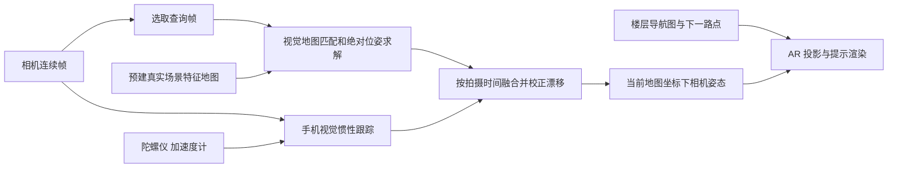

# Google Indoor Live View：定位、跟踪与开源复现路径

日期：2026-10-17；研究基线 `4b6b66e`。回应成员提供的 2021 年演示与报道，补充[导航与 AI 工作流计划](navigation-ai-workflow-plan.md)。本文仅研究，不安装依赖或变更应用/API，也不宣称掌握 Google 私有实现。

## 1. 直接判断

**最有依据的解释是：提前建好的视觉定位地图负责绝对定位，手机本地视觉惯性跟踪负责连续运动，位姿融合把两者对齐，AR 渲染按当前相机姿态投影路线提示。** 其中“云端定位 + 本地连续跟踪”在 Google 相关公开论文中已有直接描述；该论文与 2021 室内产品每个模块是否相同，公开资料尚不能确认。

阅读了成员给出的 [Ars Technica 报道](https://arstechnica.com/gadgets/2021/03/google-maps-gets-ar-indoor-navigation-new-eco-friendly-route-options/)。其报道 Indoor Live View 的位置/楼层提示；具体算法判断优先依据下列 Google 官方和作者来源。报道里“只有相机和图片”应理解为产品层概括，实际跟踪还涉及手机惯性传感器与已有地图数据。

## 2. 证据强度

| 结论 | 证据 / 确信边界 |
|---|---|
| Live View 的基础是视觉 global localization，室内扩展处理建筑内的高度与物体位置 | **Google 官方明确披露**：[2021 发布说明](https://blog.google/intl/en-africa/company-news/technology/redefining-what-map-can-be-with-new/)；未披露完整室内建图方法、楼层融合算法或定位误差 |
| 从已定位图像构建可搜索视觉特征索引，并匹配手机所见；优先稳定结构，减少临时景物影响 | **Google 官方明确披露**：[2019 技术文章](https://research.google/blog/using-global-localization-to-improve-navigation/)；说明了 VPS 和 ARCore 叠加路线的关系 |
| 使用稀疏三维模型、2D–3D 匹配、几何验证和手机端视觉惯性融合 | **相关公开研究直接描述**：[Google Research 论文页](https://research.google/pubs/large-scale-real-time-visual-inertial-localization-revisited/)、[作者论文](https://arxiv.org/abs/1907.00338)；不能等同于 Indoor Live View 源代码 |
| 连续相机姿态来自视觉特征与 IMU，虚拟相机据此绘制正确透视 | **公开 ARCore 原理**：[官方基本概念](https://developers.google.com/ar/develop/fundamentals)；某一演示的具体内部 SDK/融合配置未公开 |
| 2021 室内版本使用上述整体范式并配合建筑楼层/路线数据 | **高可信架构推断**：与官方产品能力和同时代公开系统一致；采集设备、特征网络、滤波器和调用频率仍未知 |
| 必须部署 Wi-Fi RTT/BLE、使用气压计/LiDAR、使用特定现代模型 | **没有足够证据**：这些技术可能辅助某些系统，不能据报道/GIF认定是该产品必需组件 |

相关论文 *Large-scale, real-time visual-inertial localization revisited* 的第 3 节描述得尤其直接：离线 SfM 建模；手机本地连续追踪；服务器对选取的帧进行地图匹配；绝对定位异步融合回跟踪器。该论文提到的约 200ms 是特定实验系统的查询量级，不能当作 2021 室内产品或本项目端到端承诺。其重力辅助位姿求解也说明不能只用一句“统一采用标准 PnP”概括所有内部算法。

## 3. 最可能的实际工作链路

### 3.1 离线：建立三份有对应关系的数据

1. **视觉定位地图**：采集有重叠、存在视角/位置变化的真实照片或视频关键帧，恢复/关联相机位姿与稳定三维特征。保存特征描述、三维位置和可见关系；无需为定位生成完整精美的三维网格。
2. **建筑与楼层坐标**：把视觉模型对齐到真实尺度、楼层高度和已知建筑位置。Google 的具体室内采集、标定与配准程序未公开；它需要有相应能力才能给出可用的楼层与方向提示。
3. **导航图与设施数据**：记录真正可走的通路、楼梯/电梯、楼层转换与目标设施。视觉地图回答相机在哪、朝哪；路线图决定下一步该走哪。两个图通过共同坐标/地标对应，不是同一种数据。

上述第 1 点属于公开视觉定位的常见实现，且与 Google 论文吻合；不是声称 Google 实际采用 COLMAP。2021 宣布的是部分场所覆盖，也不能推导出上传任意楼层平面图就能立即启用室内 VPS。

### 3.2 在线：高频跟踪、较低频绝对校正



- **起始搜索**：用户/建筑上下文、可用的粗位置或无线信息缩小地图范围。Google 相关论文使用 GPS/Wi-Fi 先验；具体室内产品如何组合这些信息未披露。
- **视觉定位**：当前图像特征与已知模型关联，排除不符合几何的对应点，恢复地图坐标中的相机位置/朝向。常见开源方案是检索候选 → 局部匹配 → 2D–3D 对应 → 鲁棒绝对位姿求解。
- **局部跟踪**：本地利用连续帧和 IMU 估计相机相对运动。即使云端尚未返回，仍可按跟踪状态更新渲染；局部跟踪会漂移、会丢失，也需要重新定位。
- **绝对校正**：再次匹配到地图时，将结果与本地轨迹融合，纠正位置和朝向漂移；不能把拍摄时刻的旧位置直接当成用户此刻的位置。
- **绘制**：计算下一可达路点相对当前相机的位置，根据相机内参和姿态生成正确的屏幕投影；路线和距离计算属于导航层。平面/深度有助于贴地和遮挡，但 GIF 不证明其采用了哪种具体遮挡策略。

这解释了箭头为什么能在手机转动时改变屏幕位置，同时看上去仍对应现实空间：渲染每帧使用当前本地姿态，地图定位只需要间歇纠正。实际帧率、云请求周期和漂移精度不能由宣传 GIF 测得。

### 3.3 对齐关系的简化表示

定义 `T_A_B` 为“把 B 坐标变换到 A 坐标”。设 `M` 为已标定地图坐标，`L` 为手机局部跟踪坐标，`C(t)` 为时刻 t 的相机坐标：

```text
T_M_L        = T_M_C(t0) × inverse(T_L_C(t0))
T_M_C(now)   = T_M_L × T_L_C(now)
```

这是帮助理解的刚体对齐关系，不是 Google 私有融合公式。真实实现还需要处理误差、时间同步和持续优化；若地图/单目重建没有正确尺度，还需尺度对齐。旧查询结果只在对应跟踪历史、版本、误差和有效性可验证时参与融合；没有这类历史的 LLM 节点判断仍应按新鲜度规则处理。

## 4. 为什么能识别楼层与排除干扰

楼层可来自匹配到已知三维位置/建筑层级，加上对上下楼转换的跟踪；这是一种与能力吻合的推断，不能断言具体一定使用气压计。只有二维平面图上的 `(x, y)` 无法天然区分外观相同的多个楼层。

Google 2019 说明用机器学习优先选择长期稳定结构。几何匹配还要求多个局部特征能共同解释同一相机姿态：行人、变化的家具、反射或光照造成的错误对应往往不具备一致性。具体 Indoor Live View 是否对每种干扰使用显式分割模型并未公布；不能仅凭这种整体鲁棒性推断它先生成一段自然语言描述。

## 5. 可研究的开源组件

这些是可复用同类能力的候选，**没有证据表明 Google 使用这些项目**，也不是拿来即可运行的完整室内导航产品。以下信息来自维护者仓库；未在本项目安装或基准测试。

| 项目 | 可承担的环节 | 对本项目的实际边界 |
|---|---|---|
| [COLMAP](https://github.com/colmap/colmap) | SfM/MVS，真实多视角图像恢复相机与三维结构 | 适合离线视觉底图库；纹理弱/玻璃/重复走廊可能失败，重建尺度/楼层配准仍需处理。主体 BSD |
| [hloc](https://github.com/cvg/Hierarchical-Localization) | 层级图像检索、匹配、三维模型与 6DoF 查询定位；含室内 InLoc 示例 | 最适合验证“小范围自建 VPS”；需真实参考图和几何模型，不是手机持续跟踪器。主体 Apache-2.0 |
| [LightGlue](https://github.com/cvg/LightGlue) | 局部特征匹配，可作为 hloc 等系统的组件 | 一对图的匹配并不自动得到可用三维地图/绝对位置。代码与自身权重 Apache-2.0，特征提取器单独核实 |
| [OpenVINS](https://github.com/rpng/open_vins) | 相机 + IMU 的滤波式视觉惯性估计 | 用于研究连续相对运动；需标定/时间同步和设备集成，建筑绝对坐标需外部定位约束。GPL-3.0 |
| [ORB-SLAM3](https://github.com/UZ-SLAMLab/ORB_SLAM3) | 视觉、视觉惯性与多地图 SLAM | 可研究局部跟踪/重定位；Android/Capacitor 接入和与楼层图配准不是现成功能。GPL-3.0 |
| [AprilTag](https://github.com/AprilRobotics/apriltag) | 已知尺寸/位置的人工标志检测和姿态估计 | 可作低风险小 demo 的初始锚定实验；需要布设标记，并明确这属于有标记方案 |

LightGlue 维护者特别区分其许可证与 SuperPoint 的较受限代码/权重；不能因上层 hloc/LightGlue 为 Apache 就认为所有模型权重相同许可。实现前再按实际组件固定版本和核对依赖，本文不执行许可证或架构迁移。

Google 的 [ARCore](https://developers.google.com/ar/develop/fundamentals) 适合 Android 本地跟踪/渲染集成候选，但核心运行时不能作为上述完全开源替代来描述。当前 [Geospatial API](https://developers.google.com/ar/develop/geospatial) 公布的覆盖依赖 Street View/VPS；不能据 Google Maps 支持某机场室内导航就认定开发者 API 会为我们的 IA 楼层提供相同服务。[Cloud Anchors](https://developers.google.com/ar/develop/cloud-anchors) 则是另一条局部空间特征地图锚定服务，仍需要采集与地图对应，不能自动完成建筑路由。

## 6. 对 SnapWay 计划的影响

现有“Gemini 4 每三秒重定位”的安排适合做低频语义确认和候选筛选；如果要接近演示中的稳定现实附着效果，可在后续独立试验中加入**本地连续跟踪 + 图坐标配准 + 鲁棒几何重定位**。Gemini 继续负责地图理解、标签、干扰排除和歧义解释；各模块职责可共存，不需要为研究擅自更换成员指定模型。

四向照片有利于参考引导和场景识别，但不能保证三维重建：同一点原地旋转缺少三角测量基线，90° 采集也可能缺少足够重叠。若验证自建 VPS，需要补充沿路线移动的重叠实拍/视频关键帧，记录相机参数、时间与可获得的姿态。多节点原始照片若已具备充分重叠可复用；不能预先认定必须全部重拍。

保留两种不同地图：**真实照片建立的定位特征地图**与**人工审核的通行路线图**。GPT 生成/修改后的平面底图可辅助 Developer，但不能代替真实环境三维测量，也不能用其像素精度推断厘米级视觉定位。模型描述可以降低检索候选数量，最后是否到达某物理地点仍需可检验的视觉/几何证据。

建议下一轮仅比较两个独立小试验，不立即扩展主系统：

1. **稳定渲染试验**：已知位置/尺寸的 AprilTag 或人工校准锚点 + 手机本地跟踪 + 一段已校准路线，验证转动/短距移动时的箭头与丢失恢复。它验证坐标/渲染链路，不证明无标记定位。
2. **无标记定位试验**：一小段真实路线的重叠照片，使用 COLMAP/hloc 等候选建模，在未参与建图的照片上评估位置/朝向误差、错误接受、拒绝率与延迟，再决定是否连接本地跟踪。不能用建图原图查自身作为验收。

两者都应记录设备、时序、尺度/配准误差、遮挡/弱光/相似走廊失败和人工准备时间；供应商论文性能不作为本项目承诺。现阶段继续执行已约定的静态实景闭环和 IA-4 mock，不新增运行依赖或调用收费 API。
