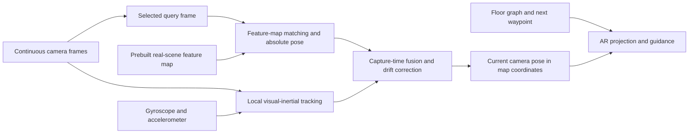

# Google Indoor Live View: localization, tracking and open-source approaches

Date: 2026-10-17. Research baseline: `4b6b66e`. This responds to the member's 2021 demonstration/article and supplements the [navigation/AI plan](navigation-ai-workflow-plan.md). Research only: no dependency, runtime/API change or claim of access to Google's private implementation.

Subsequent decision: the member authorized continuous tracking and accelerometer/gyroscope integration as explicit dynamic-navigation work. Plan sections 9.4-9.7 define implementation/acceptance; this note retains the original research evidence. Hardware integration remains pending.

## 1. Direct assessment

**The strongest explanation is a prebuilt visual localization map for absolute location, local visual-inertial tracking for continuous movement, pose fusion for alignment, and AR projection using current camera pose.** Related Google research explicitly describes server localization plus local tracking; public information does not confirm that every module matches the 2021 indoor product.

Read the supplied [Ars Technica article](https://arstechnica.com/gadgets/2021/03/google-maps-gets-ar-indoor-navigation-new-eco-friendly-route-options/), which reports Indoor Live View position/floor guidance. Algorithm conclusions prioritize Google/author sources below. Its camera-and-images description is a product-level summary; practical tracking also uses inertial sensors and prior maps.

## 2. Evidence strength

| Finding | Evidence / certainty boundary |
|---|---|
| Live View uses visual global localization; the indoor extension handles building altitude/object placement | **Google disclosure:** [2021 announcement](https://blog.google/intl/en-africa/company-news/technology/redefining-what-map-can-be-with-new/); no complete indoor capture/floor-fusion algorithm or measured error |
| Searchable features from located imagery match the phone view, prioritizing stable structure over transient detail | **Google disclosure:** [2019 technical article](https://research.google/blog/using-global-localization-to-improve-navigation/), including VPS/ARCore guidance |
| Sparse 3D models, 2D-3D correspondences, geometric verification and mobile visual-inertial fusion | **Direct related research:** [Google paper page](https://research.google/pubs/large-scale-real-time-visual-inertial-localization-revisited/), [author paper](https://arxiv.org/abs/1907.00338); not the indoor product's source code |
| Visual features plus IMU estimate continuous pose for perspective-correct rendering | **Public ARCore principles:** [fundamentals](https://developers.google.com/ar/develop/fundamentals); exact demonstration SDK/fusion settings undisclosed |
| The 2021 product combines this general pattern with floor/routing data | **Strong architectural inference**, consistent with disclosed capabilities; hardware, feature network, filter and query cadence remain unknown |
| Wi-Fi RTT/BLE deployment, barometer/LiDAR or a specific modern model is mandatory | **Insufficient evidence**; possible aids in some systems cannot be inferred as requirements from the GIF/article |

Section 3 of *Large-scale, real-time visual-inertial localization revisited* describes offline SfM, local continuous tracking, selected-frame server matching and asynchronous correction. Its approximately 200ms query result belongs to that experimental system, not a 2021 product/project end-to-end promise. Its gravity-assisted solvers also caution against claiming one standard PnP algorithm for all private internals.

## 3. Likely implementation pattern

### 3.1 Offline: three associated data sets

1. **Visual localization map:** overlapping real photographs/video keyframes with varying viewpoints/positions, recovered/associated camera poses and stable 3D features. Retain descriptors, positions and visibility; a complete photorealistic mesh is unnecessary for localization.
2. **Building/floor coordinates:** align the model with metric scale, floor heights and known building coordinates. Google's exact indoor capture/calibration/registration process is undisclosed, but useful floor/direction guidance requires corresponding capability.
3. **Routing/facility graph:** real passages, stairs/lifts, floor transitions and destinations. The feature map estimates camera location/orientation; the route graph chooses legal next steps, linked through shared coordinates/landmarks.

The first stage is a public visual-localization pattern consistent with the paper, not a claim that Google uses COLMAP. Limited-site coverage in 2021 does not imply that uploading any floor plan enables indoor VPS.

### 3.2 Online: fast tracking and slower absolute correction



- **Search initialization:** building/user context, coarse position or wireless evidence narrows candidates. The related paper uses GPS/Wi-Fi priors; exact indoor product fusion is undisclosed.
- **Visual localization:** associate current features with known geometry, filter inconsistent matches and recover camera pose. Common open-source stages are retrieval, local matching, 2D-3D correspondence and robust absolute-pose estimation.
- **Local tracking:** continuous frames/IMU estimate relative movement and drive rendering while awaiting server responses. Drift and tracking loss still require recovery.
- **Absolute correction:** fuse repeated map matches with the local trajectory; a pose for a past image cannot simply become the visitor's present pose.
- **Rendering:** transform the next reachable waypoint into the camera frame and project with intrinsics/pose. Route/distance calculations belong to navigation; planes/depth can aid ground attachment/occlusion, but the GIF does not establish a specific occlusion technique.

This explains why an arrow moves on screen as the phone turns while remaining associated with physical space: each rendered frame uses current local pose, with intermittent map correction. The promotional GIF cannot establish frame rate, query cadence, drift or precision.

### 3.3 Simplified alignment

Let `T_A_B` transform coordinates from B to A, with calibrated map M, local tracker L and camera C(t):

```text
T_M_L        = T_M_C(t0) * inverse(T_L_C(t0))
T_M_C(now)   = T_M_L * T_L_C(now)
```

This is an explanatory rigid alignment, not Google's private fusion equation. Real systems handle uncertainty, synchronization and continued optimization; unscaled maps/monocular reconstruction also need scale alignment. Delayed queries participate only with valid tracking history, compatible versions and error bounds. LLM node judgments without such history still follow freshness checks.

## 4. Floors and interference

Known 3D position/building levels plus tracked transitions can explain floor detection, but do not prove use of a barometer. A floor plan's `(x, y)` alone cannot distinguish visually identical levels.

Google's 2019 explanation prioritizes permanent features. Geometric matching also requires multiple correspondences consistent with one camera pose: moving people, furniture, reflections and lighting can produce inconsistent matches. Explicit segmentation for each interference category in Indoor Live View is undisclosed; robustness does not imply prior natural-language description generation.

## 5. Open-source candidates

These projects provide comparable modules, **not evidence of Google's dependencies or ready-made complete navigation products**. Information comes from maintainers; none was installed/benchmarked here.

| Project | Role | Project boundary |
|---|---|---|
| [COLMAP](https://github.com/colmap/colmap) | SfM/MVS: camera poses and 3D structure from real multiview images | Offline localization maps; weak texture/glass/repeated corridors may fail, and scale/floor alignment remains. Main license: BSD |
| [hloc](https://github.com/cvg/Hierarchical-Localization) | Retrieval, matching, 3D models and 6DoF queries, including indoor InLoc examples | Good small self-hosted VPS experiment; requires real references/geometry and is not a phone continuous tracker. Apache-2.0 |
| [LightGlue](https://github.com/cvg/LightGlue) | Local matching component for pipelines such as hloc | Image-pair matches alone do not form a usable 3D map/absolute location. Code/own weights Apache-2.0; check feature extractors separately |
| [OpenVINS](https://github.com/rpng/open_vins) | Filter-based camera/IMU estimation | Relative tracking research requiring calibration/synchronization/device integration; external constraints supply building coordinates. GPL-3.0 |
| [ORB-SLAM3](https://github.com/UZ-SLAMLab/ORB_SLAM3) | Visual, visual-inertial and multi-map SLAM | Local tracking/re-localization research; Capacitor/Android integration and map registration remain work. GPL-3.0 |
| [AprilTag](https://github.com/AprilRobotics/apriltag) | Known-size/position fiducial detection and pose | Small-demo anchoring experiment requiring installed markers and explicit disclosure that the approach is marker-based |

LightGlue's maintainer distinguishes its license from SuperPoint's more restrictive code/weights. An Apache upper layer does not establish identical terms for every model. Pin and review actual components before implementation; this note performs no license/dependency migration.

[ARCore](https://developers.google.com/ar/develop/fundamentals) is an Android tracking/rendering candidate, but its core runtime is not a fully open-source replacement. The public [Geospatial API](https://developers.google.com/ar/develop/geospatial) describes Street View/VPS coverage; Google Maps airport support does not prove equivalent developer API coverage for IA. [Cloud Anchors](https://developers.google.com/ar/develop/cloud-anchors) offers local feature-map anchoring, still requiring capture/map association and separate building routing.

## 6. Implications for SnapWay

**Canonical place identity:** MegaLoc via `/api/navigation/localize/` ([localization-megaloc.md](../localization-megaloc.md)). Approaching real-world attachment also needs **local continuous tracking, map alignment and robust geometric re-localization**. Gemini remains for **map authoring** (interpretation, labels, exclusions); do not use Gemini as the visitor place matcher.

Four-direction references aid recognition/guidance but do not guarantee reconstruction: rotation at one point lacks triangulation baseline, and 90-degree views may not overlap sufficiently. A VPS experiment needs overlapping captures/keyframes along the route, camera parameters, timestamps and available poses. Reuse existing multianchor originals if their overlap is adequate rather than assuming a full reshoot.

Keep **real-photo localization features** separate from the **reviewed walkable graph**. A GPT-edited floor background supports Developer but cannot replace physical 3D measurements or prove centimetre-level localization. Descriptions can narrow candidates; accepted physical position needs testable visual/geometric evidence.

Suggested isolated experiments, before broad integration:

1. **Stable rendering:** known-size/position AprilTag or manual anchor, local phone tracking and a calibrated short route; test turns/motion/loss. This establishes alignment/rendering, not markerless positioning.
2. **Markerless localization:** overlapping real route captures, candidate COLMAP/hloc modeling, held-out query images and measured position/heading/false-accept/rejection/latency results before tracking integration. Querying mapping photos against themselves is not acceptance.

Record devices, timing, registration/scale errors, obstruction/weak light/repeated-corridor failures and preparation effort. Supplier paper performance is not a project promise. The agreed static loop/IA-4 mock continue without new runtime dependencies or paid API calls in this research phase.
