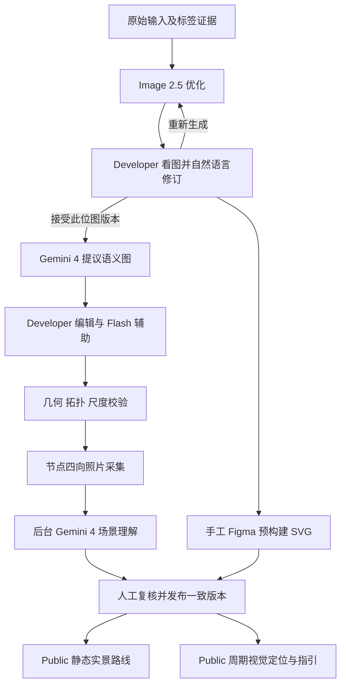

# 地图开发、场景采集与视觉导航：新工作流计划

日期：2026-10-17；分支 `acceptance/map-authoring-pipeline`；评估基线 `d78c5f4`。
状态：**未来规划与可行性评估，尚未实现新运行链路**。依据成员最新七项需求，遵循[架构基线](../initial/Indoor_Navigation_Architecture_and_Dependencies_EN.md)，补充[现有工作流要求](../initial/Indoor_Navigation_Stakeholders_and_Workflows_Review_EN.md)。保留 Angular、Django/DRF、PostgreSQL、Celery/Redis、Capacitor 的职责划分；本次只更新文档，不修改 API、数据库 schema 或依赖，不调用收费服务。

**连续跟踪更新（2026-10-17）：** 成员已授权把相机与加速度计、陀螺仪等设备接入、连续几何跟踪列为动态导航的正式工作项，参考 OpenVINS/ORB-SLAM3 等开源实现。以下 §9.4–9.7 定义接入方案与验收边界；这次更新仍是计划，不表示已经读取真机传感器或安装跟踪依赖。

## 1. 结论与产品定义

**整体可行，建议以“人工审核的导航图 + 四向实景参考 + 受约束的视觉重新定位”推进。** 无需等待自动矢量化完成，即可建设和验证主要闭环。必须把以下能力分别验收：

| 环节 | 评估 | 必须补齐的条件 |
|---|---|---|
| Image 2.5 优化与自然语言改图 | 接口支持，地图结构保真待验证 | 原图保留、版本化、人工接受、重建/复核受影响的语义图 |
| Gemini 4 识图、节点/边/标签提案 | 可实现候选生成，不能承诺一次找全或绝不穿墙 | 原始标签证据、可信障碍/可通行区域、确定性校验与人工审核 |
| 人工编辑与 Flash 辅助 | 可在现有权限/ChangeSet 方向上实现 | 稳定 ID、并发版本检查、可撤销的结构化操作 |
| 四向照片异步理解 | 可实现 | 采集方位基准、独立任务、来源/干扰标注、结果版本检查 |
| 静态实景路线 | 最适合作为首个实地闭环 | 起点/朝向确认、路线方向选图、用户手动推进、明确失败恢复 |
| 连续几何跟踪 + 每三秒视觉重新定位 | 已授权纳入动态方案；精度和延迟待真机验证 | 相机/IMU 接入、本地姿态与相对运动、限流、时序/运动约束、未知/歧义恢复 |
| 摄像头内稳定贴合地面的箭头/位标 | 动态方案中分阶段验收 | 在连续跟踪上完成尺度、锚点与地图配准；通过后才开放世界坐标叠加 |

Public User 的室内主界面改为**起终点选择、参考照片、摄像头和下一步指引**，不再展示室内地图；地图及图编辑界面留给 Developer。Google Maps 仍可承担室外找楼/接近入口，不能据此认定室内楼层和位置。将需求中的“输入重点”按上下文解释为“输入终点”；这是本文唯一的文字歧义假设。

## 2. 模型职责与现有矢量化决策

| 工作流 | 指定模型 / 服务 | 使用边界 |
|---|---|---|
| 原图优化、自然语言改图 | GPT Image 2.5；延续 `gpt-image-2.5-sunburst` | 输出可审核位图，不输出权威距离或自动批准的通路 |
| 地图语义理解、照片描述、初始定位/重新定位 | `gemini-4-argon`（Gemini 4） | 有界结构化回复，绑定输入版本与证据；不直接发布 |
| Developer 辅助标签、编辑提案 | `gemini-3.8-flash` | 只提交允许的编辑命令，经过相同服务端验证 |
| 自动矢量化 | Vectorizer.AI 官方适配器 | 本赛程不启用，凭据留空；不调用收费服务 |
| 构建演示替代 | 现有 `/api/vectorization/mock` | **仅 IA 四楼 `ia-4`**，真实预构建素材仍待提供；不是任意图片转换 |

OpenAI 官方文档支持带源图与文字的编辑；Google 模型页确认上述 Gemini ID、图像输入和结构化输出。供应商能力不代表本项目地图/定位质量已经达标；模型账号访问、Vertex 与 Gemini API 的入口差异仍需实现时核对。Gemini 4 和 3.8 Flash 的模型页均不支持 Live API；本文持续定位采用普通异步请求，不把它们当作实时流式视觉服务。[OpenAI 编辑接口](https://developers.openai.com/api/reference/resources/images/methods/edit)、[Gemini 4](https://ai.google.dev/gemini-api/docs/models/gemini-4-argon)、[Gemini 3.8 Flash](https://ai.google.dev/gemini-api/docs/models/gemini-3.8-flash)

手工 Figma 导入、矢量化、导出、入库沿用[现有具体命令与 mock 合同](vectorizer-api-demo.md)。**IA 一楼属于导航 demo route；IA 四楼属于构建 workflow mock，两者独立。** 演示声明继续如实展示：“存在自动化的可商业化的 API 服务，但我们没付款，此次只做效果演示。”并明确当前 SVG 来自手工 Figma 预构建。SVG 提供视觉底图，导航计算使用独立审核的语义图；不能把 1,321 个描摹 path 当作导航节点。

## 3. 完整链路与一致性边界



每个产物至少绑定 `targetId / floorId / revisionId / sourceHash / rasterHash / coordinateFrameId`；图、参考照片和检索索引再记录各自版本/哈希。发布物是同一修订的完整集合，导航会话固定到一个 Publication；不在用户行走时偷偷换图。

优化图尚未被接受时，可以后台做推测性识图，但结果只属于该草稿，不能直接应用到更新的图片。图片、图结构、照片或排除规则变化后，使相应派生产物失效；过期任务保留历史，不能覆盖新结果。结构修改应展示影响列表：受影响的边、节点坐标、照片锚点、描述、索引、路线，允许复核保留仍有效的记录。

## 4. 原图优化和 Developer 自然语言修订

1. 保存原始字节及标签证据。优化时移除标签不应销毁房号、房间用途、楼梯编号等信息；从原图/既有数据库提取并单独保存，冲突标记待核对。
2. Image 2.5 接收原图及通用约束：保持建筑内部布局、门洞、楼梯、电梯、墙体和比例；清理无意义外部线条；禁止为美观新增可通行连接。每次输出都作为候选。
3. 先把完整位图直接呈现给 Developer。支持自然语言、可选区域标注，以及原图/当前图/新图对比；例如“恢复东侧门洞，其余结构保持不变”。不承诺生成模型只改变选中区域。
4. 每次重新生成保留父版本、提示词、模型、用量和结果。默认携带原图及最新接受版本，减少多轮编辑漂移；提供接受、回退、再次修改。
5. Developer 接受版本后才进入正式语义提取。若修改改变结构，旧图需要重新配准或重提取；即使像素尺寸相同，也不能假定空间对应关系未变。

对照[前次真实 API 验收](../audits/2026-10-17-gpt-fullchain-pilot.md)，现有优化图仍有外部清理和几何误差，不能作为“生图后结构自动正确”的证据。

## 5. Gemini 4 地图理解与防穿墙图构建

### 5.1 节点、特征与标签

输入同时包含接受的优化图、原图、已读标签和可信的人工记录。输出分块且可拼接的候选：门、房间目的地/教室地标、特殊设施、入口、楼梯、电梯、走廊交点、转角与间隔采样点；记录源图区域、类别、坐标、关联对象、标签来源、不确定性。不能宣称“识别了所有顶点”，应输出已发现项、未覆盖区域和待人工确认项。

节点类型与现有 Node.Kind 对齐；特殊地标/走廊样本可用 checkpoint，必要的细分类记录在有版本的语义属性中。房间目的地节点和门节点分开；可见但不可走入的建筑特征通过对象关联展示，不强行加入可通行边。节点坐标是**行走/采集锚点**，地标本体的位置与可见方向单独记录，避免站在门牌或实体设施内部。

走廊采样先保留交点、转角、门口和易混淆位置，再按弧长补采样。间距是待实验参数，不能直接按图上像素声称每隔数米；采样越密，四向采集与理解成本越高。共用位置允许多个语义对象关联同一个采集锚点，避免重复拍摄。

### 5.2 坐标、尺度、空间关系

- 原图像素、优化图像素、SVG、导航图坐标、手机相机/AR 坐标分别命名；记录变换与校验地标。图片顶边不是天然地图北向。
- 有可信标尺或实测距离后才能给 `distance_metres` 和米制采样间隔；校准前距离未知，使用相对单位并禁止显示伪造米数。单个标尺只适合等比例图，局部形变需要多处检查。
- 几何位置关系、视觉上左右/前后关系、图上可达关系分开存储。几何距离与沿路距离不能互换；模型描述的“较近/左侧”不能直接当作真实米数。
- 同层相邻关系与跨层转换分开。楼梯/电梯连接必须由实际楼层对和转换记录确认，不能连接相同像素位置的不同楼层。现有 Revision 按 MapTarget/楼层组织，跨层边需另行设计，不能直接违反同 revision 的数据库约束。

### 5.3 边提案与确定性校验

Gemini 负责提议连接及证据；服务端负责在经审核的墙体/可通行区域上校验。即使自动 Vectorizer 禁用，也必须能人工标记必要墙段、门洞和走廊区域，或提供人工审核的可通行 mask。只有彩色位图和节点坐标无法保证防穿墙。

检查边的**完整折线**及行走宽度包络，而不只检查两个端点；禁止穿墙、跨房间捷径、跨隔断和未经确认的门洞。曲折走廊使用折线或中间节点，门洞需接到真实可达区域；可通行宽度/无障碍属性未知时明确保留未知。视觉相邻不自动代表可通行，关闭/未验证连接不能被路由器自动开放。

边分离 `distance_metres`、`cost`、方向、开闭、验证状态和限制。可修改偏好/惩罚权重，但不能用低权重绕过禁行或验证约束。采用非负成本；若成本单位或下界不能支撑 A* 启发式，先用 Dijkstra。计算几何、连通性和路线均由确定性程序完成，LLM 不负责最后一跳的合法性。

## 6. Developer 图编辑与 Gemini 3.8 Flash 辅助

Developer 可增删/移动节点、增删边、调整边折线、方向、距离证据和权重，修改标签与设施属性。地图底图可切换位图/SVG，图层叠加不要求 SVG path 有语义 ID。

Flash 接收选中对象、限定区域和当前修订，返回结构化 ChangeSet：操作类型、稳定对象 ID、旧版本、修改值、理由及影响项。批量标签需检查对象数量、顺序和标签冲突；编辑必须可撤销。自然语言“把这里连过去”不能直接生成已验证通道。

服务端先做权限、版本、对象存在性、坐标、成本、几何和可达性验证；结构性修改显示预览/差异后应用，简单标签修改可按现有草稿策略应用并可撤销。较晚完成的 AI 提案不能覆盖人工新改动；删除节点同时显式处理关联边和照片，不能静默丢失采集成果。

## 7. 四向实景采集、排除干扰与后台任务

### 7.1 采集要求

默认每个可定位采集锚点有前/右/后/左四槽，相邻中心朝向相差 90°。这里的“前”固定到地图局部方向基准；记录 `heading_map_deg`、校准方式与误差，不能随每位拍摄者的起始朝向变化，也不能直接把手机磁北当成地图零度。四张透视照片并不组成完整无缝全景，视场边缘仍可能漏景。

采集者站在同一可达位置、近似一致相机高度并避免明显俯仰；保存节点、位置偏移、楼层、拍摄时间、设备、朝向与质量信息。无法安全拍摄的方向必须标记 `not_capturable` 并人工决定是否可发布/需补锚点，不能生成或复制照片补齐。默认四向完整覆盖是目标；例外不是默认豁免，实际例外必须在路线验收中显式披露。

### 7.2 上传与非阻塞理解

```text
上传完成并持久化资产
  → 原子创建 pending Job（照片 + 修订 + 方位 + 排除规则哈希）
  → 返回资产/任务 ID，立即允许下一次上传
  → 派发 authoring 队列，Gemini 4 理解
  → 校验结构、证据、版本，保存 proposed 结果
  → Developer 修正/审核，再纳入发布索引
```

“后台运行直至结束”指服务器持久任务在浏览器关闭后仍可恢复，并不等于无限重试。复用现有 Job/Attempt 的幂等键、租约、截止时间、有限重试和可见失败；持久任务先落库再派发，派发失败可重投，不能只靠浏览器 Promise 或内存队列。Developer 可轮询任务进度，某张失败不阻塞其他上传。定位队列单独保留容量，避免批量照片理解堵住访客请求。

重新上传产生新资产与描述版本；同图重复上传/重试不创建重复有效记录。更改排除规则触发对应照片重分析及索引失效；写回前检查任务输入是否仍是当前版本。

### 7.3 场景 schema 与干扰排除

自然语言放在**有类型、有证据的结构化字段**内，不能只存一段长描述。下例仅表示未来数据合同，`example-*` 不是真实房间；不是已实现 API：

```json
{
  "schema_version": "scene-v1",
  "revision_id": "example-revision",
  "reference_id": "example-reference",
  "node_id": "example-node",
  "image_sha256": "example-image-hash",
  "direction_slot": "right",
  "heading_map_deg": 90,
  "heading_uncertainty_deg": 15,
  "capture_context": {"lighting": "indoor daylight", "pitch_deg": null},
  "features": [{
    "id": "f1",
    "category": "door",
    "description": "双扇深色门，门框右侧有固定标牌",
    "color": {"relative": "darker than surrounding wall", "reliability": "conditional"},
    "bbox_normalized": [0.2, 0.25, 0.5, 0.9],
    "spatial": {"image_side": "left", "depth_order": "midground"},
    "perspective": {"view": "oblique", "vanishing_direction": "right"},
    "stability": "stable",
    "observed_text": null,
    "associations": [{"object_id": "example-door", "status": "proposed"}]
  }],
  "exclusions": [{
    "reason": "temporary furniture",
    "description": "平常不会出现在这里的桌子",
    "polygon_normalized": [[0.55, 0.6], [0.85, 0.6], [0.85, 0.95]],
    "declared_by": "developer",
    "scope": "this_reference"
  }],
  "quality": {"blur": "low", "occlusion": "partial", "usable": true},
  "uncertainties": ["标牌文字无法读清"],
  "review_state": "proposed"
}
```

上述角度/框仅为示例；实际记录必须来自采集上下文/图像证据，允许未知。坐标归一化规则、字段枚举和区域合法性由服务端验证；JSON Schema 合规不能证明识图结论正确。[Google 结构化输出说明](https://ai.google.dev/gemini-api/docs/structured-output)

排除策略包括：人和动物不作为稳定定位地标；玻璃外动态景色/反射不作可靠匹配依据，但玻璃/窗框本身可保留；光照和曝光单独记录，颜色只作辅助证据。Developer 可用文字和可选区域圈定临时桌子等干扰，结果需展示“排除了什么/不确定什么”；模糊指令不能删除整面墙或所有桌子。排除是匹配权重/证据策略，不是编辑原始照片抹除现场事实。

标牌显示某房间或箭头指向某设施，不等于拍摄者就在该处。记录“观测对象”和“相机所在节点”两种关系。自然语言描述可能不能区分类似走廊：先用同一 Gemini 4 方案验证，再评估文本检索 + 小候选集原图复核，必要时比较兼容的图像检索；不把加入新 embedding 服务视为已确定架构。

## 8. Public 静态实景导航

1. 选择可用建筑/楼层上下文和起点，输入终点；终点解析为已发布节点，重名或不存在时要求选择，不能由模型创造目的地。
2. 选择“拍照确认起点”或“持续定位”。手选起点是用户声明，拍照匹配后才是视觉确认；保留起点选择作为相机拒权时的手动模式。
3. 初次定位比较当前图与该范围的已审核四向参考，分别返回位置、楼层、朝向和不确定性；朝向不明时让用户对齐参考场景。
4. 服务端在固定发布图的开放、已验证且符合限制的边上寻路；无路线则明确报告。距离使用已校准边长。
5. 按路线每一步的**出发朝向**选照片，展示下一地标、转向和约略距离；返回走同一条边时应选择反向参考。离四个中心朝向太远或转角缺视图时提示对齐/补拍，不能假装有对应照片。
6. 支持连续预览全路线照片，但**播放进度不是用户位置**。行走模式默认用户“到达此处/下一步”推进，必要时再次拍照确认；终点需要标牌/场景或用户确认，不能因自动播到最后一张宣布到达。

静态模式不估计连续运动；下一个采集点之间可能没有连续画面，不能将幻灯片描述为实景视频或实际位置跟踪。

## 9. Public 动态视觉导航

### 9.1 每三秒三帧与排队策略

将要求明确为：前台持续相机预览，**每三秒启动一次三帧短 burst**，例如相隔约 200ms 取三帧，端侧依据清晰度、曝光、遮挡和画面内容选一张上传；具体间隔需实机验证。三张都不合格就提示重拍，不能强选最清晰但仍无信息的一张。保留时间/选择原因供测试，不默认上传全部视频。

每会话最多一个定位请求在途、一个最新待处理帧；新帧替换旧待处理帧，避免队列不断累积。定位结果绑定 `sessionId / publicationId / contextVersion / captureSequence / capturedAt`，过期或乱序结果不得覆盖新状态。目的地/楼层变更递增上下文版本。

此三秒采样仅用于 Gemini 查询；本地连续跟踪使用跟踪引擎所需的连续相机帧与 IMU 流。两者共享相机来源，不能每三秒才唤醒一次相机并期待连续 VIO；具体相机所有权见 §9.5。

三秒是采样目标，**不是端到端延迟保证**。每分钟最多约 20 张被选帧；如果单次请求耗时 10 秒，串行会话约只能处理每分钟 6 张，其余必须丢弃或降频。量测拍摄、上传、队列、推理、验证各段 p50/p95，再决定采样频率、裁切和请求配置；不把增加并发作为无限补救。

浏览器相机需要真实权限和适用的安全上下文；Cookie 不能代替相机许可。页面隐藏、锁屏、切后台、停止导航时暂停采样，恢复时检查新鲜度。Capacitor Camera 的单次拍照接口不能直接当作常驻分析管线；Android 连续模式需验证 WebView 相机流，或另行设计 CameraX bridge。当前仅规划，不安装插件/增加依赖。[W3C 媒体采集规范](https://www.w3.org/TR/mediacapture-streams/)、[Capacitor Camera](https://capacitorjs.com/docs/apis/camera)、[CameraX ImageAnalysis](https://developer.android.com/media/camera/camerax/analyze)

### 9.2 约束搜索与重新定位

先以用户选择/初次视觉确认确定地图范围；不要把全部照片每三秒送给 Gemini。优先匹配上次位置、附近图邻域和可能朝向，结合稳定场景特征、标牌与候选照片，输出候选集合、位置证据、朝向、歧义/拒绝理由。位置状态可为节点或某条边上的区间，避免在稀疏节点间虚假精确跳转。

可用约束 `图上可达距离 ≤ v_max × Δt + 位置误差余量` 缩小范围，距离沿已验证路线计算而非穿墙直线。`Δt` 按实际拍摄时间差，`v_max` 与移动模式匹配；尺度未知时不能实施米制速度硬裁剪。保留多个候选，低置信度扩大范围、请求新视角或重新选择楼层，不能因初次错配永远排除正确位置。电梯/楼梯的转移另行处理；一次房号识别不能直接宣布换楼层。

示例：若行走速度 1.5m/s，三秒可移动约 4.5m，再加请求延迟可能越过路口。因此转角/歧义处应提示停下确认，显示最后确认时间与不确定性；光滑长走廊不能仅凭运动上限保证精确位置。摄像头看见的人和动物可从定位特征中排除，但不代表它们不是现实障碍；本方案不承诺实时避障。

### 9.3 画面上的方向、位标与距离

本赛程优先做**屏幕空间指引**：显示下一路线段的相对方向、地标参考、剩余图上距离和定位更新时间。远处终点可能隔墙/隔层，应引导至下一可达路点，不能用直指终点的箭头诱导穿墙。

有已确认地图朝向时才能计算相对转角；无朝向则显示“请对齐该地标”，不显示有确定含义的左右箭头。沿边位置未知时距离为区间/约数；无标尺不显示米数。局部可见地标若做框选，必须来自当前帧检测且有时效，不能把旧图框贴在新画面。

成员已同意推进**连续几何跟踪与世界坐标配准**。实施时需要相机内参、持续姿态/视觉惯性跟踪、地图与跟踪坐标对齐、真实尺度以及跟踪丢失恢复；达到相应门槛前保留屏幕空间指引。四向照片 + 周期 LLM 识别提供位置/朝向假设，本地跟踪负责连续相对运动，两者共同参与导航状态估计。[ARCore 基本原理](https://developers.google.com/ar/develop/fundamentals)

[Google Indoor Live View 技术研究](indoor-live-view-research.md)记录公开证据和对齐原理；下列章节将其转化为本项目获准推进的工作项。当前没有引入运行依赖或替换指定的 Gemini 工作流。

### 9.4 双速率定位、跟踪状态与延迟校正

**本地快路径：** 连续相机 + 加速度计/陀螺仪 → 原生 VIO/SLAM 或受支持的跟踪 SDK → 相机位姿/跟踪质量 → 地图坐标对齐 → 每个可用渲染帧更新箭头。原始 IMU 用于引擎内部融合，不通过网络逐条发送给 Gemini，也不逐样本触发 Angular 全页面刷新。

**云端慢路径：** 三秒 burst 选帧 + 拍摄时刻的跟踪上下文 → Gemini 4 语义位置/朝向验证及候选收缩 → 一致性检查 → 校正地图关联/请求重新锚定。若以后接入几何 VPS，可返回受约束的绝对相机位姿；Gemini 的节点/标签判断本身不等价于这种完整位姿。

跟踪能力与状态分开暴露：

| 能力 / 状态 | 可以展示什么 |
|---|---|
| `orientation-only` | 设备转动/粗朝向与屏幕空间提示；不输出虚构平移 |
| `local-vio`，尚未地图对齐 | 相对轨迹及跟踪状态；不能声称已精确定位到建筑坐标 |
| `registered-vio` 且 `tracking` | 经过尺度/锚点校验的路线箭头、沿图进度和估计距离 |
| `initializing / limited / lost / paused / unavailable` | 当前限制与最后确认状态；丢失时撤下依赖精确位姿的叠加，引导重新定位/静态模式 |

局部跟踪坐标原点重置、重定位或原生 session 重启时递增 `trackingEpoch`；旧坐标变换和旧云结果不得跨 epoch 应用。保存有界的时间戳位姿历史：延迟结果只在同一发布版本、上下文、epoch 且对应历史可用时校正，再按后续运动传播到当前时刻；不能把旧截图位置直接写成“现在的位置”。超过历史窗口或误差边界就丢弃/重拍。大幅位置冲突触发重新确认，不能单靠视觉平滑隐藏错误。

地图锚定需要位置、朝向、尺度和相机到地图平面的关系。初期用已知位置/朝向的人工校准或已知尺寸的 AprilTag 验证；一个手选节点或四向照片中的粗方向不足以自动确定精确 6DoF。锚点校准与无标记定位必须分开标注和验收。跟踪器未提供的协方差/精度字段写未知，不能自行编造高置信度。

### 9.5 设备接入与客户端边界

沿用[Android 架构](../initial/Indoor_Navigation_Android_Architecture_EN.md)：Android/Capacitor 为主要连续跟踪目标，Angular 通过设备适配器调用原生能力；浏览器作为按能力降级的入口。当前 [DevicePreview](../../apps/web/src/app/core/device-preview.ts) 明确是模拟边界，不能作为已经接入硬件的证据。

| 输入 / 能力 | 计划调用方式 | 使用约束 |
|---|---|---|
| 加速度计 | 原生 Android `SensorManager` / `TYPE_ACCELEROMETER`，或选定跟踪 SDK 内部采集 | 原始加速度含重力与偏置；经标定/融合后估计运动，不能简单二次积分当作可靠室内距离 |
| 陀螺仪 | `TYPE_GYROSCOPE`；原生记录角速度与采样时间 | 用于姿态变化和相机融合；积分会漂移，不能单独给出建筑朝向 |
| 辅助姿态/重力/步态 | 按设备能力读取 rotation vector / gravity；步态仅作为后续可选约束 | 传感器缺失必须可降级；不把磁北直接当地图方向，启用计步时再处理对应权限 |
| 连续相机与内参 | Android 原生统一 session；优先验证 ARCore 跟踪与图像/渲染接口 | 相机帧、IMU、物理相机姿态、显示旋转保持对应；SDK 不支持时明确降级 |
| Web/快速传感器探针 | `DeviceMotionEvent` / `DeviceOrientationEvent`，或评估 `@capacitor/motion` | 测读取可用性与交互；官方 Motion 当前基于 Web 事件，不提供完整原生 VIO，不保证硬件级频率/同步 |

设备调用的服务合同先定义为 `capabilities()`、`requestAccess()`、`start(options)`、`subscribePose()`、`captureBestFrame()`、`stop()`；这是拟定的客户端适配器接口，不是已发布后端 API。能力结果区分相机/陀螺仪/加速度计可用性、授权、跟踪引擎与时钟支持。姿态结果携带 session/epoch、原生采样时刻、源坐标系、位置、四元数、tracking 状态、地图对齐 ID 和可获得的质量信息。

实施记录要求：

- Android 原始加速度统一为 `m/s²`、角速度为 `rad/s`；Web 事件的旋转单位需按其实际合同转换。记录重力是否包含、偏置处理、设备/相机外参、自然屏幕方向与显示旋转，优先用四元数/变换矩阵避免 Euler 角跳变。
- 保存原生单调时钟时间戳和时钟来源；`SensorEvent.timestamp` 为纳秒，与 Android elapsed realtime 同基准。相机/SDK/JS 的时钟须验证对应关系，不能用 JS 回调到达时间或 `Date.now()` 代替曝光/采样时间。跨 bridge 的纳秒整数采用字符串或明确的相对时间编码，避免 JS 数值精度损失。
- 原始相机与 IMU 高频处理留在原生线程；向 Angular 批量/节流输出可用状态和位姿，必要时原生完成相机背景与 AR 渲染。先验证原生视图，再验证与 Angular 控件层叠加、触摸和生命周期；大量像素/每个 IMU 样本不经 JS bridge 往返。
- **一个相机所有者**：启用 ARCore 时从该 session 获取允许的查询帧；自建 VIO 时由对应 Camera2/CameraX 管线统一管理。不要让 WebView `getUserMedia`、CameraX 和 ARCore 分别抢占摄像头；共享相机方案先按官方接口验证。
- 请求前说明持续摄像头/运动用途；相机走平台运行时授权，Web 按平台支持处理安全上下文、策略和用户触发的 motion 授权。普通 Android 原始运动传感器不假定有统一的运行时弹窗；高采样率/计步等限制按实际 Android 版本和已选 API 单独处理。
- 导航停止、页面隐藏、锁屏、离开原生视图或授权撤销时，解除传感器监听、停止跟踪/相机并清理缓冲；恢复后检查时钟、epoch 和地图锚定。服务端照片分析任务仍可后台完成，手机连续跟踪按前台生命周期运行。

参考：[Android 运动传感器](https://developer.android.com/develop/sensors-and-location/sensors/sensors_motion)、[传感器总览](https://developer.android.com/develop/sensors-and-location/sensors/sensors_overview)、[SensorEvent 时钟](https://developer.android.com/reference/android/hardware/SensorEvent#timestamp)、[ARCore Camera 物理/显示姿态](https://developers.google.com/ar/reference/java/com/google/ar/core/Camera)、[ARCore 共享相机](https://developers.google.com/ar/develop/java/camera-sharing)、[Capacitor Motion](https://capacitorjs.com/docs/apis/motion)。

### 9.6 开源代码参考与引擎选择

成员已授权参考下列实现；先固定版本并在本地做可复现探针，再选择进入产品的依赖。项目目前未安装 `@capacitor/motion`、OpenVINS、ORB-SLAM3 或 ARCore；Android 包装器也不等于完整跟踪功能。

| 候选 / 具体源码入口 | 参考内容与决策 |
|---|---|
| [Capacitor Motion `web.ts`](https://github.com/ionic-team/capacitor-plugins/blob/main/motion/src/web.ts) 与 [定义](https://github.com/ionic-team/capacitor-plugins/blob/main/motion/src/definitions.ts) | 事件监听、能力探针、生命周期清理。适合先验证真机事件；不能据插件名称当作原生同步 IMU 引擎 |
| [OpenVINS `VioManager.cpp`](https://github.com/rpng/open_vins/blob/master/ov_msckf/src/core/VioManager.cpp) | 参考 `feed_measurement_imu`、IMU 缓冲/传播、初始化、视觉更新及状态管理；需要完整相机/IMU 标定与同步，不能只复制积分片段 |
| [ORB-SLAM3 `System.h`](https://github.com/UZ-SLAMLab/ORB_SLAM3/blob/master/include/System.h) | `TrackMonocular` 接收带时间的图像与 IMU 测量，参考跟踪状态、重置和地图生命周期；不是现成的 Capacitor 插件 |
| [hloc](https://github.com/cvg/Hierarchical-Localization) / [LightGlue](https://github.com/cvg/LightGlue) / [COLMAP](https://github.com/colmap/colmap) | 作为后续无标记绝对重定位/建图候选，配合真实重叠采集；不代替高频本地运动跟踪 |
| [ARCore 官方 `HelloArActivity.java`](https://github.com/google-ar/arcore-android-sdk/blob/main/samples/hello_ar_java/app/src/main/java/com/google/ar/core/examples/java/helloar/HelloArActivity.java) | Android 首个完整相机姿态/渲染探针的优先评估路径；核心运行时非完全开源，SDK 示例不能等同于可自行维护的 VIO 源码 |

推荐实施选择是：**先读设备和记录数据 → 在目标 Android 手机验证 ARCore 原生姿态/渲染 → 通过统一 Tracking 适配器接入 → 以同一记录评估 OpenVINS/ORB-SLAM3 的必要性**。采用 SDK 时复用其内部相机/IMU 融合，额外读取原始传感器用于诊断，不重复将同一数据叠加融合。若选开源引擎，则显式承担同步、标定、构建、线程和地图管理。

OpenVINS/ORB-SLAM3 主体为 GPL-3.0；hloc/LightGlue 主体 Apache-2.0，但特征模型/权重的许可可能不同。实际采用前记录对应版本及依赖边界。上述是工程选型与代码参考，当前不自动复制代码或改变生产依赖，也不新增付费 VPS 服务。

### 9.7 连续跟踪真机验收

先在忽略目录 `local/android/tracking/` 保存探针、录制样本、设备/标定信息与测量报告，再把可复用接口/必要回归纳入共享代码。必须记录数据来源是真机、回放还是模拟；当前无任何真机验收通过声明。

1. **设备与生命周期**：相机/IMU 存在性、授权拒绝/撤销、停止后无回调、旋转屏幕、切后台/恢复、相机占用、无 ARCore/缺陀螺仪时的降级。
2. **采集质量**：量测实际相机/IMU 频率、抖动、丢样、时间偏移与 bridge 延迟；选择满足目标引擎的采样配置，不从 UI 刷新率推定硬件采样率。
3. **几何真值**：静止、原地旋转、实测直线/转角、往返闭合与长走廊；统计姿态误差、轨迹/闭合漂移、渲染抖动、尺度/地图配准误差。短距测试通过不推出整栋楼可用。
4. **丢失与恢复**：镜头遮挡、低纹理、弱光、快速转身和相似走廊；跟踪丢失时撤下精确叠加，恢复后检测坐标重置；错楼层、错误地标不能强制吸附回预期路线。
5. **慢路径融合**：模拟长延迟、乱序、目的地变更、tracking epoch 重置；历史姿态匹配后才融合，缺历史就拒绝。Gemini 仅确认节点时维持相应不确定性，不升级为精确六自由度定位。
6. **手机资源**：测帧率、CPU/内存、耗电、发热、网络量与原生/Angular 叠层；本地跟踪开销与云模型费用分别统计。数值门槛在目标手机基线试验后确定，再以独立实地路线验收。

## 10. 与现有仓库的映射及缺口

| 现有基础 | 可复用职责 | 仍需实现/约定 |
|---|---|---|
| [Revision / Asset / Node / Edge](../../apps/api/maps/models.py) | 修订、源/标准化资产、坐标系/比例、稳定图身份、成本与验证状态 | 图编辑服务、语义输出适配、障碍/边折线合同、跨层转换、原图与优化图配准 |
| 同文件 ReferencePhoto / SceneRelationship | 照片到节点、朝向、场景描述、关系与审核来源 | 四向覆盖/例外、结构化 descriptor、排除区域与规则版本、采集质量和索引有效性 |
| [Job / JobAttempt](../../apps/api/jobs/models.py) | 任务状态、幂等、租约、重试、提供者与用量记录 | 实际照片分析 worker、可靠派发/恢复、队列容量、前端状态反馈 |
| [NavigationSession / Capture / LocalizationResult / Route](../../apps/api/navigation/models.py) | 固定发布版本、捕获顺序、上下文版本、定位状态、路线历史 | 初始/持续定位、候选/沿边位置、检索服务、方向确认和访客 API/UI |
| [Capacitor Android 访客边界](../initial/Indoor_Navigation_Android_Architecture_EN.md)与 [DevicePreview](../../apps/web/src/app/core/device-preview.ts) | 原生能力适配职责与现有模拟设备状态 | 相机/IMU 真机接入、Tracking 适配器、原生渲染、时间同步/epoch/地图对齐；模拟边界不能冒充实测 |
| [Node pipeline](../../apps/pipeline/server/index.js) | 当前作者工作流与独立矢量化路由 | 通过边界适配对接 Django 域服务；不能形成第二份权威发布数据 |
| [Vectorizer mock / 预构建资产库](vectorizer-api-demo.md) | demo 底图导入、来源记录、固定 IA-4 mock | IA-4 真实资产、共享资产存储适配、Angular 演示接线；一楼导航图另行完善 |

这些数据库实体是基础结构，不能据字段存在宣称服务已完成。现有 ReferencePhoto 没有独立的 typed descriptor/四槽覆盖表，Node 也没有通用语义属性字段；初期可评估版本化 JSON/Revision.geometry 存储，但要先统一单一权威归属与验证器。此文不声称现有任意 JSON 字段已自然满足新合同，也不先行生成 migration。

照片资产通过现有存储边界保存，数据库保存身份、引用和描述；原始照片与模型派生结果分开。排除干扰项不是删除原图或识别人类身份的要求。索引必须绑定 descriptor、模型、规则、修订与审核版本；若以后比较 embedding，其空间/维度/归一化必须完整匹配。

## 11. 实施顺序、成本与验收

### 11.1 建议切片

1. **数据合同与小路线人工真值**：确定一条 IA 导航路线的节点、门洞、真实距离/方向；准备独立测试照片和预构建 SVG。四楼构建 mock 保持独立，不等待其素材来验证一楼路线。
2. **Developer 接受位图 → 图草稿**：接入自然语言改图和版本选择；Gemini 4 提案、确定性验证、手工编辑、Flash 辅助。优先验证一段含转角与门的地图。
3. **采集后台闭环**：四向槽、照片上传、排除标注、持久任务、审核与发布；证明上传不被模型等待阻塞、任务不会错误写回。
4. **Public 静态路线闭环**：起终点解析、拍照定位/方向确认、正确选图、手动推进与到达确认；用真实行走验证，不仅浏览器点击。
5. **设备采集与本地跟踪**：在目标 Android 真机读取加速度计/陀螺仪，统一相机来源与时钟；先姿态探针，再连续相对运动和锚点配准，验证停止/恢复与降级。
6. **动态短段闭环**：单走廊/单转角，已校准 Tracking + 三帧选优/Gemini 查询 + 邻域约束 + 延迟融合 + 偏航恢复；分开验收屏幕空间与世界坐标提示。
7. **条件升级**：通过独立实机证据后再扩楼层/设备/光照、补无标记几何重定位；自动 Vectorizer 保持赛后商业启用事项。

### 11.2 时间和费用记录

每次模型尝试记录模型/入口、实际参数、提示词/schema 版本、输入哈希/图片尺寸、排队/上传/推理/验证耗时、usage（含可获得的缓存/思考等计费项）、重试、成功/拒绝/人工修正结果。按当时供应商/入口价格计算币种明确的估算，实际用量缺失写未知；不沿用已过期单价，不比较不同质量任务的原始 token 成本来宣称赢家。

若有 N 个独立采集锚点，基础照片数约 4N；采集补拍、规则重分析、图修订导致重建都计入成本。一次 T 分钟动态会话最多发起约 20T 次候选请求，实际由在途限制/降频减少；预算应覆盖首定位、拒绝后重拍、超时/失败和并发访客。按“完成并验收一条路线”的总费用/总时长评估，不只统计成功的单次调用。

保留 Gemini 4 为指定理解/定位模型，Flash 为指定编辑助手；比较不同模型/配置时冻结任务、输入和验收集，列出质量、端到端延迟、人工纠错时间与费用。若 Gemini 4 不能达到动态新鲜度要求，先报告限制并降级静态/停步定位，再提模型调整方案；不自动换成 Flash 后宣称满足原要求。

### 11.3 验收门槛与失败样例

以下是要建立的测试/量测，**不是已经达到的结果**。定位数值阈值需要在小样本试验后冻结，再用未参与调参的实拍集验收。

| 范围 | 通过证据 | 必须包含的失败/恢复用例 |
|---|---|---|
| 位图修订 | 变更可见、可回退、标签证据未丢，图与资产版本一致 | 新增假门、局部几何漂移、旧任务晚到 |
| 节点/边/距离 | 标注真值上覆盖率可统计；发布路线全部人工检查，无已知穿墙边；距离可溯源校准 | 视觉相邻但隔墙、折线跨障碍、关闭门、无比例、同位置不同楼层 |
| 四向采集 | 方位一致、槽位覆盖/例外明确、描述有图像证据 | 逆序上传、重复上传、弱光/模糊、临时桌子、玻璃反射、错绑节点 |
| 后台与发布 | 幂等、重试受限、进程重启可恢复，旧结果不覆盖；发布图/照片/索引一致 | 派发失败、失联 worker、改排除规则、删节点时任务完成 |
| 静态导航 | 正反路线均选对照片和转向，实地到达；无照片/无路线可恢复 | 起点声明错误、朝向未知、重名终点、自动播放未移动 |
| 动态定位 | 报告接受精度/覆盖率、错误接受数、楼层/方向错误、沿路线误差、端到端 p50/p95、拒绝与恢复时间 | 相似走廊、未知地点/楼层、运动模糊、超出邻域、长延迟、乱序帧 |
| 连续几何跟踪 | 真机相机/IMU 数据质量、姿态/轨迹漂移、尺度/地图对齐、渲染稳定性和丢失恢复均有记录 | 采样时钟错配、坐标 epoch 重置、原地转动被误作平移、漂移后强制吸附、重复相机占用 |
| 设备体验 | 真机授权/暂停/恢复、耗电/流量、停止后不再采样；屏幕空间提示不冒充世界配准 | 拒权、切后台、锁屏、离线、无传感器、相机被占用 |
| demo 诚信 | 构建 mock 只返回 IA-4 并显示真实来源，IA-1 只属于导航 demo | 四楼缺失时明确待配置，不能回退成一楼或宣称实时矢量化 |

测试集需来自不同拍摄人/时段/接近方向，并保留不受支持位置；不能用同一张参考照片当查询获得的命中率代替实地定位效果。定位置信度必须用实测错误接受率校准，不能直接把模型自报分数解释为正确概率。

当前结论是**方案可进入分阶段实现与小范围实地验证**；自动无误建图、仅靠自然语言描述完成稳定精定位、周期识别实现连续世界配准，均未被现有项目证据证明。
