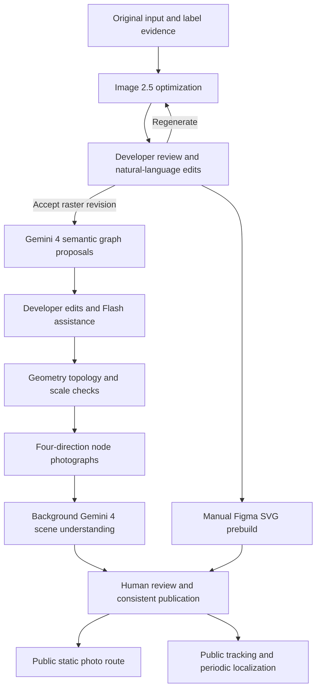
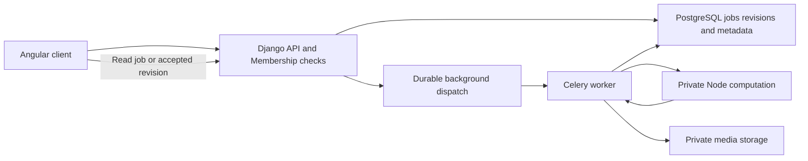

# Map development, scene capture and visual navigation workflow plan

Date: 2026-10-17. Branch: `acceptance/map-authoring-pipeline`; assessment baseline: `d78c5f4`.
Status: **future plan and feasibility assessment for map authoring / navigation UX**, not a completed runtime replacement. This addresses the member's seven updated requirements under the [architecture baseline](../initial/Indoor_Navigation_Architecture_and_Dependencies_EN.md) and [stakeholder workflows](../initial/Indoor_Navigation_Stakeholders_and_Workflows_Review_EN.md). Angular, Django/DRF, PostgreSQL, Celery/Redis and Capacitor retain their responsibilities.

> **Canonical visitor photo localization (2026-10-17):** MegaLoc image embeddings + cosine search over ready revision index zips, **no floor prompt**.  
> See [localization-megaloc.md](../localization-megaloc.md) and [localization-visitor-match.md](../localization-visitor-match.md).  
> Sections below that assign **Gemini 4 / NLP embeddings / floor-first search** to visitor photograph matching are **superseded** by that pipeline. Gemini remains relevant for **map authoring** (raster/semantics/graph proposals) and optional scene-description jobs — not for place match.

**Continuous-tracking update, 2026-10-17:** the member authorized camera, accelerometer and gyroscope integration and continuous geometric tracking as explicit dynamic-navigation work, informed by OpenVINS/ORB-SLAM3 and related implementations. Sections 9.4-9.7 define the approach and acceptance boundary; actual hardware access and SDK installation remain unimplemented.

## 1. Feasibility and product definition

**The overall workflow is feasible as a reviewed navigation graph, four-direction scene references and constrained visual re-localization.** Most of the loop can be built without automated vectorization. Accept these capabilities separately:

| Stage | Assessment | Required conditions |
|---|---|---|
| Image 2.5 optimization and natural-language edits | Supported interfaces; structural fidelity unproven | Retain original, version every result, require developer acceptance, rebuild/review affected semantics |
| Gemini 4 node/edge/label proposals | Candidate generation is feasible; completeness and wall avoidance are not guaranteed | Original-label evidence, trusted obstacles/free space, deterministic checks and human review |
| Manual editing and Flash assistance | Compatible with existing permission/ChangeSet direction | Stable IDs, optimistic version checks and undoable structured operations |
| Asynchronous four-direction scene understanding | Feasible | A shared heading convention, independent jobs, interference/provenance records and stale-result checks |
| Static reference-photo navigation | Best first field-tested loop | Confirmed start/heading, route-directed image selection, manual progress and explicit recovery |
| Continuous tracking with three-second re-localization | Authorized dynamic-navigation work; device accuracy/latency unverified | Camera/IMU integration, local pose/relative motion, bounded requests, temporal/motion constraints and ambiguity handling |
| Arrows/landmarks fixed to real-world surfaces | Staged acceptance within dynamic navigation | Metric scale, anchors and map alignment on top of tracking; enable only after validation |

The Public User indoor interface becomes **start/destination selection, reference photos, camera and next-step guidance**, without an indoor map. Developer retains map/graph editing. Google Maps may still support outdoor building/entrance approach; proximity cannot establish indoor floor/location. The member's wording for destination contained a typographical ambiguity; this plan interprets it as entering the route endpoint.

## 2. Model responsibilities and vectorization decision

| Workflow | Selected model / service | Boundary |
|---|---|---|
| Source optimization and natural-language image editing | GPT Image 2.5, retaining `gpt-image-2.5-sunburst` | Reviewable raster output, not authoritative metric distances or approved passages |
| Map semantics / graph proposals / optional scene descriptions | `gemini-4-argon` (Gemini 4) | Bounded structured responses with input identity/evidence; no direct publication; **not** visitor place match |
| **Visitor photograph localization (canonical)** | **MegaLoc** via place-match + Django `/api/navigation/localize/` | Image embedding + cosine over ready indexes; no floor prompt — [localization-megaloc.md](../localization-megaloc.md) |
| Developer label/edit assistance | `gemini-3.8-flash` | Allowed edit commands through the same server validation |
| Automated vectorization | Official Vectorizer.AI adapter | Disabled for this event, credentials empty, no paid conversion |
| Construction demonstration substitute | Existing `/api/vectorization/mock` | **IA floor 4, `ia-4`, only**; real prebuilt asset pending; not arbitrary-image conversion |

OpenAI documents source-image/text editing; Google model pages confirm the Gemini IDs for **authoring**. Supplier interfaces do not establish project accuracy. **Repeated visitor localization uses MegaLoc** (`/api/navigation/localize/`), not Gemini Live/API vision. [OpenAI edit API](https://developers.openai.com/api/reference/resources/images/methods/edit), [Gemini 4](https://ai.google.dev/gemini-api/docs/models/gemini-4-argon), [Gemini 3.8 Flash](https://ai.google.dev/gemini-api/docs/models/gemini-3.8-flash).

Manual Figma import, Vectorize, export and storage follow the [implemented commands/mock contract](vectorizer-api-demo.md). **IA-1 is part of the navigation demo route; IA-4 is the construction-workflow mock.** The English meaning of the required disclosure is: "A commercial automated API service is available, but we have not paid for it; this demonstration shows the resulting experience only." Also identify the SVG as a manual Figma prebuild. SVG is a visual background; routing uses a separately reviewed semantic graph, not the 1,321 traced paths.

## 3. Complete workflow and consistency boundary



Bind artifacts to `targetId / floorId / revisionId / sourceHash / rasterHash / coordinateFrameId`. Graphs, references and retrieval indexes also carry their own versions/hashes. Publish a consistent revision set; pin navigation sessions to one Publication rather than silently switching maps while a visitor walks.

Speculative understanding may run before raster acceptance, but remains tied to its draft. Raster, graph, photograph or exclusion-rule changes invalidate affected derivatives; keep stale job history without overwriting current output. Structural edits show affected edges, node coordinates, photo anchors, descriptions, indexes and routes, with review/reuse of still-valid records.

## 4. Raster optimization and developer edits

1. Preserve original bytes and label evidence. Removing labels must not destroy room numbers, functions or stair identifiers: extract/store them independently from the original/existing database and flag conflicts.
2. Give Image 2.5 the source and constraints to preserve internal layout, doors, stairs, lifts, walls and proportion while cleaning irrelevant exterior lines; forbid invented connections. Every result is a candidate.
3. Show the full raster directly to Developer, with natural-language input, optional region annotation and original/current/candidate comparison. Example: "Restore the east doorway and preserve the remaining structure." A selected region does not guarantee unrelated pixels remain unchanged.
4. Retain parent revision, prompt, model, usage and output for each regeneration. Include the original and latest accepted image where appropriate to reduce edit drift; support acceptance, rollback and further edits.
5. Start authoritative semantic extraction after acceptance. Structural changes require registration/re-extraction; identical pixel dimensions do not prove unchanged geometry.

The [previous real API trial](../audits/2026-10-17-gpt-fullchain-pilot.md) still showed exterior-cleanup and geometric problems. It does not establish automatic structural correctness after generation.

## 5. Gemini 4 map interpretation and wall-safe graph construction

### 5.1 Nodes, features and initial labels

Supply the accepted raster, original, extracted labels and trusted manual records. Generate bounded, mergeable proposals for doors, room destinations/classroom landmarks, special facilities, entrances, stairs, lifts, corridor junctions, corners and interval samples. Record source region, category, position, association, label provenance and uncertainty. Report discovered objects, uncovered regions and review items rather than claiming every vertex was found.

Align kinds with existing Node.Kind; checkpoints may represent special landmarks/corridor samples, with versioned semantic attributes for finer categories. Separate room destinations from door nodes. Associate visible but inaccessible objects without inventing walkable edges. Node positions are **walking/capture anchors**; the physical landmark position and viewing relationship are separate, avoiding camera anchors inside signs or solid objects.

Preserve junctions, turns, doors and confusing scenes before adding samples by corridor arc length. Sampling interval is experimental: pixels cannot be presented as metres without calibration, and density increases four-direction collection/analysis work. Multiple objects at the same physical position may share a capture anchor.

### 5.2 Coordinates, scale and spatial relationships

- Name original raster, optimized raster, SVG, graph and camera/AR frames separately; retain transforms and checked landmarks. Image top is not automatically map north.
- Set `distance_metres` and metric sampling intervals only from trusted scale or measurements. Before calibration, use relative units/unknown distances, not invented metres. One scale reference assumes uniform scale; inspect several locations if warping is possible.
- Keep geometric proximity, image-relative left/right/front/back, and graph reachability distinct. Euclidean and route distances differ; qualitative model descriptions are not metric measurements.
- Separate same-floor adjacency from floor transitions. Confirm actual stair/lift floor pairs and transfer records; equal pixels on different floors are not a connection. Existing Revisions belong to a MapTarget/floor, so cross-floor edges require an explicit design compatible with revision-scoped database constraints.

### 5.3 Edge proposals and deterministic checks

Gemini proposes connections/evidence; the server validates against reviewed walls/free space. With automated Vectorizer disabled, allow manual wall/door/corridor annotations or a reviewed traversability mask. A colored raster plus node coordinates cannot guarantee wall avoidance.

Check the **complete edge polyline and clearance envelope**, not only endpoints. Reject walls, partitions, room shortcuts and unconfirmed doorways. Curved corridors need polylines/intermediate nodes; doors must connect actual reachable regions. Preserve unknown clearance/accessibility instead of inventing certainty. Visual adjacency alone does not open an edge, and routing cannot automatically enable closed/unverified access.

Separate `distance_metres`, `cost`, direction, open/verified state and restrictions. Weight preferences cannot override prohibited/unverified access. Costs are nonnegative; use Dijkstra when the cost units/lower bounds do not justify an A* heuristic. Deterministic code performs geometry, connectivity and route checks; model output never grants the final legal connection by itself.

## 6. Developer graph editing and Flash assistance

Allow adding/deleting/moving nodes, editing edges/polylines/direction, distance evidence, weights, labels and facility properties. Raster/SVG backgrounds and graph overlays do not require semantic SVG path IDs.

Flash receives selected objects, a bounded region and the current revision, returning a structured ChangeSet: operation, stable object ID, expected version, values, rationale and impact. Check object counts/order/conflicts in batch labeling; retain undo. "Connect this point to that one" cannot directly create a verified passage.

Server checks cover permissions, versions, object existence, coordinates, costs, geometry and reachability. Structural changes receive a preview/diff before application; simple labels may follow existing undoable draft policy. Late AI proposals cannot overwrite newer manual work. Deleting a node explicitly handles related edges/photos rather than silently losing evidence.

## 7. Four-direction references, interference exclusions and background jobs

### 7.1 Capture requirements

Each localization anchor normally has front/right/back/left slots with headings 90 degrees apart. "Front" uses a fixed map-local convention, not each collector's initial heading. Record `heading_map_deg`, calibration method and error; magnetic north cannot automatically define map zero. Four perspective photos are not a seamless panorama and may leave gaps.

Capture from the same accessible position at approximately consistent height/pitch. Retain node, offset, floor, capture time, device, heading and quality. Mark unsafe/unavailable directions `not_capturable` for explicit publication/extra-anchor review; never synthesize/copy missing views. Four-direction coverage is the default goal; each exception must be disclosed and exercised in route acceptance.

### 7.2 Non-blocking upload and analysis

```text
Persist uploaded asset
  -> Atomically create pending Job: photo, revision, heading, exclusion-rule hash
  -> Return asset/job IDs and immediately allow another upload
  -> Dispatch authoring queue; Gemini 4 analyzes the scene
  -> Validate structure, evidence and input version; store proposed result
  -> Developer correction/review; include in the published index
```

"Run in the background until completion" means durable server recovery after browser closure, not infinite retries. Reuse Job/Attempt idempotency, leases, deadlines, bounded retries and visible failures. Persist before dispatch; recover dispatch failures instead of depending on browser Promises/in-memory queues. Expose progress; one failure must not block unrelated uploads. Reserve localization capacity so bulk authoring does not starve visitors.

Replacement photos create new asset/description versions; duplicate uploads/retries do not create duplicate effective records. Exclusion changes reanalyze that reference and invalidate affected indexes. Check input currency before committing a result.

### 7.3 Scene schema and interference exclusions

Store natural language inside **typed, evidence-linked fields**, not one unstructured paragraph. This example is a future contract; `example-*` identities and geometry are illustrative, not real rooms or an implemented API:

```json
{
  "schema_version": "scene-v1",
  "revision_id": "example-revision",
  "reference_id": "example-reference",
  "node_id": "example-node",
  "image_sha256": "example-image-hash",
  "direction_slot": "right",
  "heading_map_deg": 90,
  "heading_uncertainty_deg": 15,
  "capture_context": {"lighting": "indoor daylight", "pitch_deg": null},
  "features": [{
    "id": "f1",
    "category": "door",
    "description": "Dark double door with a fixed sign to the right of its frame",
    "color": {"relative": "darker than surrounding wall", "reliability": "conditional"},
    "bbox_normalized": [0.2, 0.25, 0.5, 0.9],
    "spatial": {"image_side": "left", "depth_order": "midground"},
    "perspective": {"view": "oblique", "vanishing_direction": "right"},
    "stability": "stable",
    "observed_text": null,
    "associations": [{"object_id": "example-door", "status": "proposed"}]
  }],
  "exclusions": [{
    "reason": "temporary furniture",
    "description": "A table that is not normally present here",
    "polygon_normalized": [[0.55, 0.6], [0.85, 0.6], [0.85, 0.95]],
    "declared_by": "developer",
    "scope": "this_reference"
  }],
  "quality": {"blur": "low", "occlusion": "partial", "usable": true},
  "uncertainties": ["The sign text is unreadable"],
  "review_state": "proposed"
}
```

Actual angles/regions need capture context or image evidence and may remain unknown. The server validates coordinate conventions, enums and regions; JSON Schema compliance does not prove semantic correctness. [Google structured-output guidance](https://ai.google.dev/gemini-api/docs/structured-output).

People/animals are not stable localization landmarks. Treat changing scenery/reflections beyond glass as unreliable while retaining stable window frames/glass structure where useful. Record lighting/exposure separately and use color as supporting evidence. Developer can describe/outline temporary tables and inspect what was excluded or remains uncertain; ambiguous instructions cannot remove a whole wall or every table. Exclusions control matching evidence/weights, not deletion of facts from original photographs.

A room name or directional sign does not establish the camera's location. Separate observed-object relations from camera-node associations. **Visitor place match uses MegaLoc image embeddings** ([localization-megaloc.md](../localization-megaloc.md)), not Gemini scene-text retrieval. Optional Gemini scene descriptors remain authoring/enrichment only and must not replace the MegaLoc index.

## 8. Public static reference-photo navigation

1. Enter a destination mapped to a published node (building/floor may be inferred from the destination or later from visual match). Resolve duplicate/unknown names by selection, not invented destinations.
2. Choose a start-confirmation photo or continuous localization. A selected start is a user claim until visually confirmed; retain manual mode for denied camera access.
3. **Visual start:** `POST /api/navigation/localize/` (MegaLoc global catalog; **no floor prompt**). Response includes `node_id`, `target_id`, `floor_id`, `building_id`, and decision. Heading alignment remains a separate UX step when needed.
4. Route through open, verified edges satisfying restrictions on the pinned publication. Report unreachable destinations; use calibrated edge distances.
5. Select each image by the route segment's **departure heading**. Reverse routes use reverse references. Show the next landmark, turn and approximate distance; request alignment/additional photos when headings or corners lack coverage.
6. Offer a continuous route-photo preview, but **playback progress is not physical location**. Walking mode uses explicit "Reached this point / Next step" confirmation and optional re-capture. Confirm the destination from a sign/scene or user action, not the final slide.

Static guidance does not estimate continuous motion. Gaps between capture points are not continuous video or tracking.

## 9. Public dynamic visual navigation

### 9.1 Three-frame bursts and request backpressure

While foreground camera preview runs, start **one three-frame burst every three seconds**, for example with about 200ms between frames. Rank sharpness, exposure, obstruction and useful scene content locally, then upload one frame. Tune timing on the actual device. If all frames are unusable, request a retake instead of choosing the least bad empty/blurred image. Record capture/selection metadata for testing; do not upload continuous video by default.

Allow one in-flight localization request and one latest pending frame per session. Replace old pending frames rather than growing a queue. Bind results to `sessionId / publicationId / contextVersion / captureSequence / capturedAt`; stale/obsolete responses cannot overwrite current state. Destination/floor changes increment context version.

This schedule is for **MegaLoc / localize** cloud requests (not Gemini place match). Local tracking needs continuous camera/IMU streams; waking a camera every three seconds does not provide continuous VIO. Share camera ownership as defined in section 9.5.

Three seconds is a sampling target, not an end-to-end latency guarantee. At most about 20 selected frames/minute are available; a ten-second serial request processes about six/minute, requiring drops or reduced frequency. Measure capture/upload/queue/inference/validation p50/p95 before selecting cadence, crops and settings; concurrency is not an unlimited remedy.

Browser camera access requires real permission and an appropriate secure context; cookies cannot grant it. Pause on hidden/background/locked/stopped navigation and recheck freshness on resume. Capacitor Camera's one-shot capture is not a continuous analyzer. Validate WebView streaming or a native CameraX bridge; this plan installs neither. [W3C capture specification](https://www.w3.org/TR/mediacapture-streams/), [Capacitor Camera](https://capacitorjs.com/docs/apis/camera), [CameraX ImageAnalysis](https://developer.android.com/media/camera/camerax/analyze).

### 9.2 Constrained search and re-localization

**Canonical matcher:** MegaLoc global (or debug-narrowed) cosine search via `/api/navigation/localize/` — not Gemini per frame. After a confirmed start, optional product logic may prioritize neighborhood/route consistency in the **client or Django**, but must not replace MegaLoc or invent a floor prompt. Return candidates, evidence, and ambiguity/rejection from the engine decision. Position may be a node or interval along an edge, avoiding false precision between sparse anchors.

Constrain candidates with `reachable graph distance <= v_max * elapsed capture time + position-error margin`. Use graph distance, actual capture-time differences and the relevant movement mode; unknown metric scale prevents metric hard pruning. Keep multiple hypotheses. Low confidence expands search or requests a new view (still **no floor prompt**), so an initial false match cannot permanently exclude the true location. Handle lift/stair transitions separately; a room number alone does not establish a floor change.

At an illustrative 1.5m/s, a visitor travels about 4.5m in three seconds, plus inference delay. Ask visitors to stop at ambiguous turns, show last-confirmed time and uncertainty, and do not claim precise corridor position from a speed bound. People/animals excluded from localization may still obstruct the real path; this is not a real-time obstacle-avoidance promise.

### 9.3 Direction, landmarks and distance in the camera view

Start with **screen-space guidance**: next segment's relative direction, landmark reference, remaining route distance and localization age. A destination may lie behind a wall/on another floor; guide to the next reachable waypoint instead of pointing through obstacles.

Relative turns require confirmed map heading. Otherwise ask for reference alignment without a definite left/right arrow. Unknown along-edge position requires ranges/approximation; no scale means no metre display. A landmark bounding box must come from the current valid frame, not an old image overlaid on new video.

The member authorized **continuous geometric tracking and world-coordinate alignment**. Implementation needs camera intrinsics, visual-inertial pose tracking, map alignment, metric scale and recovery; retain screen-space guidance until the corresponding gates pass. Four-direction reference photos and MegaLoc localize provide place/heading hypotheses; local tracking supplies continuous relative movement. Gemini remains authoring enrichment only. [ARCore fundamentals](https://developers.google.com/ar/develop/fundamentals).

The [Indoor Live View research](indoor-live-view-research.md) records evidence and alignment principles. The following sections turn them into authorized project work without claiming installed dependencies or changing MegaLoc as the place matcher.

### 9.4 Dual-rate estimation, tracking states and delayed corrections

**Local fast path:** continuous camera plus accelerometer/gyroscope -> native VIO/SLAM or supported tracking SDK -> pose/quality -> map alignment -> arrow updates on available render frames. Fuse raw IMU locally; do not send every sample to Gemini or trigger full Angular refreshes per sample.

**Cloud slow path:** selected burst frame -> **MegaLoc localize** (same canonical engine) and/or optional later geometric verification -> consistency check with tracking epoch -> map-association correction/re-anchoring. A future geometric VPS may provide constrained absolute camera pose; a Gemini node/label judgment is **not** the place matcher and does not supply full pose.

| Capability / state | Permitted display |
|---|---|
| `orientation-only` | Rotation/coarse heading and screen-space cues; no fabricated translation |
| `local-vio`, not map-aligned | Relative trajectory and tracking status, without precise building-coordinate claims |
| `registered-vio` and `tracking` | Scale/anchor-checked route arrows, estimated route progress and distance |
| `initializing / limited / lost / paused / unavailable` | Limitations and last confirmed state; remove precise pose-dependent overlays when lost and request re-localization/static mode |

Increment `trackingEpoch` on local-origin reset, re-localization or native-session restart. Never apply old transforms/cloud results across epochs. Keep bounded timestamped pose history: only correct results matching publication, context, epoch and available capture-time history, then propagate later motion to now. Do not directly assign an old screenshot location as current. Reject/re-capture outside the history/error window. Large conflicts require confirmation, not cosmetic smoothing.

Anchoring needs position, heading, scale and camera-to-map-plane relation. First validate with known-position/heading manual alignment or a known-size AprilTag. One selected node/coarse directional reference cannot automatically determine accurate 6DoF. Label and test anchored versus markerless positioning separately. Leave unavailable covariance/precision unknown instead of manufacturing confidence.

### 9.5 Device integration and client boundary

Follow the [Android architecture](../initial/Indoor_Navigation_Android_Architecture_EN.md): Android/Capacitor is the main continuous-tracking target; Angular uses device adapters and browsers degrade by capability. Existing [DevicePreview](../../apps/web/src/app/core/device-preview.ts) is explicitly simulated, not hardware evidence.

| Input / capability | Planned access | Constraints |
|---|---|---|
| Accelerometer | Native `SensorManager` / `TYPE_ACCELEROMETER`, or tracking SDK's internal capture | Raw data includes gravity/bias; calibrate/fuse it rather than treating double integration as reliable indoor distance |
| Gyroscope | `TYPE_GYROSCOPE`, retaining native angular rate/time | Supports rotation and camera fusion; integrated rates drift and do not establish map heading alone |
| Supporting orientation/gravity/gait | Available rotation vector/gravity; optional later gait constraints | Detect missing sensors, separate magnetic north/map heading, and handle step-API permissions only if enabled |
| Continuous camera/intrinsics | One native session; prioritize an ARCore pose/image/rendering probe | Keep frames, IMU, physical pose and display rotation corresponding; degrade if unsupported |
| Web/quick motion probe | `DeviceMotionEvent` / `DeviceOrientationEvent` or evaluate `@capacitor/motion` | Checks availability/interaction; official Motion currently wraps Web events, not full native VIO or guaranteed hardware timing |

Proposed client adapter: `capabilities()`, `requestAccess()`, `start(options)`, `subscribePose()`, `captureBestFrame()`, `stop()`. This is not a published backend API. Report camera/gyro/accelerometer availability, authorization, engine and clock support separately. Pose records carry session/epoch, native time, source frame, position, quaternion, tracking state, alignment ID and available quality.

Implementation requirements:

- Normalize acceleration to `m/s²` and angular rate to `rad/s`; convert Web rotation units according to the actual contract. Record gravity inclusion, bias handling, device/camera extrinsics and natural/display orientation. Prefer quaternions/matrices over discontinuous Euler angles.
- Retain native monotonic timestamps and clock identities. `SensorEvent.timestamp` is nanoseconds on Android's elapsed-realtime base; verify camera/SDK/JS clock relationships. JS callback arrival or `Date.now()` cannot replace exposure/sample time. Encode nanosecond bridge values as strings or defined relative times to avoid numeric precision loss.
- Keep high-rate pixels/IMU processing on native threads. Batch/throttle pose/state to Angular; native camera/AR rendering may be appropriate. Validate the standalone native view before Angular overlay/touch/lifecycle integration; avoid per-sample/pixel round trips through JS.
- Use **one camera owner**. With ARCore, obtain permitted query frames from its session; custom VIO uses a unified Camera2/CameraX pipeline. WebView `getUserMedia`, CameraX and ARCore must not independently compete for the camera. Validate shared-camera mode against official interfaces.
- Explain sustained camera/motion use before requesting access. Use platform camera runtime permission and applicable Web secure-context/policy/user-gesture motion permission. Ordinary Android raw motion sensors do not imply one generic runtime dialog; handle high-rate/step restrictions for the chosen OS/API.
- On stop, hidden/background/locked state, native-view exit or revoked access, remove listeners, stop camera/tracking and clear buffers. Recheck clocks, epoch and alignment on resume. Server photo-analysis jobs may continue while phone tracking follows foreground lifecycle.

References: [Android motion sensors](https://developer.android.com/develop/sensors-and-location/sensors/sensors_motion), [sensor overview](https://developer.android.com/develop/sensors-and-location/sensors/sensors_overview), [SensorEvent clock](https://developer.android.com/reference/android/hardware/SensorEvent#timestamp), [ARCore physical/display camera poses](https://developers.google.com/ar/reference/java/com/google/ar/core/Camera), [shared camera](https://developers.google.com/ar/develop/java/camera-sharing), [Capacitor Motion](https://capacitorjs.com/docs/apis/motion).

### 9.6 Open-source references and engine selection

The member authorized these references. Pin versions and run reproducible local probes before adopting dependencies. Motion, OpenVINS, ORB-SLAM3 and ARCore are not installed; the Android wrapper is not a tracking implementation.

| Candidate / source entry | Intended use |
|---|---|
| [Motion `web.ts`](https://github.com/ionic-team/capacitor-plugins/blob/main/motion/src/web.ts) and [definitions](https://github.com/ionic-team/capacitor-plugins/blob/main/motion/src/definitions.ts) | Event/lifecycle/capability probe, without assuming synchronized native IMU from the plugin name |
| [OpenVINS `VioManager.cpp`](https://github.com/rpng/open_vins/blob/master/ov_msckf/src/core/VioManager.cpp) | `feed_measurement_imu`, buffering/propagation, initialization, visual updates and state management; requires full calibration/synchronization, not an isolated integration snippet |
| [ORB-SLAM3 `System.h`](https://github.com/UZ-SLAMLab/ORB_SLAM3/blob/master/include/System.h) | Timestamped images/IMU via `TrackMonocular`, tracking state, reset/map lifecycle; not a ready Capacitor plugin |
| [hloc](https://github.com/cvg/Hierarchical-Localization), [LightGlue](https://github.com/cvg/LightGlue), [COLMAP](https://github.com/colmap/colmap) | Future markerless absolute localization/map building from overlapping real captures, not high-rate local tracking replacements |
| [ARCore `HelloArActivity.java`](https://github.com/google-ar/arcore-android-sdk/blob/main/samples/hello_ar_java/app/src/main/java/com/google/ar/core/examples/java/helloar/HelloArActivity.java) | Preferred first Android pose/rendering probe; the sample does not make the core runtime fully open source |

Recommended sequence: **read/record device data -> verify native ARCore pose/rendering on the target phone -> connect a common Tracking adapter -> use the same recordings to assess OpenVINS/ORB-SLAM3 if necessary**. Reuse SDK-internal fusion when selected; extra raw readings are diagnostic, not a second fusion of the same measurements. A custom engine explicitly owns synchronization, calibration, builds, threads and maps.

OpenVINS/ORB-SLAM3 are GPL-3.0; hloc/LightGlue are Apache-2.0 at the project level, with potentially different feature-model/weight terms. Record actual versions/dependency boundaries before adoption. This is planning/source review, not automatic code copying, production dependency installation or paid VPS activation.

### 9.7 Real-device continuous-tracking acceptance

Initially keep probes, recordings, device/calibration details and measurements in ignored `local/android/tracking/`; move reusable interfaces/necessary regressions into shared code. Distinguish physical capture, replay and simulation. No real-device pass is claimed yet.

1. **Capabilities/lifecycle:** presence, denial/revocation, no callbacks after stop, screen rotation, background/resume, camera contention, missing gyro/ARCore degradation.
2. **Capture quality:** actual frame/IMU rates, jitter, dropped samples, clock offset and bridge delay; select engine-compatible settings instead of inferring sensor rate from UI refresh.
3. **Geometric truth:** stationary, rotation in place, measured straight/turning paths, return loops and long corridors; measure pose error, trajectory/closure drift, rendering jitter and scale/alignment error. Short tests do not establish building-wide success.
4. **Loss/recovery:** obstruction, weak texture/light, rapid turns and repeated corridors; withdraw precise overlays when lost and detect origin resets on recovery. Never force a false-floor/landmark match onto the expected route.
5. **Slow-path fusion:** delays, reordering, destination changes and epoch resets; fuse only with compatible historical pose, otherwise reject. A Gemini node confirmation retains its uncertainty rather than becoming precise 6DoF.
6. **Resources:** FPS, CPU/memory, battery, temperature, network and native/Angular composition; track local compute separately from cloud cost. Freeze numerical gates after a target-device baseline, then evaluate an independent field route.

## 10. Repository mapping and remaining work

| Existing foundation | Reusable role | Still required |
|---|---|---|
| [Revision / Asset / Node / Edge](../../apps/api/maps/models.py) | Revisions, source/standardized assets, frame/scale, graph IDs, costs/verification | Edit services, semantic adaptation, obstacle/polyline contract, floor transfers and raster registration |
| ReferencePhoto / SceneRelationship in the same file | Node association, headings, descriptions, relations/review | Four-slot coverage/exceptions, typed descriptors, exclusion/version/quality/index validity |
| [Job / JobAttempt](../../apps/api/jobs/models.py) | States, idempotency, leases, retries and usage | Photo worker, reliable dispatch/recovery, capacity and progress UI |
| [Navigation models](../../apps/api/navigation/models.py) | Pinned publication, capture/context sequence, results and route history | Real localization, candidates/along-edge state, retrieval, heading and visitor services |
| [Android boundary](../initial/Indoor_Navigation_Android_Architecture_EN.md) / [DevicePreview](../../apps/web/src/app/core/device-preview.ts) | Native adapter responsibility and simulated state | Real camera/IMU, Tracking adapter/rendering, timing/epoch/alignment; simulations are not measurements |
| [Node pipeline](../../apps/pipeline/server/index.js) | Existing authoring and vectorization slice | Adaptation to Django domain authority instead of a second publication truth |
| [Prebuilt catalog / mock](vectorizer-api-demo.md) | Imports, provenance and fixed IA-4 output | Actual IA-4 asset, shared storage, Angular integration; IA-1 navigation graph remains separate |

Models are foundations, not proof of completed services. ReferencePhoto lacks a dedicated typed descriptor/four-slot coverage table; Node lacks general semantic attributes. Versioned JSON/Revision.geometry may be evaluated initially after choosing one authority/validator. Existing JSON fields do not automatically satisfy the new contract; this plan creates no migrations.

Use the existing asset-storage boundary for photos and database identities/references/descriptors. Interference exclusion requires neither deleting original evidence nor identifying people. Bind indexes to descriptor/model/rule/revision/review versions; future embedding comparisons must use compatible spaces, dimensions and normalization.

### 10.1 Node/Django responsibility and integration proposal

**Member clarification:** browser Local Storage prototype records are personal test data and may be discarded when the real services replace them; a legacy-data migration is not a requirement. No clearing is performed by this planning update. Source evidence and prebuilt demo assets are outside that browser store.

Node and Django can retain different internal representations. The current problem is the missing authority/adapter boundary, not their implementation languages. The Node pipeline evolved as an independently runnable authoring/AI tool while the Django team developed relational identity, permission, revision and publication foundations; their product integration has not yet been implemented.

| Boundary | Current mismatch | Proposed responsibility |
|---|---|---|
| Saved building and revisions | Node `PUT /api/building` writes `.local/building.json`; Django has MapTarget/Contribution/Revision, but no adapter imports the saved building | Django owns shared revisions/publications; Node files become computation artifacts/caches, not a second shared publication database |
| Geometry, graph and assets | Node building JSON aggregates floors, string IDs, inline `dataUrl` assets and `both/forward` edges; Django uses scoped UUID records, revision geometry, storage keys and directed edge records | A versioned adapter maps IDs, floor/revision scopes, node kinds, coordinates/units, polylines, access evidence and edge direction; split bidirectional edges where required and store binaries privately |
| Identity and review | Django checks Membership; Node authoring receives the building and reviewer text from its caller and does not enforce the Django session/membership | Django derives the acting user and authorizes each target/write/review. A private compute call cannot grant membership, impersonate human review or publish |
| Jobs and recovery | Node keeps active jobs in memory and snapshots in `.local/map-jobs`; Django Job/JobAttempt are separate records | Django owns public job identity/state and idempotency; workers invoke Node, map progress/results and record attempts. Node execution IDs are subordinate implementation details |
| Runtime delivery | Angular currently calls `/pipeline/api` directly; current deployment packages Django/Web without the Node service | Browser-facing business APIs terminate at Django. Deploy a private Node compute service for required modules and invoke it from workers; define startup/readiness/persistence without exposing the entire local-tool API |

Recommended initial design, preserving useful JavaScript geometry/model code:



1. Define one bounded input/output contract before changing public routes: target/source revision identity, frame/scale, asset references, operation/options, result graph proposals, artifacts, issues and provenance. Map Node-internal IDs deterministically; do not match rooms only by display name. Unknown metric scale stays unknown, and cross-floor associations must respect existing constraints.
2. Django authenticates and authorizes the request, persists a job tied to its actor/target/source, then dispatches after commit. The worker prepares the Node input and invokes an internal operation with service-scoped access; long model requests do not block the API process. Do not forward provider keys or rely on a caller-supplied reviewer string as identity.
3. Node performs extraction/geometry/rendering and returns proposals/artifacts. The worker validates output and source revision/hash freshness before storing private files and associated Django records. Model checks remain agent-inspected; human review/publication stays in Django-authorized domain services.
4. Expose job status and the resulting draft through Django, preserving idempotency and rejecting stale write-back. Move frontend authoring to this boundary one operation at a time; keep the old Node endpoints local for diagnosis until replaced. Browser state may still hold temporary unsaved edits without becoming shared persistent authority.
5. Prove a small input -> authorized job -> Node result -> stored draft -> review/publication loop, including denied target, duplicate request, worker failure and intervening manual edit. Then migrate additional operations and deploy the internal runtime under R-03.

This avoids rewriting the complete tested Node implementation in Python or letting Node independently write shared tables and bypass Django business rules. A later Python consolidation may reduce operational overhead if justified by measurements, but it is not the first repair requirement. The design is a recommendation only: no public API, runtime topology, dependency, database record or Node persistence behavior changes in this documentation update.

## 11. Delivery sequence, costs and acceptance

The [deployment update plan](../deployment-update-plan.md) selects the stage
direction for section 10.1: retain one private Node compute service behind
Django-owned jobs and one authoring worker, rather than rewriting the pipeline.
It defines resource limits, serial execution, persistent paths, coordinated
releases and capacity/failure gates. This is a selected plan, not deployed work.

### 11.1 Implementation slices

1. **Contracts and short-route truth:** manually confirm IA nodes, doors, metric distances/headings, independent test photos and SVG. Keep IA-4 construction assets independent of IA-1 navigation testing.
2. **Accepted raster to graph draft:** natural-language image edits/version selection, Gemini 4 proposals, deterministic checks, manual editing and Flash assistance on a short segment with a turn/door.
3. **Reference ingestion:** directional slots, uploads/exclusions, durable jobs, review/publication; prove non-blocking uploads and correct write-back.
4. **Public static loop:** destinations, initial position/heading, directional photos, manual progress and actual arrival in a field walk.
5. **Device/local tracking:** accelerometer/gyro on the target Android phone, one camera/clock source, pose probe followed by relative motion/anchoring, lifecycle and degradation.
6. **Dynamic short route:** calibrated Tracking plus burst/Gemini requests, neighborhood constraints, delayed fusion and recovery; separately accept screen-space/world-aligned guidance.
7. **Conditional expansion:** more floors/devices/lighting and markerless geometric re-localization after independent evidence; live Vectorizer remains post-event commercial work.

### 11.2 Time and cost accounting

Record every attempt's model/endpoint/settings, prompt/schema version, input hashes/resolution, queue/upload/inference/validation timing, available billable usage including cache/thinking, retries and accepted/rejected/corrected outcome. Use dated supplier/endpoint rates and explicit currency; missing usage is unknown. Do not reuse stale prices or declare a winner from token costs for unequal-quality tasks.

For N distinct anchors, basic collection is about 4N photographs; include retakes, exclusion reanalysis and graph-revision rebuilds. A T-minute dynamic session offers at most about 20T requests before in-flight limits/reduced cadence. Include initial localization, rejection/retakes, failures and concurrent visitors. Compare total cost/time per accepted route, not successful single calls alone.

Keep Gemini 4 / Flash for **authoring** cost accounting; keep MegaLoc for **visitor localize** latency/quality. Freeze task/input/acceptance sets when comparing configurations. If MegaLoc freshness or accuracy misses the gate, use static/stop-to-localize and report the limitation — do not silently substitute Gemini as the place matcher.

### 11.3 Acceptance gates and failure cases

These are required tests/measurements, **not achieved results**. Freeze numeric localization thresholds after a small pilot, then evaluate fresh held-out field captures.

| Area | Passing evidence | Required failure/recovery cases |
|---|---|---|
| Raster revisions | Visible/undoable changes, retained labels, consistent graph/assets | Invented doors, geometric drift, late jobs |
| Graph/distances | Measured truth-set coverage, reviewed published routes without known wall crossings, traceable scale | Adjacent-but-separated rooms, obstacle-crossing polylines, closed doors, missing scale, similar floors |
| Four-direction references | Common headings, explicit coverage/exceptions and visual evidence | Reordering/duplicates, blur/light, temporary table, glass reflection, wrong anchor |
| Jobs/publication | Bounded retries/idempotency/restart recovery and consistent graph/photos/indexes | Dispatch/worker loss, exclusion edits and deleted-node late completion |
| Static guidance | Correct forward/reverse photos/turns and field arrival | Wrong declared start, unknown heading, duplicate destination, slides advance without walking |
| Dynamic localization | Accepted precision/coverage, false accepts, floor/heading/route error, p50/p95 and recovery | Similar corridors, unknown places/floors, blur, escaped neighborhood, latency/reordering |
| Continuous tracking | Real camera/IMU quality, pose/trajectory drift, alignment, rendering and recovery | Clock mismatch, epoch resets, rotation mistaken for translation, forced snapping, camera contention |
| Device UX | Permission/pause/resume, power/data use and stopped sampling | Denial, background/lock/offline, absent sensors and camera contention |
| Honest demo | IA-4-only mock with actual manual provenance; IA-1 navigation separate | Missing IA-4 stays pending without substitution or live-conversion claims |

Use different collectors, sessions and approach directions, including unsupported places. Querying reference images against themselves is not field-localization acceptance. Calibrate confidence against measured false accepts rather than treating model self-scores as correctness probabilities.

The plan is ready for staged implementation and small field trials. Error-free automatic graphs, stable precise localization from descriptions alone and continuous world alignment from periodic recognition remain unproven by current evidence.
