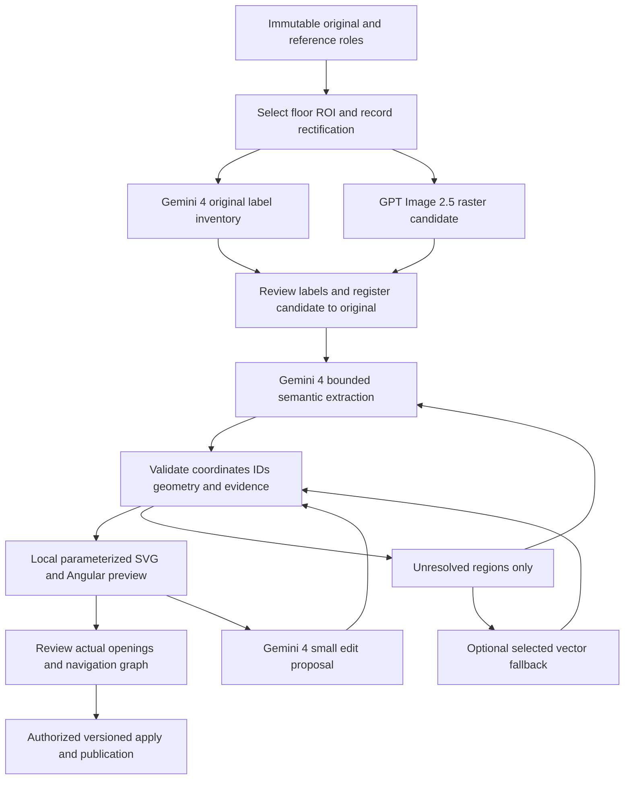

# Floor-plan authoring pipeline redesign proposal

**Date:** October 17, 2026. **Status:** proposed experiments; no runtime, dependency, application API or architecture migration has been implemented. Requesting-member approval remains required before changing architecture/dependencies under [AGENTS.md](../../AGENTS.md).

The [real API trial](../audits/2026-10-17-map-authoring-pipeline.md) failed map acceptance. The [independent web artifact review](../audits/2026-10-17-chatgpt-web-floorplan.md) demonstrates a promising human-corrected visual workflow and also a reproducible second-version interaction failure. This proposal turns those observations into bounded experiments; it does not claim that the new chain already works or costs less.

## 1. Model policy and verified capabilities

Follow the requesting member's latest choice: **GPT Image 2.5 for image generation; Gemini 4 for other inference; Opus 5.5 or GPT 6.1 only as optional vectorization fallbacks.** Earlier preserved plans remain historical context.

| Task | Proposed adapter/model | Execution rule |
| --- | --- | --- |
| Clean raster candidate | OpenAI Image API, `gpt-image-2.5-sunburst` | One initial image edit/generation; immutable output and provenance |
| Original label inventory, floor/region understanding, bounded geometry, semantic checks and natural-language edits | Existing Vertex transport, `gemini-4-argon` | Gemini remains primary; tune effort within this model rather than silently changing model family |
| Difficult residual vectorization | Explicitly selected `claude-opus-5-5` **or** `gpt-6.1-sol` | Opt-in, one bounded region, same contract; no automatic calls to both alternatives |
| Rendering, layout, geometry validation, graph and ordinary UI actions | Existing local deterministic code | No model call |

The [image model capability page](https://developers.openai.com/api/docs/models/gpt-image-2.5-sunburst) lists image output without structured output/function calling. Request the bitmap through the image API; application code records its metadata. A separate semantic model returns JSON. Do not request an image and strict geometry JSON from one image-model response.

[Gemini 4's model page](https://ai.google.dev/gemini-api/docs/models/gemini-4-argon) lists image understanding, structured output and function calling, but no image generation. The [Vertex Gemini 4 guide](https://docs.cloud.google.com/gemini-enterprise-agent-platform/models/start/get-started-with-gemini-4) documents LOW/MEDIUM/HIGH thinking and implicit caching; custom temperature/top-p/top-k are ignored. Optimize task size, effort and schemas rather than temperature. Do not design an explicit `cached_content` dependency for this model.

Only the existing Gemini/Vertex path has been exercised with the team's credentials. Catalog availability is not account access: OpenAI image and optional fallback authorization, exact returned model version, billing and limits must be probed before their experiment. Do not silently substitute an accessible model. The [GPT 6.1 model page](https://developers.openai.com/api/docs/models/gpt-6.1-sol) supports structured output/tools for the optional adapter; its suitability still needs the same fixture evaluation.

## 2. Proposed flow and human review gates



Every inference produces a proposal, never a published map. Local gates must preserve partial valid work and expose unresolved items even when a later stage fails. A `needs-review` result is a resumable review state, not successful apply. Image-stage failure can retain the original and review artifacts; it cannot be reported as completion of the required image stage.

### A. Preserve evidence, select the floor, normalize

- Keep the uploaded bytes/hash, source dimensions, reference roles, selected floor and ROI. For IA-1 explicitly exclude the lower inset; do not absorb Muffler or The Hive into Level 1.
- Use deterministic crop/orientation/perspective correction with recorded transforms. Ask for corner/ROI adjustment when automatic selection is ambiguous; no guessed transformation hidden in a prompt.
- Inventory text from the original before creating a label-free raster. Keep raw text, source bounding region and proposed map association separately. Include the `STAIR J`/`STAIR C` ambiguity instead of merging names. Unknown labels stay unknown.
- Separate structural lines, annotations and decorative facade candidates. A red leader or exit arrow is not a wall, and removing display annotations must not erase their source evidence.

### B. Generate a clean raster, then check it

Send the normalized target floor as the geometry reference and any second image with an explicit label-only role. Request clean linework with the same floor arrangement; retain door openings, stairs, landings, columns and voids. Avoid generating a fresh legend or page layout. A label-free variant is derived only after inventory.

Register source/candidate landmarks across the whole floor and difficult areas. Compare footprints, room positions and critical openings against the original, not merely the generated raster. A candidate may be pretty but structurally wrong; queue drift or reject it. A homography cannot undo arbitrary nonlinear changes introduced by generation. Do not assume same dimensions, crop, orientation or pixel alignment because the prompt requested preservation. Image generation has acknowledged precision/placement limitations in the [official guide](https://developers.openai.com/api/docs/guides/image-generation).

### C. Extract semantics with Gemini 4 in bounded requests

Start with global floor/label inventory, then extract bounded groups with original + registered candidate + only useful source crops. Return rooms/circulation, stair flights versus landings, elevator shafts, voids, observed openings and unresolved evidence. Use local temporary IDs and resolve them to stable server-owned IDs after validation.

Do not ask the model to emit thousands of seat lines, treads, SVG paths or an entire HTML page. Initial trace limits are 16 spaces, 16 opening candidates and 32 unresolved entries per request; use smaller subsets for semantic checks. Reaching capacity must be reported and split, not silently truncated. Coverage reconciles every original label and every selected region to an accepted association, explicit exclusion or review item.

For region verification, begin with 2–4 regions per batch, bounded reason codes and short descriptions. The current implementation allows eight checks, 1,500-character explanations and two images per region within a 6,000-output-token request. That is a concrete sizing risk exposed by the `MAX_TOKENS` trial. On incomplete/refused/malformed output, retain raw evidence privately, reject incomplete JSON, and retry or split only the failed batch within the job budget; preserve earlier valid checks.

### D. Render repeatable components locally

| Component | Validated parameters | Renderer responsibility |
| --- | --- | --- |
| Stair presentation | Reviewed envelope, tread angle/count, landing boundary | Even spacing and clipping; no inferred floor connector |
| Door presentation | Existing verified opening, hinge, width, swing or unknown | Draw leaf/arc connected to the opening; do not create access by drawing a symbol |
| Seating | Block polygon, local axis, rows/spacing, aisles | Regular marks clipped to the block; count/style is presentation until independently verified |
| Decorative exterior | Separate nonstructural layer and simplification tolerance | Simplify without changing the actual exterior wall/footprint |
| Labels/hotspots | Stable entity ID and map anchor, text and screen-sized hit area | Attach only to the map SVG, inverse-transform pointer input, support keyboard and independent state |

Retain non-axis-aligned geometry where the source requires it. Bound snapping by a documented tolerance, show its displacement, and never snap a doorway across a wall or erase a narrow corridor to make lines attractive.

Use a fixed Angular renderer and controls rather than generated executable pages. Export sanitized SVG/JSON as artifacts if useful; arbitrary script, external resources and generated HTML are not production rendering inputs. Add a focused regression check that every marker/label belongs to the map SVG, has a rendered hit area, and remains attached under pan/zoom; the web v2 failure passes ID uniqueness and counter-only tests.

### E. Verify openings, graph and publishability

Reuse current geometry/access/coverage validators and graph construction. Separately check evidence for each critical opening, floor membership, disconnected destination and wall crossing. Flights and shafts are not same-level walkable rooms. A source sign's HERE mark does not initialize a visitor GPS/indoor location.

Expose assumed openings as explicitly unverified and disabled for publication/routing until the existing domain's evidence/review policy accepts them. Repairing a rendering does not prove access. Structural edits invalidate affected graph/review state; style changes do not silently rebuild route meaning. Navigation acceptance requires correct reachable destinations and blocked routes, not just a valid SVG or connected graph.

## 3. Coordinate and data contracts

The current [BuildingSchema v2](../../apps/pipeline/shared/building/schema.js), [map geometry](../../apps/pipeline/shared/map.js), access records, revisions and graph remain the intended application model. Do not introduce a second canonical building database. The new extraction shape is a **transient model response**, adapted into a draft of the existing schema by trusted application code.

### Coordinate contract

1. Application assigns `frame_id` and keeps a trusted registry: source/candidate hashes, target floor, crop origin/size, orientation, rectification/provenance and image dimensions actually sent.
2. Model output uses only `coordinate_space="crop_n1000_xy"`: origin top-left, x right, y down, each coordinate in [0,1000]. This is an explicit application choice, not a guess about a response.
3. Convert with `x_rectified = cropLeft + x / 1000 * cropWidth`, similarly for y; then apply the registered rectified-to-floor mapping. Coordinates describe continuous canvas edges from 0 to width/height; raster sampling is handled separately.
4. Echoed request/frame IDs, bounds, nonzero polygon area, self-intersection, duplicate IDs, opening adjacency and label references are validated before conversion/apply. Wrong frame means rejection, not automatic rescaling.
5. Any native Google bounding-box adapter must explicitly convert `[ymin,xmin,ymax,xmax]` into the application's named xy representation. Google's [image-understanding guide](https://ai.google.dev/gemini-api/docs/image-understanding) documents normalized 0–1000 boxes; that does not prove the cause of our earlier polygon displacement. Mixed frames remain a hypothesis until captured request/response values reproduce it.
6. Existing source transforms are six-number affine tuples, currently manipulated by similarity alignment helpers; they cannot store a general 3×3 perspective homography. Keep a rectified asset as a new source and store perspective provenance in a versioned job sidecar. A shared-contract extension, if needed, requires explicit review before implementation.
7. SVG viewBox origins need not be zero. The supplied SVG uses y=125; use the actual viewBox and inverse screen transformation for pointer coordinates. Never derive map points from a stretched CSS width alone.

The original remains authoritative visual evidence. A reviewed map revision is authoritative application data. Generated images and unreviewed extraction remain candidates, even when the JSON is valid.

### Bounded examples supplied with this proposal

- [Trace response schema](proposals/v2/trace-response.schema.json) and [synthetic example](proposals/v2/trace-response.example.json): strict frame echoes, bounded spaces/opening candidates and explicit unresolved regions. The example is deliberately synthetic, not an extracted IA-1 result.
- [Edit patch schema](proposals/v2/edit-patch.schema.json) and [synthetic example](proposals/v2/edit-patch.example.json): a small allowlist for label and stair/door presentation edits, with `request_id` and `base_revision`.

These are local Draft 2020-12 validation contracts, not new HTTP payloads, complete production schemas or schemas already accepted by a provider. Compile a provider-compatible subset: resolve references, project one allowed operation into a separate tool schema where union support differs, and retain stricter local validation. Gemini supports a subset and still requires semantic checks; see [structured output guidance](https://ai.google.dev/gemini-api/docs/structured-output). A model's echoed revision does not prove it is current; the server checks the stored revision.

Label IDs must resolve in the trusted inventory; local object IDs must be unique within the frame; stable IDs and ownership come from the server. Opening adjacency IDs refer to supplied regions; unresolved boundary adjacency stays queued. Parameter metadata can initially live in experiment artifacts; any persisted presentation extension must have a versioned compatible adapter and approval. The included schema intentionally does not attempt to encode every future component or routing command.

## 4. Prompt contracts to test

Use versioned templates plus structured inputs; do not store secrets or the whole project history in prompts. Image text and imported files are evidence, never instructions. Do not request prose reasoning chains.

**Raster template (`raster-preserve-v1`):**

```text
Create a clean linework floor-plan candidate from geometry_reference.
Preserve the selected floor's footprint, room arrangement, wall openings,
stairs, landings, elevators, columns and voids. Keep diagonal geometry.
label_reference supplies text evidence only; do not borrow its layout.
Remove camera background, glare and annotation leaders; add no legend,
new room, doorway, connector or guessed label. Do not complete hidden areas.
This is a visual candidate; the original will be checked independently.
```

**Trace template (`trace-frame-v1`, Gemini 4):**

```text
Return only the supplied response schema for request_id and frame_id.
Coordinates: crop_n1000_xy, top-left origin, x right, y down, 0..1000.
The original crop is evidence; the registered clean candidate is a drawing aid.
Extract only this requested region and reference supplied label IDs.
Separate flights, landings, shafts, voids and other floors from circulation.
Propose an opening only if visible in the original, with its evidence region.
Do not infer a door from adjacency, or invent a label/connector.
Use unresolved for clipped, unreadable, ambiguous or capacity-limited areas.
Do not return SVG, HTML, seat/tread line arrays or explanatory paragraphs.
```

**Edit template (`presentation-patch-v1`, Gemini 4):**

```text
Propose only the selected allowlisted operation for the supplied target IDs
and base_revision. Use the affected objects and crop, not unrelated floor data.
Keep geometry, opening anchors, walkability and graph unchanged for presentation
edits. If the request needs a structural change or an unknown target, return
an unresolved result through the surrounding tool contract; do not improvise.
The application previews, validates and authorizes any actual mutation.
```

An unresolved edit is an orchestration result outside the patch schema; an empty or fabricated patch is not success. Structural edits need existing typed domain commands, not a generic JSON path writer.

## 5. Natural-language editing, tools and persistence

Resolve user selection → supply affected objects/crop → Gemini proposes typed patch → validate schema, target and current revision → render diff → member confirms structural intent where required → execute authorized domain transaction → persist revision → invalidate affected graph/cache → support undo. Repeated `request_id` must not double-apply. Stale revisions and unauthorized map access fail without mutation.

Logical tools could be `propose_raster`, `extract_regions`, `render_preview`, `validate_draft`, `propose_edit` and existing domain apply commands. Tool names are proposals, not MCP endpoints now available. Long-running tools return a job/artifact reference, support cancellation and resume, and redact credential-bearing provider errors. UI and MCP share the same authorization, ownership and publication rules; tool invocation is not permission to publish.

Keep stages inside the architecture's Django/worker/domain boundary. The experimental Node service can first host isolated adapters and offline replays behind its existing endpoints. This does not justify deploying five microservices. Real database/R2 integration must use actual account/job ownership and storage adapters; blank user IDs or browser local storage cannot stand in for production authorization.

## 6. Existing implementation to reuse and specific work to change

| Existing code | Proposed work |
| --- | --- |
| [Preparation](../../apps/pipeline/server/pipelines/preparation.js), [source crops](../../apps/pipeline/server/pipelines/source-crops.js), [vision frame](../../apps/pipeline/server/pipelines/vision-frame.js) | Reuse decoding/crops; record floor ROI and explicit frame registry before changing model coordinates |
| [Provider](../../apps/pipeline/server/provider.js), [Vertex](../../apps/pipeline/server/vertex.js) | Reuse transport; add bounded response adapters, requested/effective effort logging and image-provider boundary |
| [Region semantics](../../apps/pipeline/server/pipelines/region-semantics.js) | Smaller batches, short reasons, bounded split recovery and retained successful results |
| [Schema](../../apps/pipeline/shared/building/schema.js), [access](../../apps/pipeline/shared/building/access.js), [coverage](../../apps/pipeline/shared/building/coverage.js), [graph](../../apps/pipeline/shared/building/graph.js) | Reuse domain rules; adapt experimental DTOs, preserve provenance and review obligations |
| [Design](../../apps/pipeline/shared/building/design.js) | Add deterministic presentation components only after checking existing presentation capabilities; avoid duplicate state |
| [Angular authoring](../../apps/web/src/app/features/authoring/authoring.ts), [pipeline service](../../apps/web/src/app/features/authoring/pipeline.service.ts) | Distinguish complete/needs-review/failed, show partial review, resume, and explicit apply rather than unconditional apply/fallback |

A concrete adapter discrepancy needs a focused fix: inventory/extraction request `reasoning.effort="low"` in `provider.js`, but `vertexResponse()` chooses `VERTEX_EFFORTS[provider.effort]` and does not consult that request field. A globally HIGH provider therefore stays HIGH. Record the effective setting per stage and benchmark LOW/MEDIUM/HIGH with identical inputs. This is confirmed source behavior, **not proof that it alone caused the observed truncation**.

The authoring page currently calls `applyJob` after polling unless `state.error` exists, then invokes doorway fallback. Preserve the backend's observed rejection of an unready proposal, and make the frontend expose the review state before apply. Never let a presentation improvement bypass access review.

## 7. Cost, caching, recovery and experiment budgets

The goal is lower **cost per accepted map**, including failures and human corrections. No saving has been measured. Record stage latency, model/version, prompt/schema version, effort requested/effective, response status, attempts, input/output/thinking/cache usage when reported, image units/settings, artifact hashes and repair time. Unknown usage is null, not zero. The current 98,224-token summary cannot alone provide an accurate stage-by-stage bill.

Cache normalized assets, generated raster, valid extraction batches and render artifacts separately. Key by ownership/access scope, source+reference hashes, floor/ROI/transforms, exact model/config, prompt/schema version and renderer version. A cache hit does not waive authorization. Structural changes invalidate relevant extraction/graph; label display changes should not rerun image generation. Provider implicit prompt caching is separate from our durable artifact cache.

Initial **proposed** paid trial ceiling per fixture: one raster call, at most six Gemini attempts total (including retries, inventory, extraction and semantic checks), at most two local repair requests within that six, and at most one explicitly selected fallback call. If decomposition needs more calls, stop with usable partial evidence and review the budget. No paid trial is being run as part of this documentation task. Set a dollar ceiling and price snapshot before executing, using the applicable [OpenAI pricing](https://developers.openai.com/api/docs/pricing) and provider billing data; do not infer costs from ChatGPT subscription use.

Use request deadlines, cancellation between stages, persisted stage checkpoints and one bounded split/retry policy. A complete valid batch may be cached; incomplete JSON never becomes a valid cache result. Rate-limit/auth/safety errors need their own non-geometric recovery, not repeated geometry retries. User text/style edits should cost zero raster calls and at most one Gemini patch call; pan/zoom/toggles cost zero model calls.

## 8. Experiment sequence and acceptance

| Experiment | Inputs and purpose | Completion evidence |
| --- | --- | --- |
| E0: offline contract/replay | Existing failed IA-1 request/response artifacts and supplied web SVG/HTML | Reproduce coordinate conversions/truncation handling; detect v2 SVG ownership failure; no paid calls |
| E1: isolate vectorization | Freeze the supplied web raster; Gemini 4 bounded contract, same original evidence | Compare region/label alignment and review effort; explicitly does not test the API image stage |
| E2: full selected chain | New GPT Image 2.5 API raster followed by the identical E1 extractor | Verify account access, transformations, structural preservation and complete cost ledger |
| E3: targeted repair/fallback | Only unresolved E2 regions; Gemini local patch, then one approved alternative if needed | Measure incremental accepted quality against cost and human repair, with all attempts retained |
| E4: editing and app integration | Accepted map data, fixed Angular renderer, domain commands | Working label/tread/door-style edits, stale revision/authorization rejection, undo and route invariants |

After one constrained pilot, compare at least three cold repetitions and warm-edit runs over IA-1 plus oblique, multi-floor/inset and difficult stair/door fixtures. Hold out at least one fixture from prompt tuning. A manually approved web raster is a useful frozen fixture, not proof that the end-to-end API chain succeeds. Report failure rates and human correction time alongside average cost; do not discard unsuccessful trials.

Proposed acceptance gates to agree before paid runs:

- Original bytes/hash preserved; all frames round-trip known landmarks; zero cross-floor leakage; Brainstorm/Dark Matter/The Cave correctly associated with the three target regions; Stair J/C ambiguity explicitly resolved or queued.
- Source-registered landmark p95 error initially targeted at ≤1% of the selected floor ROI diagonal, with **no critical door/wall topology error** accepted even if that aggregate passes. This tolerance is a proposed experiment threshold, not measured current accuracy or surveyed precision.
- Coverage has no silently omitted requested objects. Critical route openings and stairs are checked against original evidence; ambiguous access remains blocked. Reachable and intentionally blocked routes both match a member-reviewed fixture.
- Stairs/seats stay inside their intended envelopes; door leaves/arcs connect to their actual anchors; decorative simplification does not alter footprint or route geometry.
- Browser marker click and keyboard toggle, independent labels, visible all/none, pan/zoom/reset and narrow-screen hit targets work against the actual map SVG. Counter changes alone never pass. Visible label accessibility state stays synchronized.
- Partial failure is resumable; malformed/incomplete/wrong-frame responses cannot mutate the map; stale/unauthorized/double-apply requests are rejected or idempotent as appropriate. Presentation changes cannot alter accepted route edges.
- Every trial has a complete attempt ledger and an accepted/rejected/review-required verdict. Compare cost and time only after equivalent quality gates. No unattended publication based on model confidence.

## 9. Reviewable implementation slices

1. **Coordinate/recovery baseline:** frozen fixtures, frame registry, DTO validation, requested/effective effort, partial review display. Existing endpoints stay compatible; no paid model call required for replay.
2. **Raster experiment adapter:** server-only OpenAI image credentials and separate settings template, immutable raster artifacts and source comparison gate. Confirm access and budget before E2.
3. **Semantic vectorization and local renderer:** Gemini extraction adapter → existing building draft; parameterized presentation and marker ownership checks. Compare E1/E2 before expanding scope.
4. **Typed edits and tools:** one display-edit path first; revision/permission/idempotency/undo tests; reuse domain apply. Add structural commands only with agreed API contracts.
5. **Product integration:** real database/storage/job ownership, authorized MCP adapter and publication/navigation acceptance. Keep their gaps visible until integrated evidence exists.

Review decisions still needed before implementation are the shared schema/API extension boundary, experiment spending ceiling, and any geometry threshold changes. The model preference is already specified by the user; it does not need to be asked again. This proposal changes no deployed architecture, dependencies, secrets or existing API contracts.
